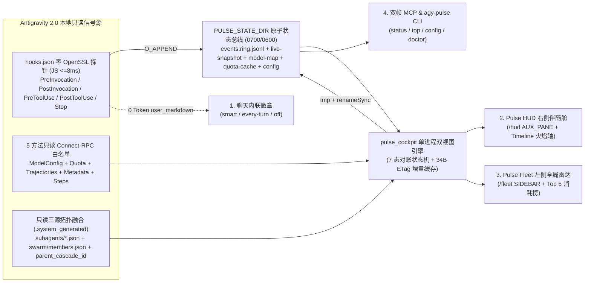

# Antigravity Pulse (`antigravity-pulse` / `agy-pulse`)

[](LICENSE)
[](docs/user-guide/getting-started.md)
[](docs/PRODUCT_DESIGN.md)
[](DESIGN.md)
[](docs/developer-guide/contributing.md)

面向 **Google Antigravity 2.0** 构建的跨平台（**Windows & Linux**）实时活跃模型指示器、多智能体并发拓扑态势感知与配额精算插件（展示名：**Model Pulse**，配套 CLI：**`agy-pulse`**），集 **右侧会话伴随舱 (`/hud` `AUX_PANE`)**、**零 Token 聊天内联微章 (`hooks.json`)**、**左侧全局舰队雷达 (`/fleet` `SIDEBAR`)** 与 **MCP / CLI 工具集** 于一体。

[项目背景与核心价值](#项目背景与核心价值) · [零依赖快速安装](#零依赖快速安装) · [系统架构总览](#系统架构总览) · [四大核心形态](#四大核心形态渐进式可观测体验) · [安全与零 Token 保证](#安全与零-token-保证) · [交付里程碑](#交付里程碑roadmap) · [文档中心](#文档中心-docs) · [致敬与灵感](#致敬与设计灵感) · [开源协议](#开源协议与署名说明) · [商标声明](#商标与非官方声明)

---

## 项目背景与核心价值

在 Antigravity 2.0 的高强度工程实践中，任务往往由**主会话（Root Cascade）+ 多级子代理（`invoke_subagent`）+ 编排流水线（`run_workflow`）+ 原生蜂群（`swarm`）**并发驱动。然而原生界面仅提供静态模型选择下拉框，存在“动态路由不可见、子代理实际模型成谜、15s–65s 深度思考静默期难归因、并发配额消耗滞后感知”四大黑盒。

`antigravity-pulse` 在**零解包、零篡改 `app.asar` 宿主文件、100% 本地只读（`127.0.0.1`）**的前提下，基于官方原生插件与 Sidecar 协议实现毫秒级算力透明化：

| 能力维度 | Antigravity 2.0 原生体验 | Antigravity Pulse (`Model Pulse` / `agy-pulse`) |
| :--- | :--- | :--- |
| **主会话活跃模型可见性** | 仅显示静态配置项（选 `Auto` 或 `Orchestrator` 时不知实际落地模型） | **`Requested ➔ Served` 双层核验铭牌**（反解 `MODEL_PLACEHOLDER_*`，透出真实响应 `responseModel` 与推理档位 `XHigh/High/Med/Low/Flash`） |
| **多级 Subagents / Swarm 可见性** | 子代理继承或隐式切模（如 `flash` / `argon`）无集中实时指示 | **并发智能体实时拓扑矩阵**：三源融合并活跃置顶展示每个子代理的实际模型、角色与当前工具，点击 **`[↗]`** 一键切入子会话 |
| **长耗时静默期状态归因** | 15s–65s+ Extended Thinking 期间易误判为卡死 | **7 态毫秒级生命周期状态机**：精确区分 `PRE_FLIGHT`、`THINKING 读秒`、`STREAMING tok/s`、`TOOL_RUNNING`、`BLOCKED_APPROVAL`、`ERROR_OR_QUOTA` 与 `IDLE` |
| **聊天流内联提示开销** | 无原生模型变更内联回执 | 基于 `systemMessage: ""` + `metadata.user_markdown` 且不携带插件 `rules/`（`D-007`），实现 **0 Token 闲置与微章开销**，100% 保护 Prompt Cache |
| **配额与上下文水位预警** | 往往等到弹出 `429 / RESOURCE_EXHAUSTED` 才被动察觉 | 实时追踪 **8 位精度 5h/Weekly 真实配额扣减 (`ΔQuota%`)**、**Prompt Cache 命中率**、**上下文饱和度 (`>70%`/`>85%`)** 与并发高算力预警横幅 |
| **跨项目与系统状态栏外延** | 局限于单会话窗口内部 | **左侧边栏全局舰队监控 (`/fleet`)** + **双帧协议 MCP 配额自省 (`dist/mcp.cjs`)** + **`agy-pulse` CLI (`status` / `top` / `config` / `doctor`)** |

---

## 零依赖快速安装

仓库内置了全部 5 个零外部运行时依赖的预构建单文件产物（`dist/*` 与 `sidecars/pulse_cockpit/dist/*`，`D-005`），克隆仓库后**无需执行 `npm install` 或编译 TypeScript** 即可直接完成原子安装（保持运行中插件进程目录 inode 不变，`D-006`）：

```bash
git clone https://github.com/springtian1982/antigravity-pulse.git
cd antigravity-pulse

# 一键原子安装至 ~/.gemini/config/plugins/antigravity-pulse 并创建 agy-pulse 启动器
node scripts/install.mjs
# （若已安装开发依赖，也可等价运行：npm run install:global）

# 验证本机运行时、状态总线目录、宿主 Language Server 连通性与插件健康度
agy-pulse doctor
```

- **Linux**：自动安装至 `~/.gemini/config/plugins/antigravity-pulse`，并在 `~/.local/bin/agy-pulse` 创建符号链接。
- **Windows**：自动安装至 `%USERPROFILE%\.gemini\config\plugins\antigravity-pulse`，并在 `%LOCALAPPDATA%\Microsoft\WindowsApps\agy-pulse.cmd` 生成命令垫片（同时提供 `bin/agy-pulse.ps1`）。
- **`agy-node` 自动回退**：当目标机器 `PATH` 中未安装全局 `node` 时，安装脚本与 `bin/agy-pulse*` 启动器会自动定位并回退至 Antigravity 内置的 `agy-node` / `agy-node.exe`。

---

## 系统架构总览



---

## 四大核心形态（渐进式可观测体验）

### 1. 右侧会话伴随舱：`Pulse HUD` (`/hud` · `SIDECAR_UI_ENTRYPOINT_AUX_PANE`)

面向 `340px–480px` 窄侧栏深度调优的实时仪表盘（统一入口胶囊 URI：`[Model Pulse](sidecar://antigravity-pulse/pulse_cockpit/hud)`，`D-002`），自动跟随当前打开的主会话或子会话切换：

- **吸顶主会话脉冲栏（Sticky Hero Card）**：子会话面包屑导航 + 返回父级按钮、7 态阶段秒表与吐字率（`Thinking 18.4s` / `Streaming 46 tok/s` / `Tool: run_command`）、`Requested ➔ Served` 路由信任铭牌、`Retry ×N` 重试告警、上下文窗口水位条（`>70%` 琥珀预警、`>85%` 珊瑚红告警）与 Prompt Cache 命中率（`cacheReadTokens / (inputTokens + cacheReadTokens)`）。
- **多智能体并发矩阵 & 智能治理横幅**：支持 **`Active-First`（活跃置顶）** 与 **`Topology-Tree`（层级缩进）** 一键切换；单卡展示 `Role + 实际模型档位胶囊 + 当前工具摘要 + CTX% + ΔQuota%`，点击右侧 **`[↗]`** 调用 `window.sidecar.ui.toggleConversation(cid)` 秒级切入目标子会话；当并发运行 `>= 3` 个高算力（`apex`）节点且 Gemini 5h 配额 `< 40%` 时自动亮起 **Smart Governance Banner**。
- **轮次调用火焰轴（`Timeline` Tab）**：支持 `Current Session`（`conversation`）与 `Cascade Tree`（`tree`）双作用域切换，按逆序展示每轮调用的 **紫色 `TTFT`（首字思考等待）vs 青色 `Streaming`（流式输出）** 双色火焰条、Thinking Token 占比（%）、动态切模标记与 `429` 重试徽章。
- **底部常驻配额油量表（Quota Fuel Bar）**：实时展示 Gemini 与 Claude/第三方模型组的 `5h` / `Weekly` 剩余百分比、重置倒计时与当前会话树净消耗 `ΔQuota%`。

### 2. 聊天流零 Token 内联回执：`Inline Turn Stamp` (`hooks.json` -> `dist/hook-probe.cjs`)

即使关闭右侧面板，也能在主会话与子代理聊天气泡流中直接确认真实服务模型：

- 默认启用 **`smart` 智能防刷屏模式**：仅在**会话首轮响应**、**中途实际服务模型发生切换**、**出现后端重试（`retryInfos.length > 1`）/ 降级回退**、**上下文 `> 75%`** 或 **5h 配额 `< 20%`** 时输出单行内联铭牌，并附带 `[Model Pulse](sidecar://antigravity-pulse/pulse_cockpit/hud)` 一键呼出入口。
- 支持通过 HUD、MCP 或 `agy-pulse config set inlineStampMode <smart|every-turn|off>` 实时切换。
- **极速零阻塞（`D-004` / `D-010`）**：`dist/hook-probe.cjs`（`34K`，剔除 `node:crypto`/OpenSSL 冷启动开销）保持零网络请求与零目录递归扫描，进程内 JS 处理耗时中位数 `~0.2ms`（严守 `<= 8ms`），冷启动相对裸 Node V8 增量开销 `<= 20ms`。

### 3. 左侧全局舰队监控台：`Pulse Fleet` (`/fleet` · `SIDECAR_UI_ENTRYPOINT_SIDEBAR`)

服务多项目并行与 `/goal`、`/schedule` 后台长任务场景，一屏汇总本机全局算力态势：

- **全局活跃算力头条（Active Headline）**：汇总本机正在运行的 Root 会话数、Subagent/Swarm 节点数及模型档位并发直方图。
- **跨项目活跃会话树抽屉**：按 Project 分组展示活跃会话树，展开抽屉可查看每个子节点的实时阶段、模型胶囊并通过 **`[↗]`** 跨会话直达。
- **Top 5 配额消耗排行榜（Top 5 Quota Burners）**：按当前 5 小时窗口内的真实配额净扣减（`Δ5h%`）与 Token 总量排序定位高消耗任务。

### 4. 智能体配额自省与系统顶栏外延：`MCP Server` + `agy-pulse` CLI

#### 4.1 零依赖双帧协议 MCP 服务（`dist/mcp.cjs` + 按需技能 `skills/model-pulse/SKILL.md`）

同时支持 **`NDJSON`** 与多字节 UTF-8 安全的 **`Content-Length`** 标准输入输出帧协议，提供三大工具：

| MCP 工具名 | 输入参数 | 核心返回字段与用途 |
| :--- | :--- | :--- |
| `pulse_status_card` | `{ conversationId?, theme?: "auto"\|"light"\|"dark", includeTree?: boolean }` | 在 `$PULSE_STATE_DIR/cards/` 生成无 `<script>`、抗 XSS 的自适应 Flexoki HTML 状态卡，返回 `embedTag`（`<agent-embed src="file:///..."></agent-embed>`）、`sidecarPill`（`[Model Pulse](sidecar://antigravity-pulse/pulse_cockpit/hud)`）、`summary`、`hostConnected`、`stale`、`nodeCount` |
| `pulse_get_compute_budget` | `{ conversationId?, plannedSubagentCount?, taskKind?: "exploration"\|"coding"\|"review"\|"general" }` | 返回 `ComputeBudgetAdvice`：`activeModel`、`contextWindowPct`、`quota`、`recommendedSubagentModel`（`"inherit" \| "argon" \| "flash"`）、`reason` 与 `warnings`，指导主 Agent 在配额吃紧时自动为检索子代理降档至 `flash` |
| `pulse_set_preference` | `{ inlineStampMode?, hudSortMode?, timelineScope?, smartThresholds? }` | 校验并原子更新 `$PULSE_STATE_DIR/config.json` 用户偏好 |

#### 4.2 跨平台命令行套件（`agy-pulse` CLI · `dist/cli.cjs`）

```bash
# 1. 状态栏与流式输出（支持 waybar | tmux | json | text，--watch 基于 fs.watch 去重推流）
agy-pulse status [--format <waybar|tmux|json|text>] [--watch] [--interval <ms>] [--conversation <uuid>] [--live]

# 2. 终端交互式多智能体监控器（支持 CJK 宽字符对齐、q/r/s/j/k 快捷键与非 TTY --once 快照）
agy-pulse top [--interval <ms>] [--once] [--conversation <uuid>] [--sort <active-first|topology-tree>] [--no-color] [--live]

# 3. 偏好配置读取、原子修改、重置与路径查询
agy-pulse config [get [key] | set <key> <value> | reset | path]

# 4. 五维非破坏性环境诊断（runtime / state_dir / host_ls / plugin_install / launcher_link）
agy-pulse doctor [--json]
```

**Waybar 状态栏集成示例（`~/.config/waybar/config.jsonc`）**：

```json
"custom/agy-pulse": {
  "exec": "agy-pulse status --format waybar --watch",
  "return-type": "json",
  "restart-interval": 5
}
```

**tmux 状态栏集成示例（`~/.tmux.conf`）**：

```tmux
set -g status-right '#(agy-pulse status --format tmux) | %H:%M'
```

---

## 安全与零 Token 保证

1. **零闲置 Token 插件卫生（`D-007`）**：发行包严禁包含插件根目录 `rules/`（避免 `always_on` 系统提示词注入污染上下文与破坏 Prompt Cache），仅随包分发按需触发的 `skills/model-pulse/SKILL.md`；仓库根目录 `AGENTS.md` 与 `.agents/` 严格限定为贡献者研发治理资产，绝不打包进用户安装目录。
2. **100% 本地只读边界（`RTM-26`）**：`ReadOnlyLsClient` 在运行时与静态契约双层锁定 5 个只读 Connect-RPC 方法白名单，硬性拦截 `DeleteCascadeTrajectory`、`UpdateConversationAnnotations`、`JetboxWriteState` 等一切写操作及高载荷 `GetCascadeTrajectory`；可选 SQLite 回退连接强制使用 `file:...?mode=ro`。
3. **回环隔离与严格 CSP / XSS 防护（`RTM-27`）**：Sidecar HTTP 仅绑定 `127.0.0.1`，强制校验 36 位 `conversationId` UUID 与 `POST /api/config` 的 `x-sidecar-token`，下发严格 CSP 响应头，并对所有会话标题、角色名与工具摘要执行统一 HTML/Markdown 转义。

---

## 交付里程碑（Roadmap）

> 本仓库全部四个工程阶段（`Stage 0`–`Stage 3`，对应产品路线图 `Phase 0`–`Phase 3` 与 `RTM-01`–`RTM-28`）均已完成研发与独立审计验收（详见 [总控实现蓝图](docs/plans/00_MASTER_IMPLEMENTATION_BLUEPRINT.md)）：

- [x] **Phase 0 / Stage 0：底层协议实证与工程设计地基（`5ca47d4`）** — 完成 Connect-RPC 与五层存储实证、TypeScript/`esbuild` 零依赖构建体系、`$PULSE_STATE_DIR` 原子状态总线、[DESIGN.md](DESIGN.md) Flexoki 双极性视觉规范与保 inode 原子安装器。
- [x] **Phase 1 / Stage 1：MVP 窗口内核心遥测闭环（`bbf1a68`）** — 交付只读 Connect-RPC 客户端、7 态对账状态机、三源拓扑融合、零 OpenSSL 极速 Hook 探针（含 `smart` 零 Token 微章）与右侧 `/hud` `AUX_PANE` 实时伴随舱。
- [x] **Phase 2 / Stage 2：深度时间轴与全局舰队视图（`71a621f`）** — 交付 `/hud` `Timeline` 轮次火焰轴（`TTFT` vs `Streaming` + 思考占比）与左侧 `/fleet` `SIDEBAR` 跨项目并发雷达及 Top 5 配额消耗榜。
- [x] **Phase 3 / Stage 3：CLI 系统状态栏与 MCP 智能体算力治理（`4064b48`）** — 交付跨平台 `agy-pulse` CLI（`status` / `top` / `config` / `doctor`）、双帧协议零依赖 MCP 服务（`pulse_status_card` / `pulse_get_compute_budget` / `pulse_set_preference`）与按需技能 `skills/model-pulse/SKILL.md`。

---

## 文档中心 (`docs/`)

面向**普通用户**和**开发者 / 贡献者**的完整文档索引位于 [`docs/README.md`](docs/README.md)：

### 核心规范与用户指南
- [快速上手与使用指南](docs/user-guide/getting-started.md) — 零依赖安装升级、四大形态实操、`agy-pulse` 全量参数、MCP 工具与 `config.json` 配置参考
- [完整产品设计与技术实证文档](docs/PRODUCT_DESIGN.md) — 痛点拆解、五大深层意图（JTBD）、实测协议映射与交互详设
- [视觉与交互设计系统规范](DESIGN.md) — Flexoki Light/Dark 五档模型语义色板、宿主主题映射与无障碍对比度规范

### 面向开发者与贡献者
- [系统架构与内部原理](docs/developer-guide/architecture.md) — `$PULSE_STATE_DIR` 原子总线、双通道遥测、7 态状态机、三源拓扑融合、`34B` ETag 缓存与双帧 MCP 架构
- [本地开发、测试与贡献指南](docs/developer-guide/contributing.md) — 构建与顺序基准测试流水线（`D-009`/`D-010`）、上下文门禁（`--strict-paths`）、`agy-pele` 图表门禁与 PR 检查清单
- [总控实现蓝图](docs/plans/00_MASTER_IMPLEMENTATION_BLUEPRINT.md) · [架构决策日志 (`D-001`–`D-010`)](docs/plans/DECISION_LOG.md) · [实证避坑台账 (`L-001`–`L-021`)](docs/plans/LESSONS_LEARNED.md)

---

## 致敬与设计灵感

- **[Steph Ango (`@kepano`) — Flexoki](https://stephango.com/flexoki)**：感谢 `@kepano` 设计并开源极其耐看的 **Flexoki** 暖墨色体系，使 Model Pulse 的模型梯队胶囊（紫/蓝/青/琥珀/珊瑚红）在浅色与暗黑模式下均具备高辨识度与低视觉疲劳感。
- **姊妹项目 [`antigravity-pele`](https://github.com/springtian1982/antigravity-pele)**：本项目沿用了 `antigravity-pele`（`agy-pele`）验证成熟的 Windows & Linux 零外部依赖预构建体系、`agy-node` 自动回退垫片与文档工程规范。

---

## 开源协议与署名说明

本项目采用标准 **[MIT License](LICENSE)** 开源发布：

```text
Copyright (c) 2026 springtian <springtian@gmail.com>
```

- **自由使用、修改与商用**：个人、社区与商业机构均可免费使用、复制、修改、合并、发布、分发、再许可或销售本软件的副本。
- **软件副本与衍生分发的署名要求**：在分发包含本软件全部或实质性部分的副本、安装包或修改后的衍生代码时，须保留原作者版权与署名声明（`Copyright (c) 2026 springtian <springtian@gmail.com>`）及 [LICENSE](LICENSE) 许可全文（具体授权条款与免责边界以英文 [LICENSE](LICENSE) 原文为准）。
- **遥测快照输出物归属**：用户通过 `antigravity-pulse` / `agy-pulse` 查看或导出的会话遥测卡片与统计数据完全归用户本人所有，本插件仅在本地回环（`127.0.0.1`）运行，不向任何外部服务器上传数据。
- **第三方开源组件声明**：零运行时依赖说明、配色规范与构建工具链的许可证声明详见 [THIRD_PARTY_NOTICES.md](THIRD_PARTY_NOTICES.md)。

---

## 商标与非官方声明

`antigravity-pulse`（`Model Pulse` / `agy-pulse`）是由社区开发者独立发起并维护的第三方开源插件与命令行工具，与 **Google LLC**（Google Antigravity / Gemini）、**Anthropic PBC**（Claude）及 **OpenAI** 无任何官方隶属、合作、赞助或背书关系。

文中提及的所有产品名称、模型名称、商标与品牌标识均归其各自合法权利人所有，在本仓库中仅用于客观指代兼容宿主环境与模型遥测对象。
