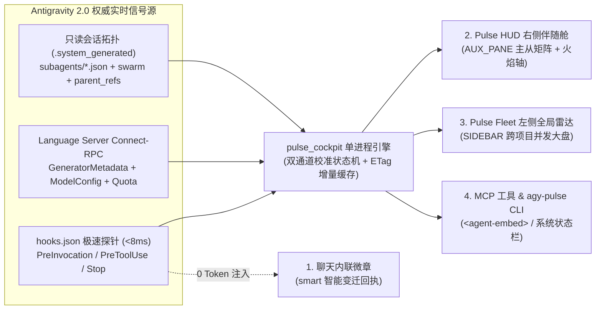

# Antigravity Pulse (`antigravity-pulse` / `agy-pulse`)

[](LICENSE)
[](docs/user-guide/getting-started.md)
[](docs/PRODUCT_DESIGN.md)
[](https://stephango.com/flexoki)
[](docs/developer-guide/contributing.md)

面向 **Google Antigravity 2.0** 构建的跨平台（**Windows & Linux**）实时活跃模型指示器、多智能体并发拓扑态势感知与配额精算插件（展示名：**Model Pulse**，配套 CLI：**`agy-pulse`**），集 **右侧会话伴随舱 (`AUX_PANE`)**、**零 Token 聊天内联微章 (`hooks.json`)**、**左侧全局舰队雷达 (`SIDEBAR`)** 与 **MCP / CLI 工具集** 于一体。

[项目背景与核心价值](#项目背景与核心价值) · [系统架构总览](#系统架构总览) · [四大核心形态](#四大核心形态渐进式可观测体验) · [研发路线图](#研发路线图roadmap) · [文档中心](#文档中心-docs) · [致敬与灵感](#致敬与设计灵感) · [开源协议](#开源协议与署名说明) · [商标声明](#商标与非官方声明)

---

## 项目背景与核心价值

在 Antigravity 2.0 的高强度工程实践中，任务往往由**主会话（Root Cascade）+ 多级子代理（`invoke_subagent`）+ 编排流水线（`run_workflow`）+ 原生蜂群（`swarm`）**并发驱动。然而原生界面仅提供静态模型选择下拉框，存在“动态路由不可见、子代理实际模型成谜、15s–65s 深度思考静默期难归因、并发配额消耗滞后感知”四大黑盒。

`antigravity-pulse` 在**零解包、零篡改 `app.asar` 宿主文件**的前提下，基于官方原生插件与 Sidecar 协议实现毫秒级算力透明化：

| 能力维度 | Antigravity 2.0 原生体验 | Antigravity Pulse (`Model Pulse` / `agy-pulse`) |
| :--- | :--- | :--- |
| **主会话活跃模型可见性** | 仅显示静态配置项（选 `Auto` 或 `Orchestrator` 时不知实际落地模型） | **`Requested ➔ Served` 双层核验铭牌**（精确透出后端真实响应 `responseModel` 与推理档位 `High/Med/Low`） |
| **多级 Subagents / Swarm 可见性** | 子代理继承或隐式切模（如 `flash` / `argon`）无集中实时指示 | **并发智能体实时拓扑矩阵**：活跃置顶展示每个子代理的实际模型、角色与动作，支持**一键切入子会话** |
| **长耗时静默期状态归因** | 15s–65s+ Extended Thinking 期间易误判为卡死 | **毫秒级阶段状态机**：精确区分 `🧠 Thinking 读秒`、`⚡ Streaming 吐字率`、`🔧 Tool 执行`、`⏸️ 等待审批` 与 `💤 Idle` |
| **聊天流内联提示开销** | 无原生模型变更内联回执 | 基于 `systemMessage: ""` + `metadata.user_markdown` 实现 **0 Token 模型侧开销**，100% 保护 Prompt Cache |
| **配额与上下文水位预警** | 往往等到弹出 `429 / RESOURCE_EXHAUSTED` 才被动察觉 | 实时追踪 **8 位精度 5h/Weekly 真实配额扣减 (`ΔQuota%`)**、**Prompt Cache 命中率**与 **256k 上下文饱和度** |
| **跨项目与系统状态栏外延** | 局限于单会话窗口内部 | **左侧边栏全局舰队监控 (`SIDEBAR`)** + **MCP 配额自适应派单** + **`agy-pulse` 系统顶栏 CLI (Waybar/tmux)** |

---

## 系统架构总览



---

## 四大核心形态（渐进式可观测体验）

### 1. 右侧会话伴随舱：`Pulse HUD` (`SIDECAR_UI_ENTRYPOINT_AUX_PANE`)

面向 340px–480px 窄侧栏深度调优的实时仪表盘，自动跟随当前打开的主会话或子会话切换：

- **吸顶主会话脉冲栏**：呼吸灯 + 实时阶段计时器（`Thinking 18.4s` / `Streaming 46 tok/s` / `Tool: run_command`）、`Requested ➔ Served` 核验铭牌、429 重试警示、上下文窗口水位条（CTX）与前缀缓存命中率（Cache Hit）。
- **多智能体并发矩阵（活跃置顶）**：自动聚合整棵派生树（含 `invoke_subagent`、`run_workflow` 与 `Swarm`），单行呈现 `Role + 实际模型档位胶囊 + 当前动作摘要 + ΔQuota%`，点击右侧 **`[↗]`** 即可调用 `window.sidecar.ui.toggleConversation(cid)` 直达目标子会话。
- **轮次调用火焰轴 (`Timeline` Tab)**：逐轮对比 `TTFT`（首字思考等待）与 `Streaming` 耗时、Thinking Token 占比及动态路由轨迹。
- **底部常驻配额油量表**：实时显示 Gemini / Claude 5h 与 Weekly 剩余额度、重置倒计时与当前会话树净消耗。

### 2. 聊天流零 Token 内联回执：`Inline Turn Stamp` (`hooks.json`)

即使关闭右侧面板，也能在主会话与子代理聊天气泡流中直接看到模型身份：

- 默认启用 **`smart` 智能防刷屏模式**：仅在**会话首轮响应**、**中途实际模型发生切换**、或**出现后端重试 / 高水位告警**时输出单行内联铭牌，并附带 `[Model Pulse](sidecar://antigravity-pulse/pulse_cockpit/hud)` 一键呼出入口。
- 支持随时切换为 `every-turn`（全量审计）或 `off`（纯面板无痕模式）。

### 3. 左侧全局舰队监控台：`Pulse Fleet` (`SIDECAR_UI_ENTRYPOINT_SIDEBAR`)

服务多项目并行与 `/goal`、`/schedule` 后台长任务场景，一屏汇总本机所有活跃运行的会话树、并发模型组合计数与 **Top 配额消耗排行榜**。

### 4. 智能体配额自省与系统顶栏外延：`MCP Server` + `agy-pulse` CLI

- **MCP 工具集**：提供 `pulse_status_card`（内联 `<agent-embed>` 快照卡）与 `pulse_get_compute_budget`（让主 Agent 在低配额时主动将非核心检索子代理降档至 `flash`，避免主任务中途断粮）。
- **`agy-pulse` 跨平台 CLI**：支持 `agy-pulse top` 终端实时监视器与 `agy-pulse status --format waybar|tmux|json`，将活跃模型指示器常驻到桌面系统顶栏。

---

## 研发路线图（Roadmap）

> 当前仓库已完成完整技术可行性实证与产品架构规范定稿，正按以下三阶段推进代码实现（详见 [产品设计文档](docs/PRODUCT_DESIGN.md)）：

- [x] **Phase 0：底层协议实证与产品架构设计** — 完成 Connect-RPC、5 层会话存储、`sidecar_sdk` 双入口与零 Token `user_markdown` 机制验证，锁定 [PRODUCT_DESIGN.md](docs/PRODUCT_DESIGN.md)。
- [ ] **Phase 1：MVP 窗口内核心闭环** — 交付 `pulse_cockpit` 右侧 `AUX_PANE` 实时面板（主从拓扑树 + 一键跳转 + 5h/Weekly 配额油量表）与 `<8ms` 极速 Hook 探针（含 `smart` 内联微章）。
- [ ] **Phase 2：深度时间轴与全局舰队视图** — 交付 `Timeline` 轮次调用火焰轴与左侧边栏 `SIDEBAR` 跨项目并发雷达 (`Pulse Fleet`)。
- [ ] **Phase 3：CLI 系统状态栏与智能体算力治理** — 交付 `agy-pulse` 跨平台 CLI（`top` / `waybar` / `tmux`）与 MCP 配额自省工具集。

---

## 文档中心 (`docs/`)

面向**普通用户**和**开发者 / 贡献者**的完整文档位于 [`docs/`](docs/README.md)：

### 核心规范与用户指南
- [完整产品设计与技术实证文档](docs/PRODUCT_DESIGN.md) — 痛点拆解、五大深层意图、实测协议映射、交互详设与已锁定设计决策
- [快速上手与使用指南](docs/user-guide/getting-started.md) — 四大形态协同工作流、内联微章模式说明与跨平台环境准备

### 面向开发者与贡献者
- [系统架构与内部原理](docs/developer-guide/architecture.md) — 双通道遥测流水线、6 态生命周期状态机、单进程多入口 Sidecar 与只读安全护栏
- [本地开发、测试与贡献指南](docs/developer-guide/contributing.md) — 构建体系、性能预算（Hook `<8ms`）、`agy-pele` 图表校验门禁与 PR 规范

---

## 致敬与设计灵感

- **[Steph Ango (`@kepano`) — Flexoki](https://stephango.com/flexoki)**：感谢 `@kepano` 设计并开源极其耐看的 **Flexoki** 暖墨色体系，使 Model Pulse 的模型梯队胶囊（紫/蓝/青/琥珀/珊瑚红）在浅色与暗黑模式下均具备高辨识度与低视觉疲劳感。
- **姊妹项目 [`antigravity-pele`](https://github.com/springtian1982/antigravity-pele)**：本项目沿用了 `antigravity-pele`（`agy-pele`）验证成熟的 Windows & Linux 零外部依赖预构建体系、`agy-node` 自动回退垫片与文档工程规范。

---

## 开源协议与署名说明

本项目采用标准 **[MIT License](LICENSE)** 开源发布：

```text
Copyright (c) 2026 springtian <springtian@gmail.com>
```

- **自由使用、修改与商用**：个人、社区与商业机构均可免费使用、复制、修改、合并、发布、分发、再许可或销售本软件的副本。
- **软件副本与衍生分发的署名要求**：在分发包含本软件全部或实质性部分的副本、安装包或修改后的衍生代码时，须保留原作者版权与署名声明（`Copyright (c) 2026 springtian <springtian@gmail.com>`）及 [LICENSE](LICENSE) 许可全文（具体授权条款与免责边界以英文 [LICENSE](LICENSE) 原文为准）。
- **遥测快照输出物归属**：用户通过 `antigravity-pulse` / `agy-pulse` 查看或导出的会话遥测卡片与统计数据完全归用户本人所有，本插件仅在本地回环（`127.0.0.1`）运行，不向任何外部服务器上传数据。
- **第三方开源组件声明**：配色规范与图标资产的许可证声明详见 [THIRD_PARTY_NOTICES.md](THIRD_PARTY_NOTICES.md)。

---

## 商标与非官方声明

`antigravity-pulse`（`Model Pulse` / `agy-pulse`）是由社区开发者独立发起并维护的第三方开源插件与命令行工具，与 **Google LLC**（Google Antigravity / Gemini）、**Anthropic PBC**（Claude）及 **OpenAI** 无任何官方隶属、合作、赞助或背书关系。

文中提及的所有产品名称、模型名称、商标与品牌标识均归其各自合法权利人所有，在本仓库中仅用于客观指代兼容宿主环境与模型遥测对象。
