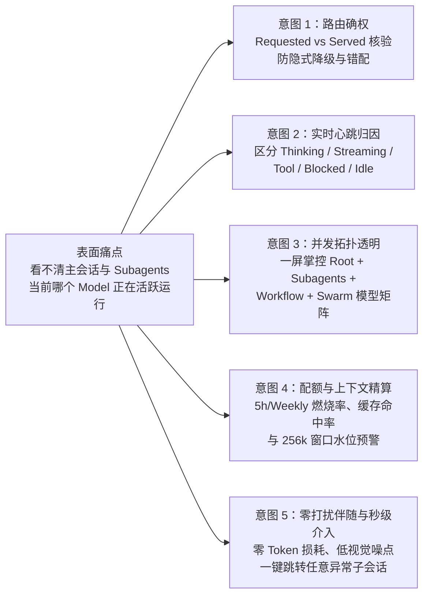
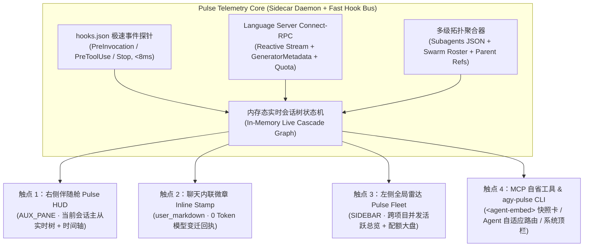
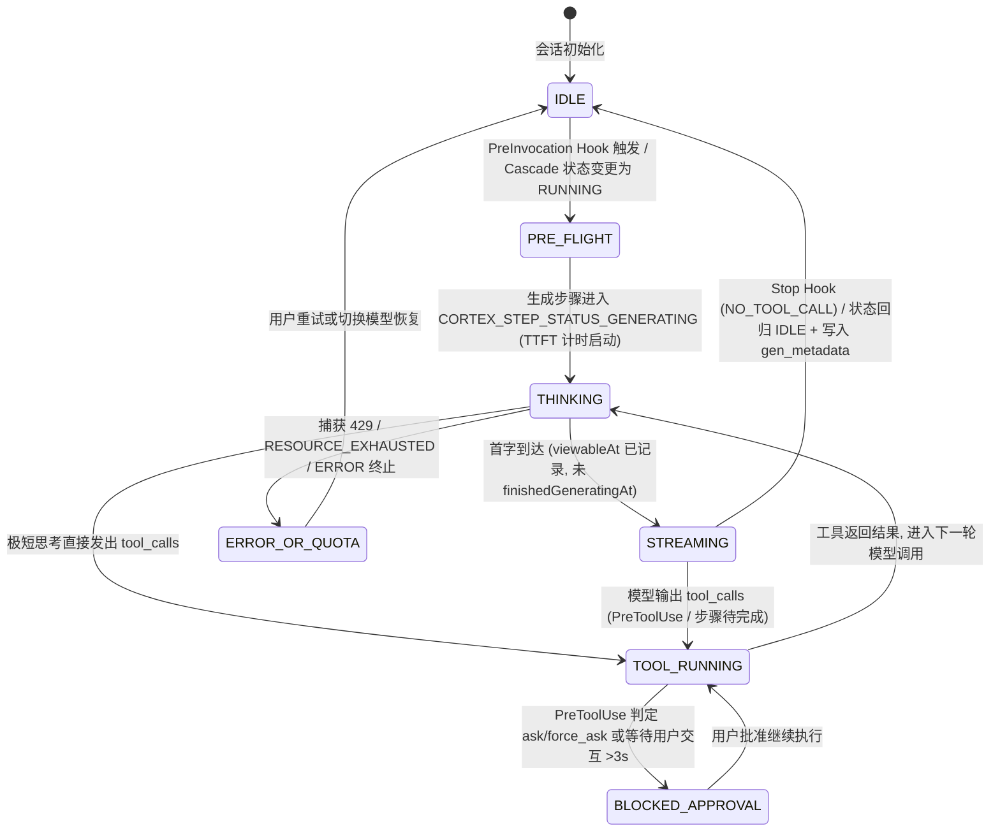

# Antigravity Pulse (`antigravity-pulse`) — 实时活跃模型与多智能体算力态势感知插件产品设计文档

> **目标宿主**：Google Antigravity 2.0 Desktop App (`language_server` + Electron Workbench / Sidecar 体系)  
> **插件标识**：`antigravity-pulse`（展示名：**Model Pulse**，配套 CLI：`agy-pulse`）  
> **文档状态**：PRD & 技术架构蓝图 v1.0  
> **核心定位**：解决主会话与多级 Subagents / Workflow / Swarm 运行期间“当前活跃调用模型不可见、路由黑盒、长思考卡顿难归因、并发配额消耗失控”的核心痛点，打造零侵入、毫秒级响应的模型与算力可观测性驾驶舱。

---

## 目录

1. [问题诊断与深层用户意图洞察（Why & JTBD）](#1-问题诊断与深层用户意图洞察why--jtbd)
2. [Antigravity 2.0 插件技术可行性与边界实证研究](#2-antigravity-20-插件技术可行性与边界实证研究)
3. [产品总体定位与四大触点交互设计（Multi-Surface UX）](#3-产品总体定位与四大触点交互设计multi-surface-ux)
4. [核心功能模块详设（Feature Specifications）](#4-核心功能模块详设feature-specifications)
5. [实时状态机与视觉编码规范（State Machine & Visual Semantics）](#5-实时状态机与视觉编码规范state-machine--visual-semantics)
6. [系统工程架构、目录结构与性能安全护栏](#6-系统工程架构目录结构与性能安全护栏)
7. [分阶段落地路线图（Roadmap）与已锁定设计决策](#7-分阶段落地路线图roadmap与已锁定设计决策)

---

## 1. 问题诊断与深层用户意图洞察（Why & JTBD）

### 1.1 现状痛点：为什么在 Antigravity 2.0 中“看不清谁在干活”？

在 Antigravity 2.0 的日常高强度工程工作流中，用户面对的不再是单轮问答聊天框，而是由**主会话（Root Cascade）+ 多级子代理（`invoke_subagent`）+ 编排脚本（`run_workflow`）+ 原生蜂群（`swarm`）**组成的并发智能体网络。当前原生界面在模型可见性上存在**四重黑盒**：

1. **四层模型间接映射黑盒**：
   - 全局或会话级 `Model Selection` 支持选择 `Auto`、`Orchestrator (Carbon/Argon)` 或具体模型档位（如 `Gemini 4 Carbon (High)`），而底层协议使用不透明的枚举值（如 `MODEL_PLACEHOLDER_M427`、`MODEL_PLACEHOLDER_M418`）。
   - 子代理派生时支持 `Model: "inherit" | "pro" | "flash" | "flash_lite"`（例如 `browser` 子代理默认切为 `flash`，`self` 子代理默认 `inherit`，而编排器可能将子代理实际解析至 `Gemini 4 Argon (Medium)`）。
   - 原生 `Swarm` 允许每个 Worker 独立绑定模型并在运行中通过 `swarm(action="model")` 动态热切换。
   - **结果**：界面顶部的静态设置项仅代表“初始配置倾向”，既不代表主会话当前回合实际路由到的后端模型，更无法反映后台若干个子代理各自实际运行的模型。
2. **长思考（Extended Thinking）静默期的“假死焦虑”**：
   - 实测高推理档位模型（如 `Carbon (High)`、`Hydrogen (XHigh)`、`Claude Opus 5.5 (High)`）单轮 `timeToFirstToken (TTFT)` 常达 **12s–65s+**。在此期间（尤其是主会话等待多个后台子代理返回时），用户无法分辨系统是**正在深度思考推理**、**正在执行慢速终端命令**、**卡在权限审批**，还是**遭遇配额耗尽/网络重试**。
3. **子代理会话界面缺乏模型身份透出**：
   - 无论在主会话的 `invoke_subagent` 折叠卡片中，还是点进子代理独立会话视图后，均无醒目的实时模型铭牌与推理强度标识。
4. **并发算力燃烧与上下文退化的滞后感知**：
   - 当主会话处于旗舰模型并并发派生 4–8 个 `inherit` 子代理时，短短数分钟即可消耗显著比例的 **5 小时滚动配额桶（5h Limit）**；用户往往要等到弹出 `RESOURCE_EXHAUSTED` 报错才意识到算力错配。

### 1.2 从“表面诉求”到“五大深层意图”的推导

围绕“清晰显示主会话和 Subagents 哪个模型正在活跃调用”这一诉求，背后隐藏着五个递进层次的真实工程意图（Jobs-to-be-Done）：



| 意图维度 | 用户的真实心理追问 | 产品必须交付的核心价值 |
| :--- | :--- | :--- |
| **1. 路由确权与防降级**<br>*(Routing Trust)* | “我切到了 `Carbon (High)`（或选了 `Auto`），这一轮和派出去的重构子代理**真的**跑在目标模型和预期推理档位上吗？有没有偷偷回退或重试？” | 对比展示 **配置意图（Requested）** 与 **后端实测响应模型（Served `responseModel` + `modelDisplayName`）**，一旦出现动态路由分流或降级重试立即高亮提示。 |
| **2. 长静默期心跳归因**<br>*(Live Phase Attribution)* | “已经安静了 45 秒没动静，到底是 `Carbon (High)` 正在深度思考，还是某个子代理卡死在了 `run_command`？” | 毫秒级透出每个节点的**实时执行阶段**（`🧠 Thinking 读秒` / `⚡ Streaming 吐字率` / `🔧 Tool 名称` / `⏸️ 等待审批` / `💤 已就绪`）。 |
| **3. 主从算力性价比治理**<br>*(Multi-Agent Tier Audit)* | “这 5 个只做简单文件搜索的子代理，是不是全都继承了昂贵的旗舰模型？关键代码修改子代理有没有误用轻量模型？” | 实时呈现**多级会话树模型拓扑**，对“重炮打蚊子（多并发旗舰继承做轻量检索）”或“关键任务弱模型”给出直观的层级色彩区分。 |
| **4. 配额与上下文水位前瞻**<br>*(Quota & Context Health)* | “当前这波并发任务烧了多少 5 小时配额？距离配额重置还有多久？主会话上下文是不是快满、该 `/compact` 了？” | 实时追踪 **5h / Weekly 真实配额余量与单轮扣减量（`ΔQuota%`）**、**Prompt Cache 命中率** 及 **上下文窗口饱和度（`estimatedTokensUsed / maxContextTokens`）**。 |
| **5. 零打扰感知与一键控场**<br>*(Ergonomic Control)* | “我不希望为了看模型状态去污染 Prompt、破坏缓存，也不想在十几个会话间盲目翻找。” | **零 LLM Token 注入**；提供“聊天内联轻量印记 + 右侧伴随 HUD + 左侧全局舰队视图 + 系统顶栏 CLI”四级渐进视图，支持单点直达目标子会话。 |

---

## 2. Antigravity 2.0 插件技术可行性与边界实证研究

基于对当前运行中的 Antigravity 2.0 (`language_server` + `sidecar_sdk` + 五层会话存储) 的实证调研，我们明确了插件的能力边界与最佳工程路径。

### 2.1 宿主 UI 扩展边界（什么不可为 vs 什么大有可为）

- **架构红线（不可为）**：Antigravity 2.0 桌面端采用沙箱化插件机制，第三方插件位于 `~/.gemini/config/plugins/<name>/`，**不能也不应通过解包篡改 `app.asar` 去强行注入主窗口顶部原生标题栏 DOM**（此类 Hack 会在每次客户端自动更新时失效、破坏文件完整性并带来维护灾难）。
- **官方原生支持的四大合法交付平面（大有可为）**：
  1. **右侧会话辅助面板 (`SIDECAR_UI_ENTRYPOINT_AUX_PANE`)**：通过 `sidecar_sdk` 挂载常驻 Web 视图，宿主自动注入 `window.sidecar.conversationId`（自动跟随当前主窗口打开的会话切换！）、宿主亮暗主题 CSS 变量（`--background`、`--foreground`、`--primary` 等），并提供 **`window.sidecar.ui.toggleConversation(convId)`** 原生桥接方法，点击即可将主聊天画布无缝切换至任意子代理或父会话。
  2. **左侧全局边栏入口 (`SIDECAR_UI_ENTRYPOINT_SIDEBAR`)**：在应用左侧一级导航栏注册全局面板，适合跨 Project 监控所有后台并发运行的会话树与全局配额大盘。
  3. **聊天流零 Token 内联徽章 (`hooks.json` + `metadata.user_markdown`)**：
     - 实证发现 Antigravity `PreInvocation` / `PostInvocation` 钩子返回 `injectSteps` 时支持特殊字段：
       ```json
       {
         "injectSteps": [
           {
             "systemMessage": {
               "systemMessage": "",
               "metadata": {
                 "user_markdown": "🟢 **Gemini 4 Carbon (High)** · `gemini-4-carbon` · [Model Pulse](sidecar://antigravity-pulse/pulse_hud/)"
               }
             }
           }
         ]
       }
       ```
     - **核心技术优势**：当 `systemMessage` 设为空字符串 `""` 时，**模型完全不可见（消耗 0 Token，100% 不破坏 Prompt Cache 前缀命中率）**，而前端聊天画布（无论主会话还是子代理会话！）会将其直接渲染为干净的内联 Markdown 状态条，且其中的 `sidecar://` 胶囊链接可一键呼出右侧实时面板。
  4. **MCP 内联交互卡片 (`<agent-embed>`) + 跨平台系统状态栏 CLI (`agy-pulse`)**：
     - 对话内可通过 MCP 工具输出自包含 HTML 仪表盘卡片；
     - 终端/桌面外延可通过 `agy-pulse status --waybar / --tmux / --watch` 将实时活跃模型推送到 Linux Waybar / Polybar / tmux 状态栏，即便切出 Antigravity 窗口也能全局常驻可见。

### 2.2 全链路权威数据源实证映射

Sidecar 进程启动时由宿主自动注入 `ANTIGRAVITY_LS_ADDRESS`、`ANTIGRAVITY_CSRF_TOKEN` 与 `ANTIGRAVITY_EXECUTABLE_DATA_DIR`，无需任何逆向提权即可通过本地回环 Connect-RPC 与只读文件系统获取 **100% 精确的实时模型遥测数据**：

| 监测时机与维度 | 权威数据源（Connect-RPC / Hook / 文件） | 实测关键字段与精确度验证 |
| :--- | :--- | :--- |
| **T = 0ms 飞行前捕获**<br>*(调用刚发起、正在思考中)* | 1. `hooks.json` (`PreInvocation` / `PreToolUse`)<br>2. RPC `StreamCascadeReactiveUpdates` / `GetCascadeTrajectorySteps` | - Hook 在模型请求发出的**同一毫秒**传入 `{conversationId, modelName, invocationNum}`，并在 `invoke_subagent` 工具执行前捕获 `{Role, TypeName, Model}`。<br>- 步骤表立即出现 `CORTEX_STEP_STATUS_GENERATING` 及 `generatorModel: "MODEL_PLACEHOLDER_M427"`。 |
| **模型枚举字典与实时配额**<br>*(毫秒级反解内部占位符)* | RPC `GetCascadeModelConfigData` & `RetrieveUserQuotaSummary` | - 将不透明的 `MODEL_PLACEHOLDER_M427` 精确映射为 `label: "Gemini 4 Carbon (High)"`、`modelId: "gemini-4-carbon-high"`。<br>- 提供 **8 位小数精度**的实时配额余量 `quotaInfo.remainingFraction`（如 `0.84972906 -> 0.84324217`）及精确 `resetTime`，可直接算出单轮真实配额扣减 `ΔQuota%`！ |
| **T > 0ms 实际响应核验**<br>*(模型返回后权威审计)* | 专用轻量 RPC `GetCascadeTrajectoryGeneratorMetadata` | **无需拉取庞大的 `steps` 文本**，轻量返回每轮 `chatModel`：<br>- `modelDisplayName`: `"Gemini 4 Carbon (High)"`<br>- `responseModel`: `"gemini-4-carbon"`（后端真实响应模型 ID）<br>- `usage`: `inputTokens`, `outputTokens`, `thinkingOutputTokens`, `cacheReadTokens`, `apiProvider`<br>- `timeToFirstToken` (如 `"12.13s"`), `streamingDuration` (如 `"8.13s"`), `retryInfos`<br>- `chatStartMetadata.contextWindowMetadata`: `{estimatedTokensUsed, maxContextTokens}` |
| **多级子代理与蜂群拓扑**<br>*(Root + Subagents + Swarm)* | 1. `brain/<cid>/.system_generated/subagents/*.json`<br>2. `brain/<cid>/.system_generated/swarm/members.json`<br>3. `customMetadata.parent_cascade_id` & `root_cascade_id` | - 递归关联任意深度的子代理树（含 `self`、`research`、`browser`、`image-generator`、自定义子代理、`run_workflow` 派生会话及 `Swarm` 成员），完整还原父子层级、角色名（`role`）与存活状态。 |

---

## 3. 产品总体定位与四大触点交互设计（Multi-Surface UX）

### 3.1 产品一句话愿景

> **Model Pulse (`antigravity-pulse`)**：让每一次主会话思考与每一个后台子代理调用的模型身份、推理档位、运行阶段与配额消耗，都像汽车仪表盘一样**实时透明、一目了然、一键可控**。

### 3.2 四大触点渐进式信息架构（Progressive Observability）

为了兼顾“平时写代码不喧宾夺主”与“并发调度时掌控全局”，产品采用**由轻到重、四端联动**的信息分层设计：



| 触点层级 | 载体表面 | 使用场景与解决的核心问题 | 视觉密度与打扰度 |
| :--- | :--- | :--- | :--- |
| **L1 聊天内联微章**<br>*(Inline Turn Stamp)* | 主会话与子会话聊天气泡流 (`metadata.user_markdown`) | 用户**未打开任何侧边面板**时，依然能在对话流中直接看到当前会话实际运行的模型，并在发生 `Auto` 路由切换或重试时收到静默提示。 | 极低（默认仅在首轮或模型变化时单行显示，0 Token 消耗） |
| **L2 会话伴随驾驶舱**<br>*(Pulse HUD Aux Pane)* | 右侧辅助面板 (`sidecar://antigravity-pulse/pulse_hud/`) | 正在推进复杂任务、派生多级 Subagents / Workflow / Swarm 时，实时盯盘**主会话 + 所有子代理**的活跃模型、思考读秒、上下文水位与单步耗时。 | 中（专为 360px 窄侧栏优化的高信噪比仪表盘） |
| **L3 全局舰队监控台**<br>*(Pulse Fleet Sidebar)* | 左侧全局导航栏 (`SIDECAR_UI_ENTRYPOINT_SIDEBAR`) | 同时开启多个 Project、后台跑着 `/goal` 长任务或 `/schedule` 定时任务时，跨项目汇总所有正在活跃消耗算力的会话与全局配额速率。 | 按需点开（全局运维视角） |
| **L4 桌面顶栏与智能体自省**<br>*(CLI & MCP Server)* | `agy-pulse` 终端/状态栏输出 + MCP 工具集 | 1. 切到浏览器/终端时在系统顶栏（Waybar/tmux）看一眼当前模型与运行态；<br>2. 让主 Agent 在派发大批子代理前通过 MCP 自动感知剩余配额，合理选择 `flash` / `argon` / `inherit`。 | 零界面占用 / 自动化赋能 |

---

## 4. 核心功能模块详设（Feature Specifications）

### 4.1 触点一：右侧伴随舱 `Pulse HUD` (`AUX_PANE`)

当用户在任意主会话或子会话中打开 `Model Pulse` 右侧面板时，界面由上至下分为 **4 个紧凑功能区**（支持 `Overview 实时态`、`Timeline 调用轴`、`Quota 配额精算` 三个标签页切换）：

#### A. 吸顶主会话脉冲栏（Active Session Hero Card）
常驻顶部（约 88px 高），聚焦当前打开会话（若是子会话，顶部显示面包屑 `Root 会话标题 › 当前子代理 Role` 及一键返回父会话按钮）：
- **实时状态呼吸灯 + 阶段计时器**：
  - 思考预填期：`🟣 Thinking · 18.4s`（实时递增秒表，消除长思考假死感）
  - 流式生成期：`🟢 Streaming · 46 tok/s`
  - 工具执行期：`🔵 Tool: run_command (Unit test execution) · 4.1s`
  - 空闲等待期：`⚪ Idle · 上轮完成于 12s 前`
- **双层核验模型铭牌（Requested ➔ Served）**：
  - 常规一致态：**`Gemini 4 Carbon`** `[HIGH]` · `✓ gemini-4-carbon`
  - 动态路由态（用户选 `Auto` 或 `Orchestrator`）：**`Auto ➔ Gemini 4 Argon`** `[MEDIUM]` · `gemini-4-argon`
  - 偏移/重试告警态（发生静默重试或实际响应模型与预期不符）：**`⚠ Gemini 4 Carbon (High)`** · `Retried ×2 (429 Backoff)`
- **双微型健康条（Micro Health Bars）**：
  - **上下文窗口水位（CTX）**：`38.8k / 256k (15.1%)`（`>70%` 变琥珀色提示可 `/compact`，`>85%` 变珊瑚红预警注意力衰减）。
  - **前缀缓存命中率（CACHE）**：`Cache Hit 91.8%`（直观反映规则/上下文是否稳定命中缓存）。

#### B. 多智能体并发实时矩阵（Live Agent Tree & Swarm Matrix）
**这是解决“Subagents 活跃模型看不清”的核心杀手锏模块**：
- **自动拓扑聚合**：以当前会话所属的 `root_cascade_id` 为根，自动拉起整棵多级派生树（涵盖 `invoke_subagent`、`run_workflow` 子节点与 `Swarm` 成员）。
- **智能排序策略**：默认采用 **“活跃置顶 + 拓扑缩进”** 双模切换。正在 `Thinking / Streaming / Tool Running` 的子代理自动浮到可视区最上方并附带微光呼吸态；已完成（`Idle/Done`）的子代理紧凑折叠在下方。
- **单节点三要素高密度行设计**：
  1. **第一行（身份 + 模型铭牌 + 跳转）**：
     - `[🟢 脉冲点]` **`W1-03 Atomic Refactoring Executor`** `self`
     - 右侧紧跟清晰模型胶囊：**`Argon · Med`**（悬停展示完整枚举与实测 ID：`MODEL_PLACEHOLDER_M418 -> gemini-4-argon` 及配置来源 `inherited / explicit: flash`）
     - 最右侧 **`[↗]` 一键切入按钮**：调用 `window.sidecar.ui.toggleConversation(subCid)`，毫秒级跳转到该子代理会话现场。
  2. **第二行（实时动作摘要 + 读秒）**：
     - 活跃时动态展示最新工具的 `toolSummary`（如 `🔧 Inspect SQLite schema · 3.2s`）或思考状态（`🧠 Extended thinking · 第 6 步 · 21.0s`）。
  3. **第三行（算力消耗微指标）**：
     - `Steps: 14` · `In 84k (Cache 89%) / Out 4.2k (Think 2.9k)` · `ΔQuota -0.41%`
- **算力治理智能提示条（Smart Governance Banner）**：
  - 当检测到 `>= 3` 个并发子代理同时处于旗舰高消耗档位（如 `Carbon High` / `Opus 5.5 High`）且 5h 配额低于 `40%` 时，温和展示单行提示：`💡 当前有 4 个子代理并发运行于 Carbon (High)，预计每分钟消耗 ~1.2% 5h 配额`。

#### C. 轮次级模型调用火焰轴（Turn-by-Turn Invocation Timeline）
切换到 `Timeline` 标签页后，按时间倒序展示当前会话（或整棵会话树合并时间轴）的每一次 LLM 调用明细：
- 每一行代表一次真实的 `generatorMetadata` 调用记录（如 `Turn #9 · Steps 41–45`）：
  - **实际模型标签**（一眼看清会话中途用户是否切过模型，或 `Auto` 在哪几轮切了 `Flash`、哪几轮上了 `Carbon`）。
  - **双段耗时条**：左侧紫条代表 `TTFT`（首字等待/思考预填耗时，如 `12.1s`），右侧青条代表 `Streaming`（流式输出耗时，如 `8.1s`）。
  - **思考比（Thinking Ratio）**：如 `Think 1,892 / Total Out 2,383 tok (79%)`，帮助用户判断 `High` 档位是否在简单操作上过度思考（Overthinking）。

#### D. 底部常驻配额油量表（Live Quota Fuel Bar）
固定在面板底栏（约 36px 高），数据直连 `GetCascadeModelConfigData` 与 `RetrieveUserQuotaSummary`：
- **双桶余量进度条**：`Gemini 5h: 84.3% (2h 21m 后重置)` · `Weekly: 96.5%` | `Claude 5h: 100%`
- **本会话树累计净消耗**：`本树净耗: -1.68% (5h)`，让用户对不同任务规模的真实配额成本建立精准体感。

---

### 4.2 触点二：聊天流零 Token 内联回执 `Inline Turn Stamp` (`hooks.json`)

针对“平时关闭右侧面板、只看主聊天窗口（或点进子代理聊天窗口）”的高频场景：
- **工作原理**：通过 `PostInvocation`（及可选 `PreInvocation`）钩子注入 `systemMessage: { systemMessage: "", metadata: { user_markdown: "..." } }`。
- **呈现样式示例**：
  > `⚡ Gemini 4 Carbon (High)` · `gemini-4-carbon` · `TTFT 12.1s` · `CTX 15%` · `5h 余量 84.3%` · [打开实时监控](sidecar://antigravity-pulse/pulse_hud/)
- **三档防刷屏策略（用户可通过配置文件或对话指令随时切换）**：
  1. **`smart`（智能感知模式，默认开启）**：**绝不每步刷屏**！仅在以下关键节点输出单行微章：
     - 新会话（含子代理新会话！）的第 1 次模型响应完成时（让每个会话顶部天然自带一张清晰的“模型出生证明”）；
     - 当前轮实际响应模型与上一轮相比**发生变化**时（包括手动切换、`Auto` 路由变动、`swarm` 切模）；
     - 发生**后端重试（`retryInfos.length > 1`）**、**模型降级偏移**、**上下文窗口突破 `75%` 阈值**或 **5h 配额跌破 `20%` 警戒线**时。
  2. **`every-turn`（全量审计模式）**：每次模型调用后均附上紧凑单行遥测条，适合深度评测与基准对比。
  3. **`off`（纯面板静默模式）**：不向对话流注入任何 `user_markdown` 步骤，100% 仅通过右侧 `Pulse HUD`、左侧 `Pulse Fleet` 与 CLI 展示。

---

### 4.3 触点三：左侧全局舰队监控台 `Pulse Fleet` (`SIDEBAR`)

注册 `SIDECAR_UI_ENTRYPOINT_SIDEBAR`，服务多项目并行开发者：
- **全局活跃算力热力头栏**：实时汇总本机 `language_server` 下所有 `CASCADE_RUN_STATUS_RUNNING` 的主会话与子代理（例如：`🔥 当前活跃调用：2 个主会话 + 5 个子代理 | Carbon(H) ×2 · Argon(M) ×3 · Flash ×2`）。
- **跨项目运行中会话卡片列表**：按 Project 分组，展示每个活跃会话树的当前执行阶段、活跃模型组合与累计耗时，支持一键跨窗口定位。
- **配额消耗排行榜（Top Quota Burners）**：列出当前 5 小时窗口内消耗配额最多的前 5 个会话树（精确定位“配额刺客”）。

---

### 4.4 触点四：MCP 智能体自省工具与 `agy-pulse` 状态栏 CLI

1. **MCP Server (`antigravity-pulse`)**：
   - `pulse_status_card`：在对话中直接生成内联 `<agent-embed>` 交互式模型与配额快照卡（适合复盘报告或任务总结）。
   - `pulse_get_compute_budget`：**赋能主 Agent 具备“算力自知之明”**！返回当前会话实际模型、上下文占用百分比、各模型族 5h 剩余配额比例及推荐的子代理档位策略（例如当 Gemini 5h 配额 `< 25%` 时，建议主 Agent 将非关键探索类 `invoke_subagent` 显式指定 `Model: "flash"`，避免主任务中途断粮）。
   - `pulse_set_preference`：一句话修改插件配置（如“把内联模型提示调成全量模式”或“关闭内联提示只留右侧面板”）。
2. **跨平台命令行工具 (`agy-pulse`)**：
   - `agy-pulse top`：终端 TUI 实时监控面板（类似 `htop` 的多智能体模型实时监视器）。
   - `agy-pulse status --format waybar|tmux|json`：单行 JSON/文本流输出，30 秒即可接入 Linux Waybar / Polybar / GNOME 顶栏，实现**突破应用窗口边界的全局系统顶栏模型指示器**！

---

## 5. 实时状态机与视觉编码规范（State Machine & Visual Semantics）

### 5.1 单节点实时生命周期状态机

为彻底消除“状态滞后”或“异常退出导致永久显示运行中（幽灵卡死）”，每个会话节点（主会话或子代理）遵循以下双通道校准状态机：



- **防幽灵兜底机制（Anti-Stale Reconciler）**：即使某个 Hook 因超时跳过，Sidecar 后端每 `1000ms`（活跃期）/ `3000ms`（空闲期）与 Language Server 的 `CascadeStatus` 对账；若 `status != CASCADE_RUN_STATUS_RUNNING`，强制收敛回 `IDLE` 或 `ERROR`，绝不残留虚假的“思考中”指示灯。

### 5.2 模型家族与推理强度视觉色彩语义（Flexoki Light/Dark 自适应）

在严格复用宿主 CSS Token 保持原生质感的基础上，采用语义色区分**模型梯队（Tier）**，让用户用眼角余光（0.2 秒）即可分辨当前跑的是旗舰重器还是轻量快马：

| 模型梯队 | 覆盖模型示例 | Flexoki 语义主色（Light / Dark） | 档位角标样式 | 设计意图 |
| :--- | :--- | :--- | :--- | :--- |
| **旗舰推理层 (Apex / Heavy)** | `Gemini 4 Hydrogen (XHigh/High)`、`Gemini 4 Carbon (High)`、`Claude Opus 5.5 (High)` | 紫罗兰 `Purple` (`#5e409d` / `#8b7ec8`) | 实心高对比胶囊 `[XHIGH]` `[HIGH]` | 醒目提示高算力、高深度推理与较高配额消耗速率 |
| **主力均衡层 (Workhorse / Pro)** | `Gemini 4 Carbon (Med/Low)`、`Gemini 4 Argon (High/Med)`、`Claude Sonnet 5.5` | 钴蓝 `Blue` (`#205ea6` / `#4385be`) | 半透明描边胶囊 `[MED]` `[LOW]` | 沉稳可靠的主力工程编码色调 |
| **极速轻量层 (Fast / Subagent)** | `Gemini 3.8 Flash`、`Gemini 4 Argon (Low)`、`flash_lite` | 青绿 `Cyan` (`#24837b` / `#3aa99f`) | 闪电微标 `[⚡ FLASH]` | 轻快灵动，标识高吞吐、低成本并行子代理 |
| **动态编排器 (Orchestrator / Auto)** | `Orchestrator (Carbon/Argon)`、`Auto` | 琥珀金 `Yellow/Orange` (`#ad8301` / `#d0a215`) | 路由双箭头 `[AUTO ➔ ...]` | 强调“动态路由生效中”，重点引导视线关注箭头右侧的实际落地模型 |
| **异常/降级/配额告警** | `429 Retry`、`Served != Expected`、`Quota < 15%` | 珊瑚红 `Red` (`#af3029` / `#d14d41`) | 脉冲警示 `[⚠ RETRY]` | 第一时间吸引用户干预处理 |

---

## 6. 系统工程架构、目录结构与性能安全护栏

### 6.1 标准插件目录结构 (`~/.gemini/config/plugins/antigravity-pulse/`)

参考 `antigravity-pele` 验证过的跨平台零依赖分发经验（预编译单文件 Bundle + 自动探测 `node` / `agy-node` 启动垫片，Windows 与 Linux 开箱即用）：

```text
antigravity-pulse/
├── plugin.json                      # 插件清单 (name, displayName, description, logo, suggestedPrompts)
├── mcp_config.json                  # 注册 MCP 服务 antigravity-pulse
├── hooks.json                       # 注册轻量级 PreInvocation / PostInvocation / PreToolUse / Stop 探针
├── assets/
│   └── logo.svg                     # 128x128 10% 留白亮暗自适应脉冲图标
├── bin/
│   ├── agy-pulse                    # Linux/macOS 启动器 (自动回退 agy-node)
│   └── agy-pulse.cmd                # Windows 启动器
├── dist/
│   ├── hook-probe.cjs               # 极速 Hook 处理脚本 (<8ms 冷启动, 负责事件投递与智能内联徽章输出)
│   ├── mcp.cjs                      # MCP 工具服务进程
│   └── cli.cjs                      # agy-pulse 命令行工具 (top / status / config)
├── sidecars/
│   └── pulse_cockpit/
│       ├── sidecar.json             # 同时声明 AUX_PANE (/hud) 与 SIDEBAR (/fleet) 两个视图入口
│       ├── index.html               # 共享轻量前端壳 (CSP 严格收敛 + 宿主 CSS 变量桥接)
│       ├── styles.css               # 响应式窄栏 UI 样式
│       └── dist/
│           ├── server.mjs           # SidecarApp 后端 (LS RPC 聚合、缓存、拓扑构建、Delta Quota 计算)
│           └── ui.js                # 零框架原生高性能前端渲染引擎
├── skills/
│   └── model-pulse/
│       └── SKILL.md                 # 指导 Agent 在复杂多代理编排时如何查询算力预算与展示状态卡
└── README.md
```

> **多入口单 Sidecar 进程优化**：在 `sidecars/pulse_cockpit/sidecar.json` 的 `ui_config.views` 数组中，同时注册 `{ "path": "/hud", "entrypoint": "SIDECAR_UI_ENTRYPOINT_AUX_PANE", "title": "Model Pulse" }` 与 `{ "path": "/fleet", "entrypoint": "SIDECAR_UI_ENTRYPOINT_SIDEBAR", "title": "Pulse Fleet" }`。这样**只需运行一个后台 Sidecar Node 进程**，即可同时支撑右侧会话面板与左侧全局边栏，内存开销减半！

### 6.2 性能与安全四大铁律（Engineering Guardrails）

1. **Hook 零阻塞铁律（`< 8ms` 硬上限）**：
   - Antigravity 的 `hooks.json` 同步阻塞智能体主循环。`hook-probe.cjs` 严禁发起慢速网络请求或扫描大目录，仅做两件事：① 将 stdin JSON 单行原子追加至 `$PLUGIN_DATA/events.ring.jsonl`（或通过本地 UDP/Unix Socket 非阻塞投递给 Sidecar）；② 根据本地轻量状态缓存判断是否输出单行 `metadata.user_markdown`，全程耗时控制在 `5ms–8ms` 以内；任何异常一律捕获并返回 `{}`，**绝不阻断用户正常对话**。
2. **RPC 按需增量拉取（拒绝全量重型轮询）**：
   - 严禁高频对多个子代理调用带完整 `steps` 与 `systemPrompt` 的 `GetCascadeTrajectory`（单次响应可达 `500KB+`）。
   - 统一采用 **`GetAllCascadeTrajectories`（摘要状态） + `GetCascadeTrajectoryGeneratorMetadata`（仅拉取轻量生成元数据）**，并对已处于 `IDLE` 且 `stepCount` 未变化的子会话实施 `mtime/stepCount` 强缓存；前端轮询携带 `etag`，无变化时仅返回 `34 bytes` 的 `{ "unchanged": true, "etag": "..." }`。
3. **100% 只读会话存储安全边界**：
   - 插件对 `conversations/*.db`（若用于离线历史补全则强制 `file:...?mode=ro` URI 只读打开）、`brain/`、`LanguageServerService` 严格保持**只读观测**。
   - **严禁调用** `DeleteCascadeTrajectory`、`UpdateConversationAnnotations`、`JetboxWriteState` 等任何状态变更 RPC，杜绝触发 `s.deleted` 内存墓碑或清空会话自定义标题的风险。
4. **严格 CSP 与路径规范化**：
   - Sidecar 前端启用严格 CSP，所有会话 ID 强制校验 UUID 正则 `/^[0-9a-f-]{36}$/i`，杜绝路径穿越与 XSS。

---

## 7. 分阶段落地路线图（Roadmap）与已锁定设计决策

### 7.1 三阶段迭代计划

| 阶段 | 核心交付物 | 验收里程碑 |
| :--- | :--- | :--- |
| **Phase 1：MVP 核心闭环**<br>*(最快可用版本)* | 1. `pulse_cockpit` 右侧 `AUX_PANE` 面板（主会话实时状态 + 核验模型铭牌 + 多级 Subagent & Swarm 实时树 + 一键跳转 `toggleConversation` + 底部 5h/Weekly 配额条）<br>2. `hooks.json` 毫秒级飞行前状态探针 + `smart` 模式聊天内联微章 (`user_markdown`) | 打开任意含多级 Subagents 的会话，能在 `<500ms` 内实时显示主从各自正在调用的真实模型、思考读秒与实际 `ΔQuota%`。 |
| **Phase 2：全局监控与时间轴**<br>*(深度可观测版本)* | 1. `Timeline` 轮次调用火焰轴（TTFT vs Streaming、Thinking 占比、Auto 路由轨迹、429 重试标记）<br>2. 左侧边栏 `SIDEBAR` 全局跨项目并发舰队视图 (`Pulse Fleet`) | 多项目后台并发运行 `/goal` 或 Swarm 时，可在左侧栏一屏总览全局活跃算力与 Top 配额消耗会话。 |
| **Phase 3：生态外延与智能治理**<br>*(极客与自动化版本)* | 1. `agy-pulse` CLI（`top` 终端视图 + Linux Waybar / tmux 状态栏实时流）<br>2. MCP 工具集（`<agent-embed>` 快照卡 + 供主 Agent 调用的配额感知自适应派单工具） | 系统顶栏常驻可见活跃模型；低配额时主 Agent 能主动将非核心检索子代理降级为 `Flash`。 |

### 7.2 已锁定产品设计决策（Finalized Product Decisions）

以下关键架构与交互决策已评审确认并作为后续研发基线：

| 决策项 | 已锁定方案 | 核心理由与价值 |
| :--- | :--- | :--- |
| **1. 聊天流内联微章默认策略** | 默认开启 **`smart` 智能感知模式**（支持一键切换至 `every-turn` 或 `off`） | 利用 `systemMessage: ""` + `metadata.user_markdown` 实现 **0 Token 模型侧开销**，100% 保护 Prompt Cache；仅在会话首轮、实际响应模型切换或重试/高水位告警时显示，兼顾不开侧栏时的可见性与对话整洁度。 |
| **2. 正式命名与仓库对齐** | 插件名：**`antigravity-pulse`**<br>展示名：**Model Pulse**<br>CLI 名：**`agy-pulse`**<br>仓库目录：`antigravity-pulse` | 与姊妹开源插件 [`antigravity-pele`](https://github.com/springtian1982/antigravity-pele)（`agy-pele`）构成统一的命名家族、包管理规范与用户体验认知。 |
| **3. 跨平台工程底座与首发边界** | 采用 TypeScript + `esbuild` 零外部运行时依赖预构建体系（Windows & Linux，自动回退 `agy-node`），按 Phase 1 -> 2 -> 3 迭代交付 | Phase 1 优先打穿窗口内 `AUX_PANE + SIDEBAR + Hook 探针` 实时闭环；工程目录自初始化起即预留 `agy-pulse` CLI 与 MCP 统一架构，确保平滑演进。 |
