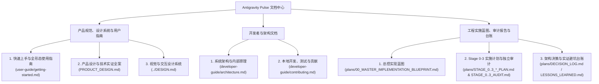

# Antigravity Pulse 文档中心

欢迎查阅 **Antigravity Pulse (`antigravity-pulse` / `Model Pulse` / `agy-pulse`)** 文档库。文档按读者角色分为**产品与用户指南**、**开发者与架构文档**以及**工程实施蓝图与审计台账**三条路径。

---

## 产品规范与普通用户指南（Product, Design & User Guide）

如果你希望快速安装 `antigravity-pulse`，并掌握四大核心触点（右侧 `Pulse HUD` + `Timeline`、零 Token 聊天微章、左侧 `Pulse Fleet`、MCP 工具与 `agy-pulse` CLI）的使用与配置方式，请从这里开始：

| 文档 | 内容摘要 | 适合场景 |
| :--- | :--- | :--- |
| [快速上手与四大形态指南](user-guide/getting-started.md) | Windows / Linux 原子安装、`Pulse HUD` 与火焰轴、`Pulse Fleet`、`agy-pulse` 全子命令与参数、MCP 工具及 `config.json` 配置说明 | 安装部署、日常观测主从活跃模型、配置 Waybar/tmux 与配额监控 |
| [产品设计与技术实证文档](PRODUCT_DESIGN.md) | 五大深层意图（JTBD）推导、Connect-RPC 与五层存储实测验证、UI/UX 模块详设与宿主安全边界 | 全面理解产品设计哲学与完整功能边界 |
| [视觉与交互设计系统 (`DESIGN.md`)](../DESIGN.md) | Flexoki Light/Dark 暖纸与黑曜石双极性色板、5 档模型语义胶囊、宿主 CSS 变量映射（`D-008`）与 WCAG 无障碍规范 | 查阅 UI 视觉 Token、窄侧栏响应式断点与对比度标准 |

---

## 面向开发者与贡献者（Developer Guide）

如果你计划阅读遥测引擎源码、本地调试 UI/CLI/MCP 或向仓库提交 Pull Request，请阅读：

| 文档 | 内容摘要 | 适合场景 |
| :--- | :--- | :--- |
| [系统架构与内部原理](developer-guide/architecture.md) | `$PULSE_STATE_DIR` 原子状态总线、零 OpenSSL Hook 探针（`D-004`/`D-010`）、5 方法只读 Connect-RPC 白名单、7 态状态机、三源拓扑融合 + `MODEL_PLACEHOLDER_*` 路由对账（`L-021`）、`34B` ETag 缓存与双帧 MCP 服务 | 深入理解各 `src/*` 模块职责与数据流 |
| [本地开发、测试与贡献指南](developer-guide/contributing.md) | TypeScript + `esbuild` 预构建体系、109 项功能测试 + 2 项顺序校准基准测试（`D-009`/`D-010`）、`verify-context.mjs --strict-paths`、`agy-pele` 图表门禁与 `D-001`–`D-011` / `L-001`–`L-022` 速查 | 本地构建、运行全量验证门禁与提交贡献 |

---

## 工程实施蓝图、阶段计划与审计台账（Engineering Plans, Audits & Ledgers）

面向多 Agent 协作研发、契约冻结与分阶段独立验收的全套工程档案位于 `docs/plans/` 目录：

| 文档 | 内容摘要 | 适合场景 |
| :--- | :--- | :--- |
| [总控实现蓝图](plans/00_MASTER_IMPLEMENTATION_BLUEPRINT.md) | Stage 0–3 依赖 DAG、冻结目录树、`src/types/telemetry.ts` 与 `$PULSE_STATE_DIR` 契约、轨道文件锁表、28 项 RTM 追踪矩阵与提交台账 | 查验跨模块冻结契约与全局交付状态 |
| [Stage 0 基础工程与设计地基计划](plans/STAGE_0_FOUNDATION_PLAN.md) · [Stage 0 独立审计](plans/STAGE_0_AUDIT.md) | 包清单、`esbuild` 构建体系、`src/types/*`、`$PULSE_STATE_DIR` 原子总线、Stitch `DESIGN.md` 与保 inode 安装器（提交 `5ca47d4`，`APPROVED`） | 查阅或复核 Stage 0 工程与设计地基 |
| [Stage 1 核心遥测闭环计划](plans/STAGE_1_MVP_LOOP_PLAN.md) · [Stage 1 独立审计](plans/STAGE_1_AUDIT.md) | 只读 Connect-RPC、7 态状态机、三源拓扑融合、极速 Hook 探针、`smart` 内联微章与 `/hud` `AUX_PANE` 伴随舱（提交 `bbf1a68`，`APPROVED`） | 查阅或复核 Stage 1 MVP 遥测闭环 |
| [Stage 2 时间轴与全局舰队计划](plans/STAGE_2_TIMELINE_FLEET_PLAN.md) · [Stage 2 独立审计](plans/STAGE_2_AUDIT.md) | `/hud` `Timeline` 火焰轴（`TTFT` vs `Streaming` + 思考占比）与 `/fleet` `SIDEBAR` 跨项目雷达及 Top 5 配额消耗榜（提交 `71a621f`，`APPROVED`） | 查阅或复核 Stage 2 深度可观测性 |
| [Stage 3 CLI、MCP 治理与打包计划](plans/STAGE_3_CLI_MCP_GOVERNANCE_PLAN.md) · [Stage 3 独立审计](plans/STAGE_3_AUDIT.md) | `agy-pulse` CLI（`status`/`top`/`config`/`doctor`）、双帧零依赖 MCP 服务、`skills/model-pulse/SKILL.md` 与真机端到端验收（提交 `4064b48`，`APPROVED`） | 查阅或复核 Stage 3 生态外延与打包发布 |
| [终验全量审计报告 (`FINAL_ACCEPTANCE_AUDIT_REPORT.md`)](plans/FINAL_ACCEPTANCE_AUDIT_REPORT.md) | 覆盖 `PRODUCT_DESIGN.md` §1–§7、全部 28 项 `RTM-01`–`RTM-28`、多阶段视觉走查与最终 8 道自动化门禁的独立终验档案（`FINAL-QA` `APPROVED`） | 发布终验复核与全链路需求追溯 |
| [架构决策日志 (`DECISION_LOG.md`)](plans/DECISION_LOG.md) | 只追加不删改的架构、协议、基准测试与打包决策台账（`D-001`–`D-011`） | 追溯设计取舍与发起 `[CONTRACT_CHANGE_REQUEST]` |
| [实证避坑台账 (`LESSONS_LEARNED.md`)](plans/LESSONS_LEARNED.md) | 宿主 RPC、存储、CSS 窄栏、终端宽字符与冷启动实测陷阱记录（`L-001`–`L-022`） | 编码、重构与代码评审前强制预读避坑 |

---

## 相关链接

- **项目仓库**：[springtian1982/antigravity-pulse](https://github.com/springtian1982/antigravity-pulse)
- **姊妹插件**：[springtian1982/antigravity-pele](https://github.com/springtian1982/antigravity-pele)（Mermaid 12.1 & 33 种扩展图表渲染工作台）
- **配色体系**：[Flexoki by Steph Ango](https://stephango.com/flexoki)
- **开源协议**：[MIT License](../LICENSE) · [Third-Party Notices](../THIRD_PARTY_NOTICES.md)
