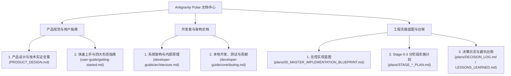

# Antigravity Pulse 文档中心

欢迎查阅 **Antigravity Pulse (`antigravity-pulse` / `Model Pulse` / `agy-pulse`)** 文档库。文档按读者角色分为**产品与用户指南**与**开发者与架构文档**两条路径。

---

## 产品规范与普通用户指南（Product & User Guide）

如果你希望了解 `antigravity-pulse` 解决的核心痛点、四大交互触点（右侧 `Pulse HUD`、零 Token 聊天微章、左侧 `Pulse Fleet`、`agy-pulse` CLI）以及安装配置方式，请从这里开始：

| 文档 | 内容摘要 | 适合场景 |
| :--- | :--- | :--- |
| [产品设计与技术实证文档](PRODUCT_DESIGN.md) | 五大深层意图（JTBD）推导、Connect-RPC 与五层存储实测验证、UI/UX 模块详设、视觉色板与已锁定决策 | 全面理解产品设计哲学与完整功能边界 |
| [快速上手与使用指南](user-guide/getting-started.md) | Windows / Linux 环境要求、四大形态使用方式、内联微章三档策略（`smart` / `every-turn` / `off`）说明 | 日常观测主从活跃模型与监控配额 |

---

## 面向开发者与贡献者（Developer Guide）

如果你计划参与 Phase 1–3 核心模块研发、阅读遥测状态机源码或提交 Pull Request，请阅读：

| 文档 | 内容摘要 | 适合场景 |
| :--- | :--- | :--- |
| [系统架构与内部原理](developer-guide/architecture.md) | 双通道毫秒级状态捕获、RPC 按需增量拉取、单进程双入口 Sidecar、防幽灵对账与 100% 只读安全边界 | 架构研读与模块实现 |
| [本地开发、测试与贡献指南](developer-guide/contributing.md) | TypeScript + `esbuild` 构建流水线、`<8ms` Hook 性能红线、`node:test` 单测与提交前强制门禁 | 本地开发、调试与提交贡献 |

---

## 工程实施蓝图与阶段计划（Engineering Plans & Ledgers）

面向多 Agent 协作与分阶段交付的架构契约、Stage 0–3 实施计划及实证台账位于 `docs/plans/` 目录：

| 文档 | 内容摘要 | 适合场景 |
| :--- | :--- | :--- |
| [总控实现蓝图](plans/00_MASTER_IMPLEMENTATION_BLUEPRINT.md) | Stage 0–3 依赖 DAG、冻结目录树、`src/types/telemetry.ts` 与 `$PULSE_STATE_DIR` 契约、轨道文件锁表与 RTM 追踪矩阵 | 查验跨模块冻结契约与全局架构 |
| [Stage 0 基础工程与设计地基计划](plans/STAGE_0_FOUNDATION_PLAN.md) | 包清单、TypeScript/`esbuild` 构建流水线、`src/types/*`、`$PULSE_STATE_DIR` 原子总线、Stitch `DESIGN.md` 与保 inode 安装器 | 执行或审计 Stage 0 地基交付 |
| [Stage 1 核心遥测闭环计划](plans/STAGE_1_MVP_LOOP_PLAN.md) | Language Server Connect-RPC、7 状态机、三源拓扑融合、`<8ms` Hook 探针、智能内联微章与 `/hud` `AUX_PANE` 驾驶舱 | 执行或审计 Stage 1 MVP 闭环 |
| [Stage 2 时间轴与全局舰队计划](plans/STAGE_2_TIMELINE_FLEET_PLAN.md) | `Timeline` 页签（TTFT vs Streaming 与思考占比）与 `/fleet` `SIDEBAR` 跨项目雷达及 Top 5 配额消耗榜 | 执行或审计 Stage 2 深度可观测性 |
| [Stage 3 CLI、MCP 治理与打包计划](plans/STAGE_3_CLI_MCP_GOVERNANCE_PLAN.md) | `agy-pulse` CLI（`top`/`status`/`config`/`doctor`）、零依赖 MCP 服务、`skills/model-pulse/SKILL.md` 与预构建发行包校验 | 执行或审计 Stage 3 生态集成与发布 |
| [架构决策日志](plans/DECISION_LOG.md) | 只追加不删改的架构与协议权衡记录（`D-001`–`D-007`+） | 追溯设计取舍与发起契约变更 |
| [实证避坑台账](plans/LESSONS_LEARNED.md) | 宿主 RPC、存储与 SDK 实测陷阱记录（`L-001`–`L-007`+：症状、根因与防呆红线） | 编码与评审前强制预读避坑 |

---

## 相关链接

- **项目仓库**：[springtian1982/antigravity-pulse](https://github.com/springtian1982/antigravity-pulse)
- **姊妹插件**：[springtian1982/antigravity-pele](https://github.com/springtian1982/antigravity-pele)（Mermaid 12.1 & 33 种扩展图表渲染工作台）
- **配色体系**：[Flexoki by Steph Ango](https://stephango.com/flexoki)
- **开源协议**：[MIT License](../LICENSE) · [Third-Party Notices](../THIRD_PARTY_NOTICES.md)
