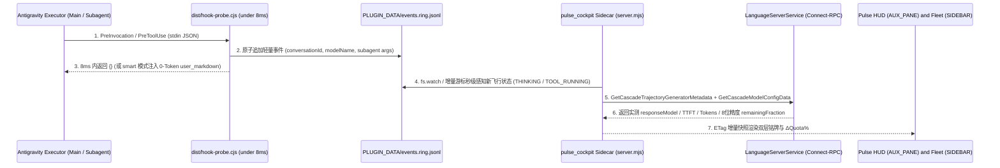

# 系统架构与内部原理

本文档深入说明 `antigravity-pulse` 如何在不修改 Antigravity 2.0 宿主程序文件（`app.asar`）的前提下，通过官方插件协议与本地 Connect-RPC 实现毫秒级多智能体模型态势感知。

---

## 1. 双通道实时遥测流水线（Dual-Channel Telemetry Pipeline）

单一轮询方案难以兼顾“模型刚发起调用时（`T = 0ms`）的即时感知”与“模型返回后（`T > 0ms`）的精确后端核验”。因此，`antigravity-pulse` 采用 **Hook 极速推流 + Connect-RPC 权威对账** 的双通道架构：

### 1.1 通道 A：`hooks.json` 极速事件探针（`T = 0ms`）

- 覆盖钩子：`PreInvocation`、`PostInvocation`、`PreToolUse`（匹配 `*` 以捕获当前执行工具及 `invoke_subagent` 参数）、`Stop`。
- **零 Token 聊天微章机制**：在 `PostInvocation`（或 `PreInvocation`）返回 `injectSteps` 时，设置 `systemMessage.systemMessage = ""` 并将 Markdown 徽章写入 `systemMessage.metadata.user_markdown`。Antigravity 聊天画布会将其渲染为内联信息条，而发往 LLM 的上下文完全不包含该文本，从而 **100% 保持 Prompt Cache 前缀稳定**。

### 1.2 通道 B：Language Server 专用轻量 Connect-RPC（`T > 0ms`）

Sidecar 进程利用宿主注入的 `ANTIGRAVITY_LS_ADDRESS` 与 `ANTIGRAVITY_CSRF_TOKEN` 调用以下只读接口：

| RPC 方法 | 调用频率与缓存策略 | 核心提取字段 |
| :--- | :--- | :--- |
| `GetCascadeModelConfigData` | 启动时加载 + 每 30s 或状态变更后刷新 | `clientModelConfigs[]`（反解 `MODEL_PLACEHOLDER_Mxxx` 为展示名与 `modelId`）、`quotaInfo.remainingFraction`、`resetTime` |
| `RetrieveUserQuotaSummary` | 会话轮次完成后按需刷新 | Gemini 与 Claude/GPT 模型组的 `5h` 与 `weekly` 配额桶余量 |
| `GetAllCascadeTrajectories` | 活跃期 `1s` / 空闲期 `3s` | 所有会话摘要、`status` (`CASCADE_RUN_STATUS_RUNNING` / `IDLE`)、`stepCount` |
| `GetCascadeTrajectoryGeneratorMetadata` | **仅当目标会话 `stepCount` 增长时增量拉取** | `chatModel.responseModel`、`modelDisplayName`、`usage`、`timeToFirstToken`、`streamingDuration`、`retryInfos`、`contextWindowMetadata`、`customMetadata.parent_cascade_id` |

> **关键性能优化**：严禁在轮询循环中对多个会话调用 `GetCascadeTrajectory`（其返回的完整 `steps` 与 `systemPrompt` 单次可达 `500KB+`）；改用 `GetCascadeTrajectoryGeneratorMetadata` 可将单次载荷降低 95% 以上。

---

## 2. 多级子代理与蜂群拓扑融合算法

为确保没有任何后台活跃模型成为盲区，拓扑聚合器（Topology Builder）以 `root_cascade_id` 为锚点融合三路只读数据源：

1. **标准子代理描述文件**：扫描 `<appData>/brain/<cid>/.system_generated/subagents/<sub_cid>.json`，提取 `subagentDescriptor.role`、`typeName` 与 `spawnStepIndex`。
2. **原生蜂群成员表**：扫描 `<appData>/brain/<cid>/.system_generated/swarm/members.json`，提取 Worker 名称、角色、绑定 `model` 与 `conversation_id`。
3. **跨层父子引用链**：通过 `generatorMetadata[].chatModel.customMetadata.parent_cascade_id`（以及必要时只读打开 `file:conversations/<cid>.db?mode=ro` 的 `parent_references` 表），将多级孙代理（Grandchild Subagents）与 `run_workflow` 动态派生的子会话完整挂载至同一棵可交互会话树。

---

## 3. 单进程多视图 Sidecar 设计

`sidecars/pulse_cockpit/sidecar.json` 在同一个 `SidecarApp` 实例上挂载两个官方入口：

- `/hud` ➔ `SIDECAR_UI_ENTRYPOINT_AUX_PANE`（会话级右侧面板，读取 `window.sidecar.conversationId` 并调用 `window.sidecar.ui.toggleConversation`）
- `/fleet` ➔ `SIDECAR_UI_ENTRYPOINT_SIDEBAR`（全局左侧导航面板，聚合本机全部活跃 Project 会话树）

两者共享同一份内存态会话图缓存与配额快照，显著降低后台常驻内存与本地 RPC 开销。

---

## 4. 安全与稳定性不变量（Hard Invariants）

1. **绝对只读原则**：绝不调用 `DeleteCascadeTrajectory`、`UpdateConversationAnnotations`、`JetboxWriteState` 等写操作 RPC，避免触发 `jetbox_summaries_store` 单向内存墓碑或冲掉用户自定义会话标题。
2. **Hook 故障隔离**：`hook-probe.cjs` 全局包裹 `try / catch` 与硬超时保护，任何读写异常均静默退化为输出 `{}` 并以退出码 `0` 结束，绝不阻塞主 Agent 执行链。
3. **严格参数校验与本地绑定**：Sidecar HTTP 服务仅监听 `127.0.0.1`，所有 `POST` 配置接口强制校验 `x-sidecar-token`，所有 `conversationId` 参数强制匹配标准 36 位 UUID 正则。
