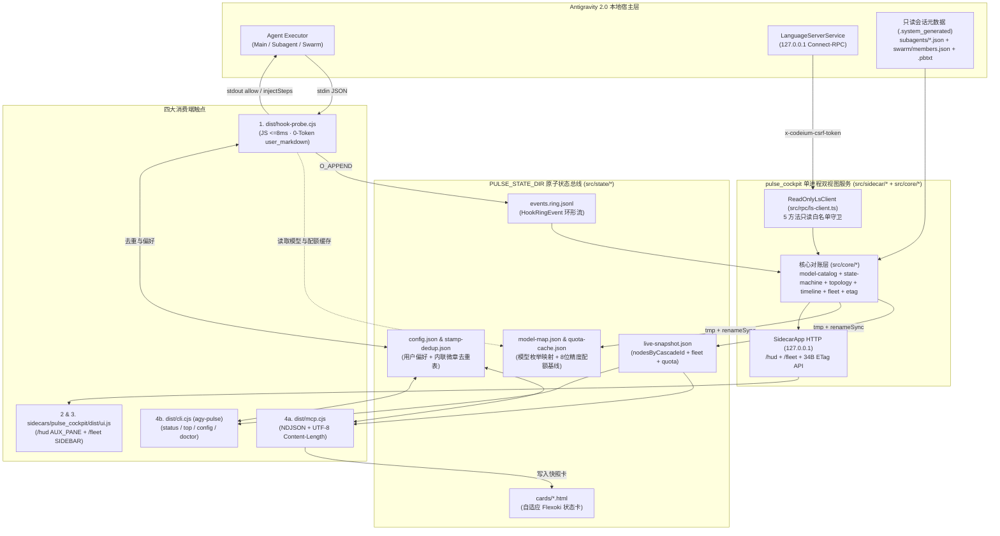
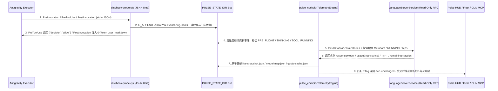

# 系统架构与内部原理

本文档深入剖析 `antigravity-pulse` 如何在**零解包、零篡改 `app.asar` 宿主文件、0 闲置 LLM Token 注入（`D-007`）**的前提下，通过 `$PULSE_STATE_DIR` 跨进程原子状态总线、零 OpenSSL 极速 Hook 探针与只读 Connect-RPC 引擎实现毫秒级多智能体态势感知。

---

## 1. 模块分层与跨进程原子状态总线（`$PULSE_STATE_DIR`，`D-003` / `D-011`）

由于 `dist/hook-probe.cjs`、`agy-pulse` CLI（`dist/cli.cjs`）与 MCP 服务（`dist/mcp.cjs`）均作为独立操作系统进程运行在常驻 `pulse_cockpit` Sidecar（`sidecars/pulse_cockpit/dist/server.mjs`）之外，且外部终端不一定持有宿主注入的 `ANTIGRAVITY_LS_ADDRESS` / `ANTIGRAVITY_CSRF_TOKEN` 环境变量，系统以本地受限权限目录 **`$PULSE_STATE_DIR`** 作为跨进程无锁共享总线：

- **目录解析优先级（`src/state/state-dir.ts`）**：`ANTIGRAVITY_PULSE_STATE_DIR` ➔ `PLUGIN_DATA` ➔ `<ANTIGRAVITY_APP_DATA_DIR || ANTIGRAVITY_DATA_DIR || ~/.gemini/antigravity>/plugin_data/antigravity-pulse`（与宿主默认 `PLUGIN_DATA` 路径完全一致，`D-011`；目录权限 `0700`，JSON 状态文件权限 `0600`）。`TelemetryEngine` 同时优先读取 `ANTIGRAVITY_APP_DATA_DIR` 再回退 `ANTIGRAVITY_DATA_DIR`。
- **无 OpenSSL 原子写与环形日志轮转**：`writeJsonAtomic` 采用单调序列后缀 `${process.pid}.${process.hrtime.bigint().toString(36)}.${atomicTmpSeq.toString(36)}` 生成同目录临时文件后执行原子 `renameSync`（刻意避免引入 `node:crypto` 以消除 `~8.3ms` OpenSSL 冷启动开销，`D-010` / `L-020`）；`events.ring.jsonl` 由 Hook 探针通过单行 `appendFileSync`（`O_APPEND`）追加，由 Sidecar 守护进程在超过 `512 KiB` 时原子轮转为 `events.ring.prev.jsonl`。

### 源码模块职责映射表

| 模块路径 | 核心职责 |
| :--- | :--- |
| `src/types/telemetry.ts` & `src/types/rpc.ts` | 冻结的跨模块领域模型、7 态枚举、HTTP/MCP 载荷契约与原始 Connect-RPC 线格式类型 |
| `src/state/state-dir.ts` & `src/state/config-store.ts` | `$PULSE_STATE_DIR` 解析、零 `node:crypto` 原子写、`512 KiB` 环形日志轮转与原型污染防护配置校验 |
| `src/rpc/ls-client.ts` | `ReadOnlyLsClient`：5 方法只读白名单校验（发包前同步拦截写操作与 `GetCascadeTrajectory`） |
| `src/core/model-catalog.ts` & `quota-calculator.ts` | `MODEL_PLACEHOLDER_*` 目录解码（含 `M669`/`M681`/`M322` 内置别名与未知占位符信任对账，`L-021`）、`cacheHitPct`、`retryCount`、8 位小数 `ΔQuota%` 与燃烧率计算 |
| `src/core/state-machine.ts` | 7 态生命周期状态机（`IDLE`..`ERROR_OR_QUOTA`）与防幽灵卡死对账器（Anti-Stale Reconciler） |
| `src/core/topology-builder.ts`、`timeline-builder.ts`、`fleet-builder.ts`、`etag.ts` | 三源派生树融合、逆序 `TTFT`/`Streaming` 火焰轴构建、跨项目舰队与 Top 5 消耗榜聚合、剔除易变时间戳的确定性 `34B` ETag 计算 |
| `src/core/formatters.ts` | 紧凑时长/Token 格式化、`smart` 内联微章 Markdown 生成与统一 HTML/Markdown XSS 转义 |
| `src/hook/hook-probe.ts` | 零网络、零 OpenSSL 极速 Hook 处理器与按轮次去重的 `smart`/`every-turn`/`off` 微章引擎 |
| `src/sidecar/telemetry-engine.ts` & `server.ts` | 增量 RPC 轮询调度、状态总线发布、`SidecarApp` `Response` 显式 MIME/CSP/HTTP `400` 封装（`L-007`）以及 `watchBundleForRestart` 原子升级自重启守卫（`D-011` / `L-022`） |
| `src/ui/state.ts`、`hud-view.ts`、`fleet-view.ts`、`main.ts` | 窄侧栏（`360px`）自适应 Flexoki 双极性 `/hud`、`/fleet` 与 `Timeline` 前端渲染引擎 |
| `src/cli/snapshot-reader.ts`、`status-formatter.ts`、`top-tui.ts`、`main.ts` | 状态总线与可选 `--live` RPC 读取、`waybar`/`tmux`/`json`/`text`（含 `--watch`）、CJK 宽字符对齐 `top` TUI（`L-018`）、`config` 与 `doctor` |
| `src/mcp/server.ts` & `src/mcp/embed-card.ts` | 双帧协议（`NDJSON` + UTF-8 `Content-Length`）JSON-RPC 2.0 服务与无脚本 Flexoki `<agent-embed>` 卡片生成器 |

---

## 2. 双通道实时遥测流水线（Dual-Channel Telemetry Pipeline）

单一轮询无法兼顾模型刚发起调用时（`T = 0ms`）的即时感知与返回后（`T > 0ms`）的后端核验，因此系统结合 **通道 A（Hook 极速推流）** 与 **通道 B（Connect-RPC 增量权威对账）**：

### 2.1 通道 A：`hooks.json` 非对称规范与双指标延迟标定（`L-006`、`D-004`、`D-010`）

1. **`hooks.json` `map[string]JSONHookSpec` 非对称结构（`L-006`）**：
   - 顶层包裹在命名组 `"pulse-telemetry"` 下：`PreToolUse` 与 `PostToolUse` 采用带 `matcher: "*"` 的分组结构；`PreInvocation`、`PostInvocation` 与 `Stop` 采用扁平数组结构。
   - **标准输出硬契约**：`PreToolUse` 即使在异常降级分支中也**必须**输出 `{"decision":"allow"}`（否则会阻塞宿主工具执行）；`PostToolUse` 与 `Stop` 输出 `{}`；`PostInvocation` 在命中微章条件时返回 `injectSteps`（`systemMessage.systemMessage = ""` + `systemMessage.metadata.user_markdown`），实现 **0 LLM Token 注入**且 100% 保护 Prompt Cache 前缀。
2. **双指标诚实延迟红线（`D-004` + `D-010`）**：
   - `dist/hook-probe.cjs`（`34K`）严禁网络请求、严禁 `/proc` 扫描、严禁加载 `node:crypto`。
   - 基准测试（`tests/benchmarks/hook-latency.test.ts`）同时锁定两项真实指标：
     - **Metric 1（进程内同步 JS 处理，`n=100`）**：`median <= 8.0ms` 且 `p95 <= 8.0ms`（实测 `median ~0.2ms`）。
     - **Metric 2（配对裸 Node V8 标定的 OS `fork+exec` 冷启动，`n=10` 配对采样）**：同时要求相对于裸 `node -e ''` 的边际增量 `pairedDeltaMedianMs <= 20.0ms`、总耗时 `probeMedianMs <= max(50.0ms, bareMedianMs + 20.0ms)` 且硬上限 `<= 100.0ms`（实测 `paired_delta ~9.4–13.3ms`）。

### 2.2 通道 B：5 方法只读 Connect-RPC 白名单与按需增量策略（`src/rpc/ls-client.ts`）

`ReadOnlyLsClient` 仅允许调用以下 5 个只读 `LanguageServerService` 方法，任何非白名单方法（如 `DeleteCascadeTrajectory`、`UpdateConversationAnnotations`、`JetboxWriteState`、`DeletePlugin`、`InstallCustomization` 及全量重型接口 `GetCascadeTrajectory`）在构造 HTTP 请求前即同步抛出 `ReadonlyRpcViolationError`：

| 只读 RPC 方法 | 调用时机与增量门控 | 关键解析与防呆规则 |
| :--- | :--- | :--- |
| `GetCascadeModelConfigData` | 启动加载 + 默认每 `30s` 刷新 | 构建 `MODEL_PLACEHOLDER_*` 目录，合并内置线上占位符别名（`M669`/`M681`/`M322`），提取 `quotaInfo` |
| `RetrieveUserQuotaSummary` | 启动加载 + 每 `30s` 或轮次完成后刷新 | 归一化 Gemini 与第三方模型组 `5h` / `weekly` 8 位精度余量与重置倒计时 |
| `GetAllCascadeTrajectories` | 活跃期 `1s` / 空闲期 `3s` | 获取会话状态（`RUNNING` / `IDLE`）、`stepCount` 与工作区归属 |
| `GetCascadeTrajectoryGeneratorMetadata` | **仅在目标会话 `stepCount` 增长时增量调用**（冷启动并发上限 `6`） | 字符串型 Int64 Token 强制转有限非负数（`L-001`）；`cacheHitPct = cacheReadTokens / (inputTokens + cacheReadTokens)`（`L-002`）；`retryCount = Math.max(0, retryInfos.length - 1)`（`L-003`） |
| `GetCascadeTrajectorySteps` | **仅当 `status === "CASCADE_RUN_STATUS_RUNNING"` 时调用** | 严禁传无效的 `startIndex`/`endIndex`，固定传 `{ cascadeId, stepOffset: Math.max(0, stepCount - 4), disableRehydration: true }` 仅检视尾部 4 步（`L-004`） |

---

## 3. 7 态生命周期状态机、三源拓扑融合与路由信任对账

### 3.1 7 态单节点生命周期与防卡死对账器（`src/core/state-machine.ts`）

每个会话节点在 `IDLE`、`PRE_FLIGHT`、`THINKING`、`STREAMING`、`TOOL_RUNNING`、`BLOCKED_APPROVAL`、`ERROR_OR_QUOTA` 七种状态间演进：

- 当 Hook 捕获 `PreInvocation` 时立即切入 `PRE_FLIGHT` / `THINKING`；捕获 `PreToolUse` 时立即切入 `TOOL_RUNNING` 并透出工具摘要。
- **Anti-Stale Reconciler（防幽灵运行态对账）**：若 Hook 因外部中断丢失 `Stop` 事件，一旦后续 `GetAllCascadeTrajectories` 确认后端会话已回到 `IDLE` 且静默超过宽限窗口，状态机自动收敛回 `IDLE`，杜绝面板永久挂死在 `THINKING`。

### 3.2 三源多级拓扑融合与 `MODEL_PLACEHOLDER_*` 路由对账（`L-005`、`L-021`）

1. **三源只读拓扑拼装（`src/core/topology-builder.ts`）**：
   - 扫描 `<appDataDir>/brain/<cid>/.system_generated/subagents/*.json` 提取标准子代理角色、`typeName` 与 `spawnStepIndex`；
   - 扫描 `<appDataDir>/brain/<cid>/.system_generated/swarm/members.json`——注意 `members` 为键值对象映射 `Record<memberName, SwarmMemberRaw>` 而非数组，通过 `Object.entries(data?.members ?? {})` 安全遍历（`L-005`）；
   - 结合 `generatorMetadata[].chatModel.customMetadata.parent_cascade_id`（及可选 `file:conversations/<cid>.db?mode=ro` 只读 `parent_references` 表与 `.pbtxt` 标题回退）还原任意深度的多级子会话树。
2. **未映射宿主占位符路由信任对账（`L-021`）**：
   - `src/core/model-catalog.ts` 除了通过 `clientModelConfigs` 动态解码枚举并内置线上常见内部占位符（`MODEL_PLACEHOLDER_M669`、`M681`、`M322`）外，对未来宿主新增但未出现在客户端列表中的 `^MODEL_PLACEHOLDER_` 请求值在 `reconcileRequestedVsServed()` 中归类为合法路由（`matched` / `routed`），仅在用户显式指定具体模型却被后端降级至不同模型族/档位时才触发 `mismatch_or_fallback` 告警，彻底消除误报。

---

## 4. 单进程双视图 Sidecar、`34B` ETag 缓存与双帧协议 MCP

### 4.1 `SidecarApp` `Response` 封装与 `34B` ETag 命中（`src/sidecar/server.ts`，`L-007`）

- 单一 `pulse_cockpit` 进程同时挂载 `/`（别名指向 `/hud`，`D-002`）、`/hud`（`AUX_PANE`）与 `/fleet`（`SIDEBAR`），共享内存态拓扑图与配额缓存。
- 鉴于宿主 `sidecar_sdk` 的 `SidecarApp.page()` 默认将非 `.js` 路由响应为 `text/html`，且在 `SidecarApp.api()` 内抛出异常会一律变为 HTTP `500`（`L-007`），`server.ts` 显式导入 `sidecar_sdk` 的 `Response` 类包装 `/styles.css`（`text/css`）、`/dist/ui.js`（`application/javascript`）、HTML 页面（附带严格 CSP 头：`default-src 'self'; script-src 'self'; style-src 'self' 'unsafe-inline'; img-src 'self' data:; connect-src 'self'; frame-ancestors *`）以及所有客户端参数校验错误的 HTTP `400` JSON 响应。
- `/api/hud`、`/api/timeline` 与 `/api/fleet` 使用 `src/core/etag.ts` 对剔除易变计时字段后的语义快照计算确定性 ETag；当客户端传入的 `etag` 命中时，仅返回 **34 字节** `{"unchanged":true,"etag":"..."}`，大幅降低空闲与稳态轮询时的序列化与 DOM 重绘开销。
- **原子覆盖升级热自重启（`watchBundleForRestart`，`D-011` / `L-022`）**：`server.ts` 在入口启动时通过 `.unref()` 定时器每 `3000ms` 轮询自身 `server.mjs` 的 `ino:mtimeMs:size` 签名；一旦检测到 `scripts/install.mjs`（`D-006`）完成同目录 `tmp + renameSync` 覆盖更新，延迟 `400ms` 执行优雅 `shutdown()`，配合 `sidecar.json` 的 `"restart_policy": "always"` 由宿主无缝拉起新版本 V8 实例。

### 4.2 零依赖双帧协议 MCP 服务（`src/mcp/server.ts` & `embed-card.ts`）

- **双帧自适应编解码（`McpFrameDecoder`）**：基于原始字节 `Buffer`（而非字符串字符数）同时兼容按行分隔的 **`NDJSON`** 与标准 **`Content-Length: <utf8ByteLength>\r\n\r\n`** 帧格式，即使包含多字节中文或 Emoji 的负载在任意字节边界发生管道分片也能无损重组，并按请求帧格式对称回包。
- **零脚本抗 XSS 状态卡（`embed-card.ts`）**：生成的 `$PULSE_STATE_DIR/cards/<cid>-<ts>.html` 内联全部 Flexoki Light/Dark 自适应样式（包含 `440px` 窄视口下的 `2×2` 配额网格与双层弹性节点行，`L-019`），零 `<script>` 标签、零外部链接，所有不可信文本均经 `escapeHtml` 转义。
