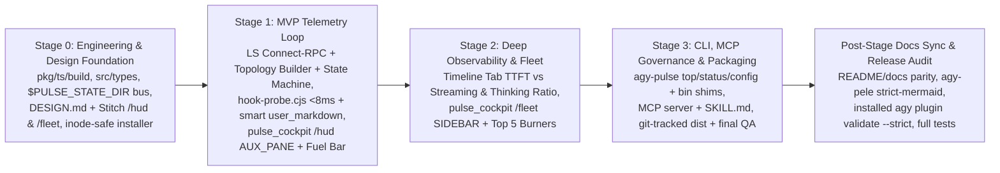
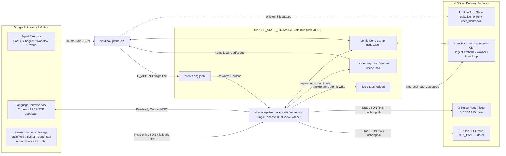

# Antigravity Pulse — Master Implementation Blueprint (`00_MASTER_IMPLEMENTATION_BLUEPRINT.md`)

> **Project**: `antigravity-pulse` (Display Name: **Model Pulse** · CLI: **`agy-pulse`**)  
> **Target Host**: Google Antigravity 2.0 Desktop App (Windows & Linux · `language_server` + `sidecar_sdk`)  
> **Canonical PRD**: [`docs/PRODUCT_DESIGN.md`](../PRODUCT_DESIGN.md)  
> **Companion Ledgers**: [`DECISION_LOG.md`](./DECISION_LOG.md) · [`LESSONS_LEARNED.md`](./LESSONS_LEARNED.md)  
> **Baseline Commit**: `87419f0` (`feat: initialize antigravity-pulse open-source repository and product design`)  
> **Blueprint Status**: Active Master Contract (MISSION I — Step M1.3 `VERDICT: APPROVED`; Ready for MISSION II Stage 0)

---

## 1. Executive Architecture & Stage Dependency DAG

### 1.1 Four-Stage Delivery Decomposition

To transform the three-phase product roadmap in [`docs/PRODUCT_DESIGN.md`](../PRODUCT_DESIGN.md) §7.1 into cleanly parallelizable, contract-locked engineering increments, implementation is decomposed into **4 sequential stages (Stage 0 -> Stage 3)** followed by repository documentation synchronization and final release verification (see Decision `D-001`):



### 1.2 Runtime Dual-Channel Architecture & Verified Host Contracts

Antigravity Pulse runs **100% locally on `127.0.0.1`**, without modifying `app.asar` or calling any state-mutating host RPCs. Telemetry flows through two complementary channels bridged by a cross-process `$PULSE_STATE_DIR` atomic bus:



#### Empirically Verified Host Invariants (Ground Truth)

1. **Canonical Sidecar Dual-View Entrypoint (`D-002`)**:
   - `sidecars/pulse_cockpit/sidecar.json` registers two `ui_config.views` on a single Node `SidecarApp` process:
     - `{ "path": "/hud", "entrypoint": "SIDECAR_UI_ENTRYPOINT_AUX_PANE", "title": "Model Pulse" }` -> canonical chat pill URI `sidecar://antigravity-pulse/pulse_cockpit/hud` (`server.mjs` also mounts `/` as an alias to `/hud`).
     - `{ "path": "/fleet", "entrypoint": "SIDECAR_UI_ENTRYPOINT_SIDEBAR", "title": "Pulse Fleet" }`.
2. **Connect-RPC Read-Only Endpoints (`POST http://${ANTIGRAVITY_LS_ADDRESS}/exa.language_server_pb.LanguageServerService/<Method>`, header `x-codeium-csrf-token`)**:
   - `GetCascadeModelConfigData` (`{}`): returns `clientModelConfigs[]` (`label`, `modelOrAlias: { model?, alias? }`, `modelId`, `quotaInfo?: { remainingFraction, resetTime }`, `tagTitle?`) and `defaultOverrideModelConfig?` (resolves `MODEL_PLACEHOLDER_M427` -> `"Gemini 4 Carbon (High)"` / `"gemini-4-carbon-high"`, `MODEL_PLACEHOLDER_M667` -> `"Orchestrator (Carbon)"` / `"gemini-pro-orchestrator"`).
   - `RetrieveUserQuotaSummary` (`{}`): returns `response.groups[].buckets[]` (`bucketId`: `"gemini-5h"`, `"gemini-weekly"`, `"3p-5h"`, `"3p-weekly"`, `displayName`, `window`, `remainingFraction` 8-decimal float, `resetTime`).
   - `GetAllCascadeTrajectories` (`{}`): returns `trajectorySummaries` (`Record<cid, { trajectoryId, status, stepCount, createdTime, lastModifiedTime, summary, killed, latestExecutorTerminationReason, workspaces }>`). When `summary` is `null`, fall back read-only to `~/.gemini/antigravity/annotations/<cid>.pbtxt` (`title: "..."`) or the first workspace folder basename.
   - `GetCascadeTrajectoryGeneratorMetadata` (`{"cascadeId": cid}`): returns `generatorMetadata[]` with `stepIndices` and `chatModel` (`model`, `modelDisplayName`, `responseModel`, `timeToFirstToken`, `streamingDuration`, `retryInfos`, `chatStartMetadata.contextWindowMetadata: { estimatedTokensUsed, maxContextTokens }`, `customMetadata: { cascade_id, parent_cascade_id, root_cascade_id, model_enum, last_step_index, ... }`, `usage: { inputTokens, outputTokens, thinkingOutputTokens, responseOutputTokens, cacheReadTokens, apiProvider }`).
     - **Int64 String Parsing (`L-001`)**: `usage.*` token fields are JSON strings (e.g. `"19353"`); always parse with `Number(v ?? 0)`.
     - **Cache Hit Formula (`L-002`)**: `inputTokens` is uncached input tokens; `cacheReadTokens` is cached prefix tokens. `cacheHitPct = totalIn > 0 ? (cacheReadTokens / (inputTokens + cacheReadTokens)) * 100 : 0`.
     - **`retryInfos` Baseline (`L-003`)**: A normal non-retried call has `retryInfos.length === 1`. Actual retry count = `Math.max(0, (retryInfos?.length ?? 0) - 1)`; a retry occurred ONLY when `retryInfos.length > 1`.
     - **Durations**: `timeToFirstToken` and `streamingDuration` are duration strings (e.g. `"8.738093225s"`).
   - `GetCascadeTrajectorySteps` (`{"cascadeId": cid, "stepOffset": Math.max(0, stepCount - 4), "disableRehydration": true}`): MUST use `stepOffset` (`L-004`), NEVER `startIndex`/`endIndex`, and call ONLY when `status === "CASCADE_RUN_STATUS_RUNNING"` to inspect the tail 3–4 steps (`type`, `status`: `CORTEX_STEP_STATUS_GENERATING` vs `CORTEX_STEP_STATUS_RUNNING`, `metadata.viewableAt`, `metadata.finishedGeneratingAt`, `metadata.generatorModel`, `metadata.toolCall: { id, name, argumentsJson }`).
   - **100% Read-Only Guarantee**: NEVER call `DeleteCascadeTrajectory`, `UpdateConversationAnnotations`, `JetboxWriteState`, `DeletePlugin`, or `InstallCustomization`.
3. **Filesystem Topology**:
   - `~/.gemini/antigravity/brain/<cid>/.system_generated/subagents/<sub_cid>.json`: `{ conversationId, subagentDescriptor: { typeName, role }, state, spawnStepIndex, workspaceUris }`.
   - `~/.gemini/antigravity/brain/<cid>/.system_generated/swarm/members.json`: `{ title?: string, members: Record<memberName, { conversation_id, role, desired_state, desired_model, applied_model, workspace_mode, phase, wake_mode, killed, model }> }` (`members` is an object map, NOT an array; `L-005`).
   - Correlate `customMetadata.parent_cascade_id` and `root_cascade_id` (plus optional read-only `file:conversations/<cid>.db?mode=ro` fallback only if needed).
4. **Hooks Contract & Honest Latency (`D-004`, `L-006`)**:
   - Antigravity's `hooks.json` loader unmarshals into `map[string]JSONHookSpec` (verified against `agy` binary & `data-agent-kit-plugin/hooks.json`), so all event keys MUST be nested under the top-level `"pulse-telemetry"` named hook-group wrapper (`{ "pulse-telemetry": { "PreToolUse": [...], ... } }`).
   - `PreToolUse` and `PostToolUse` MUST use grouped `{ matcher: "*", hooks: [{ type: "command", command: "node ./dist/hook-probe.cjs", timeout: 5 }] }`.
   - `PreInvocation`, `PostInvocation`, and `Stop` MUST use flat arrays `[{ type: "command", command: "node ./dist/hook-probe.cjs", timeout: 5 }]`.
   - Stdout contracts: `PreToolUse` -> `{"decision":"allow"}`; `PostToolUse` & `Stop` -> `{}`; `PreInvocation` / `PostInvocation` -> `{}` or `{"injectSteps":[{"systemMessage":{"systemMessage":"","metadata":{"user_markdown":"..."}}}]}` with turn-key dedup.
   - Latency honesty: On Linux Node v24.21.0, OS `fork+exec` V8 startup alone is ~25–32ms before JS line 1, while in-process JS handler execution (`process.hrtime.bigint()`) is `< 5ms` (`<= 8ms` target). Verification gates assert BOTH: `in-process JS <= 8ms` AND `OS wall-clock <= 50ms` with zero network I/O.
5. **Cross-Platform `node` vs `agy-node` Execution**:
   - Git-tracked `hooks.json` uses `"node ./dist/hook-probe.cjs"` for zero extra shell-hop overhead and clean `agy plugin validate`.
   - `bin/agy-pulse` (POSIX `sh`), `bin/agy-pulse.cmd` (Windows Batch), and `bin/agy-pulse.ps1` (Windows PowerShell helper) resolve `node` on `PATH` and automatically fall back to Antigravity's bundled `agy-node` / `agy-node.exe`.
   - During `scripts/install.mjs`, if system `node` is missing from `PATH`, the installer atomically patches the *installed* `~/.gemini/config/plugins/antigravity-pulse/hooks.json` copy to invoke `"\"<resolved-node-or-agy-node>\" ./dist/hook-probe.cjs"` while keeping the source repository clean.

---

## 2. Frozen Canonical Repository & Plugin Directory Tree

Every file path in the repository and distributed plugin package is frozen below. Prebuilt bundles in `dist/` and `sidecars/pulse_cockpit/dist/` MUST remain git-tracked (never added to `.gitignore`, per Decision `D-005`).

```text
antigravity-pulse/                          # Git repository root
├── AGENTS.md                               # Repo-contributor 3-tier context index (NOT distributed in plugin)
├── DESIGN.md                               # Stitch-synced visual system & Flexoki + host token spec (dev doc)
├── LICENSE                                 # MIT License (Copyright (c) 2026 springtian)
├── THIRD_PARTY_NOTICES.md                  # Flexoki & icon notices
├── README.md                               # Distributed & repo root README
├── package.json                            # Scripts (build, typecheck, test, install:global, verify:context, preview) & files allowlist
├── tsconfig.json                           # Strict TypeScript config (ES2022, bundler, allowJs:true, checkJs:false, noEmit)
├── .gitignore                              # Excludes node_modules/, .test-dist/, *.tgz, *.tsbuildinfo, .stitch/exports/ (NOT dist/)
├── plugin.json                             # [Plugin Root] Manifest (name, displayName, logo, suggestedPrompts)
├── mcp_config.json                         # [Plugin Root] Registers MCP server `antigravity-pulse` -> dist/mcp.cjs
├── hooks.json                              # [Plugin Root] "pulse-telemetry" JSONHookSpec map (grouped ToolUse + flat Invocation/Stop)
├── assets/
│   └── logo.svg                            # [Plugin] 128x128 10% padding light/dark adaptive pulse logo
├── bin/
│   ├── agy-pulse                           # [Plugin] POSIX launcher (node -> agy-node fallback)
│   ├── agy-pulse.cmd                       # [Plugin] Windows Batch launcher (node -> agy-node.exe fallback)
│   └── agy-pulse.ps1                       # [Plugin] Windows PowerShell launcher helper (node -> agy-node.exe fallback)
├── dist/                                   # [Plugin · Git-Tracked Prebuilt Bundles with SPDX MIT Header]
│   ├── hook-probe.cjs                      #   Zero-dep CJS hook probe (<8ms JS / <=50ms OS wall-clock)
│   ├── mcp.cjs                             #   Zero-dep CJS MCP stdio server
│   └── cli.cjs                             #   Zero-dep CJS CLI (`agy-pulse top | status | config`)
├── sidecars/
│   └── pulse_cockpit/                      # [Plugin] Single-process dual-view Sidecar
│       ├── sidecar.json                    #   Declares `/hud` (AUX_PANE) & `/fleet` (SIDEBAR)
│       ├── index.html                      #   Shared strict-CSP HTML shell (loads /preload.js, /styles.css, /dist/ui.js)
│       ├── styles.css                      #   Flexoki + host CSS token responsive styles (340px-480px & wide)
│       └── dist/                           #   [Git-Tracked Prebuilt Sidecar Bundles]
│           ├── server.mjs                  #     SidecarApp backend (`sidecar_sdk` marked external)
│           └── ui.js                       #     Zero-framework DOM UI renderer for /hud and /fleet
├── skills/
│   └── model-pulse/
│       └── SKILL.md                        # [Plugin] On-demand skill (0 prompt tokens when idle; D-007)
├── .agents/                                # [Repo Dev Only] 3-tier Antigravity workspace governance
│   ├── rules/                              #   Always-on / glob rules for repo contributors (never shipped as plugin rules/)
│   └── skills/                             #   Repo-specific engineering workflows if needed
├── scripts/                                # [Repo Dev & Installer]
│   ├── build.mjs                           #   esbuild pipeline producing dist/* & sidecars/pulse_cockpit/dist/*
│   ├── build-tests.mjs                     #   esbuild test compiler flattening tests/<subpath>/*.test.ts -> .test-dist/<subpath>--*.test.cjs
│   ├── install.mjs                         #   Inode-preserving atomic installer (D-006)
│   ├── preview-ui.mjs                      #   Localhost UI preview & dense visual fixture server (`npm run preview`)
│   └── verify-context.mjs                  #   Zero-dep 3-tier repo context governance & link verifier (`npm run verify:context`)
├── src/                                    # [Repo TypeScript Source of Truth]
│   ├── types/
│   │   ├── telemetry.ts                    #   Frozen domain, state machine, snapshot, config & budget contracts
│   │   ├── rpc.ts                          #   LanguageServer Connect-RPC raw wire payload interfaces
│   │   ├── sidecar-sdk.d.ts                #   Ambient SidecarApp, Response & Window.sidecar type declarations
│   │   └── index.ts                        #   Barrel export of frozen contracts
│   ├── state/
│   │   ├── state-dir.ts                    #   $PULSE_STATE_DIR resolver, atomic tmp+rename, 0700/0600, ring append/rotate
│   │   └── config-store.ts                 #   PulseUserConfig defaults, validation, load/save
│   ├── core/
│   │   ├── model-catalog.ts                #   ModelConfig parser, Tier classification, Requested vs Served resolver
│   │   ├── quota-calculator.ts             #   Quota buckets, 8-decimal ΔQuota%, burn rate, reset labels
│   │   ├── state-machine.ts                #   7-state LifecyclePhase transitions + Anti-Stale Reconciler
│   │   ├── topology-builder.ts             #   Root + subagents/*.json + swarm/members.json + parent_cascade_id fusion
│   │   ├── timeline-builder.ts             #   generatorMetadata -> TimelineTurnItem[] (TTFT, Streaming, Thinking Ratio)
│   │   ├── fleet-builder.ts                #   Cross-project FleetProjectGroup[] + Top 5 QuotaBurnerEntry[]
│   │   ├── etag.ts                         #   Deterministic snapshot hashing & 34-byte unchanged response helper
│   │   └── formatters.ts                   #   Duration, compact token counts, inline stamp markdown, XSS escaping
│   ├── rpc/
│   │   └── ls-client.ts                    #   Read-only Connect-RPC client (loopback HTTP, strict method allowlist)
│   ├── hook/
│   │   └── hook-probe.ts                   #   Entry for dist/hook-probe.cjs (stdin parse, ring append, smart stamp)
│   ├── sidecar/
│   │   ├── telemetry-engine.ts             #   Dual-channel orchestrator (adaptive 1s/3s poll, fs.watch, snapshot sync)
│   │   └── server.ts                       #   Entry for sidecars/pulse_cockpit/dist/server.mjs (SidecarApp routes & CSP)
│   ├── ui/
│   │   ├── state.ts                        #   Client polling loop, ETag state, tab/sort state, host bridge wrappers
│   │   ├── hud-view.ts                     #   /hud renderer (Hero Card, Live Agent Matrix, Smart Banner, Timeline, Fuel Bar)
│   │   ├── fleet-view.ts                   #   /fleet renderer (Active Headline, Project Groups, Top 5 Quota Burners)
│   │   └── main.ts                         #   Entry for sidecars/pulse_cockpit/dist/ui.js
│   ├── mcp/
│   │   ├── embed-card.ts                   #   Self-contained HTML card generator for <agent-embed>
│   │   └── server.ts                       #   Entry for dist/mcp.cjs (MCP stdio JSON-RPC server & 3 tools)
│   └── cli/
│       ├── snapshot-reader.ts              #   Shared $PULSE_STATE_DIR + optional env-injected LS telemetry loader
│       ├── top-tui.ts                      #   ANSI terminal live TUI (`agy-pulse top`)
│       ├── status-formatter.ts             #   Waybar / tmux / JSON / text formatter (`agy-pulse status`)
│       └── main.ts                         #   Entry for dist/cli.cjs
└── tests/                                  # [Repo Automated Test Suite (`node:test`)]
    ├── unit/                               #   Parsers, Cache Hit, retryInfos, State Machine, Topology, ETag, Config
    ├── contracts/                          #   hooks.json, sidecar.json, plugin.json, MCP schema & RPC allowlist tests
    ├── benchmarks/                         #   Dual-metric hook latency tests (in-process <=8ms, OS spawn <=50ms)
    └── e2e/                                #   Mock LS server + sidecar HTTP server + CLI + MCP end-to-end tests
```

### Canonical Hygiene & URI Notes

- **Zero-Token Plugin Surface (`D-007`)**: The distributed plugin omits `rules/AGENTS.md` completely. Plugin `rules/` inject text unconditionally into every user conversation (`always_on`), which would break the **0 LLM Token Injection** promise when idle. Instead, agent guidance lives inside `skills/model-pulse/SKILL.md` (loaded strictly on demand), while repository contributor instructions live in repo-root `AGENTS.md` and `.agents/` (never copied into `~/.gemini/config/plugins/antigravity-pulse/`).
- **Canonical Sidecar Pill URI (`D-002`)**: All inline stamps, MCP cards, and docs MUST link to `sidecar://antigravity-pulse/pulse_cockpit/hud` (never the early PRD draft `pulse_hud`). `server.mjs` mounts both `/hud` and `/` for the `AUX_PANE` view and `/fleet` for the `SIDEBAR` view.

---

## 3. Frozen Cross-Module TypeScript Contracts & `$PULSE_STATE_DIR` Schemas

The types below are frozen as the cross-module API contract in `src/types/telemetry.ts`. Any modification requires a `[CONTRACT_CHANGE_REQUEST]` approved by the Chief Systems Architect and logged in `DECISION_LOG.md`.

### 3.1 Frozen TypeScript Interfaces (`src/types/telemetry.ts`)

```typescript
/** Semantic visual tier aligned with Flexoki Light/Dark tokens. */
export type ModelTier = 'apex' | 'workhorse' | 'fast' | 'orchestrator' | 'alert';

/** 7-state single-node real-time execution lifecycle phase. */
export type LifecyclePhase =
  | 'IDLE'
  | 'PRE_FLIGHT'
  | 'THINKING'
  | 'STREAMING'
  | 'TOOL_RUNNING'
  | 'BLOCKED_APPROVAL'
  | 'ERROR_OR_QUOTA';

/** Inline zero-token user_markdown stamp mode. */
export type InlineStampMode = 'smart' | 'every-turn' | 'off';

export type ModelFamily = 'gemini' | 'claude' | 'openai' | 'auto' | 'unknown';

export type EffortTier =
  | 'xhigh'
  | 'high'
  | 'medium'
  | 'low'
  | 'flash'
  | 'auto'
  | 'unknown';

/** Resolved model catalog entry from GetCascadeModelConfigData. */
export interface ModelConfigEntry {
  modelEnum: string;
  modelId: string;
  label: string;
  family: ModelFamily;
  effortTier: EffortTier;
  tier: ModelTier;
  tagTitle?: string;
  isOrchestrator: boolean;
  quotaInfo?: {
    remainingFraction: number;
    resetTime: string | null;
  };
}

/** Single quota bucket from RetrieveUserQuotaSummary. */
export interface QuotaBucketView {
  bucketId: string;
  groupId?: string;
  displayName: string;
  window: '5h' | 'weekly' | string;
  remainingFraction: number;
  remainingPct: number;
  resetTime: string | null;
  resetInSeconds: number | null;
  resetInLabel: string;
  isLowAlert: boolean;
}

/** Normalized quota summary + active tree net consumption. */
export interface QuotaSummaryView {
  fetchedAt: string;
  buckets: QuotaBucketView[];
  gemini5h: QuotaBucketView | null;
  geminiWeekly: QuotaBucketView | null;
  thirdParty5h: QuotaBucketView | null;
  thirdPartyWeekly: QuotaBucketView | null;
  treeNetDelta5hPct: number | null;
  burnRate5hPctPerMin: number | null;
}

/** Unified node in a multi-agent cascade tree (Root, Subagent, Workflow, Swarm). */
export interface CascadeNodeView {
  cascadeId: string;
  rootCascadeId: string;
  parentCascadeId: string | null;
  kind: 'root' | 'subagent' | 'workflow' | 'swarm_member';
  title: string;
  role: string | null;
  typeName: string | null;
  depth: number;
  status: string;
  phase: LifecyclePhase;
  phaseStartedAt: string | null;
  phaseElapsedMs: number;
  requestedModel: {
    raw: string;
    displayName: string;
    modelId: string;
    source: 'user' | 'orchestrator' | 'inherited' | 'explicit' | 'swarm' | 'unknown';
  };
  servedModel: {
    responseModel: string;
    displayName: string;
    modelEnum: string;
    family: ModelFamily;
    effortTier: EffortTier;
    tier: ModelTier;
  };
  routingStatus: 'matched' | 'routed' | 'mismatch_or_fallback' | 'retrying' | 'unknown';
  retryCount: number;
  lastTool: {
    id?: string;
    name: string;
    summary?: string;
    startedAt?: string;
  } | null;
  stepCount: number;
  turnCount: number;
  streamingTokPerSec: number | null;
  contextWindow: {
    estimatedTokensUsed: number;
    maxContextTokens: number;
    pct: number;
    level: 'normal' | 'warn_70' | 'critical_85';
  };
  cacheHitPct: number;
  tokens: {
    inputTokens: number;
    cacheReadTokens: number;
    outputTokens: number;
    thinkingOutputTokens: number;
    responseOutputTokens: number;
  };
  deltaQuota5hPct: number | null;
  lastTtftMs: number | null;
  lastStreamingMs: number | null;
  lastModifiedTime: string;
  spawnStepIndex: number | null;
  swarmState?: {
    memberName: string;
    desiredState?: string;
    phase?: string;
    wakeMode?: string;
    killed?: boolean;
  };
  childrenIds: string[];
}

export interface SmartGovernanceBanner {
  active: boolean;
  heavyConcurrentCount: number;
  gemini5hRemainingPct: number | null;
  estimatedBurnPctPerMin: number | null;
  message: string | null;
}

/** Persistent user preferences stored in $PULSE_STATE_DIR/config.json. */
export interface PulseUserConfig {
  version: 1;
  inlineStampMode: InlineStampMode;
  hudSortMode: 'active-first' | 'topology-tree';
  timelineScope: 'conversation' | 'tree';
  smartThresholds: {
    contextWarnPct: number;
    contextCriticalPct: number;
    stampContextTriggerPct: number;
    quotaLowTriggerPct: number;
    heavyConcurrentAlertCount: number;
    heavyQuotaThresholdPct: number;
  };
  pollIntervalsMs: {
    active: number;
    idle: number;
    quota: number;
    modelConfig: number;
  };
  updatedAt: string;
}

/** 34-byte ETag cache hit response for /api/hud, /api/timeline, /api/fleet. */
export interface UnchangedEtagResponse {
  readonly unchanged: true;
  readonly etag: string;
}

/** GET /api/hud full payload. */
export interface HudSnapshotResponse {
  unchanged?: false;
  etag: string;
  generatedAt: string;
  hostConnected: boolean;
  activeConversationId: string | null;
  rootCascadeId: string | null;
  breadcrumb: Array<{
    cascadeId: string;
    title: string;
    role: string | null;
  }>;
  activeNode: CascadeNodeView | null;
  treeNodes: CascadeNodeView[];
  smartGovernanceBanner: SmartGovernanceBanner;
  quota: QuotaSummaryView;
  config: PulseUserConfig;
  warnings: string[];
}

/** Single LLM invocation turn extracted from generatorMetadata[]. */
export interface TimelineTurnItem {
  turnIndex: number;
  cascadeId: string;
  cascadeTitle: string;
  role: string | null;
  stepIndices: number[];
  timestamp: string | null;
  requestedLabel: string;
  servedModelDisplayName: string;
  responseModel: string;
  tier: ModelTier;
  routingChangedFromPrevTurn: boolean;
  ttftMs: number;
  streamingMs: number;
  totalMs: number;
  inputTokens: number;
  cacheReadTokens: number;
  cacheHitPct: number;
  outputTokens: number;
  thinkingOutputTokens: number;
  responseOutputTokens: number;
  thinkingRatioPct: number;
  retryCount: number;
  contextUsedTokens: number;
  contextMaxTokens: number;
  contextPct: number;
  deltaQuota5hPct: number | null;
  apiProvider: string | null;
}

/** GET /api/timeline full payload (reverse-chronological turns). */
export interface TimelineSnapshotResponse {
  unchanged?: false;
  etag: string;
  generatedAt: string;
  rootCascadeId: string | null;
  scope: 'conversation' | 'tree';
  turns: TimelineTurnItem[];
}

export interface FleetTreeSummary {
  rootCascadeId: string;
  rootTitle: string;
  rootPhase: LifecyclePhase;
  activeNodeCount: number;
  totalNodeCount: number;
  elapsedMs: number;
  modelMix: Record<string, number>;
  nodes: CascadeNodeView[];
  treeDeltaQuota5hPct: number | null;
}

export interface FleetProjectGroup {
  projectKey: string;
  projectName: string;
  workspaceUris: string[];
  runningCount: number;
  trees: FleetTreeSummary[];
}

export interface QuotaBurnerEntry {
  rank: number;
  rootCascadeId: string;
  title: string;
  projectName: string;
  dominantModel: string;
  dominantTier: ModelTier;
  consumed5hPct: number;
  delta5hPct: number;
  totalTokens: number;
  lastActiveAt: string;
  isRunning: boolean;
}

/** GET /api/fleet full payload. */
export interface FleetSnapshotResponse {
  unchanged?: false;
  etag: string;
  generatedAt: string;
  hostConnected: boolean;
  activeHeadline: {
    runningRoots: number;
    runningSubagents: number;
    totalRunningNodes: number;
    modelHistogram: Array<{
      label: string;
      tier: ModelTier;
      count: number;
    }>;
  };
  projects: FleetProjectGroup[];
  topQuotaBurners: QuotaBurnerEntry[];
  quota: QuotaSummaryView;
}

/** Single line appended to $PULSE_STATE_DIR/events.ring.jsonl by hook-probe.cjs. */
export interface HookRingEvent {
  ts: number;
  iso: string;
  event: 'PreInvocation' | 'PostInvocation' | 'PreToolUse' | 'PostToolUse' | 'Stop';
  conversationId: string;
  invocationNum?: number;
  modelRaw?: string;
  modelDisplay?: string;
  toolName?: string;
  toolCallId?: string;
  toolSummary?: string;
  subagentRequest?: {
    role?: string;
    typeName?: string;
    model?: string;
  };
  stopReason?: string;
  hookDurationUs?: number;
}

/** Output contract for MCP tool `pulse_get_compute_budget`. */
export interface ComputeBudgetAdvice {
  generatedAt: string;
  conversationId: string | null;
  activeModel: {
    displayName: string;
    responseModel: string;
    tier: ModelTier;
  } | null;
  contextWindowPct: number | null;
  quota: {
    gemini5hRemainingPct: number | null;
    geminiWeeklyRemainingPct: number | null;
    thirdParty5hRemainingPct: number | null;
    resetInLabel: string | null;
  };
  recommendedSubagentModel: 'inherit' | 'argon' | 'flash';
  reason: string;
  warnings: string[];
}
```

### 3.2 Sidecar HTTP & Route Contract (`sidecars/pulse_cockpit/dist/server.mjs`)

- Bind host: `127.0.0.1` only (enforced by `sidecar_sdk`).
- Note on `sidecar_sdk/index.mjs` `SidecarApp.page()`: `SidecarApp` only auto-sets `application/javascript` for `.js` paths and defaults all other `page()` routes to `text/html`. Therefore, `/styles.css`, `/dist/ui.js`, and HTML shells MUST return `new Response(body, { contentType, headers })` with explicit `Content-Type` and strict CSP headers (`default-src 'self'; script-src 'self'; style-src 'self' 'unsafe-inline'; img-src 'self' data:; connect-src 'self'; frame-ancestors *`).
- Frozen Routes:
  - `GET /` -> Alias to `/hud` HTML shell (`Pulse HUD`).
  - `GET /hud` -> `Pulse HUD` (`AUX_PANE`) HTML shell.
  - `GET /fleet` -> `Pulse Fleet` (`SIDEBAR`) HTML shell.
  - `GET /styles.css` -> Flexoki + host CSS stylesheet (`text/css; charset=utf-8`).
  - `GET /dist/ui.js` -> Browser UI bundle (`application/javascript; charset=utf-8`).
  - `GET /api/hud?conversationId=<uuid>&etag=<str>` -> `HudSnapshotResponse | UnchangedEtagResponse` (`conversationId` validated against `/^[0-9a-f-]{36}$/i` when provided).
  - `GET /api/timeline?conversationId=<uuid>&scope=conversation|tree&etag=<str>` -> `TimelineSnapshotResponse | UnchangedEtagResponse`.
  - `GET /api/fleet?etag=<str>` -> `FleetSnapshotResponse | UnchangedEtagResponse`.
  - `GET /api/config` -> `PulseUserConfig`.
  - `POST /api/config` -> Partial update to `PulseUserConfig` (protected by `x-sidecar-token` via `SidecarApp`; validates fields, persists atomically to `$PULSE_STATE_DIR/config.json`, returns updated `PulseUserConfig`).
  - `GET /api/health` -> `{ ok: true, version, lsConnected, stateDir, uptimeMs }`.

### 3.3 Cross-Process State Bus (`$PULSE_STATE_DIR`) File Schemas

- **Directory Resolution**:
  ```ts
  const stateDir =
    process.env.ANTIGRAVITY_PULSE_STATE_DIR ||
    process.env.PLUGIN_DATA ||
    path.join(os.homedir(), '.gemini', 'antigravity', 'pulse-state');
  ```
- **Security & Atomicity Invariants**:
  - Directory created with mode `0o700`; JSON files written via temp file (mode `0o600`) in the same directory followed by atomic `renameSync(tmpPath, targetPath)`.
  - `events.ring.jsonl` uses single-line `appendFileSync` (`O_APPEND`) from `hook-probe.cjs`; the Sidecar daemon rotates `events.ring.jsonl` -> `events.ring.prev.jsonl` when size exceeds `512 KiB` so hook hot-path writes never scan or rewrite the file.
- **Frozen File Schemas**:

| File Name | Writer(s) | Reader(s) | Schema & Purpose |
| :--- | :--- | :--- | :--- |
| `events.ring.jsonl` | `hook-probe.cjs` | `pulse_cockpit/server.mjs` | NDJSON lines of `HookRingEvent`. |
| `live-snapshot.json` | `pulse_cockpit/server.mjs` | `agy-pulse` CLI, `mcp.cjs` | `{ schemaVersion: 1, updatedAt: string, hostConnected: boolean, activeConversationId: string \| null, nodesByCascadeId: Record<string, CascadeNodeView>, fleet: FleetSnapshotResponse, quota: QuotaSummaryView }`. |
| `model-map.json` | `pulse_cockpit/server.mjs` | `hook-probe.cjs`, `mcp.cjs` | `{ schemaVersion: 1, updatedAt: string, defaultModelEnum: string \| null, modelsByEnum: Record<string, ModelConfigEntry> }`. |
| `quota-cache.json` | `pulse_cockpit/server.mjs` | `hook-probe.cjs`, `mcp.cjs` | `{ schemaVersion: 1, updatedAt: string, quota: QuotaSummaryView, cascadeBaselines: Record<string, { firstSeenAt: string, baseline5hFraction: number \| null, last5hFraction: number \| null, delta5hPct: number }> }`. |
| `config.json` | `server.mjs`, `mcp.cjs`, `cli.cjs` | `hook-probe.cjs`, `server.mjs`, `mcp.cjs`, `cli.cjs` | `PulseUserConfig` (default `inlineStampMode: 'smart'`, `hudSortMode: 'active-first'`, `timelineScope: 'tree'`). |
| `stamp-dedup.json` | `hook-probe.cjs` | `hook-probe.cjs` | `{ schemaVersion: 1, byConversation: Record<string, { lastInvocationNum: number, lastServedModel: string, lastTurnStamped: boolean, lastContextAlertPct: number, lastQuotaAlerted: boolean, updatedAt: string }> }` (bounded LRU/TTL prune at >200 entries). |

### 3.4 Frozen Metric Formulas & Thresholds

- **Token Parsing**: `const toNum = (v: unknown): number => Number(v ?? 0) || 0;`
- **Prompt Cache Hit %**:
  ```ts
  const totalIn = inputTokens + cacheReadTokens;
  const cacheHitPct = totalIn > 0 ? (cacheReadTokens / totalIn) * 100 : 0;
  ```
- **Retry Count**:
  ```ts
  const retryCount = Math.max(0, (retryInfos?.length ?? 0) - 1);
  const didRetry = (retryInfos?.length ?? 0) > 1;
  ```
- **Context Window Watermark**:
  - `pct = maxContextTokens > 0 ? (estimatedTokensUsed / maxContextTokens) * 100 : 0`
  - `> 70%` -> `warn_70` (Amber); `> 85%` -> `critical_85` (Coral Red); `> 75%` triggers `smart` inline turn stamp.
- **Smart Governance Banner**:
  - Active when `heavyConcurrentCount >= 3` (running nodes in tree with tier `'apex'`) AND `(gemini5hRemainingPct ?? 100) < 40`.
- **Quota Warnings**:
  - `smart` inline stamp quota trigger: `5h < 20%`.
  - Red visual alert tier: `5h < 15%`.
  - MCP `pulse_get_compute_budget` downgrade advice: `5h < 25%` -> recommend `'flash'` for non-critical exploration subagents.

---

## 4. Inter-Agent Collaboration, File-Ownership Lock Table & Peer Communication Charter

### 4.1 Disjoint Path Ownership Lock Table (MISSION II Tracks)

Parallel worker agents within each stage MUST operate exclusively on disjoint file ownership paths. No agent may edit outside its assigned `OWNED_WRITE_PATHS`.

| Stage | Track ID | Role | Owned Write Paths (Strictly Disjoint) | Shared Read-Only Dependencies |
| :--- | :--- | :--- | :--- | :--- |
| **Stage 0** | `S0-A` | Core Scaffold, Types, State Bus & Build/Install | `package.json`, `package-lock.json`, `tsconfig.json`, `src/types/**`, `src/state/**`, `scripts/{build,build-tests,install,preview-ui}.mjs`, `hooks.json`, `plugin.json`, `mcp_config.json`, `sidecars/pulse_cockpit/sidecar.json`, `skills/model-pulse/SKILL.md` (stub), `bin/{agy-pulse,agy-pulse.cmd,agy-pulse.ps1}` (initial scaffolds), minimal entry scaffolds + `dist/**` | `docs/PRODUCT_DESIGN.md`, `docs/plans/*` |
| **Stage 0** | `S0-B` | Stitch UI/UX Authoring & Flexoki Token Spec | `DESIGN.md`, `sidecars/pulse_cockpit/styles.css`, `sidecars/pulse_cockpit/index.html` | `docs/PRODUCT_DESIGN.md` §4–§5, `DESIGN.md` references |
| **Stage 0** | `S0-QA` | Independent Referee & Contract Test Harness | `tests/unit/state-dir.test.ts`, `tests/contracts/manifest-contracts.test.ts`, `docs/plans/STAGE_0_AUDIT.md` | All Stage 0 files (read-only) |
| **Stage 1** | `S1-A` | LS Connect-RPC, Core Calculations, Topology & State Machine | `src/rpc/**`, `src/core/**`, `tests/unit/core-*.test.ts`, `tests/unit/topology*.test.ts` | `src/types/**`, `src/state/**` |
| **Stage 1** | `S1-B` | `<8ms` Hook Probe & `smart` Inline Stamp Engine | `src/hook/**`, `dist/hook-probe.cjs` (via build), `tests/unit/hook-*.test.ts`, `tests/benchmarks/hook-latency.test.ts` | `src/types/**`, `src/state/**`, `src/core/formatters.ts` |
| **Stage 1** | `S1-C` | Sidecar Telemetry Engine, HTTP Server & `/hud` UI | `src/sidecar/**`, `src/ui/state.ts`, `src/ui/hud-view.ts`, `src/ui/main.ts`, `scripts/preview-ui.mjs`, `sidecars/pulse_cockpit/dist/**`, `tests/e2e/hud-loop.test.ts` | `src/types/**`, `src/core/**`, `src/rpc/**`, `DESIGN.md` |
| **Stage 1** | `S1-QA` | Stage 1 Independent Referee | `tests/e2e/stage1-acceptance.test.ts` (or audit report), `docs/plans/STAGE_1_AUDIT.md` | All Stage 1 artifacts (read-only) |
| **Stage 2** | `S2-A` | Timeline & Fleet Aggregation Builders + Server APIs | `src/core/timeline-builder.ts`, `src/core/fleet-builder.ts`, `src/sidecar/telemetry-engine.ts`, `src/sidecar/server.ts`, `tests/unit/timeline-fleet.test.ts` | `src/types/**`, `src/core/**` |
| **Stage 2** | `S2-B` | `/hud` Timeline Tab & `/fleet` Sidebar UI | `src/ui/hud-view.ts`, `src/ui/fleet-view.ts`, `src/ui/state.ts`, `sidecars/pulse_cockpit/styles.css`, `scripts/preview-ui.mjs`, `sidecars/pulse_cockpit/dist/**`, `tests/e2e/fleet-timeline.test.ts` | `src/types/**`, `DESIGN.md` |
| **Stage 2** | `S2-QA` | Stage 2 Independent Referee | `docs/plans/STAGE_2_AUDIT.md` | All Stage 2 artifacts (read-only) |
| **Stage 3** | `S3-A` | `agy-pulse` CLI (`top` / `status` / `config`) & `bin/` Shims | `src/cli/**`, `bin/{agy-pulse,agy-pulse.cmd,agy-pulse.ps1}` (tested & hardened), `dist/cli.cjs`, `tests/unit/cli*.test.ts` | `src/types/**`, `src/state/**`, `src/core/formatters.ts` |
| **Stage 3** | `S3-B` | MCP Server (`mcp.cjs`) & On-Demand `SKILL.md` | `src/mcp/**`, `skills/model-pulse/SKILL.md`, `dist/mcp.cjs`, `tests/unit/mcp*.test.ts` | `src/types/**`, `src/state/**`, `src/core/formatters.ts` |
| **Stage 3** | `S3-QA` | Stage 3 & Prebuilt Packaging Independent Referee | `tests/e2e/full-system.test.ts`, `docs/plans/STAGE_3_AUDIT.md` | Whole repository (read-only) |
| **Docs Sync** | `DOC-1` | Documentation Parity & Final Release Verification | `README.md`, `docs/README.md`, `docs/user-guide/getting-started.md`, `docs/developer-guide/*.md` | Whole repository |

> **Sequential Edit Rule**: Files shared across tracks across stages (such as `src/sidecar/server.ts`, `src/ui/hud-view.ts`, `scripts/preview-ui.mjs`, `skills/model-pulse/SKILL.md`, and cross-platform launchers `bin/agy-pulse`, `bin/agy-pulse.cmd`, `bin/agy-pulse.ps1` — scaffolded in `Stage 0` `S0-A` and tested/hardened end-to-end in `Stage 3` `S3-A`) are strictly owned by **one track per stage**; Stage `N+1` never begins until Stage `N` passes audit and commits. `S0-A` never modifies `scripts/verify-context.mjs` (owned by Context Governance).

### 4.2 Peer Messaging & Contract Governance Charter

1. **`[CONTRACT_SYNC]` Broadcast**: Whenever a frozen contract (`src/types/*`, `$PULSE_STATE_DIR` JSON schema, HTTP endpoint signature) is materialized or updated after approval, the Chief Architect broadcasts `[CONTRACT_SYNC]` with exact file paths, symbol names, and commit/checksum state to all downstream tracks.
2. **`[CONTRACT_CHANGE_REQUEST]` Protocol**: No implementation agent may unilaterally alter any symbol in `src/types/**`, `$PULSE_STATE_DIR` JSON schemas, or Sidecar/MCP/Hook wire contracts. If an unforeseen host nuance requires a change, the worker MUST stop editing shared types, send `[CONTRACT_CHANGE_REQUEST]` with empirical evidence to the Chief Architect, wait for decision logging in `DECISION_LOG.md`, and wait for `[CONTRACT_SYNC]` before proceeding.
3. **Independent Referee Rule**: Every stage closes with a dedicated QA/Referee agent that did NOT author the production code under test. The Referee independently executes all automated gates, inspects code against `PRODUCT_DESIGN.md`, verifies zero forbidden RPCs or token leaks, and issues `PASS` or `FAIL` with verbatim command outputs.
4. **Mandatory Stage Closed-Loop Workflow**:
   1. Read `00_MASTER_IMPLEMENTATION_BLUEPRINT.md`, `DECISION_LOG.md`, `LESSONS_LEARNED.md`, and the active `STAGE_X_*_PLAN.md`.
   2. Execute parallel disjoint tracks under strict `OWNED_WRITE_PATHS`.
   3. Run `npm run typecheck && npm run build && npm test`.
   4. Run stage-specific benchmarks / `agy-pele check . --strict-mermaid` / `agy plugin validate . --json` (repo root, `0` errors, `components.rules === 0`) + `agy plugin validate ~/.gemini/config/plugins/antigravity-pulse --strict --json` (`0` errors, `0` warnings; see `L-008`).
   5. Independent Referee Audit (verifies PRD parity, contracts, and clean git status of prebuilt `dist/`).
   6. Record new decisions (`D-*`), lessons (`L-*`), and update Blueprint §6 Ledger.
   7. Atomic git commit per verified stage (with clean push at stage/mission milestones).

---

## 5. Complete Requirements Traceability Matrix (RTM)

Every section, feature, metric, and guardrail from [`docs/PRODUCT_DESIGN.md`](../PRODUCT_DESIGN.md) (§1.1–§7.2) is traced below:

| Req ID | `PRODUCT_DESIGN.md` Ref | Feature / Metric / Threshold | Owning Stage | Source Files | Verification Method |
| :--- | :--- | :--- | :--- | :--- | :--- |
| `RTM-01` | §1.1–§1.2 | Solve 4 black boxes & 5 JTBD (Routing Trust, Phase Attribution, Tier Audit, Quota/Context Health, 0-Token Control) | Stage 1–3 | `src/core/*`, `src/hook/*`, `src/ui/*`, `src/mcp/*`, `src/cli/*` | E2E mock LS suite + Stage audits |
| `RTM-02` | §2.1 | Zero `app.asar` tampering; 4 legal surfaces (`AUX_PANE` `/hud`, `SIDEBAR` `/fleet`, `hooks.json`, MCP+CLI) | Stage 0–3 | `sidecars/pulse_cockpit/sidecar.json`, `hooks.json`, `mcp_config.json`, `bin/*` | `agy plugin validate . --json` (repo root, `0` errors) + `agy plugin validate ~/.gemini/config/plugins/antigravity-pulse --strict --json` (`0` errors, `0` warnings) |
| `RTM-03` | §2.1 (3) | Zero-token chat stamp via `systemMessage: ""` + `metadata.user_markdown` + canonical pill `sidecar://antigravity-pulse/pulse_cockpit/hud` | Stage 1 | `src/hook/hook-probe.ts`, `src/core/formatters.ts` | Unit + contract test asserting `systemMessage === ""` & canonical URI |
| `RTM-04` | §2.2 | `GetCascadeModelConfigData` placeholder decoding (`MODEL_PLACEHOLDER_M427` etc.) + `defaultOverrideModelConfig` | Stage 1 | `src/rpc/ls-client.ts`, `src/core/model-catalog.ts` | Unit test with recorded LS payload |
| `RTM-05` | §2.2 | `RetrieveUserQuotaSummary` 8-decimal `remainingFraction` + `resetTime` + single-turn `ΔQuota%` | Stage 1 | `src/rpc/ls-client.ts`, `src/core/quota-calculator.ts` | Unit test checking 8-decimal precision delta |
| `RTM-06` | §2.2 | `GetAllCascadeTrajectories` + read-only `.pbtxt` / workspace basename title fallback when `summary` is `null` | Stage 1 | `src/rpc/ls-client.ts`, `src/core/topology-builder.ts` | Unit test with `summary: null` + mock `.pbtxt` |
| `RTM-07` | §2.2 | `GetCascadeTrajectoryGeneratorMetadata` parsing (Int64 token strings, `responseModel`, `timeToFirstToken`, `streamingDuration`, `retryInfos`, `contextWindowMetadata`) | Stage 1–2 | `src/core/model-catalog.ts`, `src/core/timeline-builder.ts` | Unit tests verifying `L-001`, `L-002`, `L-003` |
| `RTM-08` | §2.2 | `GetCascadeTrajectorySteps` using `stepOffset` + `disableRehydration: true` ONLY when `RUNNING` | Stage 1 | `src/rpc/ls-client.ts`, `src/sidecar/telemetry-engine.ts` | Contract test verifying `stepOffset` payload & IDLE skip |
| `RTM-09` | §2.2, §4.1.B | 3-source multi-level topology fusion (`subagents/*.json`, `swarm/members.json` object map, `parent_cascade_id` / `root_cascade_id`) | Stage 1 | `src/core/topology-builder.ts` | Unit test with nested subagent + `swarm/members.json` object map |
| `RTM-10` | §3.1–§3.2 | Canonical naming (`antigravity-pulse` / `Model Pulse` / `agy-pulse`) & single-process `/hud` + `/fleet` views | Stage 0–2 | `plugin.json`, `sidecars/pulse_cockpit/sidecar.json`, `src/sidecar/server.ts` | Manifest & route tests (`/` alias -> `/hud`, `/fleet`) |
| `RTM-11` | §4.1.A | Sticky Hero Card (~88px): subagent breadcrumb + back-to-parent, live phase + stopwatch/`tok/s`, `Requested ➔ Served` badge, Retry `×N` alert | Stage 1 | `src/ui/hud-view.ts`, `sidecars/pulse_cockpit/styles.css` | E2E DOM/snapshot & `340px–480px` CSS layout check |
| `RTM-12` | §4.1.A | Hero Health Bars: `CTX` (`>70%` amber, `>85%` coral red) & `Cache Hit %` (`cacheReadTokens / (inputTokens + cacheReadTokens)`) | Stage 1 | `src/core/model-catalog.ts`, `src/ui/hud-view.ts` | Unit tests for boundary thresholds (`70%`, `70.1%`, `85%`, `85.1%`) |
| `RTM-13` | §4.1.B | Live Agent Tree & Swarm Matrix: Active-Pinned vs Topology-Indented toggle, 3-row node card, `[↗]` `window.sidecar.ui.toggleConversation(subCid)` | Stage 1 | `src/ui/hud-view.ts`, `src/ui/state.ts` | Unit sort tests + E2E jump call check |
| `RTM-14` | §4.1.B | Smart Governance Banner: triggers iff `>= 3` concurrent heavy (`apex`) subagents AND `5h quota < 40%` | Stage 1 | `src/sidecar/telemetry-engine.ts`, `src/ui/hud-view.ts` | Unit truth-table tests (`2 vs 3` heavy, `39.9% vs 40%` quota) |
| `RTM-15` | §4.1.C | `Timeline` Tab: reverse-chronological turns, dual TTFT (purple) vs Streaming (cyan) bar, Thinking Ratio %, model shift & Auto route badges, 429 retry tag | Stage 2 | `src/core/timeline-builder.ts`, `src/ui/hud-view.ts` | Unit + E2E tests over multi-turn `generatorMetadata` |
| `RTM-16` | §4.1.D | Bottom Live Quota Fuel Bar (~36px): Gemini `5h` & `Weekly` + Claude/3P `5h`, reset countdown, active tree `ΔQuota%` | Stage 1 | `src/core/quota-calculator.ts`, `src/ui/hud-view.ts` | Unit formatting & E2E Fuel Bar render test |
| `RTM-17` | §4.2 | Inline Turn Stamp modes (`smart` default, `every-turn`, `off`); `smart` triggers on Turn 1, served model change, `retryInfos.length > 1` / fallback, `CTX > 75%`, `5h < 20%`, with turn-key dedup | Stage 1 | `src/hook/hook-probe.ts`, `src/state/config-store.ts` | Exhaustive unit matrix + dedup persistence test |
| `RTM-18` | §4.3 | `Pulse Fleet` (`SIDEBAR` `/fleet`): active compute headline, cross-project grouped running cascade trees, Top 5 Quota Burners | Stage 2 | `src/core/fleet-builder.ts`, `src/ui/fleet-view.ts` | Unit ranking/grouping tests + `/fleet` E2E test |
| `RTM-19` | §4.4 (1) | MCP Server (`dist/mcp.cjs`): `pulse_status_card` (`<agent-embed>`), `pulse_get_compute_budget` (`<25%` 5h recommends `flash`), `pulse_set_preference` | Stage 3 | `src/mcp/server.ts`, `src/mcp/embed-card.ts`, `skills/model-pulse/SKILL.md` | MCP JSON-RPC stdio integration tests |
| `RTM-20` | §4.4 (2) | `agy-pulse` CLI (`top` TUI, `status --format waybar\|tmux\|json [--watch]`, `config`) + `bin/agy-pulse`, `.cmd` & `.ps1` with `agy-node` fallback | Stage 3 | `src/cli/snapshot-reader.ts`, `src/cli/main.ts`, `src/cli/top-tui.ts`, `src/cli/status-formatter.ts`, `bin/*` | CLI output & launcher fallback tests |
| `RTM-21` | §5.1 | 7-state Lifecycle State Machine (`IDLE`, `PRE_FLIGHT`, `THINKING`, `STREAMING`, `TOOL_RUNNING`, `BLOCKED_APPROVAL`, `ERROR_OR_QUOTA`) + Anti-Stale Reconciler (`1000ms`/`3000ms`) | Stage 1 | `src/core/state-machine.ts`, `src/sidecar/telemetry-engine.ts` | Exhaustive transition & stale-cascade convergence unit tests |
| `RTM-22` | §5.2 | Flexoki Light/Dark 5-tier palette (`Purple #5e409d/#8b7ec8`, `Blue #205ea6/#4385be`, `Cyan #24837b/#3aa99f`, `Yellow #ad8301/#d0a215`, `Red #af3029/#d14d41`) + host CSS vars | Stage 0–2 | `DESIGN.md`, `sidecars/pulse_cockpit/styles.css` | CSS token verification & light/dark contrast audit |
| `RTM-23` | §6.1 | Git-tracked zero-dep prebuilt bundles (`dist/*`, `sidecars/pulse_cockpit/dist/*`) + SPDX MIT header + inode-preserving `scripts/install.mjs` | Stage 0 & 3 | `scripts/build.mjs`, `scripts/install.mjs`, `.gitignore` | Clean-clone install test & inode preservation test |
| `RTM-24` | §6.2 (1) | Guardrail 1: Hook zero-blocking (`in-process <= 8ms`, `OS fork+exec <= 50ms`, zero network I/O, fail-open `{}` / `allow`) | Stage 1 | `src/hook/hook-probe.ts`, `tests/benchmarks/hook-latency.test.ts` | Dual-metric benchmark + corrupted stdin fault test |
| `RTM-25` | §6.2 (2) | Guardrail 2: Incremental RPC (`GetCascadeTrajectoryGeneratorMetadata` only on `stepCount` growth, never `GetCascadeTrajectory`, `34B` ETag hit) | Stage 1–2 | `src/sidecar/telemetry-engine.ts`, `src/core/etag.ts` | Mock LS call-counter & 34-byte payload test |
| `RTM-26` | §6.2 (3) | Guardrail 3: 100% Read-Only LS/brain/SQLite (`file:...?mode=ro`, static & runtime ban on write RPCs) | Stage 1–3 | `src/rpc/ls-client.ts`, `tests/contracts/readonly-guard.test.ts` | Static AST/grep & runtime mock assertion test |
| `RTM-27` | §6.2 (4) | Guardrail 4: Strict CSP, `127.0.0.1` loopback, `x-sidecar-token` on `POST`, UUID `/^[0-9a-f-]{36}$/i` validation, HTML escaping | Stage 0–2 | `src/sidecar/server.ts`, `src/core/formatters.ts`, `src/ui/*` | Security boundary & XSS injection unit/E2E tests |
| `RTM-28` | §7.1–§7.2 | Complete PRD v1.0 delivery alignment & docs sync (`README.md`, `docs/*`) | Docs Sync | `README.md`, `docs/**` | `agy-pele check . --strict-mermaid` + final QA sign-off |

---

## 6. Stage Progress, Verification & Commit Ledger

| Phase / Step | Scope | Owner Track | Status | Audit Verdict | Commit SHA | Notes |
| :--- | :--- | :--- | :--- | :--- | :--- | :--- |
| **Repo Init** | Initial repository, `PRODUCT_DESIGN.md`, `README.md`, `docs/`, `LICENSE` | Pre-Mission | `[x] Done` | Baseline | `87419f0` | Verified baseline commit on `main`. |
| **MISSION I — M1.1** | `00_MASTER_IMPLEMENTATION_BLUEPRINT.md`, `DECISION_LOG.md`, `LESSONS_LEARNED.md` | Chief Architect | `[x] Done` | `APPROVED` (M1.3) | `d045b9f` | Validated via `agy-pele check docs/plans --strict-mermaid`. |
| **MISSION I — M1.2 (S0)** | `docs/plans/STAGE_0_FOUNDATION_PLAN.md` | Stage Planner | `[x] Done` | `APPROVED` (M1.3) | `(backfill in Stage 0)` | Covers pkg/build, `src/types/`, `$PULSE_STATE_DIR`, Stitch `DESIGN.md`, installer. |
| **MISSION I — M1.2 (S1)** | `docs/plans/STAGE_1_MVP_LOOP_PLAN.md` | Stage Planner | `[x] Done` | `APPROVED` (M1.3) | `(backfill in Stage 0)` | Covers LS RPC, State Machine, Topology, Hook Probe, `/hud` AUX_PANE. |
| **MISSION I — M1.2 (S2)** | `docs/plans/STAGE_2_TIMELINE_FLEET_PLAN.md` | Stage Planner | `[x] Done` | `APPROVED` (M1.3) | `(backfill in Stage 0)` | Covers Timeline Tab + `/fleet` SIDEBAR + Top 5 Burners. |
| **MISSION I — M1.2 (S3)** | `docs/plans/STAGE_3_CLI_MCP_GOVERNANCE_PLAN.md` | Stage Planner | `[x] Done` | `APPROVED` (M1.3) | `(backfill in Stage 0)` | Covers `agy-pulse` CLI, `mcp.cjs`, `SKILL.md`, prebuilt bundle verification. |
| **MISSION I — M1.2 (CTX)** | 3-Tier Repo Context Governance (`AGENTS.md`, `.agents/`) | Context Architect | `[x] Done` | `APPROVED` (M1.3) | `(backfill in Stage 0)` | Repo contributor governance only (zero plugin prompt leak); `verify-context.mjs` PASS. |
| **MISSION I — M1.3 (Auditor)** | MISSION I Consistency Audit, Remediation & Git Push | Referee / Lead | `[x] Done` | `VERDICT: APPROVED` | `(backfill in Stage 0)` | M1.3 Re-Audit APPROVED: `agy-pele check . --strict-mermaid` (17 files, 12 diagrams, 0 errors/warnings), `verify-context.mjs` PASS, `agy plugin validate . --json` 0 errors. |
| **MISSION II — Stage 0** | Engineering & Stitch Design Foundation | `S0-A`, `S0-B`, `S0-QA` | `[ ] Pending` | — | — | Unlocks `[CONTRACT_SYNC]` for `src/types/*` & `DESIGN.md`. |
| **MISSION II — Stage 1** | MVP Live Telemetry Loop (`/hud` + `<8ms` Hook + RPC) | `S1-A`, `S1-B`, `S1-C`, `S1-QA` | `[ ] Pending` | — | — | First end-to-end usable cockpit + smart inline stamp. |
| **MISSION II — Stage 2** | Timeline Flame Axis & `/fleet` Global Sidebar | `S2-A`, `S2-B`, `S2-QA` | `[ ] Pending` | — | — | Multi-project active radar & Top 5 Quota Burners. |
| **MISSION II — Stage 3** | `agy-pulse` CLI, MCP Server, `SKILL.md` & Packaging | `S3-A`, `S3-B`, `S3-QA` | `[ ] Pending` | — | — | Full 4-surface release + prebuilt `dist/` commit. |
| **MISSION II — Docs Sync & Release** | Docs parity check, installed `agy plugin validate --strict`, push | `DOC-1` + Referee | `[ ] Pending` | — | — | All 28 RTM rows verified passing. |
