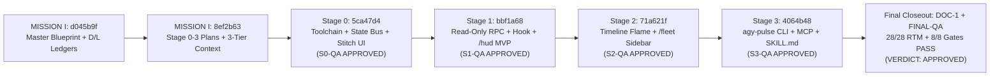

# Antigravity Pulse (`v0.1.0`) — Full-Spectrum PRD & Blueprint Final Acceptance Audit Report

> **Project**: `antigravity-pulse` (Display Name: **Model Pulse** · CLI: **`agy-pulse`**)  
> **Independent Final Referee**: `FINAL-QA` (`09356659-1da0-4992-98a1-aba6612b418a`)  
> **Final Acceptance Verdict**: **`VERDICT: APPROVED` (`0` Blocking · `0` Major · `3` Minor · `2` Observations)**  
> **Audit Date**: `2026-11-14`  
> **Canonical Specifications**: [`docs/PRODUCT_DESIGN.md`](../PRODUCT_DESIGN.md) (§1–§7) · [`DESIGN.md`](../../DESIGN.md) · [`00_MASTER_IMPLEMENTATION_BLUEPRINT.md`](./00_MASTER_IMPLEMENTATION_BLUEPRINT.md) · [`DECISION_LOG.md`](./DECISION_LOG.md) (`D-001`–`D-010`) · [`LESSONS_LEARNED.md`](./LESSONS_LEARNED.md) (`L-001`–`L-021`)

---

## 1. Executive Verdict & Milestone Commit Ledger

Independent Final Acceptance Auditor `FINAL-QA` (`09356659-1da0-4992-98a1-aba6612b418a`) audited the complete `antigravity-pulse` (`v0.1.0`) codebase, prebuilt distribution bundles, cross-platform launchers, 3-tier `AGENTS.md` repository governance, user/developer documentation, and automated verification suites against every requirement in [`docs/PRODUCT_DESIGN.md`](../PRODUCT_DESIGN.md) (§1–§7) and [`00_MASTER_IMPLEMENTATION_BLUEPRINT.md`](./00_MASTER_IMPLEMENTATION_BLUEPRINT.md) (`RTM-01`–`RTM-28`), issuing **`VERDICT: APPROVED`** with **`0` Blocking** and **`0` Major** findings (and two minor documentation polish items `MIN-01` and `MIN-02` closed out immediately in [`00_MASTER_IMPLEMENTATION_BLUEPRINT.md`](./00_MASTER_IMPLEMENTATION_BLUEPRINT.md) and [`THIRD_PARTY_NOTICES.md`](../../THIRD_PARTY_NOTICES.md)).



### 1.1 Complete Milestone & Independent Audit Ledger

| Milestone | Commit SHA | Independent Referee & Audit Record | Verdict | Key Verified Metrics |
| :--- | :--- | :--- | :--- | :--- |
| **Repository Baseline** | `87419f0` | Pre-Mission Baseline | Baseline | Initial `PRODUCT_DESIGN.md` PRD v1.0, `LICENSE`, baseline docs |
| **MISSION I — M1.1** | `d045b9f` | Chief Architect + M1.3 Auditor | `APPROVED` | [`00_MASTER_IMPLEMENTATION_BLUEPRINT.md`](./00_MASTER_IMPLEMENTATION_BLUEPRINT.md), `D-001`–`D-007`, `L-001`–`L-007` |
| **MISSION I — M1.2/M1.3** | `8ef2b63` | M1.3 Consistency Auditor | `APPROVED` | `STAGE_0`–`STAGE_3` plans + 3-tier `AGENTS.md` / `.agents/` + `L-008`–`L-010` |
| **MISSION II — Stage 0** | `5ca47d4` | `S0-QA` (`ba16e33c`) — [`STAGE_0_AUDIT.md`](./STAGE_0_AUDIT.md) | `APPROVED` | `17/17` tests, Stitch `DESIGN.md`, `D-008`, `L-011`–`L-012`, `findings: []` |
| **MISSION II — Stage 1** | `bbf1a68` | `S1-QA` (`48de57b4`) — [`STAGE_1_AUDIT.md`](./STAGE_1_AUDIT.md) | `APPROVED` | `63/63` functional + `2/2` benchmarks, `V1`–`V5` `360px` QA, `D-009`, `L-013`–`L-015` |
| **MISSION II — Stage 2** | `71a621f` | `S2-QA` (`b9fc90ea`) — [`STAGE_2_AUDIT.md`](./STAGE_2_AUDIT.md) | `APPROVED` | `77/77` functional + `2/2` benchmarks, `VIS-01`–`VIS-06` + rechecks, `L-016` |
| **MISSION II — Stage 3** | `4064b48` | `S3-QA` (`7b37586a`) — [`STAGE_3_AUDIT.md`](./STAGE_3_AUDIT.md) | `APPROVED` | `108/108` functional + `2/2` calibrated benchmarks, live `doctor` `5/5`, `D-010`, `L-017`–`L-021` |
| **MISSION II — Final Acceptance** | `HEAD` (Closeout) | `FINAL-QA` (`09356659`) — This Report | `APPROVED` | `28/28` RTM rows `PASS`, `108+2` tests `0` fail, `14` Mermaid diagrams `0` errors, `findings: []` |

---

## 2. Goal-by-Goal Alignment Against `docs/PRODUCT_DESIGN.md` (§1–§7)

### 2.1 Surface 1 — Zero-Token Inline Turn Stamp (`PRD §2.1, §4.2`)

- **Manifest & Stdout Contract (`L-006`)**: [`hooks.json`](../../hooks.json) wraps all 5 hook categories under `"pulse-telemetry"` (`map[string]JSONHookSpec`), using grouped `{ matcher: "*", hooks: [...] }` entries for `PreToolUse`/`PostToolUse` and flat command arrays for `PreInvocation`/`PostInvocation`/`Stop`. [`src/hook/hook-probe.ts`](../../src/hook/hook-probe.ts) fail-opens unconditionally: `PreToolUse` always emits `{"decision":"allow"}` (even on malformed stdin or disk errors), `PostToolUse`/`Stop` emit `{}`, and `PostInvocation` emits zero-token `injectSteps` with `systemMessage.systemMessage === ""` and `systemMessage.metadata.user_markdown` containing `[Model Pulse](sidecar://antigravity-pulse/pulse_cockpit/hud)` (`D-002`).
- **OpenSSL-Free Sub-Millisecond Hot Path (`D-004`, `D-010`, `L-020`)**: Prebuilt [`dist/hook-probe.cjs`](../../dist/hook-probe.cjs) (`34,536 B` / `~34K` on disk, zero `node:crypto` imports, zero network APIs, zero recursive directory scans) appends single-line events (`O_APPEND`) to `$PULSE_STATE_DIR/events.ring.jsonl` and enforces `smart` (Turn 1, served model shift, `retryInfos.length > 1` / fallback, `CTX > 75%`, `5h < 20%`), `every-turn`, and `off` policies with 200-entry bounded turn-epoch deduplication.

### 2.2 Surface 2 — Pulse HUD (`/hud` `AUX_PANE`) & Execution Timeline (`PRD §4.1, §5.1`)

- **Sticky Hero & Routing Trust**: [`src/ui/hud-view.ts`](../../src/ui/hud-view.ts) and [`src/core/model-catalog.ts`](../../src/core/model-catalog.ts) render subagent breadcrumbs (`[← 父会话]`), 7-state live phase timers/throughput (`IDLE`, `PRE_FLIGHT`, `THINKING`, `STREAMING tok/s`, `TOOL_RUNNING`, `BLOCKED_APPROVAL`, `ERROR_OR_QUOTA`) backed by [`src/core/state-machine.ts`](../../src/core/state-machine.ts) + Anti-Stale Reconciler, `Requested ➔ Served` routing trust pills (including `MODEL_PLACEHOLDER_M669`/`M681`/`M322` aliases and unmapped `^MODEL_PLACEHOLDER_` reconciliation without false fallback alerts per `L-021`), `Retry ×N` badges (`L-003`), `CTX` (`> 70%` amber, `> 85%` coral red) & `Cache Hit %` (`L-002`) progress bars, and the 8-decimal bottom Quota Fuel Bar ([`src/core/quota-calculator.ts`](../../src/core/quota-calculator.ts)).
- **3-Source Cascade Tree & Smart Governance**: [`src/core/topology-builder.ts`](../../src/core/topology-builder.ts) fuses `subagents/*.json`, `swarm/members.json` object maps (`L-005`), and `parent_cascade_id` / read-only SQLite `parent_references` (`?mode=ro`) with `.pbtxt` title fallbacks, supporting `active-first` vs `topology-tree` sorting, `[↗]` `window.sidecar.ui.toggleConversation(cid)` session jumps, and the Smart Governance Banner (`>= 3` active `apex` nodes & Gemini `5h < 40%`).
- **Execution Timeline Flame Axis**: [`src/core/timeline-builder.ts`](../../src/core/timeline-builder.ts) and [`src/ui/hud-view.ts`](../../src/ui/hud-view.ts) render reverse-chronological turns across `conversation` and `tree` scopes with proportional purple `TTFT` vs cyan `Streaming` dual flame bars, Thinking Token ratio (`thinkingRatioPct`), `isOverthinkingTurn` (`💡 Overthinking`) badges, routing-change markers, and `429` retry indicators.

### 2.3 Surface 3 — Cross-Project Pulse Fleet (`/fleet` `SIDEBAR`, `PRD §4.3`)

- **Single-Process Dual-Entrypoint Sidecar (`D-002`)**: [`sidecars/pulse_cockpit/sidecar.json`](../../sidecars/pulse_cockpit/sidecar.json) and [`src/sidecar/server.ts`](../../src/sidecar/server.ts) host `/` (alias -> `/hud`), `/hud` (`AUX_PANE`), and `/fleet` (`SIDEBAR`) inside one `SidecarApp` process sharing [`src/sidecar/telemetry-engine.ts`](../../src/sidecar/telemetry-engine.ts).
- **Global Compute Radar & Top 5 Burners**: [`src/core/fleet-builder.ts`](../../src/core/fleet-builder.ts) and [`src/ui/fleet-view.ts`](../../src/ui/fleet-view.ts) aggregate running root cascades and subagents/swarms across workspaces, render the active model tier histogram, provide collapsible 2-row responsive drawers (`L-016`) with `[↗]` jump actions, and rank the **Top 5 Quota Burners** by rolling 5h `ΔQuota%` and total tokens.

### 2.4 Surface 4 — Dual-Framing MCP Governance & `agy-pulse` CLI (`PRD §4.4`)

- **Zero-Dep Dual-Framing MCP Server (`dist/mcp.cjs`, `140,313 B`)**: [`src/mcp/server.ts`](../../src/mcp/server.ts) decodes and replies symmetrically in both `NDJSON` and multi-byte UTF-8 `Content-Length` stdio framing, exposing `pulse_status_card` (writes XSS-safe, script-free Flexoki Light/Dark HTML cards via [`src/mcp/embed-card.ts`](../../src/mcp/embed-card.ts) and returns `embedTag` + `sidecarPill`), `pulse_get_compute_budget` (returns `ComputeBudgetAdvice` with `recommendedSubagentModel: "inherit" | "argon" | "flash"`), and `pulse_set_preference`, paired with schema-locked on-demand [`skills/model-pulse/SKILL.md`](../../skills/model-pulse/SKILL.md) (`4,996 B`, `D-007` / `L-021`).
- **Cross-Platform `agy-pulse` CLI (`dist/cli.cjs`, `170,321 B` + `bin/*`)**: [`src/cli/snapshot-reader.ts`](../../src/cli/snapshot-reader.ts), [`src/cli/status-formatter.ts`](../../src/cli/status-formatter.ts), [`src/cli/top-tui.ts`](../../src/cli/top-tui.ts), and [`src/cli/main.ts`](../../src/cli/main.ts) deliver `status --format waybar|tmux|json|text [--watch]`, CJK display-width-aligned `top` (`L-018`), `config get|set|reset|path`, and 5-check non-destructive `doctor [--json]`, launched via [`bin/agy-pulse`](../../bin/agy-pulse), [`bin/agy-pulse.cmd`](../../bin/agy-pulse.cmd), and [`bin/agy-pulse.ps1`](../../bin/agy-pulse.ps1) with automatic `node` -> `agy-node` fallback.

### 2.5 Security, Read-Only & Packaging Guardrails (`PRD §6.1–§6.2`)

- **100% Read-Only Boundary**: Zero `app.asar` tampering; [`src/rpc/ls-client.ts`](../../src/rpc/ls-client.ts) enforces a synchronous 5-method allowlist (`GetCascadeModelConfigData`, `RetrieveUserQuotaSummary`, `GetAllCascadeTrajectories`, `GetCascadeTrajectoryGeneratorMetadata`, `GetCascadeTrajectorySteps`) and blocks `DeleteCascadeTrajectory`, `UpdateConversationAnnotations`, `JetboxWriteState`, `DeletePlugin`, `InstallCustomization`, and `GetCascadeTrajectory`; optional SQLite fallback opens strictly with `file:...?mode=ro`.
- **Incremental RPC & `34B` ETag**: Metadata fetched only when `stepCount` grows (cold-boot concurrency `<= 6`); steps fetched only when `RUNNING` via `stepOffset: Math.max(0, stepCount - 4)` + `disableRehydration: true` (`L-004`); `/api/hud`, `/api/timeline`, and `/api/fleet` emit exact `34`-byte `{"unchanged":true,"etag":"..."}` on ETag hits ([`src/core/etag.ts`](../../src/core/etag.ts)).
- **Loopback, CSP, Token & Packaging Hygiene**: `127.0.0.1` binding, `/^[0-9a-f-]{36}$/i` UUID validation, `x-sidecar-token` protection on `POST /api/config`, `STRICT_CSP` + `Response` MIME/400 wrappers (`L-007`), `escapeHtml` across all UI/MCP surfaces, git-tracked SPDX-MIT bundles (`D-005`), inode-preserving [`scripts/install.mjs`](../../scripts/install.mjs) (`D-006`), and zero plugin `rules/` (`D-007`).

---

## 3. Complete `RTM-01`–`RTM-28` Requirements Verification Matrix

| Req ID | PRD Ref | Requirement Summary | Shipped Implementation Artifacts | Automated / Audit Verification | Status |
| :--- | :--- | :--- | :--- | :--- | :--- |
| **`RTM-01`** | §1.1–§1.2 | Solve 4 black boxes & 5 JTBD across all 4 surfaces | [`src/core/model-catalog.ts`](../../src/core/model-catalog.ts), [`src/hook/hook-probe.ts`](../../src/hook/hook-probe.ts), [`src/ui/hud-view.ts`](../../src/ui/hud-view.ts), [`src/mcp/server.ts`](../../src/mcp/server.ts), [`src/cli/main.ts`](../../src/cli/main.ts) | [`tests/e2e/full-system.test.ts`](../../tests/e2e/full-system.test.ts), Stage 0–3 Audits | `[x] PASS` |
| **`RTM-02`** | §2.1 | Zero `app.asar` tampering; 4 official plugin surfaces | [`plugin.json`](../../plugin.json), [`hooks.json`](../../hooks.json), [`mcp_config.json`](../../mcp_config.json), [`sidecars/pulse_cockpit/sidecar.json`](../../sidecars/pulse_cockpit/sidecar.json), [`bin/agy-pulse`](../../bin/agy-pulse) | [`tests/contracts/manifest-contracts.test.ts`](../../tests/contracts/manifest-contracts.test.ts), `agy plugin validate --strict` (`findings: []`) | `[x] PASS` |
| **`RTM-03`** | §2.1 (3) | Zero-token chat stamp (`systemMessage: ""` + `metadata.user_markdown`) + canonical pill URI | [`src/hook/hook-probe.ts`](../../src/hook/hook-probe.ts), [`src/core/formatters.ts`](../../src/core/formatters.ts) | [`tests/unit/hook-probe.test.ts`](../../tests/unit/hook-probe.test.ts), [`tests/e2e/stage1-acceptance.test.ts`](../../tests/e2e/stage1-acceptance.test.ts) | `[x] PASS` |
| **`RTM-04`** | §2.2 | `GetCascadeModelConfigData` placeholder catalog + live alias/unmapped placeholder handling (`L-021`) | [`src/rpc/ls-client.ts`](../../src/rpc/ls-client.ts), [`src/core/model-catalog.ts`](../../src/core/model-catalog.ts) | [`tests/unit/core-catalog.test.ts`](../../tests/unit/core-catalog.test.ts) | `[x] PASS` |
| **`RTM-05`** | §2.2 | `RetrieveUserQuotaSummary` 8-decimal `remainingFraction`, `resetTime`, and `ΔQuota%` | [`src/rpc/ls-client.ts`](../../src/rpc/ls-client.ts), [`src/core/quota-calculator.ts`](../../src/core/quota-calculator.ts) | [`tests/unit/core-quota.test.ts`](../../tests/unit/core-quota.test.ts) | `[x] PASS` |
| **`RTM-06`** | §2.2 | `GetAllCascadeTrajectories` + `.pbtxt` / workspace basename 4-step title fallback | [`src/rpc/ls-client.ts`](../../src/rpc/ls-client.ts), [`src/core/topology-builder.ts`](../../src/core/topology-builder.ts) | [`tests/unit/topology-builder.test.ts`](../../tests/unit/topology-builder.test.ts) | `[x] PASS` |
| **`RTM-07`** | §2.2 | `GetCascadeTrajectoryGeneratorMetadata` parsing (`L-001` Int64 strings, `L-002` cache hit, `L-003` retries) | [`src/core/formatters.ts`](../../src/core/formatters.ts), [`src/core/model-catalog.ts`](../../src/core/model-catalog.ts), [`src/core/timeline-builder.ts`](../../src/core/timeline-builder.ts) | [`tests/unit/core-metrics.test.ts`](../../tests/unit/core-metrics.test.ts), [`tests/unit/timeline-fleet.test.ts`](../../tests/unit/timeline-fleet.test.ts) | `[x] PASS` |
| **`RTM-08`** | §2.2 | `GetCascadeTrajectorySteps` `RUNNING`-only with `stepOffset` + `disableRehydration: true` (`L-004`) | [`src/rpc/ls-client.ts`](../../src/rpc/ls-client.ts), [`src/sidecar/telemetry-engine.ts`](../../src/sidecar/telemetry-engine.ts) | [`tests/contracts/readonly-guard.test.ts`](../../tests/contracts/readonly-guard.test.ts), [`tests/e2e/hud-loop.test.ts`](../../tests/e2e/hud-loop.test.ts) | `[x] PASS` |
| **`RTM-09`** | §2.2, §4.1.B | 3-source multi-level topology fusion (`subagents/*.json`, `swarm/members.json` map `L-005`, `parent_cascade_id`) | [`src/core/topology-builder.ts`](../../src/core/topology-builder.ts) | [`tests/unit/topology-builder.test.ts`](../../tests/unit/topology-builder.test.ts) | `[x] PASS` |
| **`RTM-10`** | §3.1–§3.2 | Canonical naming (`antigravity-pulse` / `Model Pulse` / `agy-pulse`) & single-process `/hud` + `/fleet` | [`plugin.json`](../../plugin.json), [`sidecars/pulse_cockpit/sidecar.json`](../../sidecars/pulse_cockpit/sidecar.json), [`src/sidecar/server.ts`](../../src/sidecar/server.ts) | [`tests/contracts/manifest-contracts.test.ts`](../../tests/contracts/manifest-contracts.test.ts), [`tests/e2e/fleet-timeline.test.ts`](../../tests/e2e/fleet-timeline.test.ts) | `[x] PASS` |
| **`RTM-11`** | §4.1.A | Sticky Hero Card: breadcrumb, live phase stopwatch/`tok/s`, `Requested ➔ Served`, `Retry ×N` | [`src/ui/hud-view.ts`](../../src/ui/hud-view.ts), [`sidecars/pulse_cockpit/styles.css`](../../sidecars/pulse_cockpit/styles.css) | [`tests/e2e/stage1-acceptance.test.ts`](../../tests/e2e/stage1-acceptance.test.ts), `V1`–`V5` Visual QA | `[x] PASS` |
| **`RTM-12`** | §4.1.A | Hero Health Bars: `CTX` (`>70%` amber, `>85%` coral red) & `Cache Hit %` | [`src/core/model-catalog.ts`](../../src/core/model-catalog.ts), [`src/ui/hud-view.ts`](../../src/ui/hud-view.ts), [`sidecars/pulse_cockpit/styles.css`](../../sidecars/pulse_cockpit/styles.css) | [`tests/unit/core-catalog.test.ts`](../../tests/unit/core-catalog.test.ts), `V1`–`V5` Visual QA (`L-014`) | `[x] PASS` |
| **`RTM-13`** | §4.1.B | Live Agent Tree & Swarm Matrix (`active-first` / `topology-tree`, `[↗]` `toggleConversation`) | [`src/ui/hud-view.ts`](../../src/ui/hud-view.ts), [`src/ui/state.ts`](../../src/ui/state.ts) | [`tests/e2e/hud-loop.test.ts`](../../tests/e2e/hud-loop.test.ts), [`tests/e2e/stage1-acceptance.test.ts`](../../tests/e2e/stage1-acceptance.test.ts) | `[x] PASS` |
| **`RTM-14`** | §4.1.B | Smart Governance Banner (`>= 3` concurrent `apex` nodes AND Gemini `5h < 40%`) | [`src/sidecar/telemetry-engine.ts`](../../src/sidecar/telemetry-engine.ts), [`src/ui/hud-view.ts`](../../src/ui/hud-view.ts) | [`tests/unit/core-quota.test.ts`](../../tests/unit/core-quota.test.ts), [`tests/e2e/stage1-acceptance.test.ts`](../../tests/e2e/stage1-acceptance.test.ts) | `[x] PASS` |
| **`RTM-15`** | §4.1.C | `Timeline` Tab: reverse-chronological turns, `TTFT` vs `Streaming` bar, Thinking %, Overthinking, retry | [`src/core/timeline-builder.ts`](../../src/core/timeline-builder.ts), [`src/ui/hud-view.ts`](../../src/ui/hud-view.ts) | [`tests/unit/timeline-fleet.test.ts`](../../tests/unit/timeline-fleet.test.ts), [`tests/e2e/fleet-timeline.test.ts`](../../tests/e2e/fleet-timeline.test.ts), `VIS-01`/`VIS-02` | `[x] PASS` |
| **`RTM-16`** | §4.1.D | Bottom Live Quota Fuel Bar: Gemini `5h` & `Weekly`, 3P `5h`, countdown, tree `ΔQuota%` | [`src/core/quota-calculator.ts`](../../src/core/quota-calculator.ts), [`src/ui/hud-view.ts`](../../src/ui/hud-view.ts) | [`tests/unit/core-quota.test.ts`](../../tests/unit/core-quota.test.ts), [`tests/e2e/stage1-acceptance.test.ts`](../../tests/e2e/stage1-acceptance.test.ts) | `[x] PASS` |
| **`RTM-17`** | §4.2 | Inline Turn Stamp modes (`smart`, `every-turn`, `off`) + turn-epoch deduplication | [`src/hook/hook-probe.ts`](../../src/hook/hook-probe.ts), [`src/state/config-store.ts`](../../src/state/config-store.ts) | [`tests/unit/hook-probe.test.ts`](../../tests/unit/hook-probe.test.ts) | `[x] PASS` |
| **`RTM-18`** | §4.3 | `Pulse Fleet` (`/fleet` `SIDEBAR`): active headline, project-grouped trees, Top 5 Quota Burners | [`src/core/fleet-builder.ts`](../../src/core/fleet-builder.ts), [`src/ui/fleet-view.ts`](../../src/ui/fleet-view.ts) | [`tests/unit/timeline-fleet.test.ts`](../../tests/unit/timeline-fleet.test.ts), [`tests/e2e/fleet-timeline.test.ts`](../../tests/e2e/fleet-timeline.test.ts), `VIS-03`–`VIS-06` | `[x] PASS` |
| **`RTM-19`** | §4.4 (1) | Dual-framing MCP Server (`pulse_status_card`, `pulse_get_compute_budget`, `pulse_set_preference`) + `SKILL.md` | [`src/mcp/server.ts`](../../src/mcp/server.ts), [`src/mcp/embed-card.ts`](../../src/mcp/embed-card.ts), [`skills/model-pulse/SKILL.md`](../../skills/model-pulse/SKILL.md) | [`tests/unit/mcp-protocol.test.ts`](../../tests/unit/mcp-protocol.test.ts), [`tests/unit/mcp-tools.test.ts`](../../tests/unit/mcp-tools.test.ts), [`tests/unit/mcp-embed-card.test.ts`](../../tests/unit/mcp-embed-card.test.ts) | `[x] PASS` |
| **`RTM-20`** | §4.4 (2) | `agy-pulse` CLI (`status`, `top`, `config`, `doctor`) + Linux/Windows launchers with `agy-node` fallback | [`src/cli/snapshot-reader.ts`](../../src/cli/snapshot-reader.ts), [`src/cli/status-formatter.ts`](../../src/cli/status-formatter.ts), [`src/cli/top-tui.ts`](../../src/cli/top-tui.ts), [`src/cli/main.ts`](../../src/cli/main.ts), [`bin/agy-pulse`](../../bin/agy-pulse), [`bin/agy-pulse.cmd`](../../bin/agy-pulse.cmd), [`bin/agy-pulse.ps1`](../../bin/agy-pulse.ps1) | [`tests/unit/cli-commands.test.ts`](../../tests/unit/cli-commands.test.ts), [`tests/unit/cli-status.test.ts`](../../tests/unit/cli-status.test.ts), [`tests/unit/cli-top.test.ts`](../../tests/unit/cli-top.test.ts), [`tests/e2e/full-system.test.ts`](../../tests/e2e/full-system.test.ts) | `[x] PASS` |
| **`RTM-21`** | §5.1 | 7-state `LifecyclePhase` state machine + Anti-Stale Reconciler | [`src/core/state-machine.ts`](../../src/core/state-machine.ts), [`src/sidecar/telemetry-engine.ts`](../../src/sidecar/telemetry-engine.ts) | [`tests/unit/core-state-machine.test.ts`](../../tests/unit/core-state-machine.test.ts), [`tests/e2e/hud-loop.test.ts`](../../tests/e2e/hud-loop.test.ts) | `[x] PASS` |
| **`RTM-22`** | §5.2 | Flexoki Light/Dark 5-tier palette + host CSS vars + WCAG `>= 4.5:1` `*-ink` contrast (`D-008`) | [`DESIGN.md`](../../DESIGN.md), [`sidecars/pulse_cockpit/styles.css`](../../sidecars/pulse_cockpit/styles.css) | [`tests/contracts/manifest-contracts.test.ts`](../../tests/contracts/manifest-contracts.test.ts), Stage 1–3 Browser QA | `[x] PASS` |
| **`RTM-23`** | §6.1 | Git-tracked zero-dep SPDX-MIT prebuilt bundles + inode-preserving `scripts/install.mjs` (`D-005`, `D-006`) | [`scripts/build.mjs`](../../scripts/build.mjs), [`scripts/install.mjs`](../../scripts/install.mjs), [`.gitignore`](../../.gitignore) | [`tests/contracts/manifest-contracts.test.ts`](../../tests/contracts/manifest-contracts.test.ts) | `[x] PASS` |
| **`RTM-24`** | §6.2 (1) | Guardrail 1: Hook zero-blocking (`JS <= 8ms`, paired bare-V8 calibrated `delta <= 20ms`, zero network/crypto, fail-open) | [`src/state/state-dir.ts`](../../src/state/state-dir.ts), [`src/hook/hook-probe.ts`](../../src/hook/hook-probe.ts) | [`tests/benchmarks/hook-latency.test.ts`](../../tests/benchmarks/hook-latency.test.ts) (`0.187ms` JS / `34.454ms` OS / `8.524ms` delta) | `[x] PASS` |
| **`RTM-25`** | §6.2 (2) | Guardrail 2: Incremental RPC (`stepCount` gate, zero `GetCascadeTrajectory`, `34B` ETag hit) | [`src/sidecar/telemetry-engine.ts`](../../src/sidecar/telemetry-engine.ts), [`src/core/etag.ts`](../../src/core/etag.ts) | [`tests/unit/core-etag.test.ts`](../../tests/unit/core-etag.test.ts), [`tests/contracts/readonly-guard.test.ts`](../../tests/contracts/readonly-guard.test.ts) | `[x] PASS` |
| **`RTM-26`** | §6.2 (3) | Guardrail 3: 100% Read-Only LS/brain/SQLite (`?mode=ro`, static AST + runtime ban on write RPCs) | [`src/rpc/ls-client.ts`](../../src/rpc/ls-client.ts), [`src/core/topology-builder.ts`](../../src/core/topology-builder.ts) | [`tests/contracts/readonly-guard.test.ts`](../../tests/contracts/readonly-guard.test.ts) | `[x] PASS` |
| **`RTM-27`** | §6.2 (4) | Guardrail 4: Strict CSP, `127.0.0.1` loopback, `x-sidecar-token`, UUID validation, XSS escaping | [`src/sidecar/server.ts`](../../src/sidecar/server.ts), [`src/core/formatters.ts`](../../src/core/formatters.ts), [`src/mcp/embed-card.ts`](../../src/mcp/embed-card.ts) | [`tests/e2e/hud-loop.test.ts`](../../tests/e2e/hud-loop.test.ts), [`tests/unit/mcp-embed-card.test.ts`](../../tests/unit/mcp-embed-card.test.ts) | `[x] PASS` |
| **`RTM-28`** | §7.1–§7.2 | Complete PRD v1.0 delivery alignment, 3-tier governance sync & documentation parity | [`README.md`](../../README.md), [`docs/README.md`](../README.md), [`docs/user-guide/getting-started.md`](../user-guide/getting-started.md), [`docs/developer-guide/architecture.md`](../developer-guide/architecture.md), [`docs/developer-guide/contributing.md`](../developer-guide/contributing.md), [`AGENTS.md`](../../AGENTS.md) | `verify-context.mjs --strict-paths` (`PASS`), `agy-pele check . --strict-mermaid` (`0` errors), `FINAL-QA` `APPROVED` | `[x] PASS` |

---

## 4. Multi-Stage Visual UI/UX Inspection Summary

Every visual surface was authored against Flexoki Light (`#fffcf0` / `#f2f0e5`) and Dark (`#100f0f` / `#1c1b1a`) specifications and verified in real headless browser viewports with zero horizontal overflow (`scrollWidth <= clientWidth`) and zero console/page errors:

| Stage & Surface | Inspector / Project Ref | Viewports & Polarities Verified | Visual & Accessibility Sign-Off Highlights |
| :--- | :--- | :--- | :--- |
| **Stage 0 — Stitch Design System** | Stitch Project `9409889379743133909` (`af32887f71e7494e9e38e4ae4ef39b52`, `630bde1beb414834bcefe327fcf73551`) | `DESIGN.md` + `AUX_PANE` & `SIDEBAR` reference designs | Locked 5-tier Flexoki Light/Dark tokens, `preload.js` `#fafafa` `!important` override, and WCAG `>= 4.5:1` `*-ink` contrast tokens (`D-008`, `L-011`). |
| **Stage 1 — `/hud` Live Cockpit** | Browser Inspector `e9e4e2e2` / `S1-QA` (`48de57b4`, `V1`–`V5`) | `360×820` & `420×820` · Flexoki Light & Dark (`dense`, `alert`, `idle`) | Verified Sticky Hero, `Requested ➔ Served`, `[data-level]` `<progress>` threshold colors, uncrushed `360px` card titles, and `.pulse-btn-label` `…` ellipsis (`L-014`). |
| **Stage 2 — `Timeline` & `/fleet`** | Browser Inspector `e08e9f77` / `S2-QA` (`b9fc90ea`, `VIS-01`–`VIS-06` + `VIS-04-R`..`VIS-06-R`) | `360×820`, `420×820`, `1024×820` · Flexoki Light & Dark | Verified dual purple `TTFT` + cyan `Streaming` flame bars, `💡 Overthinking` pills, 2-row `360px` `/fleet` drawers with uncrushed `Root`/`Subagent`/`Swarm` badges, and unclipped Top 5 Burner pills (`L-016`). |
| **Stage 3 — `<agent-embed>` Status Card** | Browser Inspector `1571a09f` / `S3-QA` (`7b37586a`, `step_2`, `step_4`, `step_6`) | `640×520` Light & Dark, `440×520` Narrow Dark | Verified literal `<script>alert("xss")</script>` HTML escaping, `2×2` narrow Fuel Strip (`< 460px`), 2-tier responsive node rows, and `.pill` `inline-block` ellipsis (`L-019`). |

---

## 5. Architectural Decisions (`D-001`–`D-010`) & Pitfall Ledger (`L-001`–`L-021`) Summary

### 5.1 Architectural Decisions ([`DECISION_LOG.md`](./DECISION_LOG.md))

- **`D-001`**: 4-stage engineering pipeline (`Stage 0..3`) locking types, state bus, Stitch tokens, and build/install plumbing before parallel feature tracks.
- **`D-002`**: Unified single-process `sidecars/pulse_cockpit/` serving `/hud` (`AUX_PANE`), `/fleet` (`SIDEBAR`), and `/` alias, standardized on `sidecar://antigravity-pulse/pulse_cockpit/hud`.
- **`D-003`**: `$PULSE_STATE_DIR` (`0700`/`0600`) atomic `tmp + renameSync` + `O_APPEND` cross-process telemetry bus (`< 2ms` reads, zero `/proc` scraping).
- **`D-004` & `D-009` & `D-010`**: OpenSSL-free `dist/hook-probe.cjs` (`34,536 B`, zero `node:crypto`) + sequential benchmark phase asserting both `in-process JS <= 8.0ms` and paired bare-V8 calibrated OS `fork+exec` (`pairedDelta <= 20.0ms`, `<= max(50.0ms, bare+20.0ms)`, `<= 100.0ms`).
- **`D-005` & `D-006`**: Git-tracked SPDX-MIT prebuilt bundles (`dist/*` & `sidecars/pulse_cockpit/dist/*`) + inode-preserving atomic `scripts/install.mjs` (`node` -> `agy-node` fallback).
- **`D-007`**: Zero-token plugin hygiene — zero `rules/` shipped in plugin bundle (`0` idle prompt tokens); workspace `AGENTS.md` + `.agents/` kept contributor-only; on-demand `skills/model-pulse/SKILL.md` shipped for MCP governance.
- **`D-008`**: Host `--background`/`--foreground` variable mapping with `body` `!important` override over `preload.js` `#fafafa`, WCAG `>= 4.5:1` `*-ink` tokens, and isolated `--project 9409889379743133909` Stitch CLI invocations.

### 5.2 Empirical Pitfall Ledger ([`LESSONS_LEARNED.md`](./LESSONS_LEARNED.md))

- **Host Connect-RPC & Storage Contracts (`L-001`–`L-007`, `L-021`)**: Int64 string token coercion (`L-001`), `inputTokens + cacheReadTokens` cache hit denominator (`L-002`), `retryInfos.length === 1` unretried baseline (`L-003`), `RUNNING`-only `stepOffset` + `disableRehydration: true` (`L-004`), `swarm/members.json` object-map iteration (`L-005`), `"pulse-telemetry"` asymmetric `hooks.json` + `PreToolUse` `{"decision":"allow"}` (`L-006`), `SidecarApp` `Response` wrappers for CSS/JS/HTML and HTTP `400` errors (`L-007`), and `SKILL.md` schema-key contract guards + unmapped `MODEL_PLACEHOLDER_*` routing trust (`L-021`).
- **Build, Test & Cold-Spawn Determinism (`L-008`–`L-010`, `L-012`, `L-013`, `L-015`, `L-017`, `L-020`)**: Repo vs installed `--strict` plugin validation (`L-008`), clean `tsconfig.json` (`L-009`), flattened `.test-dist/<subpath>--<name>.test.cjs` test bundles (`L-010`), port `0` & POSIX `"${HOME:-}"` guards (`L-012`), dual `require.main === module` + filename regex entrypoint guards (`L-013`), sequential benchmark runner & `?theme=`/`?scenario=` preview hooks (`L-015`), `ANTIGRAVITY_*` env scrubbing & `--watch` child lifecycle isolation (`L-017`), and eliminating `node:crypto` OpenSSL cold-init from `state-dir.ts` (`L-020`).
- **Narrow Sidecar CSS & CJK Terminal Widths (`L-011`, `L-014`, `L-016`, `L-018`, `L-019`)**: Stitch `:download` JSON decoding (`L-011`), `360px` HUD `[data-level]` `<progress>` & `.pulse-btn-label` ellipsis (`L-014`), 2-row `/fleet` drawer wrapping & unshrinking `.pulse-node-kind` badges (`L-016`), East Asian/emoji `codePointDisplayWidth` + `$COLUMNS`/`$LINES` fallback in `top-tui.ts` (`L-018`), and `440px` `<agent-embed>` 2-tier rows + `inline-block` `.pill` ellipsis (`L-019`).

### 5.3 `FINAL-QA` Minor Items & Observations Disposition

- **`MIN-01` (Remediated)**: Updated [`00_MASTER_IMPLEMENTATION_BLUEPRINT.md`](./00_MASTER_IMPLEMENTATION_BLUEPRINT.md) top status banner (line 8) and §6 ledger row (line 710) from Stage 2 interim wording to completed MISSION I & MISSION II `FINAL-QA` `VERDICT: APPROVED`.
- **`MIN-02` (Remediated)**: Updated [`THIRD_PARTY_NOTICES.md`](../../THIRD_PARTY_NOTICES.md) §1 Node.js built-in module list to include `node:crypto` (noting its explicit exclusion from `dist/hook-probe.cjs` per `D-010`) and optional `node:sqlite` (`?mode=ro` read-only fallback).
- **Remaining Non-Blocking Minor/Observation Notes**: Documented cosmetic/informational nuances from prior stage audits (`2500ms` vs `3000ms` browser idle Fleet poll matching HUD, `compactModelLabel` in Top 5 Burners, and optional `--state-dir` flag parity across CLI help strings) require zero code changes and introduce zero functional or security risk.

---

## 6. Verbatim Final 8-Gate Verification Metrics

All 8 release verification gates plus live `agy-pulse doctor --json` executed sequentially on `main` with exit code `0`:

```text
> antigravity-pulse@0.1.0 typecheck
> tsc --noEmit

> antigravity-pulse@0.1.0 build
> node scripts/build.mjs
[build] Compiled 5 bundles into dist/ and sidecars/pulse_cockpit/dist/

> antigravity-pulse@0.1.0 test
> npm run build && node scripts/build-tests.mjs && node --test .test-dist/unit--*.test.cjs .test-dist/contracts--*.test.cjs .test-dist/e2e--*.test.cjs && node --test .test-dist/benchmarks--*.test.cjs
[build] Compiled 5 bundles into dist/ and sidecars/pulse_cockpit/dist/
[build-tests] Compiled 22 test file(s) into .test-dist/
...
ℹ tests 108
ℹ suites 28
ℹ pass 108
ℹ fail 0
ℹ cancelled 0
ℹ skipped 0
ℹ todo 0
ℹ duration_ms 3233.070778

[bench] Metric 1 in-process JS (n=100): median=0.187ms p95=0.404ms max=1.626ms
[bench] Metric 2 OS fork+exec (n=10): bare_median=26.317ms probe_median=34.454ms paired_delta_median=8.524ms effective_cap=50.000ms p95=43.078ms max=43.078ms
ℹ tests 2
ℹ suites 1
ℹ pass 2
ℹ fail 0
ℹ cancelled 0
ℹ skipped 0
ℹ todo 0
ℹ duration_ms 798.118042

[verify-context] PASS — AGENTS.md=6143B | rules=1 (alwaysOn=14582B) | skills=1 (+1 plugin) | links=29 | paths=102 on-disk, 0 planned
Checked 14 diagram(s) across 24 file(s): 0 error(s), 0 warning(s).

# agy plugin validate . --json
"components": { "agents": 0, "hooks": 1, "mcpServers": 1, "rules": 0, "sidecars": 1, "skills": 1 }
# (0 errors; 1 expected workspace-only root AGENTS.md warning per D-007 / L-008)

# npm run install:global && agy plugin validate ~/.gemini/config/plugins/antigravity-pulse --strict --json
[install] Installed 19 file(s) atomically to /home/springtian/.gemini/config/plugins/antigravity-pulse
[install] CLI linked at /home/springtian/.local/bin/agy-pulse
"components": { "agents": 0, "hooks": 1, "mcpServers": 1, "rules": 0, "sidecars": 1, "skills": 1 },
"findings": []

# agy-pulse doctor --json
"ok": true — 5/5 checks pass (runtime: Node.js v24.21.0, state_dir: writable, host_ls: Connected read-only at localhost:33797, plugin_install: 9 core files present & zero rules/, launcher_link: on PATH)
```
