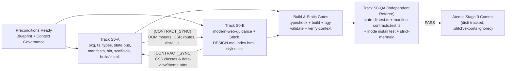

# Stage 0 Implementation Plan: Engineering & UI/UX Design Foundation

> **Stage ID**: `Stage 0`  
> **Stage Goal**: Establish the zero-runtime-dependency TypeScript + `esbuild` build/test pipeline, frozen cross-module contracts (`src/types/*`), `$PULSE_STATE_DIR` atomic state bus (`0700`/`0600`), valid Antigravity 2.0 plugin manifests and cross-platform `bin/` launchers, inode-preserving atomic global installer (`scripts/install.mjs`), and `modern-web-guidance` + Stitch-grounded `DESIGN.md` & Flexoki Light/Dark UI shell (`sidecars/pulse_cockpit/index.html`, `styles.css`).  
> **Status**: `[ ] Pending` *(Execution in MISSION II)*  
> **Upstream Preconditions**: Baseline commit `87419f0`; MISSION I Master Blueprint ([`00_MASTER_IMPLEMENTATION_BLUEPRINT.md`](./00_MASTER_IMPLEMENTATION_BLUEPRINT.md)), Architectural Decision Log ([`DECISION_LOG.md`](./DECISION_LOG.md)), Lessons Learned ([`LESSONS_LEARNED.md`](./LESSONS_LEARNED.md) `L-001`–`L-007`), and Repo Context Governance (`AGENTS.md`, `.agents/`, `scripts/verify-context.mjs`, `.gitignore`).  
> **Downstream Consumers**: Stage 1 (`S1-A`, `S1-B`, `S1-C`), Stage 2 (`S2-A`, `S2-B`), Stage 3 (`S3-A`, `S3-B`).  
> **Target RTM Rows**: `RTM-02`, `RTM-10`, `RTM-22`, `RTM-23`, `RTM-27` *(plus foundation prerequisites for `RTM-03`, `RTM-17`, `RTM-20`, `RTM-24`)*.

---

## 1. Preconditions & Environment Dependencies

Before starting MISSION II Stage 0 tracks (`S0-A`, `S0-B`, `S0-QA`), verify the following host tools, runtime resolutions, and repo preconditions:

| Dependency | Required Version / Contract | Empirically Observed on Host | Resolution / Fallback Behavior |
| :--- | :--- | :--- | :--- |
| **Node.js & npm** | `node >= 20`, `npm` | `node v24.21.0`, `npm 11.19.0` | Dev build/tests run on `node >= 20`; distributed `bin/` launchers fall back to Antigravity's `agy-node` (`agy-node.exe` on Windows). |
| **Antigravity CLI (`agy`)** | `agy plugin validate` available | `/home/springtian/.local/bin/agy` (`1.5.8`) | Used by `S0-A` and `S0-QA`: on repo root `.` with `AGENTS.md` present, `agy plugin validate . --json` asserts `0` errors (with only the expected `AGENTS.md` non-plugin-rule warning per `D-007`); on staged/installed dir, `agy plugin validate <dir> --strict --json` MUST pass with `0` errors and `0` warnings. |
| **Pele CLI (`agy-pele`)** | `agy-pele check --strict-mermaid` | `/home/springtian/.local/bin/agy-pele` (`v0.1.0`) | Validates standard Mermaid 12.1 compliance across all repository `.md` files (`0 errors, 0 warnings`). |
| **`sidecar_sdk` Runtime** | Host-injected ESM module (`SidecarApp`, `Response`) | `/home/springtian/.gemini/antigravity/lib/node_modules/sidecar_sdk/index.mjs` + `preload.js` | Antigravity's Sidecar spawner injects `--import .../register_loader.js` (`esm_resolver.js`) at runtime. **MUST** remain `external: ['sidecar_sdk']` in `esbuild` and NEVER declared in `package.json` `dependencies`. |
| **Google Stitch CLI/MCP** | `@google/stitch` + `stitch_ops.py` | `/home/springtian/.nvm/versions/node/v24.21.0/bin/stitch`, `~/.stitch.json` present | `S0-B` runs `python3 ~/.gemini/config/skills/stitch/scripts/stitch_ops.py doctor` (`NODE_USE_ENV_PROXY=1`, requires `AQ...` key — never `AIza...`). If unreachable/unauthenticated, log verbatim error & fallback in `DECISION_LOG.md`. |
| **`modern-web-guidance`** | `npx -y modern-web-guidance@latest` | Verified working on host (`search` & `retrieve`) | `S0-B` retrieves `dark-mode`, `tabs`, `progress`, and `interest-triggered-tooltips` guides before authoring `index.html` and `styles.css`. |
| **Context Governance** | `AGENTS.md`, `.agents/`, `scripts/verify-context.mjs`, `.gitignore` | Coordinated with Context Governance Architect | `scripts/verify-context.mjs` exits `0` with zero args; `.gitignore` tracks `dist/` and `sidecars/pulse_cockpit/dist/` (`D-005`) while ignoring `.stitch/exports/`, `.test-dist/`, `node_modules/`, `.env*`. |

---

## 2. Track Ownership & Parallel Execution Workflow

### 2.1 Disjoint Path Ownership Lock Table (Stage 0)

Every Stage 0 track MUST edit exclusively within its assigned `OWNED_WRITE_PATHS` to prevent write collisions:

| Track ID | Role | Owned Write Paths (Strictly Disjoint) | Shared Read-Only Inputs |
| :--- | :--- | :--- | :--- |
| **`S0-A`** | Engineering Foundation, Frozen Contracts, State Bus, Build/Install & Manifests | `package.json`, `package-lock.json`, `tsconfig.json`, `plugin.json`, `hooks.json`, `mcp_config.json`, `sidecars/pulse_cockpit/sidecar.json`, `skills/model-pulse/SKILL.md`, `bin/agy-pulse`, `bin/agy-pulse.cmd`, `bin/agy-pulse.ps1`, `src/types/**`, `src/state/**`, `src/hook/hook-probe.ts`, `src/sidecar/server.ts`, `src/ui/main.ts`, `src/mcp/server.ts`, `src/cli/main.ts`, `dist/**`, `sidecars/pulse_cockpit/dist/**`, `scripts/build.mjs`, `scripts/build-tests.mjs`, `scripts/install.mjs`, `scripts/preview-ui.mjs` | `docs/PRODUCT_DESIGN.md`, `docs/plans/*`, `assets/logo.svg`, `.gitignore`, `scripts/verify-context.mjs`, `/home/springtian/.gemini/antigravity/lib/node_modules/sidecar_sdk/*` |
| **`S0-B`** | UI/UX Architecture, `modern-web-guidance`, Stitch Workflow, `DESIGN.md` & Flexoki Shell | `DESIGN.md`, `sidecars/pulse_cockpit/index.html`, `sidecars/pulse_cockpit/styles.css`, `.stitch/exports/**` *(gitignored scratch)* | `docs/PRODUCT_DESIGN.md` §4–§5, `docs/plans/00_MASTER_IMPLEMENTATION_BLUEPRINT.md`, `S0-A` DOM/route/CSP contract |
| **`S0-QA`** | Independent Stage 0 Referee & Automated Contract Harness | `tests/unit/state-dir.test.ts`, `tests/contracts/manifest-contracts.test.ts`, `docs/plans/STAGE_0_AUDIT.md` | Whole repository (read-only) |

> **Ownership Boundary Note**: `S0-A` does NOT modify `AGENTS.md`, `.agents/**`, `scripts/verify-context.mjs`, or `.gitignore` (owned by the Context Governance step) and does NOT edit `sidecars/pulse_cockpit/index.html` or `styles.css` (owned by `S0-B`). `S0-A` creates the initial `scripts/preview-ui.mjs` static+stub loopback server so `npm run preview` works in Stage 0; Stage 1 (`S1-C`) and Stage 2 (`S2-B`) will extend `scripts/preview-ui.mjs` sequentially in later stages.

### 2.2 Stage 0 Parallel Execution & Peer Sync DAG



### 2.3 Mandatory `S0-A` ↔ `S0-B` Peer Sync Checkpoints

1. **`[CONTRACT_SYNC #1 — HTML Shell, CSP & Script Order]` (`S0-A` → `S0-B` before `S0-B` writes `index.html`)**:
   - `S0-A`'s `src/sidecar/server.ts` serves `/`, `/hud`, and `/fleet` with strict CSP:
     `default-src 'self'; script-src 'self'; style-src 'self' 'unsafe-inline'; img-src 'self' data:; connect-src 'self'; frame-ancestors *`
   - Therefore `sidecars/pulse_cockpit/index.html` **MUST NOT** contain any inline `<script>` tags or external CDN `<link>`/`<script>` URLs, and **MUST** load local assets in exact order:
     1. `<script src="/preload.js"></script>` (injected by `SidecarApp` from `sidecar_sdk`)
     2. `<link rel="stylesheet" href="/styles.css">` (served with explicit `text/css; charset=utf-8` via `Response` per `L-007`)
     3. `<script src="/dist/ui.js"></script>` (at end of `<body>`, served with `application/javascript; charset=utf-8`)
2. **`[CONTRACT_SYNC #2 — Root DOM Mounts & CSS Semantic Primitives]` (`S0-B` ↔ `S0-A` before finalizing `src/ui/main.ts` and `styles.css`)**:
   - `index.html` wraps `<main id="app" class="pulse-main" aria-live="polite">` inside `<div id="pulse-app" class="pulse-app" data-view="hud" data-theme-mode="auto">`.
   - `src/ui/main.ts` reads `window.location.pathname`, resolves `'fleet'` when starting with `/fleet` else `'hud'`, sets `data-view` on `#pulse-app`, listens to `matchMedia('(prefers-color-scheme: dark)')` (`change` event), and synchronizes host theme overrides (`[data-resolved-theme="dark"|"light"]`).
   - Core semantic CSS classes locked for Stage 1–2 (`S1-C`, `S2-B`): `.pulse-app`, `.pulse-main`, `.pulse-tabs`, `.pulse-tab`, `.pulse-tabpanel`, `.pulse-hero`, `.pulse-health-row`, `.pulse-progress`, `.pulse-matrix`, `.pulse-node-card`, `.pulse-pill`, `.pulse-tier-apex`, `.pulse-tier-workhorse`, `.pulse-tier-fast`, `.pulse-tier-orchestrator`, `.pulse-tier-alert`, `.pulse-banner`, `.pulse-fuel-bar`, `.pulse-timeline-bar`, `.pulse-fleet-grid`, `.pulse-popover`, `.tabular-nums`.

---

## 3. Track `S0-A` Specification (Engineering Foundation & Plugin Plumbing)

### 3.1 `package.json`, `package-lock.json` & `tsconfig.json`

1. **`package.json` updates**:
   - **Zero runtime dependencies**: Confirm `"dependencies"` is completely omitted (or empty `{}`) — only `"devDependencies"` (`@types/node`, `esbuild`, `typescript`).
   - Update `"scripts"` to:
     ```json
     {
       "build": "node scripts/build.mjs",
       "typecheck": "tsc --noEmit",
       "test": "npm run build && node scripts/build-tests.mjs && node --test .test-dist/*.test.cjs",
       "install:global": "node scripts/install.mjs",
       "verify:context": "node scripts/verify-context.mjs",
       "preview": "node scripts/preview-ui.mjs"
     }
     ```
   - Verify `"files"` allowlist includes ONLY distributable plugin artifacts (`plugin.json`, `hooks.json`, `mcp_config.json`, `README.md`, `LICENSE`, `THIRD_PARTY_NOTICES.md`, `assets/`, `bin/`, `dist/`, `sidecars/`, `skills/`) — strictly excluding `.agents/`, `rules/`, `src/`, `tests/`, `.stitch/` (`D-007`).
2. **`package-lock.json`**:
   - Run `npm install` in repo root to install devDependencies (`@types/node`, `esbuild`, `typescript`) and generate deterministic `package-lock.json`.
3. **`tsconfig.json`**:
   - Retain `strict: true`, `target: "ES2022"`, `module: "ESNext"`, `moduleResolution: "bundler"`, `noEmit: true`, `isolatedModules: true`, `lib: ["ES2022", "DOM", "DOM.Iterable"]`.
   - Because `"include"` covers `"scripts/**/*.mjs"`, verify `tsc --noEmit` succeeds cleanly (enable `"allowJs": true, "checkJs": false` if TypeScript requires it for `.mjs` entries in `"include"`, or exclude `.mjs` if strictly checking `.ts` only — verify with zero errors under `npm run typecheck`).

### 3.2 Plugin Manifests, `skills/` & `bin/` Launchers

1. **`plugin.json`** (validate existing baseline):
   - Keep `name: "antigravity-pulse"`, `displayName: "Model Pulse"`, `logo: "assets/logo.svg"`, `suggestedPrompts` (`RTM-10`).
2. **`hooks.json` (Asymmetric Schema + `JSONHookSpec` Map per `L-006` & Host Ground Truth)**:
   - Antigravity's `hooks.json` loader unmarshals into `map[string]JSONHookSpec` (top-level named hook group key -> event map), where `PreToolUse` / `PostToolUse` require **grouped** `{ matcher, hooks }` entries and `PreInvocation` / `PostInvocation` / `Stop` require **flat** command arrays:
     ```json
     {
       "pulse-telemetry": {
         "PreToolUse": [
           {
             "matcher": "*",
             "hooks": [
               {
                 "type": "command",
                 "command": "node ./dist/hook-probe.cjs",
                 "timeout": 5
               }
             ]
           }
         ],
         "PostToolUse": [
           {
             "matcher": "*",
             "hooks": [
               {
                 "type": "command",
                 "command": "node ./dist/hook-probe.cjs",
                 "timeout": 5
               }
             ]
           }
         ],
         "PreInvocation": [
           {
             "type": "command",
             "command": "node ./dist/hook-probe.cjs",
             "timeout": 5
           }
         ],
         "PostInvocation": [
           {
             "type": "command",
             "command": "node ./dist/hook-probe.cjs",
             "timeout": 5
           }
         ],
         "Stop": [
           {
             "type": "command",
             "command": "node ./dist/hook-probe.cjs",
             "timeout": 5
           }
         ]
       }
     }
     ```
   - Verified via `agy plugin validate . --json` (`0` errors, `"hooks": 1`, no findings on `hooks.json`) and `agy plugin validate <staged-dir> --strict --json` (`findings: []`).
3. **`mcp_config.json`**:
   ```json
   {
     "mcpServers": {
       "antigravity-pulse": {
         "command": "node",
         "args": ["dist/mcp.cjs"]
       }
     }
   }
   ```
4. **`sidecars/pulse_cockpit/sidecar.json` (`D-002`, Single-Process Dual-View Sidecar)**:
   ```json
   {
     "command": "node",
     "args": ["dist/server.mjs"],
     "restart_policy": "always",
     "display_name": "Model Pulse",
     "description": "Real-time active model telemetry HUD (AUX_PANE) and multi-project agent fleet monitor (SIDEBAR) for Google Antigravity 2.0.",
     "has_web_ui": true,
     "ui_config": {
       "display_name": "Model Pulse",
       "views": [
         {
           "path": "/hud",
           "entrypoint": "SIDECAR_UI_ENTRYPOINT_AUX_PANE",
           "title": "Model Pulse"
         },
         {
           "path": "/fleet",
           "entrypoint": "SIDECAR_UI_ENTRYPOINT_SIDEBAR",
           "title": "Pulse Fleet"
         }
       ]
     }
   }
   ```
5. **`skills/model-pulse/SKILL.md` (`D-007` Zero-Token On-Demand Skill)**:
   - Frontmatter: `name: model-pulse` + concise `description` covering active model telemetry, subagent compute budgets, and Model Pulse MCP tools.
   - Body (`< 4 KB`): Documents on-demand usage of `pulse_status_card`, `pulse_get_compute_budget`, `pulse_set_preference`, canonical pill URI `sidecar://antigravity-pulse/pulse_cockpit/hud`, and `agy-pulse` CLI. **NEVER** create a `rules/` directory inside the plugin root.
6. **Cross-Platform `bin/` Launchers (`node` → `agy-node` Fallback)**:
   - **`bin/agy-pulse`** (LF line endings, `chmod 755`): POSIX `sh` script resolving symlinks via `readlink` loop, executing `dist/cli.cjs` via `node` on `PATH`, then falling back to `agy-node` on `PATH` or `~/.config/Antigravity/bin/agy-node` (mirroring `/home/springtian/.gemini/config/plugins/antigravity-pele/bin/agy-pele`). Exit `127` with clear stderr diagnostic if neither exists.
   - **`bin/agy-pulse.cmd`** (CRLF line endings): Windows Batch script checking `where node`, then `where agy-node`, then `%APPDATA%\Antigravity\bin\agy-node.exe` and `%LOCALAPPDATA%\Programs\Antigravity\bin\agy-node.exe`, passing `%*` to `%~dp0..\dist\cli.cjs`.
   - **`bin/agy-pulse.ps1`** (CRLF line endings): PowerShell wrapper performing the exact same `node` → `agy-node` → `%APPDATA%`/`%LOCALAPPDATA%` fallback and propagating `$LASTEXITCODE`.

### 3.3 Frozen TypeScript Contracts (`src/types/*`)

1. **`src/types/telemetry.ts`**:
   - Must match [`00_MASTER_IMPLEMENTATION_BLUEPRINT.md`](./00_MASTER_IMPLEMENTATION_BLUEPRINT.md) §3.1 **verbatim**:
     - Unions: `ModelTier`, `LifecyclePhase`, `InlineStampMode`, `ModelFamily`, `EffortTier`
     - Domain & Snapshot Interfaces: `ModelConfigEntry`, `QuotaBucketView`, `QuotaSummaryView`, `CascadeNodeView`, `SmartGovernanceBanner`, `PulseUserConfig`, `UnchangedEtagResponse`, `HudSnapshotResponse`, `TimelineTurnItem`, `TimelineSnapshotResponse`, `FleetTreeSummary`, `FleetProjectGroup`, `QuotaBurnerEntry`, `FleetSnapshotResponse`, `HookRingEvent`, `ComputeBudgetAdvice`.
2. **`src/types/rpc.ts`**:
   - Strict wire payload interfaces matching Antigravity 2.0 Connect-RPC + filesystem schemas (`L-001`–`L-005`):
     - `ClientModelConfigRaw`, `GetCascadeModelConfigDataResponse`
     - `QuotaBucketRaw`, `QuotaGroupRaw`, `RetrieveUserQuotaSummaryResponse`
     - `TrajectoryWorkspaceRaw`, `TrajectorySummaryRaw`, `GetAllCascadeTrajectoriesResponse`
     - `UsageRaw` (typing `inputTokens`, `outputTokens`, `thinkingOutputTokens`, `responseOutputTokens`, `cacheReadTokens` strictly as `string | number | undefined` per `L-001`)
     - `ContextWindowMetadataRaw`, `CustomMetadataRaw`, `ChatStartMetadataRaw` (explicitly including `createdAt?: string; contextWindowMetadata?: ContextWindowMetadataRaw;`), `ChatModelMetadataRaw` (explicitly including `timestamp?: string; createdAt?: string; model?: string; modelDisplayName?: string; responseModel?: string; timeToFirstToken?: string; streamingDuration?: string; retryInfos?: unknown[]; chatStartMetadata?: ChatStartMetadataRaw; customMetadata?: CustomMetadataRaw; usage?: UsageRaw;`), `GeneratorMetadataEntryRaw`, `GetCascadeTrajectoryGeneratorMetadataRequest`, `GetCascadeTrajectoryGeneratorMetadataResponse`
     - `ToolCallRaw`, `TrajectoryStepMetadataRaw`, `TrajectoryStepRaw`, `GetCascadeTrajectoryStepsRequest` (strictly `{ cascadeId: string; stepOffset: number; disableRehydration: true }` per `L-004` — forbidding `startIndex`/`endIndex`), `GetCascadeTrajectoryStepsResponse`
     - `SubagentDescriptorFileRaw`, `SwarmMemberRaw`, `SwarmMembersFileRaw` (`members?: Record<string, SwarmMemberRaw>` object map per `L-005`)
     - `HookEventName` (`'PreInvocation' | 'PostInvocation' | 'PreToolUse' | 'PostToolUse' | 'Stop'`), `HookStdinPayload`, `HookStdoutResponse`
3. **`src/types/sidecar-sdk.d.ts`**:
   - Ambient `declare module 'sidecar_sdk'` exposing `Response` and `SidecarApp` (`config`, `page`, `api`, `run`, `close`, `sendMessage`, `startConversation`, `getConversationMetadata`) matching `sidecar_sdk/index.mjs`.
   - Global `Window.sidecar` interface (`conversationId: string | null`, `fetch`, `getWorkspaceUris`, `onWorkspaceChange`, `agent`, `ui.toggleAuxPane`, `ui.toggleConversation`, `ui.addArtifactComment`) matching `sidecar_sdk/preload.js`.
4. **`src/types/index.ts`**:
   - Barrel re-export: `export * from './telemetry'; export * from './rpc';` (with `/// <reference path="./sidecar-sdk.d.ts" />`).

### 3.4 `$PULSE_STATE_DIR` Atomic Bus & Config Store (`src/state/*`)

1. **`src/state/state-dir.ts`**:
   - **Constants & Validators**:
     - `UUID_REGEX = /^[0-9a-f-]{36}$/i`
     - `RING_MAX_BYTES = 512 * 1024` (`512 KiB`)
     - `isValidUuid(value: unknown): value is string`
     - `assertValidUuid(value: unknown, fieldName = 'conversationId'): string` (throws `RangeError` if invalid)
   - **State File Schema Interfaces** (`Blueprint §3.3`):
     - Frozen `StateDirPaths` interface (exact property names locked for Stage 1–3):
       ```ts
       export interface StateDirPaths {
         stateDir: string;
         eventsRing: string;      // <stateDir>/events.ring.jsonl
         eventsRingPrev: string;  // <stateDir>/events.ring.prev.jsonl
         liveSnapshot: string;    // <stateDir>/live-snapshot.json
         modelMap: string;        // <stateDir>/model-map.json
         quotaCache: string;      // <stateDir>/quota-cache.json
         configPath: string;      // <stateDir>/config.json
         stampDedup: string;      // <stateDir>/stamp-dedup.json
       }
       ```
     - `LiveSnapshotFile`, `ModelMapFile`, `QuotaCacheFile`, `StampDedupEntry`, `StampDedupFile`
   - **Resolution & Permissions**:
     - `resolveStateDir(overrideDir?: string): string` — checks `overrideDir` → `process.env.ANTIGRAVITY_PULSE_STATE_DIR` → `process.env.PLUGIN_DATA` → `path.join(os.homedir(), '.gemini', 'antigravity', 'pulse-state')`.
     - `getStatePaths(overrideDir?: string): StateDirPaths` — returns the exact frozen `StateDirPaths` object above (`paths.stateDir`, `paths.eventsRing`, `paths.eventsRingPrev`, `paths.liveSnapshot`, `paths.modelMap`, `paths.quotaCache`, `paths.configPath`, `paths.stampDedup`).
     - `ensureStateDir(overrideDir?: string): string` — `mkdirSync(dir, { recursive: true, mode: 0o700 })` + best-effort `chmodSync(dir, 0o700)` on POSIX.
   - **Atomic I/O & Ring Rotation**:
     - `writeJsonAtomic(filePath: string, data: unknown): void` — ensures parent dir `0o700`, writes sibling temp file `${filePath}.${process.pid}.${Date.now()}.${rand}.tmp` with `mode: 0o600`, atomically swaps via `renameSync(tmpPath, filePath)`, and cleans up orphan `.tmp` in `catch`/`finally`.
     - `readJsonSafe<T>(filePath: string, fallback: T): T` — returns `fallback` on `ENOENT`, empty file, or `SyntaxError`.
     - `appendRingLine(event: HookRingEvent, overrideDir?: string): string` — ensures state dir and calls single-line `appendFileSync(eventsRing, JSON.stringify(event) + '\n', { encoding: 'utf8', mode: 0o600 })` (`O_APPEND`, zero full-file read/scan).
     - `rotateRingIfNeeded(overrideDir?: string, maxBytes = RING_MAX_BYTES): { rotated: boolean; prevPath?: string; sizeBytes: number }` — checks `statSync(eventsRing).size > maxBytes`; when exceeded, atomically renames `events.ring.jsonl` → `events.ring.prev.jsonl`.
2. **`src/state/config-store.ts`**:
   - Export `DEFAULT_PULSE_USER_CONFIG: PulseUserConfig` (and alias `export const DEFAULT_CONFIG = DEFAULT_PULSE_USER_CONFIG;`) matching Blueprint §3.1 & `PRODUCT_DESIGN.md` (`version: 1`, `inlineStampMode: 'smart'`, `hudSortMode: 'active-first'`, `timelineScope: 'tree'`, `smartThresholds: { contextWarnPct: 70, contextCriticalPct: 85, stampContextTriggerPct: 75, quotaLowTriggerPct: 20, heavyConcurrentAlertCount: 3, heavyQuotaThresholdPct: 40 }`, `pollIntervalsMs: { active: 1000, idle: 3000, quota: 30_000, modelConfig: 30_000 }` — where `quota: 30_000` acts as the periodic fallback alongside immediate `RetrieveUserQuotaSummary` refresh upon turn completion).
   - Export `validateConfigPatch(patch: unknown): Partial<PulseUserConfig>` (rejects non-objects, strips `__proto__`/`constructor`/`prototype`, validates `inlineStampMode`, `hudSortMode`, `timelineScope`, positive bounded numbers for thresholds and poll intervals).
   - Export `mergeConfig(base: PulseUserConfig, patch: Partial<PulseUserConfig>): PulseUserConfig`.
   - Export `loadConfig(overrideDir?: string): PulseUserConfig`, `saveConfig(config: PulseUserConfig, overrideDir?: string): PulseUserConfig`, `updateConfigPartial(patch: unknown, overrideDir?: string): PulseUserConfig`.

### 3.5 Minimal Compilable Entry Scaffolds & Build/Test/Install Scripts

1. **5 Minimal Entry Scaffolds** (providing runnable Stage 0 skeletons without prematurely implementing Stage 1–3 business logic):
   - `src/hook/hook-probe.ts` → `dist/hook-probe.cjs`: Reads stdin synchronously (no network I/O), validates event name, safely emits `{"decision":"allow"}` for `PreToolUse` and `{}` for `PostToolUse` / `PreInvocation` / `PostInvocation` / `Stop`, fails open cleanly in `try/catch` (`L-006`).
   - `src/sidecar/server.ts` → `sidecars/pulse_cockpit/dist/server.mjs`: Instantiates `SidecarApp` + `Response` from `'sidecar_sdk'`, mounts `/`, `/hud`, `/fleet`, `/styles.css`, `/dist/ui.js` using `new Response(body, { contentType, headers })` with strict CSP + `X-Content-Type-Options: nosniff` (`L-007`), exposes `/api/health`, `/api/config` (`GET` & `POST` via `updateConfigPartial`), and typed empty stubs for `/api/hud`, `/api/timeline`, `/api/fleet` (validating optional `?conversationId` with `isValidUuid`).
   - `src/ui/main.ts` → `sidecars/pulse_cockpit/dist/ui.js`: Browser entry detecting `/fleet` vs `/hud`|`/`, setting `#pulse-app[data-view]`, syncing host/prefers-color-scheme theme, and rendering an accessible Stage 0 shell placeholder inside `#app`.
   - `src/mcp/server.ts` → `dist/mcp.cjs`: Minimal valid MCP stdio newline-delimited JSON-RPC server responding to `initialize`, `tools/list`, and `ping` cleanly until Stage 3 implements the 3 full tools.
   - `src/cli/main.ts` → `dist/cli.cjs`: Minimal runnable CLI handling `--version`, `--help`, and `status --format json` (reading `$PULSE_STATE_DIR/live-snapshot.json` via `readJsonSafe`) until Stage 3 adds `top` TUI and Waybar/tmux formatters.
2. **`scripts/build.mjs`** (Zero-dep ESM using `esbuild`):
   - Prepends SPDX MIT banner to every output bundle:
     ```js
     /* SPDX-License-Identifier: MIT | Copyright (c) 2026 springtian <springtian@gmail.com> */
     ```
   - Compiles 5 bundles:
     1. `src/hook/hook-probe.ts` → `dist/hook-probe.cjs` (`bundle: true`, `platform: 'node'`, `target: 'node20'`, `format: 'cjs'`)
     2. `src/mcp/server.ts` → `dist/mcp.cjs` (`bundle: true`, `platform: 'node'`, `target: 'node20'`, `format: 'cjs'`, `#!/usr/bin/env node` shebang + SPDX header)
     3. `src/cli/main.ts` → `dist/cli.cjs` (`bundle: true`, `platform: 'node'`, `target: 'node20'`, `format: 'cjs'`, `#!/usr/bin/env node` shebang + SPDX header + `chmodSync(..., 0o755)`)
     4. `src/sidecar/server.ts` → `sidecars/pulse_cockpit/dist/server.mjs` (`bundle: true`, `platform: 'node'`, `target: 'node20'`, `format: 'esm'`, `external: ['sidecar_sdk']`)
     5. `src/ui/main.ts` → `sidecars/pulse_cockpit/dist/ui.js` (`bundle: true`, `platform: 'browser'`, `target: 'es2022'`, `format: 'iife'`)
3. **`scripts/build-tests.mjs`**:
   - Recursively discovers `tests/**/*.test.ts` (`unit/`, `contracts/`, `benchmarks/`, `e2e/`).
   - Emits flattened `.test-dist/<subdir>--<name>.test.cjs` bundles (`format: 'cjs'`, `platform: 'node'`, `target: 'node20'`, `external: ['sidecar_sdk']`) so `package.json`'s `"test": "... && node --test .test-dist/*.test.cjs"` executes tests across all subdirectories without changing the glob.
4. **`scripts/preview-ui.mjs`**:
   - Lightweight loopback `127.0.0.1` HTTP server (`PORT` / `--port 4173`) serving `sidecars/pulse_cockpit/index.html`, `styles.css`, `dist/ui.js`, a minimal `/preload.js` browser shim, and Stage 0 stub `/api/*` JSON responses so `S0-B` can visually verify Flexoki Light/Dark and responsive CSS immediately via `npm run preview`.
5. **`scripts/install.mjs` (`D-006` Inode-Preserving Atomic Global Installer)**:
   - Resolves target directory (`--target-dir` flag for tests, defaulting to `~/.gemini/config/plugins/antigravity-pulse`).
   - Supports `--node-path <bin>` override and auto-detects system `node` on `PATH` vs `agy-node` fallback (`~/.config/Antigravity/bin/agy-node` on Linux, `%APPDATA%\Antigravity\bin\agy-node.exe` / `%LOCALAPPDATA%\Programs\Antigravity\bin\agy-node.exe` on Windows).
   - **Inode-Preserving Copy Loop**: Never calls `rmSync(targetDir, { recursive: true })`! Creates directories with `mkdirSync(..., { recursive: true })`, writes every distributable file from the `package.json` `"files"` allowlist (`plugin.json`, `hooks.json`, `mcp_config.json`, `README.md`, `LICENSE`, `THIRD_PARTY_NOTICES.md`, `assets/`, `bin/`, `dist/`, `sidecars/pulse_cockpit/{sidecar.json,index.html,styles.css,dist/*}`, `skills/model-pulse/SKILL.md`) via sibling temp file + atomic `renameSync` (preserving `0o755` on `bin/agy-pulse` and `dist/cli.cjs`).
   - **Installed-Only Fallback Patching**: ONLY when system `node` is missing from `PATH` (and `agy-node` was resolved), atomically rewrites the *installed* copies of `hooks.json` (each `JSONHookSpec` group's commands), `mcp_config.json`, and `sidecars/pulse_cockpit/sidecar.json` inside `targetDir` to point to the resolved `agy-node` binary — never mutating source repository files.
   - **Global CLI Link Placement**: On POSIX, atomically updates `~/.local/bin/agy-pulse` symlink (via temp symlink + `renameSync`) pointing to `<targetDir>/bin/agy-pulse` (respecting `--bin-dir` override for isolated testing); on Windows, ensures `bin/agy-pulse.cmd` and `bin/agy-pulse.ps1` exist in `<targetDir>/bin/` and optionally places a `.cmd` shim in `%LOCALAPPDATA%\Microsoft\WindowsApps` if writable, printing clear `PATH` guidance if outside `PATH`.

---

## 4. Track `S0-B` Specification (UI/UX Architecture, `modern-web-guidance`, Stitch & Flexoki Tokens)

### 4.1 Mandatory `modern-web-guidance` Search & Retrieve Protocol

Before editing `sidecars/pulse_cockpit/index.html` or `styles.css`, `S0-B` MUST execute `modern-web-guidance` searches and retrieve the corresponding guides:

| Query (`npx -y modern-web-guidance@latest search "<q>"`) | Retrieved Guide IDs | Mandatory Rules Enforced in Stage 0 HTML & CSS |
| :--- | :--- | :--- |
| `"dark mode color scheme"` | `dark-mode`, `color` | 1. Place `<meta name="color-scheme" content="light dark">` in `<head>` to prevent FOUC.<br>2. Declare `color-scheme: light dark` on `:root` (not `body`) so scrollbars & viewport canvas follow theme.<br>3. Provide explicit `--pulse-*-light` / `--pulse-*-dark` tokens with `@media (prefers-color-scheme: dark)` fallback AND `@supports (color: light-dark(white, black))`, plus `preload.js` `theme-change` host CSS variable bindings.<br>4. Wrap `::-webkit-scrollbar` fallback in `@supports not (scrollbar-color: auto)` and never animate `scrollbar-color`. |
| `"accessible tablist tabpanel"` | `tabs`, `accessibility` | 1. Render `<div role="tablist">` with `<button type="button" role="tab" aria-selected="true\|false">` on a single non-wrapping row (`overflow-x: auto`).<br>2. Render initial `hidden` attribute on inactive `[role="tabpanel"]` elements directly in HTML.<br>3. Draw selected indicator using `::after` `border-block-end: 2px solid ...` on `[aria-selected="true"]` (WCAG 1.4.1 non-color cue, preserved in Forced Colors mode).<br>4. Implement Arrow/Home/End roving tabindex in zero-dep TS instead of loading external `@microsoft/focusgroup-polyfill` CDN scripts (forbidden by strict CSP). |
| `"meter progress bar"` | `progress` | 1. Use native `<progress value="..." max="100" aria-label="...">` with `appearance: none; border: 0 solid; overflow: clip;`.<br>2. **NEVER** group `::-webkit-progress-value` and `::-moz-progress-bar` in one rule (split into separate selector blocks so Blink/Gecko do not drop the entire rule).<br>3. Never set `tabindex` on `<progress>`; announce threshold state shifts via `role="status"` / `aria-live="polite"`. |
| `"popover tooltip positioning"` | `interest-triggered-tooltips` | 1. Use native `[popover="hint"]` / `[popover="auto"]` fallback (zero external `@oddbird/*` CDN polyfills).<br>2. Gate `inset: auto; margin: 0; position-area: ...` strictly inside `@supports (position-area: block-end)` with an `@supports not (position-area: block-end)` safe fallback so unsupported engines do not strand overlays at `(0, 0)`.<br>3. Satisfy WCAG 1.4.13 (Escape dismissible, hoverable, persistent). |

### 4.2 Mandatory Google Stitch Workflow & 4-Layer Prompt Engineering

`S0-B` MUST execute the Stitch Canvas pipeline in order:

1. **Doctor & Environment Hardening**:
   ```bash
   python3 /home/springtian/.gemini/config/skills/stitch/scripts/stitch_ops.py doctor
   ```
   Confirms `NODE_USE_ENV_PROXY=1`, validates `AQ...` key (`GOOGLE_STITCH_API_KEY` / `~/.stitch.json`, rejecting `AIza...`), and checks live Stitch API reachability.
2. **Author `DESIGN.md` & Bind Stitch Design System**:
   - Author `./DESIGN.md` at repository root covering all 6 canonical Stitch sections (Visual Theme & Atmosphere, Color Palette & Roles, Typography Rules, Component Stylings, Layout Principles, Stitch Generation Notes).
   - Create/select Stitch project and synchronize `DESIGN.md` (`stitch_ops.py exec -- find projects --json`, create project or `stitch config set project <id>`, `stitch upload design DESIGN.md`, `stitch_ops.py exec -- status --flow=design --json`).
3. **Generate Screen 1 & Screen 2 with 4-Layer High-Density Prompts**:
   - **Screen 1: `Pulse HUD` (`AUX_PANE` 360px Narrow Telemetry Pane, `--device DESKTOP`)**:
     - *Layer 1 (Platform, Viewport & Aesthetic)*: Narrow `360px`-wide companion side pane inside an AI IDE workbench inspired by Linear, Raycast, and Flexoki warm-paper/ink telemetry instruments; high information density, crisp 1px structural borders, tabular numerals.
     - *Layer 2 (Macro Spatial Layout)*: Fixed `36px` top tab bar (`Overview`, `Timeline`, `Quota`) → Sticky `88px` Active Session Hero Card → Scrollable Live Agent Tree & Swarm Matrix + conditional single-line Smart Governance Banner → Pinned `36px` bottom Quota Fuel Bar.
     - *Layer 3 (Components & Authentic Copy)*: Breadcrumb `Root Refactor › W1-03 Atomic Refactoring Executor` + `[← Back to Root]`; live phase indicator `🟣 Thinking · 18.4s`; dual verification pill `Auto ➔ Gemini 4 Argon [MED] · ✓ gemini-4-argon`; two horizontal health meters (`CTX 38.8k / 256k · 15.1%`, `Cache Hit 91.8%`); 3-row agent matrix cards (`[🟢] W1-03 Atomic Refactoring Executor · self · [Argon · Med] · [↗]` / `🔧 Inspect SQLite schema · 3.2s` / `Steps: 14 · In 84k (89%) / Out 4.2k · ΔQuota -0.41%`); Smart Governance Banner (`💡 4 subagents concurrently running Carbon (High) · ~1.2%/min 5h burn`); bottom fuel bar (`Gemini 5h: 84.3% (2h 21m) · Wk: 96.5% | Claude 5h: 100% · Tree -1.68%`).
     - *Layer 4 (Design System Token Decoupling)*: Bound to project `DESIGN.md` / design-system; omit conflicting inline hex/font declarations in screen generation prompts once design-system is attached.
   - **Screen 2: `Pulse Fleet` (`SIDEBAR` Multi-Project Radar, `--device DESKTOP`)**:
     - *Layer 1 & 2*: Global workspace sidebar / wide radar (`400px`–`760px` fluid grid): Sticky Active Compute Headline (`56px`) → Project-grouped Active Cascade Tree Cards → Ranked Top 5 Quota Burners Table → Pinned `36px` bottom Quota Fuel Bar.
     - *Layer 3*: Headline `🔥 Active: 2 Roots + 5 Subagents | Carbon(H) ×2 · Argon(M) ×3 · Flash ×2`; Project Group `antigravity-pulse` with active tree (`Phase 1 Telemetry Engine`, `Thinking 12.1s`, `Carbon(H) ×1 · Argon(M) ×2`, `-1.68% (5h)`, `[↗ Focus]`); Top 5 Quota Burners rows (`#1 Phase 1 Refactor · Carbon(H) · -2.41%`, `#2 E2E Audit · Opus(H) · -1.85%`).
     - *Layer 4*: Governed by bound `DESIGN.md` design system.
4. **Export & Honest Fallback Policy**:
   - Export screens to `.stitch/exports/<project-id>/` via `stitch_ops.py export-project --project <id> --out-dir ./.stitch/exports/<project-id>` (gitignored scratch directory).
   - Inspect downloaded HTML/screenshots to validate visual proportions, contrast, and typography before finalizing `sidecars/pulse_cockpit/index.html` & `styles.css`.
   - **Fallback Rule**: If `stitch_ops.py doctor` or Stitch API returns an auth (`AQ...` missing/expired) or network timeout error, **DO NOT fabricate Stitch screenshots or skip silently** — record the exact error output and fallback to PRD §4–§5 + `modern-web-guidance` in [`DECISION_LOG.md`](./DECISION_LOG.md) and §7 of this plan.

### 4.3 Flexoki Light/Dark Tokens, Host Variable Mapping & Responsive CSS (`styles.css` & `index.html`)

1. **Exact Flexoki 5-Tier Palette (`RTM-22`, `PRODUCT_DESIGN.md` §5.2)**:

| Semantic Tier | Role & Model Examples | Flexoki Light Hex | Flexoki Dark Hex | CSS Custom Property |
| :--- | :--- | :--- | :--- | :--- |
| **Apex / Heavy (Purple)** | `Hydrogen XHigh/High`, `Carbon High`, `Opus 5.5 High` | `#5e409d` | `#8b7ec8` | `--pulse-tier-apex` |
| **Workhorse / Pro (Blue)** | `Carbon Med/Low`, `Argon High/Med`, `Sonnet 5.5` | `#205ea6` | `#4385be` | `--pulse-tier-workhorse` |
| **Fast / Subagent (Cyan)** | `Gemini Flash`, `Argon Low`, `flash_lite` | `#24837b` | `#3aa99f` | `--pulse-tier-fast` |
| **Orchestrator / Auto (Yellow)** | `Orchestrator (Carbon/Argon)`, `Auto` | `#ad8301` | `#d0a215` | `--pulse-tier-orchestrator` |
| **Alert / Retry / Critical (Red)** | `429 Retry`, `Served != Expected`, `CTX > 85%`, `5h < 15%` | `#af3029` | `#d14d41` | `--pulse-tier-alert` |

2. **Surface, Typography & Host Fallback Mapping**:
   - Flexoki Light neutrals: canvas `#fffcf0`, surface `#f2f0e5`, surface-alt `#e6e4d9`, border `#cecdc3`, ink `#100f0f`, muted `#6f6e69`.
   - Flexoki Dark neutrals: canvas `#100f0f`, surface `#1c1b1a`, surface-alt `#282726`, border `#403e3c`, ink `#cecdc3`, muted `#878580`.
   - Host mapping (`preload.js` `theme-change` injects `--background`, `--foreground`, `--border`, `--primary`, `--muted`, `--muted-foreground`, `--secondary`, `--destructive`):
     ```css
     :root {
       color-scheme: light dark;
       --pulse-bg: var(--background, var(--pulse-paper));
       --pulse-surface: var(--card, var(--secondary, var(--pulse-surface-base)));
       --pulse-surface-alt: var(--muted, var(--pulse-surface-raised));
       --pulse-fg: var(--foreground, var(--pulse-ink));
       --pulse-muted: var(--muted-foreground, var(--muted, var(--pulse-ink-muted)));
       --pulse-border: var(--border, var(--pulse-line));
       --pulse-accent: var(--primary, var(--pulse-blue));
       --pulse-critical: var(--destructive, var(--pulse-red));
     }
     ```
   - Enforce `font-variant-numeric: tabular-nums` across timers, token counters, percentages, and quotas (`.tabular-nums`).
   - Responsive breakpoints:
     - Default / Narrow Aux Pane (`340px–480px`, `@media (max-width: 480px)`): single-column stack, compact `8px` outer padding, `min-width: 0` flex children with ellipsis truncation on long role/model labels, non-wrapping scrollable `[role="tablist"]`, `>= 26px` accessible click targets.
     - Wide Sidebar / Workbench (`>= 640px`): 2-column `.pulse-fleet-grid` for project cards & Top 5 Quota Burners side-by-side (`grid-template-columns: repeat(auto-fit, minmax(300px, 1fr))`), expanded dual TTFT/Streaming bars in `.pulse-timeline-bar`.

---

## 5. Track `S0-QA` Specification (Test Suite, Acceptance Criteria & Verification Commands)

### 5.1 Required Stage 0 Automated Tests

`S0-QA` authors and executes two independent test files under `tests/`:

1. **`tests/unit/state-dir.test.ts`**:
   - **Resolution Order**: Verifies `ANTIGRAVITY_PULSE_STATE_DIR` overrides `PLUGIN_DATA`, which overrides `~/.gemini/antigravity/pulse-state` fallback.
   - **Permissions & Atomicity**: Creates temp `$PULSE_STATE_DIR`, invokes `ensureStateDir()` and `writeJsonAtomic()`, asserts directory mode `0o700` and file mode `0o600` (on POSIX), asserts JSON contents round-trip cleanly, and confirms zero residual `.tmp` files remain.
   - **`readJsonSafe` Resilience**: Missing file or corrupted JSON returns exact fallback without throwing.
   - **UUID Validator**: `isValidUuid` / `assertValidUuid` accepts lowercase & uppercase 36-char UUIDs (`198d5aa0-44bb-4273-9a52-b83805a34a3a`) and rejects `../escape`, empty string, 35-char / 37-char strings, and whitespace.
   - **Ring Append & `512 KiB` Rotation**: `appendRingLine` appends valid single-line NDJSON; `rotateRingIfNeeded` leaves files `< 512 KiB` untouched and atomically rotates files `> 512 KiB` to `events.ring.prev.jsonl`.
   - **Config Store (`config-store.ts`)**: Verifies `DEFAULT_PULSE_USER_CONFIG` defaults (`inlineStampMode: 'smart'`, `hudSortMode: 'active-first'`, `timelineScope: 'tree'`, thresholds `70/85/75/20/3/40`), `updateConfigPartial` persists valid partial updates, rejects invalid enum values, and blocks `__proto__` pollution.
2. **`tests/contracts/manifest-contracts.test.ts`**:
   - **`package.json` Hygiene**: Zero `dependencies`; scripts `build`, `typecheck`, `test`, `install:global`, `verify:context`, `preview` exist; `"files"` excludes `.agents/`, `rules/`, `src/`, `tests/`, `.stitch/`.
   - **Plugin Manifests**:
     - `plugin.json`: canonical `name`, `displayName`, existing `assets/logo.svg`.
     - `hooks.json`: named hook group (`pulse-telemetry`), grouped `PreToolUse` & `PostToolUse` (`matcher: "*"` + `hooks: [...]`), flat `PreInvocation`, `PostInvocation`, `Stop`, `command === "node ./dist/hook-probe.cjs"`, `timeout === 5`.
     - `mcp_config.json`: `antigravity-pulse` → `node` `["dist/mcp.cjs"]`.
     - `sidecars/pulse_cockpit/sidecar.json`: `/hud` (`SIDECAR_UI_ENTRYPOINT_AUX_PANE`) and `/fleet` (`SIDECAR_UI_ENTRYPOINT_SIDEBAR`), `args: ["dist/server.mjs"]`.
     - `skills/model-pulse/SKILL.md`: valid YAML frontmatter `name: model-pulse`, canonical URI `sidecar://antigravity-pulse/pulse_cockpit/hud`, zero `rules/` folder at plugin root (`D-007`).
   - **Launchers & Prebuilt Bundles**:
     - `bin/agy-pulse` (`0o755`), `bin/agy-pulse.cmd`, `bin/agy-pulse.ps1` exist and contain `node` → `agy-node` fallback.
     - All 5 `dist/*` & `sidecars/pulse_cockpit/dist/*` bundles exist, are non-empty, contain `Copyright (c) 2026 springtian <springtian@gmail.com>` SPDX MIT header, and `sidecars/pulse_cockpit/dist/server.mjs` preserves external `import ... from "sidecar_sdk"`.
   - **Hook Probe Fail-Open & Exit Check**: Spawns `node ./dist/hook-probe.cjs` with `PreToolUse` stdin → asserts stdout `{"decision":"allow"}` and exit code `0`; spawns with `Stop` / `PreInvocation` / corrupted stdin → asserts `{}` and exit code `0`.
   - **Inode-Preserving Installer & Strict Plugin Validation Test (`scripts/install.mjs`)**: Runs `install.mjs --target-dir <tmpPlugin> --bin-dir <tmpBin>` twice over an existing target directory; asserts `<tmpPlugin>` directory `ino` is **unchanged** across reinstalls (`D-006`), existing non-clobbered runtime marker survives or files swap atomically, `<tmpBin>/agy-pulse` symlink resolves cleanly, `agy plugin validate <tmpPlugin> --strict --json` passes with **zero errors and zero warnings** (`findings: []`, proving `AGENTS.md` and `.agents/` are omitted from the installed plugin per `D-007`), and running with `--node-path /custom/agy-node --force-patch` patches ONLY the installed `hooks.json`/`mcp_config.json`/`sidecar.json` without mutating repo root files.
   - **UI Shell & CSS Contract (`index.html`, `styles.css`, `DESIGN.md`)**: Asserts `<meta name="color-scheme" content="light dark">`, load order `/preload.js` → `/styles.css` → `/dist/ui.js`, zero inline `<script>`, `#pulse-app` + `<main id="app">`, all 10 Flexoki Light/Dark hex codes (`#5e409d`, `#8b7ec8`, `#205ea6`, `#4385be`, `#24837b`, `#3aa99f`, `#ad8301`, `#d0a215`, `#af3029`, `#d14d41`), `tabular-nums`, and absence of grouped `::-webkit-progress-value, ::-moz-progress-bar` selectors.

### 5.2 Exact Runnable Verification Commands (All Must Exit `0`)

```bash
# 1. Strict TypeScript check
npm run typecheck

# 2. Build all 5 zero-runtime-dep bundles with SPDX MIT headers
npm run build

# 3. Run full Stage 0 unit + contract test suite (automatically runs build + build-tests)
npm test

# 4. Validate plugin manifests against Antigravity 2.0 host loader
#    - On repo root (contains contributor AGENTS.md per D-007): 0 errors (only expected AGENTS.md warning)
agy plugin validate . --json
#    - On staged/installed plugin dir (after install.mjs omits AGENTS.md/.agents/): strict 0 errors, 0 warnings
agy plugin validate ~/.gemini/config/plugins/antigravity-pulse --strict --json

# 5. Validate 3-tier repo context & zero-token plugin hygiene
node scripts/verify-context.mjs

# 6. Validate standard Mermaid 12.1 compatibility across all Markdown docs
agy-pele check . --strict-mermaid
```

---

## 6. Implementation Status & Results (MISSION II Backfill)

> *To be filled verbatim by `S0-A`, `S0-B`, and `S0-QA` during MISSION II Stage 0 execution.*

### 6.1 Deliverable Completion Table

| Track | Deliverable / Artifact | Status | Verification Evidence / Notes |
| :--- | :--- | :--- | :--- |
| `S0-A` | `package.json`, `package-lock.json`, `tsconfig.json` | `[ ] Pending` | — |
| `S0-A` | `hooks.json`, `mcp_config.json`, `sidecar.json`, `skills/model-pulse/SKILL.md` | `[ ] Pending` | — |
| `S0-A` | `bin/agy-pulse`, `bin/agy-pulse.cmd`, `bin/agy-pulse.ps1` | `[ ] Pending` | — |
| `S0-A` | `src/types/{telemetry.ts,rpc.ts,sidecar-sdk.d.ts,index.ts}` | `[ ] Pending` | — |
| `S0-A` | `src/state/{state-dir.ts,config-store.ts}` | `[ ] Pending` | — |
| `S0-A` | Scaffolds + `scripts/{build,build-tests,install,preview-ui}.mjs` + 5 `dist/*` bundles | `[ ] Pending` | — |
| `S0-B` | `modern-web-guidance` searches & retrieved guides (`dark-mode`, `tabs`, `progress`, `interest-triggered-tooltips`) | `[ ] Pending` | — |
| `S0-B` | Stitch workflow (`stitch_ops.py doctor`, project/design-system, `/hud` & `/fleet` export or fallback log) | `[ ] Pending` | — |
| `S0-B` | `DESIGN.md`, `sidecars/pulse_cockpit/index.html`, `sidecars/pulse_cockpit/styles.css` | `[ ] Pending` | — |
| `S0-QA` | `tests/unit/state-dir.test.ts`, `tests/contracts/manifest-contracts.test.ts`, `STAGE_0_AUDIT.md` | `[ ] Pending` | — |

### 6.2 Verbatim Gate Command Outputs

```text
# Paste verbatim outputs for:
# - npm run typecheck
# - npm run build
# - npm test
# - agy plugin validate . --json & agy plugin validate <installed> --strict --json
# - node scripts/verify-context.mjs
# - agy-pele check . --strict-mermaid
# - stitch_ops.py doctor / export (or fallback decision ref)
```

---

## 7. Stage Retrospectives & Pitfalls Encountered (MISSION II Backfill)

> *To be filled during MISSION II Stage 0 closeout before atomic git commit.*

- **What Went Well**: *(Pending MISSION II execution)*
- **Pitfalls & Surprising Host/Tooling Behaviors**: *(Pending MISSION II execution; promote any reusable root causes into [`LESSONS_LEARNED.md`](./LESSONS_LEARNED.md) as `L-008+` and decisions into [`DECISION_LOG.md`](./DECISION_LOG.md) as `D-008+`)*
- **Follow-Ups Handed Off to Stage 1 (`S1-A`/`S1-B`/`S1-C`)**: *(Pending MISSION II execution)*
