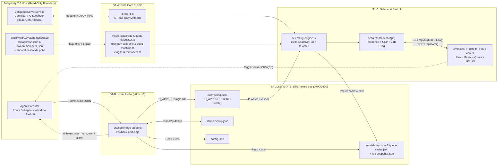

# Stage 1 Implementation Plan: MVP Core Telemetry Loop (`STAGE_1_MVP_LOOP_PLAN.md`)

> **Stage ID**: `Stage 1`  
> **Goal**: MVP Core Telemetry Loop: Dual-Channel RPC+Hook + 7-State Machine + `<8ms` Zero-Token Inline Stamp + `/hud` `AUX_PANE` Cockpit  
> **Canonical Blueprint**: [`00_MASTER_IMPLEMENTATION_BLUEPRINT.md`](./00_MASTER_IMPLEMENTATION_BLUEPRINT.md)  
> **Canonical PRD**: [`docs/PRODUCT_DESIGN.md`](../PRODUCT_DESIGN.md)  
> **Companion Ledgers**: [`DECISION_LOG.md`](./DECISION_LOG.md) · [`LESSONS_LEARNED.md`](./LESSONS_LEARNED.md)  
> **Status**: Planning Complete (MISSION I — Step M1.2); Pending MISSION II Execution  

---

## 1. Header, Preconditions, Downstream Consumers & RTM Scope

### 1.1 Stage Metadata

| Field | Value |
| :--- | :--- |
| **Stage ID** | `Stage 1` |
| **Stage Name** | MVP Core Telemetry Loop (`Dual-Channel RPC+Hook + /hud AUX_PANE`) |
| **Upstream Preconditions** | 1. `Stage 0` committed on `main` and `S0-QA` verdict is `PASS` (`docs/plans/STAGE_0_AUDIT.md`).<br>2. Frozen TypeScript contracts materialized in `src/types/telemetry.ts`, `src/types/rpc.ts`, `src/types/sidecar-sdk.d.ts`, `src/types/index.ts`.<br>3. Cross-process bus & config primitives materialized in `src/state/state-dir.ts` and `src/state/config-store.ts`.<br>4. Stitch-synced visual design & base HTML/CSS shell materialized in `DESIGN.md`, `sidecars/pulse_cockpit/styles.css`, `sidecars/pulse_cockpit/index.html`, and `sidecars/pulse_cockpit/sidecar.json`.<br>5. Build, test, and install tooling green (`package.json`, `tsconfig.json`, `scripts/build.mjs`, `scripts/build-tests.mjs`, `scripts/install.mjs`, Stage 0 minimal `scripts/preview-ui.mjs`, `hooks.json`, `plugin.json`, `mcp_config.json`).<br>6. Stage 0 `[CONTRACT_SYNC]` broadcast received and `npm run typecheck && npm run build && npm test` passing at Stage 0 commit. |
| **Downstream Consumers** | **Stage 2 (`S2-A`, `S2-B`, `S2-QA`)**: consumes `src/core/*`, `src/rpc/ls-client.ts`, `TelemetryEngine` cached metadata & snapshot hooks, `src/ui/state.ts` & `src/ui/hud-view.ts` tab hooks, and `scripts/preview-ui.mjs` (without modifying `src/ui/main.ts`).<br>**Stage 3 (`S3-A`, `S3-B`, `S3-QA`)**: consumes `$PULSE_STATE_DIR` snapshots (`live-snapshot.json`, `model-map.json`, `quota-cache.json`, `config.json`), `src/core/formatters.ts`, `src/core/model-catalog.ts`, `src/core/quota-calculator.ts`, and `src/rpc/ls-client.ts`. |
| **Target RTM Rows** | `RTM-01` (MVP core), `RTM-03`, `RTM-04`, `RTM-05`, `RTM-06`, `RTM-07` (core metadata/metrics), `RTM-08`, `RTM-09`, `RTM-10` (`/hud` + `/` alias + `/fleet` stub), `RTM-11`, `RTM-12`, `RTM-13`, `RTM-14`, `RTM-16`, `RTM-17`, `RTM-21`, `RTM-24`, `RTM-25` (`/api/hud` & `GetCascadeTrajectoryGeneratorMetadata`), `RTM-26`, `RTM-27` |

### 1.2 Mandatory Pre-Read Invariants (`D-001`–`D-007`, `L-001`–`L-007`)

Every Stage 1 implementation and referee agent (`S1-A`, `S1-B`, `S1-C`, `S1-QA`) MUST enforce these empirically verified constraints:

- **`L-001` (Int64 Strings)**: `usage.*` fields from `GetCascadeTrajectoryGeneratorMetadata` arrive as JSON strings (e.g. `"19353"`); always coerce via `toIntToken()`.
- **`L-002` (Cache Hit Formula)**: `inputTokens` is uncached tokens ONLY; `cacheHitPct = totalIn > 0 ? (cacheReadTokens / (inputTokens + cacheReadTokens)) * 100 : 0`.
- **`L-003` (`retryInfos` Baseline)**: Normal non-retried calls have `retryInfos.length === 1`. `retryCount = Math.max(0, (retryInfos?.length ?? 0) - 1)`; retry occurred ONLY when `retryInfos.length > 1`.
- **`L-004` (`stepOffset` Only)**: `GetCascadeTrajectorySteps` ignores `startIndex`/`endIndex`. Call ONLY when `status === "CASCADE_RUN_STATUS_RUNNING"`, ALWAYS passing `{ cascadeId, stepOffset: Math.max(0, stepCount - 4), disableRehydration: true }`.
- **`L-005` (`swarm/members.json` Object Map)**: `members` is `Record<string, SwarmMemberRaw>`, NOT an array. Always iterate via `Object.entries(data?.members ?? {})`.
- **`L-006` (Hook Stdout Contract)**: `PreToolUse` MUST emit `{"decision":"allow"}` even in error recovery; `PostToolUse`/`Stop` emit `{}`; `PostInvocation` emits `{}` or zero-token `injectSteps` with `systemMessage: ""` + `metadata.user_markdown`.
- **`L-007` (`SidecarApp` MIME & CSP)**: `SidecarApp.page()` defaults non-`.js` routes to `text/html` and omits custom headers for plain strings. Always import `Response` from `sidecar_sdk` and return `new Response(body, { contentType, headers })` for `/`, `/hud`, `/fleet`, `/styles.css`, and `/dist/ui.js`.
- **`D-002` (Canonical URI)**: Every inline stamp deep link uses `sidecar://antigravity-pulse/pulse_cockpit/hud`, and `server.ts` mounts `/` as an alias for `/hud`.
- **`D-003` (`$PULSE_STATE_DIR` Bus)**: Atomic `tmp + renameSync` (`0o700` dir / `0o600` files); `events.ring.jsonl` uses single-line `O_APPEND` and rotates at `512 KiB`.
- **`D-004` (Dual-Metric Hook Latency)**: Assert BOTH `in-process JS <= 8ms` (`process.hrtime.bigint()`) AND `OS fork+exec <= 50ms`, with zero network I/O.
- **`D-005` / `D-007` (Bundle & Token Hygiene)**: Prebuilt `dist/hook-probe.cjs` and `sidecars/pulse_cockpit/dist/{server.mjs,ui.js}` remain git-tracked with SPDX MIT headers; zero `rules/` injected into the plugin bundle.

### 1.3 Stage 0 Precondition Interfaces Consumed by Stage 1

Stage 1 consumes these Stage 0 modules as **read-only preconditions**:

- `src/types/telemetry.ts` & `src/types/index.ts`: `ModelTier`, `LifecyclePhase`, `InlineStampMode`, `ModelFamily`, `EffortTier`, `ModelConfigEntry`, `QuotaBucketView`, `QuotaSummaryView`, `CascadeNodeView`, `SmartGovernanceBanner`, `PulseUserConfig`, `UnchangedEtagResponse`, `HudSnapshotResponse`, `TimelineSnapshotResponse`, `FleetSnapshotResponse`, `HookRingEvent`.
- `src/types/rpc.ts`: `ClientModelConfigRaw`, `GetCascadeModelConfigDataResponse`, `QuotaBucketRaw`, `QuotaGroupRaw`, `RetrieveUserQuotaSummaryResponse`, `TrajectoryWorkspaceRaw`, `TrajectorySummaryRaw`, `GetAllCascadeTrajectoriesResponse`, `UsageRaw`, `ContextWindowMetadataRaw`, `CustomMetadataRaw`, `ChatStartMetadataRaw`, `ChatModelMetadataRaw`, `GeneratorMetadataEntryRaw`, `GetCascadeTrajectoryGeneratorMetadataRequest`, `GetCascadeTrajectoryGeneratorMetadataResponse`, `ToolCallRaw`, `TrajectoryStepMetadataRaw`, `TrajectoryStepRaw`, `GetCascadeTrajectoryStepsRequest`, `GetCascadeTrajectoryStepsResponse`, `SubagentDescriptorFileRaw`, `SwarmMemberRaw`, `SwarmMembersFileRaw`, `HookEventName`, `HookStdinPayload`, `HookStdoutResponse`.
- `src/types/sidecar-sdk.d.ts`: ambient module types for `sidecar_sdk` (`SidecarApp`, `Response`) and `Window.sidecar`.
- `src/state/state-dir.ts`: `UUID_REGEX`, `RING_MAX_BYTES`, `StateDirPaths`, `LiveSnapshotFile`, `ModelMapFile`, `QuotaCacheFile`, `StampDedupEntry`, `StampDedupFile`, `isValidUuid`, `assertValidUuid`, `resolveStateDir`, `getStatePaths`, `ensureStateDir`, `writeJsonAtomic`, `readJsonSafe`, `appendRingLine`, `rotateRingIfNeeded`.
- `src/state/config-store.ts`: `DEFAULT_PULSE_USER_CONFIG`, `validateConfigPatch`, `mergeConfig`, `loadConfig`, `saveConfig`, `updateConfigPartial`.
- `sidecars/pulse_cockpit/index.html` & `styles.css`: `<div id="pulse-app" class="pulse-app" data-view="hud" data-theme-mode="auto"><main id="app" class="pulse-main" aria-live="polite"></main></div>` plus Flexoki tokens (`--pulse-tier-{apex,workhorse,fast,orchestrator,alert}`, `--pulse-bg`, `--pulse-surface`, `--pulse-surface-alt`, `--pulse-fg`, `--pulse-muted`, `--pulse-border`, `--pulse-accent`, `--pulse-critical`) and `.pulse-*` layout primitives (`.pulse-tabs`, `.pulse-hero`, `.pulse-health-row`, `.pulse-progress`, `.pulse-matrix`, `.pulse-node-card`, `.pulse-pill`, `.pulse-banner`, `.pulse-fuel-bar`, `.tabular-nums`).

---

## 2. Stage 1 Dual-Channel Pipeline Architecture



---

## 3. Parallel Track Decomposition & Peer Sync Protocol

### 3.1 Strictly Disjoint Ownership Lock Table (Stage 1)

| Track ID | Role | Owned Write Paths (Strictly Disjoint) | Explicitly Excluded Paths | Read-Only Dependencies |
| :--- | :--- | :--- | :--- | :--- |
| **`S1-A`** | LS Connect-RPC, Core Calculations, Topology & 7-State Machine | `src/rpc/ls-client.ts`<br>`src/core/formatters.ts`<br>`src/core/etag.ts`<br>`src/core/model-catalog.ts`<br>`src/core/quota-calculator.ts`<br>`src/core/topology-builder.ts`<br>`src/core/state-machine.ts`<br>`tests/unit/core-*.test.ts`<br>`tests/unit/topology*.test.ts` | `src/core/timeline-builder.ts` (Stage 2 `S2-A`)<br>`src/core/fleet-builder.ts` (Stage 2 `S2-A`)<br>`src/hook/**`, `src/sidecar/**`, `src/ui/**` | `src/types/**`, `src/state/**`, `docs/plans/*` |
| **`S1-B`** | `<8ms` Hook Probe & `smart` Zero-Token Inline Stamp | `src/hook/hook-probe.ts`<br>`dist/hook-probe.cjs` (via build)<br>`tests/unit/hook-*.test.ts`<br>`tests/benchmarks/hook-latency.test.ts` | `src/core/**`, `src/rpc/**`, `src/sidecar/**`, `src/ui/**`, `hooks.json` | `src/types/**`, `src/state/**`, `src/core/formatters.ts` |
| **`S1-C`** | Sidecar Telemetry Engine, HTTP Server, `/hud` UI & Preview Fixture Server | `src/sidecar/telemetry-engine.ts`<br>`src/sidecar/server.ts`<br>`src/ui/state.ts`<br>`src/ui/hud-view.ts`<br>`src/ui/main.ts`<br>`scripts/preview-ui.mjs` (upgrade from Stage 0 stub)<br>`sidecars/pulse_cockpit/dist/**` (via build)<br>`tests/e2e/hud-loop.test.ts` | `src/ui/fleet-view.ts` (Stage 2 `S2-B`)<br>`sidecars/pulse_cockpit/styles.css` (Stage 0/2)<br>`src/core/**`, `src/rpc/**`, `src/hook/**` | `src/types/**`, `src/state/**`, `src/core/**`, `src/rpc/ls-client.ts`, `DESIGN.md`, `sidecars/pulse_cockpit/styles.css`, `sidecars/pulse_cockpit/index.html` |
| **`S1-QA`** | Stage 1 Independent Referee | `tests/contracts/readonly-guard.test.ts`<br>`tests/e2e/stage1-acceptance.test.ts`<br>`docs/plans/STAGE_1_AUDIT.md` | All `src/**`, `scripts/**`, `dist/**`, `sidecars/**` | Entire repository (read-only) |

> **Sequential Ownership Notes**:
> 1. `scripts/preview-ui.mjs` is created as a minimal static stub in Stage 0 (`S0-A`), then sequentially upgraded by `S1-C` in Stage 1 after Stage 0 commits.
> 2. `src/ui/main.ts` is owned exclusively by `S1-C` in Stage 1 and is **never modified in Stage 2**; `src/ui/main.ts` delegates view routing (`'/hud'`/`'/'` vs `'/fleet'`) to `src/ui/state.ts`, which renders a minimal Stage 1 `/fleet` placeholder until Stage 2 `S2-B` imports `src/ui/fleet-view.ts` inside `src/ui/state.ts`.

### 3.2 Peer Sync Checkpoints (`[CONTRACT_SYNC]`)

1. **`CP-1.0` (Precondition Verification Gate)**:
   - Orchestrator verifies Stage 0 commit SHA and `S0-QA` `PASS`, then broadcasts `[CONTRACT_SYNC]` confirming `src/types/**`, `src/state/**`, `sidecars/pulse_cockpit/index.html`, and `styles.css` are live.
2. **`CP-1.1` (`S1-A` Core & RPC API Freeze -> Unblocks `S1-B` & `S1-C` Imports)**:
   - `S1-A` completes and unit-tests `src/core/formatters.ts` (needed by `S1-B` for `formatInlineTurnStamp`), `src/rpc/ls-client.ts`, `src/core/{etag,model-catalog,quota-calculator,topology-builder,state-machine}.ts`.
   - `S1-A` broadcasts `[CONTRACT_SYNC]` with finalized exported function signatures before `S1-B` finalizes `formatInlineTurnStamp` integration and before `S1-C` wires `TelemetryEngine`. (During initial parallel startup, `S1-B` and `S1-C` program strictly against the signatures frozen in §4.1 below.)
3. **`CP-1.2` (`S1-B` Hook Ring & Dedup Parity Sync)**:
   - `S1-B` broadcasts `[CONTRACT_SYNC]` confirming `HookRingEvent` emission fields (`subagentRequest`, `modelRaw`, `toolCallId`, `toolName`, `toolSummary`, `hookDurationUs`) and `stamp-dedup.json` reads of `live-snapshot.json` / `model-map.json` / `quota-cache.json` match `S1-C` writer schemas.
4. **`CP-1.3` (Unified Build & Integration Checkpoint)**:
   - `S1-A`, `S1-B`, and `S1-C` complete all unit/benchmark/E2E tests. Orchestrator runs `npm run typecheck && npm run build && npm test` to regenerate `dist/hook-probe.cjs` and `sidecars/pulse_cockpit/dist/{server.mjs,ui.js}` cleanly and verify zero compile or integration skew.
5. **`CP-1.4` (`S1-QA` Independent Audit & Visual QA Gate)**:
   - `S1-QA` executes all automated test suites, static/runtime read-only guards, `agy plugin validate . --json` (repo root: `0` errors, `components.rules === 0`, only expected `AGENTS.md` workspace-rule warning) plus `npm run install:global && agy plugin validate ~/.gemini/config/plugins/antigravity-pulse --strict --json` (`0` errors, `0` warnings), and triggers/reviews `browser` subagent visual verification via `scripts/preview-ui.mjs`, writing `docs/plans/STAGE_1_AUDIT.md` (`PASS` or `FAIL`).

---

## 4. Track-by-Track Engineering Specifications

### 4.1 Track `S1-A`: LS Connect-RPC, Core Calculations, Topology & 7-State Machine

#### A. `src/rpc/ls-client.ts` (Read-Only Connect-RPC Client — `RTM-04`, `RTM-05`, `RTM-06`, `RTM-08`, `RTM-26`)

- **Constants & Guards**:
  ```ts
  export const READONLY_LS_METHODS = new Set([
    'GetCascadeModelConfigData',
    'RetrieveUserQuotaSummary',
    'GetAllCascadeTrajectories',
    'GetCascadeTrajectoryGeneratorMetadata',
    'GetCascadeTrajectorySteps',
  ] as const);

  export const FORBIDDEN_LS_METHODS = new Set([
    'DeleteCascadeTrajectory',
    'UpdateConversationAnnotations',
    'JetboxWriteState',
    'DeletePlugin',
    'InstallCustomization',
    'GetCascadeTrajectory', // banned heavy 500KB+ payload per RTM-25 / L-004
  ] as const);
  ```
- **Fail-Closed Enforcement**:
  - Export `ReadonlyRpcViolationError extends Error` and `LsConnectionError extends Error`.
  - Any call to `callReadonlyMethod(method, body)` MUST check `if (FORBIDDEN_LS_METHODS.has(method) || !READONLY_LS_METHODS.has(method))` and throw `ReadonlyRpcViolationError` **synchronously before constructing a URL or invoking `fetch`**.
- **Transport & Configuration**:
  - `export interface LsClientOptions { address?: string; csrfToken?: string; timeoutMs?: number; fetchFn?: typeof fetch; }`
  - Defaults `address` from `process.env.ANTIGRAVITY_LS_ADDRESS` and `csrfToken` from `process.env.ANTIGRAVITY_CSRF_TOKEN`. If missing, `isConfigured()` returns `false` and RPC methods throw `LsConnectionError('LS_NOT_CONFIGURED')` cleanly (sidecar runs offline/degraded without crashing).
  - Normalizes `address`: if it does not start with `http://` or `https://`, prepends `http://`.
  - Requests target `POST ${baseUrl}/exa.language_server_pb.LanguageServerService/${method}` with headers:
    - `'Content-Type': 'application/json'`
    - `'x-codeium-csrf-token': csrfToken`
  - Uses `AbortSignal.timeout(timeoutMs)` (default `2500ms`).
- **Typed Methods**:
  - `getCascadeModelConfigData(): Promise<GetCascadeModelConfigDataResponse>` -> `{}`
  - `retrieveUserQuotaSummary(): Promise<RetrieveUserQuotaSummaryResponse>` -> `{}`
  - `getAllCascadeTrajectories(): Promise<GetAllCascadeTrajectoriesResponse>` -> `{}`
  - `getCascadeTrajectoryGeneratorMetadata(cascadeId: string): Promise<GetCascadeTrajectoryGeneratorMetadataResponse>` -> `{ cascadeId }`
  - `getCascadeTrajectorySteps(cascadeId: string, stepCount: number): Promise<GetCascadeTrajectoryStepsResponse>` -> ALWAYS sends `{ cascadeId, stepOffset: Math.max(0, stepCount - 4), disableRehydration: true }` (`L-004`). Never accepts or sends `startIndex` or `endIndex`.

#### B. `src/core/formatters.ts` (`L-001`, `L-002`, `L-003`, `RTM-03`, `RTM-27`)

Exported pure helpers (reused directly by Stage 1 `S1-B`/`S1-C`, Stage 2 `S2-A`/`S2-B`, and Stage 3 `S3-A`/`S3-B`):

1. `toIntToken(v: unknown): number`:
   - `L-001`: parses string/number Int64 fields cleanly (`const n = typeof v === 'number' ? v : typeof v === 'string' && v.trim() !== '' ? Number(v) : 0; return Number.isFinite(n) && n >= 0 ? Math.trunc(n) : 0;`).
2. `computeCacheHitPct(inputTokens: number, cacheReadTokens: number): number`:
   - `L-002`: `const totalIn = inputTokens + cacheReadTokens; return totalIn > 0 ? (cacheReadTokens / totalIn) * 100 : 0;`.
3. `computeRetryCount(retryInfos: unknown[] | undefined | null): number`:
   - `L-003`: `return Math.max(0, (retryInfos?.length ?? 0) - 1);`.
4. `parseDurationMs(raw: string | number | null | undefined): number`:
   - Parses numeric ms or protobuf duration strings (`"8.738093225s"` -> `8738`, `"120ms"` -> `120`, `"1m5.5s"` -> `65500`, `"2h15m"` -> `8100000`). Returns `0` on invalid/negative input.
5. `formatDurationCompact(ms: number): string`:
   - `< 1000`: `${Math.round(ms)}ms`
   - `< 60_000`: `${(ms / 1000).toFixed(1)}s`
   - `< 3_600_000`: `${Math.floor(ms / 60_000)}m ${Math.floor((ms % 60_000) / 1000)}s`
   - `>= 3_600_000`: `${Math.floor(ms / 3_600_000)}h ${Math.floor((ms % 3_600_000) / 60_000)}m`
6. `formatTokensCompact(tokens: number): string`:
   - `< 1000`: `${tokens}`
   - `< 100_000`: `${(tokens / 1000).toFixed(1)}k` (strip `.0k` if exact `k` or keep `4.2k`, `38.8k`)
   - `< 1_000_000`: `${Math.round(tokens / 1000)}k`
   - `>= 1_000_000`: `${(tokens / 1_000_000).toFixed(2)}M`
7. `formatPct(pct: number | null | undefined, decimals = 1): string`:
   - Returns `'—'` if null/NaN, else `${pct.toFixed(decimals)}%`.
8. `formatDeltaQuotaPct(consumedPct: number | null | undefined): string`:
   - Sign convention: stored `delta5hPct` / `deltaQuota5hPct` / `treeNetDelta5hPct` is **non-negative consumed percentage points (`>= 0`)**; display adds leading `-`:
     - `null | undefined`: `'—'`
     - `consumedPct <= 0`: `'0.00%'`
     - `consumedPct > 0`: `-${consumedPct.toFixed(2)}%` (e.g. `"-0.41%"`, `"-1.68%"`).
9. `escapeHtml(raw: unknown): string`:
   - Replaces `&`, `<`, `>`, `"`, `'` with `&amp;`, `&lt;`, `&gt;`, `&quot;`, `&#39;` (`RTM-27`).
10. `formatInlineTurnStamp(input: InlineTurnStampInput): string`:
    - Formats canonical single-line zero-token `user_markdown` string:
      - Normal: `⚡ **Gemini 4 Carbon (High)** · \`gemini-4-carbon\` · TTFT 12.1s · CTX 15% · 5h 余量 84.3% · [Model Pulse](sidecar://antigravity-pulse/pulse_cockpit/hud)`
      - Prefix icon adapts to condition: `⚠` when `retryCount > 0 || routingStatus === 'mismatch_or_fallback' || contextPct > 75 || (gemini5hRemainingPct !== null && gemini5hRemainingPct < 20)`, `🔀` when model switched vs previous turn, `⚡` otherwise.
      - Includes `Retried ×${retryCount}` if `retryCount > 0`, and `Routed from ${requestedLabel}` if `routingStatus === 'routed'` or `'mismatch_or_fallback'`.
      - Escapes markdown special characters inside model/label strings and ALWAYS ends with `[Model Pulse](sidecar://antigravity-pulse/pulse_cockpit/hud)` (`D-002`).

#### C. `src/core/etag.ts` (`RTM-25`)

- `computeDeterministicEtag(payload: unknown): string`:
  - Recursively sorts object keys (deterministic canonical JSON stringification), computes `crypto.createHash('sha256').update(canonicalJson).digest('base64url').slice(0, 6)`.
  - Guarantees exact 6-char URL-safe ETag token so `JSON.stringify({ unchanged: true, etag })` is **exactly 34 bytes** (`{"unchanged":true,"etag":"xxxxxx"}` = 26 + 6 + 2 = 34 bytes).
- `makeUnchangedResponse(etag: string): UnchangedEtagResponse`:
  - Returns `{ unchanged: true, etag }`.
- `isEtagMatch(clientEtag: string | undefined | null, serverEtag: string): boolean`:
  - Strict string equality check after `trim()`.
- **Volatile Clock Exclusion Rule**:
  - `TelemetryEngine` computes `HudSnapshotResponse.etag` strictly over semantic state (`hostConnected`, `activeConversationId`, `rootCascadeId`, `breadcrumb`, `smartGovernanceBanner`, `quota`, `config`, `warnings`, and `treeNodes` **excluding** `phaseElapsedMs` ticks and top-level `generatedAt`). Thus steady-state polling between phase transitions returns the 34-byte cache hit while the browser's `100ms` timer increments active stopwatches smoothly from `phaseStartedAt`.

#### D. `src/core/model-catalog.ts` (`RTM-04`, `RTM-07`, `RTM-12`)

- `export interface ModelCatalog { defaultModelEnum: string | null; modelsByEnum: Record<string, ModelConfigEntry>; modelsById: Record<string, ModelConfigEntry>; }`
- `buildModelCatalog(data: GetCascadeModelConfigDataResponse | null | undefined): ModelCatalog`:
  - Extracts `defaultModelEnum` from `data?.defaultOverrideModelConfig?.modelOrAlias?.model ?? data?.defaultOverrideModelConfig?.modelOrAlias?.alias ?? null`.
  - Parses each `clientModelConfigs[]` entry:
    - Extracts `modelEnum` (`modelOrAlias?.model || modelOrAlias?.alias || modelId || label`), `modelId`, `label`, `tagTitle`, `quotaInfo`.
    - Normalizes `family`: `'gemini'` (`/gemini/i`), `'claude'` (`/claude|opus|sonnet|haiku/i`), `'openai'` (`/gpt|o[134]/i`), `'auto'` (`/orchestrator|\bauto\b/i`), else `'unknown'`.
    - Normalizes `effortTier`: `'xhigh'` (`/\bxhigh\b|\(xhigh\)/i`), `'high'` (`/\bhigh\b|\(high\)/i`), `'medium'` (`/\bmed(ium)?\b|\(medium\)/i`), `'low'` (`/\blow\b|\(low\)/i`), `'flash'` (`/flash/i`), `'auto'` (`/orchestrator|\bauto\b/i`), else `'unknown'`.
    - Sets `isOrchestrator = family === 'auto' || /orchestrator/i.test(label) || /orchestrator/i.test(modelId)`.
    - Classifies `tier` via `classifyModelTier(family, effortTier, isOrchestrator, label, modelId)`:
      - `isOrchestrator` -> `'orchestrator'`
      - `effortTier === 'xhigh'` OR (`effortTier === 'high'` && `/hydrogen|carbon|opus/i.test(label + ' ' + modelId)`) -> `'apex'`
      - `effortTier === 'flash'` OR `/flash|haiku|flash_lite/i.test(label + ' ' + modelId)` OR (`family === 'gemini'` && `/argon/i.test(label + ' ' + modelId)` && `effortTier === 'low'`) -> `'fast'`
      - Otherwise (e.g. `Carbon (Med/Low)`, `Argon (High/Med)`, `Sonnet`, `Pro`, `GPT`) -> `'workhorse'`.
  - Built-in static fallback aliases for subagent short-names & known placeholders when LS is offline (`inherit`, `pro`, `flash`, `flash_lite`, `MODEL_PLACEHOLDER_M427`, `MODEL_PLACEHOLDER_M418`, `MODEL_PLACEHOLDER_M667`).
- `decodeModelDescriptor(raw: string | null | undefined, catalog: ModelCatalog): ModelConfigEntry | null`:
  - Exact lookup in `catalog.modelsByEnum[raw]` -> `catalog.modelsById[raw]` -> case-insensitive label/modelId match -> built-in alias/heuristic synthesis.
- `computeContextWindow(meta: ContextWindowMetadataRaw | undefined, thresholds?: { warnPct?: number; criticalPct?: number }): CascadeNodeView['contextWindow']`:
  - Parses `estimatedTokensUsed` and `maxContextTokens` via `toIntToken()`. When `maxContextTokens === 0`, returns `pct = 0` and `level = 'normal'` so uninitialized conversations never fabricate a `256k` denominator; otherwise computes `pct = (estimatedTokensUsed / maxContextTokens) * 100`.
  - `level`: `pct > criticalPct (85)` -> `'critical_85'`; `pct > warnPct (70)` -> `'warn_70'`; else `'normal'`.
- `reconcileRequestedVsServed(params)`:
  - Determines `requestedModel`: prefers explicit subagent/swarm/hook requested model, else `customMetadata.model_enum`, else `catalog.defaultModelEnum`. Resolves `displayName` & `modelId` via `decodeModelDescriptor()`.
  - Determines `servedModel`: from latest `GeneratorMetadataEntryRaw.chatModel` (`responseModel`, `modelDisplayName`, `model`), decoded via `decodeModelDescriptor()` and classified with `classifyModelTier()`. If no `generatorMetadata` exists yet (e.g. `PRE_FLIGHT` or active swarm `applied_model`), uses `applied_model` / `step.metadata.generatorModel` as provisional `servedModel`.
  - Computes `retryCount = computeRetryCount(latestGenMeta?.chatModel?.retryInfos)` (`L-003`).
  - Computes `routingStatus`:
    - `retryCount > 0` -> `'retrying'`
    - No served response yet -> `'unknown'`
    - `requested` is `Auto` / `Orchestrator` / `inherit` / `'pro'` alias / `'unknown'` -> `'routed'`
    - `requested` concrete model differs in canonical base model or downgraded tier vs `served` -> `'mismatch_or_fallback'`
    - Otherwise -> `'matched'`.

#### E. `src/core/quota-calculator.ts` (`RTM-05`, `RTM-14`, `RTM-16`)

- `formatResetCountdown(resetTime: string | null | undefined, nowMs = Date.now()): { resetInSeconds: number | null; resetInLabel: string }`:
  - Parses ISO timestamp; clamps `diffSec = Math.max(0, Math.floor((targetMs - nowMs) / 1000))`.
  - Formats `resetInLabel`: `diffSec <= 0` -> `'已重置'` / `'0m'`; `< 3600` -> `${Math.ceil(diffSec / 60)}m`; `< 86400` -> `${Math.floor(diffSec / 3600)}h ${Math.floor((diffSec % 3600) / 60)}m`; `>= 86400` -> `${Math.floor(diffSec / 86400)}d ${Math.floor((diffSec % 86400) / 3600)}h`.
- `normalizeQuotaSummary(raw, prevCache, activeTreeNodeIds, fetchedAt, burnSamples)`:
  - Iterates `raw?.response?.groups ?? []` and `group.buckets ?? []`.
  - Preserves full precision `remainingFraction` (8-decimal float from LS, clamped `[0, 1]`) and `remainingPct = remainingFraction * 100`.
  - Maps canonical slots:
    - `gemini5h`: `bucketId === 'gemini-5h'` (fallback `/gemini.*5h/i`)
    - `geminiWeekly`: `bucketId === 'gemini-weekly'` (fallback `/gemini.*week/i`)
    - `thirdParty5h`: `bucketId === '3p-5h'` (fallback `/3p.*5h|claude.*5h/i`)
    - `thirdPartyWeekly`: `bucketId === '3p-weekly'` (fallback `/3p.*week|claude.*week/i`)
  - Marks `isLowAlert = remainingPct < 15` (`RTM-16` / `00_MASTER_IMPLEMENTATION_BLUEPRINT.md` §3.4).
- **Per-Cascade & Per-Tree Net `ΔQuota%` (`updateCascadeQuotaBaselines`)**:
  - `cascadeBaselines[cid]` stores `{ firstSeenAt, baseline5hFraction, last5hFraction, delta5hPct }` in `quota-cache.json` (`delta5hPct >= 0`, stored as positive consumed percentage points).
  - On each quota refresh where `currGlobal5h <= prevGlobal5h`, compute the global bucket drop `tickDropPct = Math.max(0, (prevGlobal5h - currGlobal5h) * 100)`.
  - When `currGlobal5h > prevGlobal5h + 0.005` (indicating a 5h rolling window reset), reset `baseline5hFraction = currGlobal5h` and `last5hFraction = currGlobal5h` on tracked baselines while preserving accumulated non-negative `delta5hPct`.
  - Distribute `tickDropPct` across cascades that were `RUNNING` or whose `stepCount` incremented since the previous quota sample (weighted by recent token delta `Δ(inputTokens + outputTokens)` when available, otherwise split evenly across those active cascades), updating `last5hFraction = currGlobal5h` and incrementing each attributed cascade's `delta5hPct`. This preserves 8-decimal fraction precision (`0.84972906 -> 0.84324217 => 0.648689%`) for single cascades while preventing `N×` over-counting across concurrent sibling subagents sharing the same global bucket.
  - Compute `treeNetDelta5hPct` as the non-negative sum of `cascadeBaselines[cid].delta5hPct` across `activeTreeNodeIds`.
- `computeBurnRate5hPctPerMin(samples)`:
  - Computes sliding-window positive drop rate (`sum(positiveDropsPct) / elapsedMinutes`) over samples from the last `5 min` (requires `elapsedMs >= 10_000` and `positiveDropsPct > 0`, else `null`).
- `evaluateSmartGovernanceBanner(treeNodes, gemini5hRemainingPct, burnRatePctPerMin, config)`:
  - Counts `heavyConcurrentCount` across `treeNodes` where `phase !== 'IDLE' && phase !== 'ERROR_OR_QUOTA'` and `servedModel.tier === 'apex'` (matching Blueprint §3.4: active running nodes in the tree at `'apex'` tier).
  - Activates if and only if `heavyConcurrentCount >= config.smartThresholds.heavyConcurrentAlertCount` (default `3`) AND `(gemini5hRemainingPct ?? 100) < config.smartThresholds.heavyQuotaThresholdPct` (default `40`), with unit tests covering boundary cases (`2` vs `3` active apex nodes, `39.9%` vs `40.0%` quota).

#### F. `src/core/topology-builder.ts` (`RTM-06`, `RTM-09`)

- **Named Public Exports (reused by Stage 1 `TelemetryEngine` and Stage 2 `fleet-builder.ts`)**:
  - `export function readFallbackTitleFromAnnotations(antigravityDataDir: string, cascadeId: string): string | null`: strictly read-only parse of `<antigravityDataDir>/annotations/<cid>.pbtxt` extracting `title: "..."` (unescaping `\"` / `\\`).
  - `export function resolveCascadeTitle(summary: TrajectorySummaryRaw | undefined, antigravityDataDir: string, cascadeId: string, role?: string | null): string`: implements the canonical 4-step title fallback chain (`RTM-06`):
    1. `summary?.summary` (non-empty trimmed string)
    2. `readFallbackTitleFromAnnotations(antigravityDataDir, cascadeId)`
    3. Basename of first workspace URI (`summary?.workspaces?.[0]?.workspaceFolderAbsoluteUri`)
    4. `role` (for subagents) or `Cascade ${cascadeId.slice(0, 8)}`.
  - `export function buildTopologyGraph(input: TopologyBuildInput): TopologyBuildOutput`: performs recursive three-source read-only fusion + `T=0ms` pre-flight overlay.
  1. **Source 1 — Subagents JSON**: Reads `<antigravityDataDir>/brain/<cid>/.system_generated/subagents/*.json`. Extracts `conversationId`, `subagentDescriptor.typeName`, `subagentDescriptor.role`, `state`, `spawnStepIndex`, `workspaceUris`, linking `parentCascadeId = cid`.
  2. **Source 2 — Swarm Members JSON (`L-005`)**: Reads `<antigravityDataDir>/brain/<cid>/.system_generated/swarm/members.json`. Iterates `Object.entries(data?.members ?? {})` (NEVER `.map()`), creating/enriching `swarm_member` nodes (`memberName`, `conversation_id`, `role`, `desired_state`, `desired_model`, `applied_model`, `model`, `phase`, `wake_mode`, `killed`), linking `parentCascadeId = cid`.
  3. **Source 3 — Metadata & Optional Read-Only SQLite Fallback**: Inspects `generatorMetadata[].chatModel.customMetadata.parent_cascade_id` & `root_cascade_id` across all known cascades to attach multi-level grandchild subagents (`depth >= 2`) and `run_workflow` cascades. If `parent_cascade_id` is still unresolved for a known child and `antigravityDataDir/conversations/<cid>.db` exists, optional read-only fallback opens `file:<path>?mode=ro` ONLY (never writable!) if needed.
  4. **Pre-Flight Hook Overlay (`T=0ms`)**: For recent `PreToolUse` `HookRingEvent` entries with `toolName === 'invoke_subagent'` & `subagentRequest`, if no matching `subagents/*.json` entry has materialized yet within the last `15s`, synthesizes a temporary `preflight:${parentCid}:${toolCallId}` node (`phase: 'PRE_FLIGHT'`, `role`, `typeName`, `requestedModel` from `subagentRequest.model`), automatically deduplicated once the real `subCid` appears.
- **Title Fallback Chain (`RTM-06`)**:
  1. `trajectorySummary.summary` (non-empty)
  2. Read-only `<antigravityDataDir>/annotations/<cid>.pbtxt` regex extraction of `title: "..."` (unescaping `\"` / `\\`)
  3. Basename of first `trajectorySummary.workspaces[0].workspaceFolderAbsoluteUri` (or `subagent.workspaceUris[0]`)
  4. `role` (for subagents) or `Cascade ${cid.slice(0, 8)}`.
- **Cycle-Safe Tree Assembly**:
  - Resolves `rootCascadeId` by walking `parentCascadeId` up with a visited `Set<string>` guard (prevents infinite loops on malformed metadata).
  - Computes DFS `depth` (`0` for root, `1` for direct children, `2+` for grandchildren), populates sorted `childrenIds`, aggregates `tokens` / `cacheHitPct` / `contextWindow`, and computes `breadcrumbFor(activeCid)` (`root -> ... -> activeCid`).

#### G. `src/core/state-machine.ts` (`RTM-21`)

- **7 States**: `IDLE`, `PRE_FLIGHT`, `THINKING`, `STREAMING`, `TOOL_RUNNING`, `BLOCKED_APPROVAL`, `ERROR_OR_QUOTA`.
- **Deterministic Priority & Dual-Channel Transitions**:
  1. **Error / Quota Check**: If `latestExecutorTerminationReason` matches `/RESOURCE_EXHAUSTED|429|QUOTA|ERROR|FAILED/i` (and cascade is not actively running a fresh recovery turn) or tail step has an error status -> `ERROR_OR_QUOTA`.
  2. **Anti-Stale Reconciler (Hard Invariant)**: If LS is connected and `trajectorySummary.status !== 'CASCADE_RUN_STATUS_RUNNING'`:
     - Unconditionally converge any active phase (`PRE_FLIGHT`, `THINKING`, `STREAMING`, `TOOL_RUNNING`, `BLOCKED_APPROVAL`) -> `IDLE` (unless error condition -> `ERROR_OR_QUOTA`), **except** within a tiny `<= 1500ms` grace window after a `PreInvocation` hook before LS summary catches up — and NEVER keep stale active state once `status` returns non-running or after `Stop` hook!
  3. **Active `RUNNING` Tail-Step Inspection (`L-004` tail 4 steps)**:
     - Latest step `CORTEX_STEP_STATUS_GENERATING`:
       - Has `metadata.viewableAt` and NO `metadata.finishedGeneratingAt` -> `STREAMING` (compute provisional `streamingTokPerSec` from token/time deltas if available, else `null`).
       - No `metadata.viewableAt` -> `THINKING` (TTFT timer anchored at step start or `PreInvocation.ts`).
     - Latest step `CORTEX_STEP_STATUS_RUNNING` with `metadata.toolCall`:
       - If awaiting user approval (explicit waiting status / `ask` signal / `PreToolUse` approval wait `> 3000ms` without `PostToolUse`) -> `BLOCKED_APPROVAL`.
       - Else -> `TOOL_RUNNING` (`lastTool = { id, name, summary, startedAt }`).
  4. **Hook `T=0ms` Acceleration**:
     - Newer `HookRingEvent` (`event.ts > lastLsStepUpdateMs` while `RUNNING` or within grace window):
       - `PreInvocation` -> `PRE_FLIGHT` (or `THINKING` once generation starts)
       - `PreToolUse` -> `TOOL_RUNNING` (capturing `toolName`, `toolSummary`, `toolCallId` immediately)
       - `PostToolUse` -> `THINKING`
       - `Stop` -> `IDLE`.

#### H. `S1-A` Test Deliverables (`tests/unit/`)

- `tests/unit/core-metrics.test.ts`: Int64 string parsing (`L-001`), Cache Hit formula (`L-002`: `1000+9000 -> 90%`, `0+5000 -> 100%`, `0+0 -> 0%`), `retryInfos` (`L-003`: `0->0`, `1->0`, `3->2`), duration parsers, `escapeHtml` XSS vectors, `formatDeltaQuotaPct` sign convention, `formatInlineTurnStamp` canonical URI.
- `tests/unit/core-catalog.test.ts`: `MODEL_PLACEHOLDER_M427` / `M418` / `M667` decoding, `defaultOverrideModelConfig`, 5-tier classification, `reconcileRequestedVsServed` (`matched`, `routed`, `mismatch_or_fallback`, `retrying`), context window boundaries (`70%`, `70.1%`, `85%`, `85.1%`).
- `tests/unit/core-quota.test.ts`: 8-decimal `remainingFraction` delta precision, bucket mapping (`gemini-5h`, `gemini-weekly`, `3p-5h`, `3p-weekly`), bucket reset recovery, concurrent delta non-overcounting, `evaluateSmartGovernanceBanner` truth table (`2 vs 3` apex nodes, `39.9% vs 40.0%` quota).
- `tests/unit/core-state-machine.test.ts`: all 7 states, hook-to-LS handover, `BLOCKED_APPROVAL`, `ERROR_OR_QUOTA`, Anti-Stale Reconciler killing phantom `THINKING`/`TOOL_RUNNING` when LS `status !== RUNNING`.
- `tests/unit/core-etag.test.ts`: deterministic key-order invariance, volatile clock exclusion, exact 34-byte `{ unchanged: true, etag }` serialization.
- `tests/unit/topology-builder.test.ts`: multi-level `subagents/*.json` + `swarm/members.json` object map (`L-005`) + `customMetadata.parent_cascade_id` + `.pbtxt` title fallback (`summary: null`, `RTM-06`) + workspace basename fallback + pre-flight `subagentRequest` overlay & dedup + cycle guard.

---

### 4.2 Track `S1-B`: `<8ms` Hook Probe & `smart` Zero-Token Inline Stamp (`RTM-03`, `RTM-17`, `RTM-24`)

#### A. Architecture of `src/hook/hook-probe.ts` -> `dist/hook-probe.cjs`

- **Exported Pure API + CLI Runner**:
  - `export function processHookPayload(rawStdin: string, options?: HookProbeOptions): HookProbeResult` (used directly by unit tests and in-process latency benchmark `tests/benchmarks/hook-latency.test.ts`).
  - `export function runHookCli(): void` (invoked when `require.main === module` or bundled entry in `dist/hook-probe.cjs`).
- **Hard Performance & Isolation Guardrails**:
  - **Zero Network I/O**: Strictly NO `http`, `https`, `net`, `fetch`, or Connect-RPC calls inside `src/hook/**`.
  - **Zero Directory Scans**: Only direct path reads (`readFileSync` of `config.json`, `model-map.json`, `quota-cache.json`, `live-snapshot.json`, `stamp-dedup.json`) and single-line `O_APPEND` via `appendRingLine` to `events.ring.jsonl`.
  - **Synchronous Stdin Read**: `fs.readFileSync(0, 'utf-8')` wrapped in `try/catch` (handles empty stdin, partial EOF, or invalid JSON gracefully without hanging or throwing).
  - **Fail-Open Exit `0` Invariant (`L-006`)**: Outer `try/catch` ensures `process.exitCode = 0` in 100% of failure modes (corrupt JSON, unwritable `$PULSE_STATE_DIR`, missing caches), ALWAYS emitting the safe per-event fallback stdout:
    - `PreToolUse` -> `{"decision":"allow"}`
    - `PostToolUse` / `Stop` / `PreInvocation` / `PostInvocation` / unknown -> `{}`

#### B. Event Normalization & Stdout Dispatch Matrix

- **Defensive Stdin Parsing**:
  - Accepts both camelCase and snake_case Antigravity hook fields (`hookEventName` / `hook_event_name`, `conversationId` / `conversation_id`, `invocationNum` / `invocation_num`, `model` / `modelName` / `model_name`, `toolName` / `tool_name`, `toolCallId` / `tool_call_id`, `toolInput` / `tool_input`, `stopReason` / `stop_reason`).
  - Validates `conversationId` against `UUID_REGEX` before using it as a map key in `stamp-dedup.json` (non-UUID values fall back cleanly to `'unknown'` without crashing).
  - When `toolName === 'invoke_subagent'`, extracts `subagentRequest: { role, typeName, model }` from `toolInput` (`Role`/`role`, `TypeName`/`typeName`/`subagent_type`, `Model`/`model`).
  - Extracts concise `toolSummary` (e.g. `toolInput.ToolSummary || toolInput.CommandLine || toolInput.TargetFile || toolInput.query` truncated to `80` chars).
- **Atomic Ring Append**:
  - Appends one single-line JSON `HookRingEvent` (`ts`, `iso`, `event`, `conversationId`, `invocationNum`, `modelRaw`, `modelDisplay`, `toolName`, `toolCallId`, `toolSummary`, `subagentRequest`, `stopReason`, `hookDurationUs`) via `appendRingLine` (`O_APPEND`).
- **Stdout Dispatch (`L-006`)**:
  - `PreToolUse` -> `{"decision":"allow"}`
  - `PostToolUse` -> `{}`
  - `Stop` -> `{}` (advances local turn epoch in `stamp-dedup.json` if `invocationNum` was absent so next turn resets cleanly)
  - `PreInvocation` -> `{}`
  - `PostInvocation` -> Evaluates inline stamp policy (`off` / `every-turn` / `smart`):
    - If NOT triggered -> `{}`
    - If triggered ->
      ```json
      {
        "injectSteps": [
          {
            "systemMessage": {
              "systemMessage": "",
              "metadata": {
                "user_markdown": "..."
              }
            }
          }
        ]
      }
      ```
      where `systemMessage.systemMessage` is strictly `""` (`0` LLM tokens, `RTM-03`) and `user_markdown` is generated by `formatInlineTurnStamp()` linking `sidecar://antigravity-pulse/pulse_cockpit/hud` (`D-002`).

#### C. `smart` Inline Stamp Decision Matrix & Turn-Key Dedup (`RTM-17`)

Reads `$PULSE_STATE_DIR/config.json` (default `inlineStampMode: 'smart'`), `$PULSE_STATE_DIR/live-snapshot.json` (if present for latest served model, TTFT, CTX %, retryCount), `$PULSE_STATE_DIR/model-map.json`, `$PULSE_STATE_DIR/quota-cache.json`, and `$PULSE_STATE_DIR/stamp-dedup.json`:

1. **`off`**: Never stamps; returns `{}`.
2. **`every-turn`**: Stamps once per turn key (`invocationNum` if provided, else monotonic `turnEpoch`), skipping duplicates on identical `(conversationId, turnKey)`.
3. **`smart` (Default)**:
   - Dedup check: if `entry?.lastTurnStamped && entry.lastInvocationNum === turnKey`, skip (`{}`) so multi-step tool turns sharing an invocation never double-stamp, while single-turn toolless sessions (`PreInvocation` -> `PostInvocation` -> `Stop`) stamp **once cleanly**.
   - Evaluates 5 trigger predicates:
     1. **Turn 1 ("出生证明")**: `!entry || !entry.lastTurnStamped` (first response in this root or subagent conversation).
     2. **Model Changed**: `servedModelId !== '' && entry.lastServedModel !== '' && servedModelId !== entry.lastServedModel`.
     3. **Retry or Fallback**: `retryCount > 0 || routingStatus === 'mismatch_or_fallback'`.
     4. **Context Threshold Crossed (`> 75%`)**: `contextPct > config.smartThresholds.stampContextTriggerPct` AND `entry.lastContextAlertPct <= config.smartThresholds.stampContextTriggerPct`.
     5. **5h Quota Threshold Crossed (`< 20%`)**: `gemini5hRemainingPct !== null && gemini5hRemainingPct < config.smartThresholds.quotaLowTriggerPct` AND `!entry.lastQuotaAlerted`.
   - Updates `stamp-dedup.json` atomically (`writeJsonAtomic`), pruning oldest entries by `updatedAt` whenever `Object.keys(byConversation).length > 200`.

#### D. `S1-B` Tests & Latency Benchmark (`D-004`)

- `tests/unit/hook-probe.test.ts`:
  - Verifies exact stdout for `PreToolUse` (`{"decision":"allow"}`), `PostToolUse` (`{}`), `Stop` (`{}`), `PreInvocation` (`{}`).
  - Verifies `off` vs `every-turn` vs all 5 `smart` triggers (`Turn 1`, `model change`, `retryInfos > 1`, `CTX > 75%`, `5h < 20%`).
  - Verifies single-turn toolless session stamps once, multi-step turn dedup prevents double-stamping, `>200` LRU pruning works, and `systemMessage.systemMessage === ""` + canonical URI `sidecar://antigravity-pulse/pulse_cockpit/hud`.
  - Verifies fault isolation: corrupted stdin JSON, missing state dir, and unwritable state dir still exit `0` and emit `{"decision":"allow"}` for `PreToolUse` / `{}` otherwise.
- `tests/benchmarks/hook-latency.test.ts`:
  - **Metric 1 (In-Process JS Handler)**: runs `processHookPayload()` `100` iterations timed with `process.hrtime.bigint()`; asserts median and p95 `<= 8.0ms`.
  - **Metric 2 (End-to-End OS `fork+exec` Child Process)**: spawns `process.execPath dist/hook-probe.cjs` across `10` runs with realistic `PostInvocation` & `PreToolUse` stdin; asserts median `<= 50.0ms` (with zero network calls verified).

---

### 4.3 Track `S1-C`: Sidecar Telemetry Engine, HTTP Server, `/hud` UI & Preview Server

#### A. `src/sidecar/telemetry-engine.ts` (`RTM-08`, `RTM-14`, `RTM-21`, `RTM-25`)

- **Lifecycle & Scheduling**:
  - `constructor(options: TelemetryEngineOptions)` accepting `{ lsClient, statePaths, antigravityDataDir, initialConfig?, onWarning? }` for clean DI in tests and production.
  - `start()`: loads initial `config.json`, `model-map.json`, `quota-cache.json`, performs initial `refreshOnce()`, starts `fs.watch` on `$PULSE_STATE_DIR` (debounced `50ms` + fallback ring read on every poll cycle so platforms with delayed `fs.watch` never drop events), and arms adaptive poll timer (`1000ms` when any node is `CASCADE_RUN_STATUS_RUNNING` or a ring event arrived within `5s`; `3000ms` when all cascades are `IDLE`).
  - `stop()`: clears timers, closes `fs.watch` watcher cleanly.
- **Incremental Polling & Cache Discipline (`RTM-25`, `L-004`)**:
  1. `GetCascadeModelConfigData`: refreshed on startup, every `pollIntervalsMs.modelConfig` (`30_000ms`), or immediately if an unseen `modelEnum` appears. Writes `model-map.json` when changed.
  2. `GetAllCascadeTrajectories`: called every poll cycle (`1s` active / `3s` idle).
  3. `GetCascadeTrajectoryGeneratorMetadata`: called **ONLY** when `cascadeId` has no cached metadata OR `summary.stepCount > cachedStepCount[cascadeId]` (plus newly attached active conversation if uncached). **NEVER** calls `GetCascadeTrajectory`.
  4. `GetCascadeTrajectorySteps`: called **ONLY** for cascades where `summary.status === 'CASCADE_RUN_STATUS_RUNNING'`, using `getCascadeTrajectorySteps(cid, summary.stepCount)` (`stepOffset: Math.max(0, stepCount - 4), disableRehydration: true`).
  5. `RetrieveUserQuotaSummary`: refreshed on startup, every `pollIntervalsMs.quota` (`30_000ms`), and immediately after any active cascade's `stepCount` increments or transitions `RUNNING -> IDLE`.
  6. **Ring Tail & Rotation**: tracks `ringByteOffset` across `events.ring.jsonl`; parses newly appended lines into per-cascade recent hook event ring buffers (kept bounded to last 32 events per cascade); invokes `rotateRingIfNeeded(paths.stateDir, RING_MAX_BYTES)` (matching Stage 0's `rotateRingIfNeeded(overrideDir?: string, maxBytes = RING_MAX_BYTES)`) and resets `ringByteOffset = 0` upon rotation or file truncation.
- **Snapshot Materialization & Stage 2/Stage 3 Seams**:
  - Builds unified topology via `buildTopologyGraph(...)`, derives 7-state phase + Anti-Stale Reconciler via `state-machine.ts`, computes quota summary + cascade deltas + burn rate + `SmartGovernanceBanner` via `quota-calculator.ts`.
  - Resolves `live-snapshot.json.activeConversationId` deterministically:
    1. Most recent valid `/api/hud` requested `conversationId` (within last `60s`), OR
    2. Latest `HookRingEvent.conversationId` present in known trajectories, OR
    3. Most recently modified `CASCADE_RUN_STATUS_RUNNING` root cascade, OR
    4. Most recently modified root cascade overall, OR `null`.
  - Atomically persists `live-snapshot.json` (with a schema-valid minimal `FleetSnapshotResponse` stub in Stage 1 so Stage 3 CLI/MCP readers never hit undefined keys), `model-map.json`, and `quota-cache.json`.
  - Exposes Stage 1 endpoints & Stage 2 (`S2-A`) extension getters:
    - `getHudSnapshot(conversationId: string | null, clientEtag?: string): HudSnapshotResponse | UnchangedEtagResponse`
    - `getTimelineSnapshot(conversationId: string | null, scope: 'conversation' | 'tree', clientEtag?: string): TimelineSnapshotResponse | UnchangedEtagResponse` (Stage 1 returns empty `turns: []` stub with valid deterministic `etag`)
    - `getFleetSnapshot(clientEtag?: string): FleetSnapshotResponse | UnchangedEtagResponse` (Stage 1 returns minimal valid `FleetSnapshotResponse` stub)
    - Stage 2 getters: `getAllGeneratorMetadataByCascade()`, `getCachedModelCatalog()`, `getCachedTrajectories()`, `getCachedQuotaState()`, `getCascadeBaselines()`, `getCascadeDelta5hPct(cid)`, `getCachedNodesByCascadeId()`, `getRootByCascadeId()`.

#### B. `src/sidecar/server.ts` -> `sidecars/pulse_cockpit/dist/server.mjs` (`L-007`, `RTM-10`, `RTM-27`)

- Imports `{ SidecarApp, Response } from 'sidecar_sdk'` (`sidecar_sdk` marked `external` in `scripts/build.mjs`).
- **CSP & Asset Headers**:
  ```ts
  const STRICT_CSP =
    "default-src 'self'; script-src 'self'; style-src 'self' 'unsafe-inline'; img-src 'self' data:; connect-src 'self'; frame-ancestors *";
  ```
  - Static routes wrapped in `new Response(body, { contentType, headers })` (`L-007`):
    - `GET /` & `GET /hud`: reads `index.html`, injects `data-view="hud"`, returns `text/html; charset=utf-8` + `Content-Security-Policy: STRICT_CSP` + `X-Content-Type-Options: nosniff`.
    - `GET /fleet`: reads `index.html`, injects `data-view="fleet"`, returns `text/html; charset=utf-8` + `STRICT_CSP` + `X-Content-Type-Options: nosniff`.
    - `GET /styles.css`: returns `sidecars/pulse_cockpit/styles.css` with `text/css; charset=utf-8` + `X-Content-Type-Options: nosniff`.
    - `GET /dist/ui.js`: returns `sidecars/pulse_cockpit/dist/ui.js` with `application/javascript; charset=utf-8` + `X-Content-Type-Options: nosniff`.
- **API Routes**:
  - `GET /api/hud`: validates `conversationId` (when non-empty) against `UUID_REGEX` (`/^[0-9a-f-]{36}$/i`); invalid returns `new Response(JSON.stringify({ error: 'Invalid conversationId' }), { status: 400, contentType: 'application/json' })`. Passes `etag` to `engine.getHudSnapshot(conversationId, etag)` (returns 34-byte `{ unchanged: true, etag }` on cache hit).
  - `GET /api/timeline`: validates `conversationId` against `UUID_REGEX` (returning HTTP `400` `Response` on invalid UUID), returns Stage 1 stub `engine.getTimelineSnapshot(...)`.
  - `GET /api/fleet`: returns Stage 1 stub `engine.getFleetSnapshot(...)`.
  - `GET /api/config`: returns `engine.getConfig()`.
  - `POST /api/config`: protected automatically by `SidecarApp`'s `x-sidecar-token` guard (`401` when `ANTIGRAVITY_SIDECAR_UI_TOKEN` mismatches); validates allowed patch fields (`inlineStampMode`, `hudSortMode`, `timelineScope`, `smartThresholds`) via `validateConfigPatch()`. On invalid patch payload or validation error, explicitly returns `new Response(JSON.stringify({ error }), { status: 400, contentType: 'application/json' })` (never `throw`, which `SidecarApp.api()` converts into HTTP `500`). On valid patch, persists via `engine.updateConfig()` and returns updated `PulseUserConfig`.
  - `GET /api/health`: returns `{ ok: true, version, lsConnected, stateDir, uptimeMs }`.
- **Exported Factory**: `export async function createPulseSidecarServer(options?)` (for E2E tests in `tests/e2e/hud-loop.test.ts` and `stage1-acceptance.test.ts`) + auto-start when run as entrypoint `server.mjs`.

#### C. `src/ui/main.ts`, `src/ui/state.ts` & `src/ui/hud-view.ts` -> `sidecars/pulse_cockpit/dist/ui.js` (`RTM-11`, `RTM-12`, `RTM-13`, `RTM-14`, `RTM-16`, `RTM-27`)

- **`src/ui/main.ts`** (thin immutable bootstrap, untouched in Stage 2):
  - Waits for DOMContentLoaded if needed, mounts onto `document.getElementById('app') ?? document.body` via `mountPulseUi(root)` imported from `./state`.
- **`src/ui/state.ts`**:
  - Determines active route from `window.location.pathname` (`'/fleet'` -> renders Stage 1 clean Fleet placeholder card in `<main id="app">`; `'/hud'` or `'/'` -> mounts `/hud` controller & `renderHudView`).
  - Resolves `conversationId` from `window.sidecar?.conversationId` or URL `?conversationId=`.
  - Uses `window.sidecar?.fetch ?? fetch` (automatically injects `X-Sidecar-Token` inside Antigravity host WebView and works natively in browser preview).
  - Adaptive client poll loop (`1000ms` active / `2500ms` idle) sending `?conversationId=...&etag=...`; skips full DOM re-render when `{ unchanged: true }` arrives!
  - **100ms Client Stopwatch Ticker**: updates `.pulse-live-timer` text nodes directly (`elapsedMs = serverPhaseElapsedMs + (Date.now() - snapshotReceivedAtMs)`) for nodes in `PRE_FLIGHT`, `THINKING`, `STREAMING`, `TOOL_RUNNING`, `BLOCKED_APPROVAL` without rebuilding DOM or breaking focus/hover states!
  - UI State & Actions:
    - `activeTab`: `'overview' | 'timeline' | 'quota'`
    - `expandedIdleGroup`: `boolean` (default `false`)
    - `openPopoverNodeId`: `string | null` (hover/focus/click detail popover)
    - `toggleConversation(cid)`: calls `window.sidecar?.ui?.toggleConversation?.(cid)` (graceful fallback message if outside host)
    - `setHudSortMode('active-first' | 'topology-tree')` & `setInlineStampMode('smart' | 'every-turn' | 'off')`: optimistic UI update + `POST /api/config`.
- **`src/ui/hud-view.ts`** (strictly XSS-safe: all strings escaped via `escapeHtml()` or `textContent`):
  - **1. Sticky Active Session Hero Card (`.pulse-hero`, ~88px compact height)**:
    - Breadcrumb bar (only when `activeNode?.parentCascadeId` or `breadcrumb.length > 1`): `Root Title › Role` + `[← 父会话]` button (`data-action="jump-parent"` -> `toggleConversation(parentCascadeId)`).
    - Top Status Line: Breathing phase dot + live stopwatch / rate (`🟣 Thinking · 18.4s` / `🟢 Streaming · 46 tok/s` / `🔵 Tool: run_command · 4.1s` / `⏸️ 等待审批 · 6.2s` / `⚠ Error / Quota` / `⚪ Idle · 上轮完成于 12s 前`).
    - Dual Model Nameplate (`Requested ➔ Served`):
      - `matched`: **`Gemini 4 Carbon`** `[HIGH]` · `✓ gemini-4-carbon`
      - `routed`: **`Auto ➔ Gemini 4 Argon`** `[MEDIUM]` · `gemini-4-argon`
      - `retrying` / `mismatch_or_fallback`: Coral alert pill `⚠ Retried ×N` or `⚠ Fallback ➔ ...`.
    - Dual Micro Health Bars (`.pulse-health-row`):
      - `CTX`: `38.8k / 256k (15.1%)` with `.pulse-progress` fill (`normal` default, `warn_70` amber `>70%`, `critical_85` coral red `>85%`).
      - `CACHE`: `Cache Hit 91.8%` progress bar (`tabular-nums`).
  - **2. Navigation Tabs (`.pulse-tabs`)**:
    - `[data-tab="overview"]` (`Overview 实时态`) · `[data-tab="timeline"]` (`Timeline 调用轴`) · `[data-tab="quota"]` (`Quota 配额精算`).
  - **3. `Overview` Tab Body**:
    - **Smart Governance Banner (`.pulse-banner`)**: rendered when `smartGovernanceBanner.active === true` (`>= 3` heavy `apex` nodes & `gemini5h < 40%`), displaying active heavy count and estimated `%/min` burn rate.
    - **Live Agent Tree & Swarm Matrix Header**: Node summary count + Sort Toggle (`[活跃置顶]` vs `[拓扑缩进]`, `data-action="toggle-sort"`).
    - **Active / Non-Idle Nodes (`.pulse-matrix` -> `.pulse-node-card`)**:
      - In `topology-tree` mode, applies bounded left indent `Math.min(node.depth, 3) * 10px` with subtle tree connector border so 360px layout never clips.
      - **Row 1**: Pulse dot + Role/Title + `typeName` or `Swarm` pill + Flexoki tier badge (`.pulse-pill` with `--pulse-tier-*`, `tabindex="0"` + hover/focus/click popover displaying `modelEnum -> responseModel` & `requestedModel.source`) + `[↗]` jump button (`data-action="jump-node"`, `data-cid="${cid}"`).
      - **Row 2**: Active action summary (`🔧 toolName (summary) · 3.2s` or `🧠 Thinking · Step N · 21.0s` or `🟢 Streaming · 46 tok/s` or `⏸️ 等待审批`).
      - **Row 3**: `Steps: 14 · In 84k (Cache 89%) / Out 4.2k (Think 2.9k) · ΔQuota -0.41%` (`.tabular-nums`).
    - **Collapsible Idle / Done Group**: toggle button `已完成 / 空闲节点 (${idleNodes.length})` collapsed by default (`expandedIdleGroup`), expanding compact 3-row cards when toggled.
  - **4. `Timeline` Tab Body (Stage 1 Stub for Stage 2)**:
    - Renders clean `[data-testid="timeline-placeholder"]` card summarizing active node turn count and noting Stage 2 (`Timeline` Flame Axis: TTFT vs Streaming + Thinking Ratio) replacement seam.
  - **5. `Quota` Tab Body**:
    - Full 4-bucket breakdown (`Gemini 5h`, `Gemini Weekly`, `Claude / 3P 5h`, `Claude / 3P Weekly`) with 1-decimal `%`, exact `resetInLabel`, burn rate `%/min`, tree net `ΔQuota%`, and Inline Stamp Mode selector (`smart` / `every-turn` / `off` -> `POST /api/config`).
  - **6. Sticky Bottom Fuel Bar (`.pulse-fuel-bar`, ~36px height)**:
    - Compact single-row readout: `Gemini 5h: 84.3% (2h 21m)` · `W: 96.5%` | `Claude 5h: 100%` | `本树: -1.68%` + compact Stamp mode pill (`Stamp: smart`, clickable cycle/menu `smart -> every-turn -> off`).

#### D. `scripts/preview-ui.mjs` & `tests/e2e/hud-loop.test.ts`

- **`scripts/preview-ui.mjs`**:
  - Upgrades Stage 0 minimal preview server with `--scenario dense|alert|idle|live` (default `dense`) and `--port <num>` (default `4173`):
    - `dense`: child subagent focused (`breadcrumb` visible with `[← 父会话]`), root + 5 subagents + 2 swarm members across `apex`/`workhorse`/`fast`/`orchestrator`, active `THINKING`, `STREAMING`, `TOOL_RUNNING`, `BLOCKED_APPROVAL`, and `IDLE` nodes.
    - `alert`: `>= 3` concurrent `apex` subagents + `Gemini 5h = 14.2%` (<15% red + <40% banner), `Smart Governance Banner` active, `CTX = 88.4%` (`critical_85`), `Retried ×2`.
    - `idle`: all nodes `IDLE` (verifies Anti-Stale steady state & collapsed idle group).
    - `live`: ticks simulated phase transitions every `1.5s` (`PRE_FLIGHT -> THINKING -> STREAMING -> TOOL_RUNNING -> IDLE`) for interactive timer verification.
  - Injects lightweight browser preview `/preload.js` defining `window.sidecar` (`conversationId`, `fetch`, `ui.toggleConversation` recording calls into `window.__pulseDebug.toggleCalls` for automated Playwright/browser assertion).
- **`tests/e2e/hud-loop.test.ts`**:
  - Starts mock Connect-RPC Language Server + real `createPulseSidecarServer` (`SidecarApp`) + temporary `$PULSE_STATE_DIR` + temporary `antigravityDataDir` (`subagents/*.json`, `swarm/members.json`, `annotations/*.pbtxt`).
  - Verifies `/`, `/hud`, `/fleet` (`text/html; charset=utf-8` + strict CSP), `/styles.css` (`text/css; charset=utf-8`, `L-007`), `/dist/ui.js` (`application/javascript; charset=utf-8`).
  - Verifies UUID validation (`400` on `?conversationId=../etc/passwd`), `x-sidecar-token` enforcement (`401` without token, `200` with token on `POST /api/config`), 34-byte `{ unchanged: true, etag }` response on unchanged `/api/hud`, `hook-probe.cjs` -> `events.ring.jsonl` -> `THINKING` -> `STREAMING` -> `TOOL_RUNNING` -> `IDLE` Anti-Stale reconciliation, `Requested ➔ Served`, and `live-snapshot.json` / `model-map.json` / `quota-cache.json` persistence.

---

## 5. Dense-UI Visual Inspection Plan (`browser` Subagent)

Before `S1-QA` signs off Stage 1, a dedicated `browser` subagent inspects the live compiled `/hud` UI served by `node scripts/preview-ui.mjs` (using real built `sidecars/pulse_cockpit/styles.css` and `sidecars/pulse_cockpit/dist/ui.js`) across narrow sidecar widths and both color schemes:

### 5.1 Viewport, Theme & Scenario Matrix

| Check ID | Viewport | Theme | Scenario | Tab / State | Mandatory Visual & DOM Assertions |
| :--- | :--- | :--- | :--- | :--- | :--- |
| **V1** | `360×820` | Light | `dense` | `Overview` (`active-first`) | `scrollWidth <= clientWidth`; Hero `<= 112px`; Fuel Bar `<= 44px`; child breadcrumb `[← 父会话]` clickable; Hero `Requested ➔ Served`, `CTX`, and `Cache Hit` bars unclipped; 3-row Subagent & Swarm cards cleanly wrapped with zero overlap. |
| **V2** | `360×820` | Dark | `dense` | `Overview` (`topology-tree`) | Click `"拓扑缩进"` sort toggle; verify tree indentation fits within `360px` with `scrollWidth <= clientWidth`; hover/focus `.pulse-pill` model badge and verify detail popover stays 100% inside viewport bounds (`right <= 360`). |
| **V3** | `420×820` | Light | `alert` | `Overview` | Smart Governance Banner visible (`>=3 apex` & `<40%` 5h); `CTX > 85%` coral red bar; `⚠ Retried ×2` badge high contrast; `5h < 15%` low-quota red indicator in bottom Fuel Bar. |
| **V4** | `420×820` | Dark | `dense` | `Quota` + `Timeline` + `[↗]` Jump | Switch to `Quota` tab (all 4 buckets + burn rate legible); click Stamp switcher `smart -> every-turn` (`POST /api/config` persists across reload); click `Timeline` tab (clean placeholder); click `[↗]` on subagent card -> `window.__pulseDebug.toggleCalls` contains exact `subCid`. |
| **V5** | `360×820` | Light | `idle` | `Overview` (idle group toggle) | Idle nodes collapsed by default (`已完成 / 空闲节点 (N)`); clicking header expands cards cleanly with zero overlapping text; Hero shows `⚪ Idle`. |

### 5.2 Visual Defect Rejection Criteria

Any of the following findings blocks `S1-QA` sign-off until fixed and re-verified:
- Any horizontal overflow (`document.documentElement.scrollWidth > document.documentElement.clientWidth`).
- Any overlapping text rects or clipped characters inside Hero nameplate, Micro Health Bars, 3-row node cards, hover popover, or Bottom 36px Fuel Bar.
- Broken CSS MIME type or CSP violation in browser console (`0` console errors and `0` uncaught page errors required).
- Sticky Hero Card or Bottom Fuel Bar obscuring scrollable node cards at top or scroll bottom.

---

## 6. Independent Audit & Verification Gates (`S1-QA`)

`S1-QA` is an independent referee who did NOT author `src/**` code in Stage 1. `S1-QA` authors `tests/contracts/readonly-guard.test.ts` and `tests/e2e/stage1-acceptance.test.ts`, runs every gate below verbatim, and emits `docs/plans/STAGE_1_AUDIT.md`.

### 6.1 Stage 1 Acceptance Test Suite (`S1-QA`)

1. **`tests/contracts/readonly-guard.test.ts` (`RTM-26`, `RTM-25`, `RTM-24`)**:
   - **Static AST / Source Scan** across `src/**/*.ts`:
     - Asserts ZERO active RPC calls or unguarded strings invoking `DeleteCascadeTrajectory`, `UpdateConversationAnnotations`, `JetboxWriteState`, `DeletePlugin`, `InstallCustomization`, or `GetCascadeTrajectory` (outside `FORBIDDEN_LS_METHODS` banlist/test assertions).
     - Asserts any SQLite `conversations/*.db` open string enforces `?mode=ro`.
     - Asserts `src/hook/**` contains ZERO imports/calls to `fetch`, `http`, `https`, `net`, or `dgram`.
   - **Runtime Mock LS Audit**:
     - Runs `TelemetryEngine` against a mock LS recording every RPC method & JSON request body over multiple cycles (`RUNNING` + `IDLE` cascades):
       - Asserts `GetCascadeTrajectoryGeneratorMetadata` is NOT re-called when `stepCount` is unchanged (`RTM-25`).
       - Asserts `GetCascadeTrajectorySteps` is called ONLY for `RUNNING` cascades and ALWAYS contains `stepOffset` + `disableRehydration: true` and NEVER contains `startIndex` or `endIndex` (`L-004`).
       - Asserts ZERO calls to `GetCascadeTrajectory` or any forbidden mutation RPC.
2. **`tests/e2e/stage1-acceptance.test.ts` (`RTM-01`, `RTM-03`–`RTM-17`, `RTM-21`, `RTM-24`–`RTM-27`)**:
   - End-to-end multi-component integration: spawns real `dist/hook-probe.cjs` -> writes `$PULSE_STATE_DIR/events.ring.jsonl` -> real `SidecarApp` + `TelemetryEngine` polls mock LS + real filesystem `brain/` (`subagents/*.json`, `swarm/members.json` object map, `annotations/*.pbtxt` with `summary: null`) -> verifies `/api/hud` ETag (`34 bytes`), 7-state transitions + Anti-Stale reconciliation, Smart Governance Banner, `Quota` calculations (`8-decimal` delta), and zero-token `PostInvocation` `user_markdown` stamp linking `sidecar://antigravity-pulse/pulse_cockpit/hud`.

### 6.2 Runnable Gate Commands & Pass Criteria

```bash
# 1. Strict TypeScript check (0 errors)
npm run typecheck

# 2. Rebuild git-tracked bundles & verify SPDX MIT headers
npm run build

# 3. Full automated unit + contract + benchmark + E2E test suite (0 failures, 0 skips)
npm test

# 4. Isolated dual-metric hook latency benchmark verification (in-process <= 8ms, OS spawn <= 50ms)
node --test .test-dist/benchmarks--hook-latency.test.cjs

# 5a. Repo-root plugin manifest check (0 errors, components.rules === 0; only expected AGENTS.md workspace-rule warning)
agy plugin validate . --json

# 5b. Installed/staged plugin strict check after atomic global install (0 errors, 0 warnings)
npm run install:global
agy plugin validate ~/.gemini/config/plugins/antigravity-pulse --strict --json

# 6. Strict Mermaid 12.1 validation for Stage 1 plan & repo docs
agy-pele check docs/plans/STAGE_1_MVP_LOOP_PLAN.md --strict-mermaid

# 7. Bundle freshness & clean working-tree check (dist/ & sidecars/pulse_cockpit/dist/ built cleanly)
git status --short
```

### 6.3 Gate Sign-Off Criteria (`PASS` vs `FAIL`)

- **All automated gate commands exit `0`** with zero skipped tests (`# skip 0`).
- **Dual-metric hook latency (`D-004`)**: in-process JS median & p95 `<= 8ms`; OS `fork+exec` child spawn median `<= 50ms`.
- **Browser Visual Inspection (`browser` subagent)**: all 5 viewport/theme/scenario checks (`V1`–`V5`) pass with zero horizontal overflow (`scrollWidth <= clientWidth`), zero overlapping/clipped text, and `0` console/page errors.
- **Read-Only & Zero-Token Guarantees (`RTM-03`, `RTM-26`, `D-007`)**: zero forbidden RPCs, `components.rules === 0` in `agy plugin validate . --json`, `0` errors / `0` warnings in `agy plugin validate ~/.gemini/config/plugins/antigravity-pulse --strict --json`, and `systemMessage.systemMessage === ""` verified.
- **Audit Report**: `S1-QA` records verdict, verbatim outputs, and evidence into `docs/plans/STAGE_1_AUDIT.md`, after which Stage 1 commits atomically to git before Stage 2 starts.

---

## Implementation Status & Results (MISSION II Backfill)

> *Leave blank during MISSION I. Populated by `S1-A`, `S1-B`, `S1-C`, and `S1-QA` during MISSION II execution.*

- **Commit SHA**: `(pending MISSION II)`
- **Track Completion**:
  - `S1-A`: `[ ] Pending`
  - `S1-B`: `[ ] Pending`
  - `S1-C`: `[ ] Pending`
  - `S1-QA`: `[ ] Pending` (`docs/plans/STAGE_1_AUDIT.md`)
- **Verbatim Gate Outputs**:
  - `npm run typecheck`: `(pending)`
  - `npm run build`: `(pending)`
  - `npm test`: `(pending)`
  - `node --test .test-dist/benchmarks--hook-latency.test.cjs`: `(pending)`
  - `agy plugin validate . --json`: `(pending)`
  - `npm run install:global && agy plugin validate ~/.gemini/config/plugins/antigravity-pulse --strict --json`: `(pending)`
  - Visual Inspection (`V1`–`V5`): `(pending)`

---

## Stage Retrospectives & Pitfalls Encountered (MISSION II Backfill)

> *Leave blank during MISSION I. Populated during MISSION II closeout; new empirical findings must also be appended to `docs/plans/LESSONS_LEARNED.md` (`L-008+`) and `docs/plans/DECISION_LOG.md` (`D-008+`).*

- **Pitfalls Encountered & Fixes**: `(pending MISSION II)`
- **Lessons Learned Appended (`L-*`)**: `(pending MISSION II)`
- **Decisions Logged (`D-*`)**: `(pending MISSION II)`
