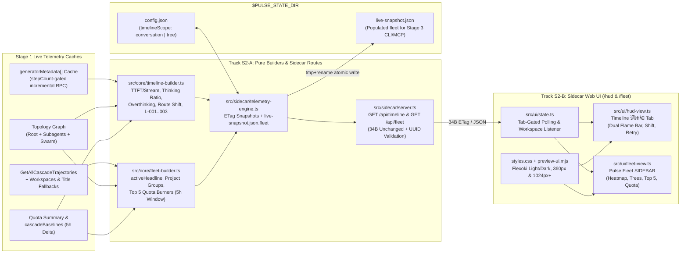

# Antigravity Pulse — Stage 2 Implementation Plan: Timeline Flame Axis & Global Fleet Radar (`STAGE_2_TIMELINE_FLEET_PLAN.md`)

> **Stage ID**: `Stage 2`  
> **Stage Goal**: Turn-by-Turn Invocation Flame `Timeline` Tab in `/hud` + Cross-Project Global Radar `Pulse Fleet` in `SIDEBAR` `/fleet`  
> **Master Contract**: [`00_MASTER_IMPLEMENTATION_BLUEPRINT.md`](./00_MASTER_IMPLEMENTATION_BLUEPRINT.md) · [`docs/PRODUCT_DESIGN.md`](../PRODUCT_DESIGN.md) (§4.1.C, §4.3, §5.2, §6.2)  
> **Companion Ledgers**: [`DECISION_LOG.md`](./DECISION_LOG.md) (`D-001`–`D-007`) · [`LESSONS_LEARNED.md`](./LESSONS_LEARNED.md) (`L-001`–`L-007`)  
> **Plan Status**: Drafted for MISSION I (`M1.2`) — Ready for `M1.3` Audit & MISSION II Execution

---

## 1. Header, Preconditions & Traceability Scope

### 1.1 Stage Metadata

| Field | Value |
| :--- | :--- |
| **Stage ID** | `Stage 2` |
| **Stage Title** | Deep Observability & Global Fleet (`Timeline` Tab + `/fleet` Sidebar) |
| **Target RTM Rows** | `RTM-07`, `RTM-10`, `RTM-15`, `RTM-18`, `RTM-22`, `RTM-25`, `RTM-27` (+ `RTM-01`, `RTM-26` continuity) |
| **Upstream Preconditions** | 1. `Stage 0` committed & `S0-QA` `PASS` (`src/types/*`, `src/state/*`, `DESIGN.md`, `index.html`, `styles.css`, `scripts/build.mjs`, `scripts/build-tests.mjs`).<br>2. `Stage 1` committed & `S1-QA` `PASS`: live `TelemetryEngine`, `SidecarApp` HTTP server on `127.0.0.1`, `/hud` `AUX_PANE` operational, all `S1-A` core modules & `S1-C` UI seam active. |
| **Downstream Consumers** | `Stage 3` (`S3-A` `agy-pulse top / status` CLI and `S3-B` MCP `pulse_status_card` / `pulse_get_compute_budget` reading populated `live-snapshot.json.fleet` & `config.json.timelineScope`). |
| **Parallel Execution Tracks** | `S2-A` (Backend Projection & Sidecar APIs) · `S2-B` (Frontend `/hud` Timeline + `/fleet` Sidebar UI + Preview Fixtures) · `S2-QA` (Independent Referee & Browser Visual Gate) |

### 1.2 Upstream Stage 1 Seams Required by Stage 2

Stage 2 consumes the following frozen Stage 0/1 exports without modifying them:

1. **Frozen Contracts (`src/types/telemetry.ts`, `src/types/rpc.ts`)**:
   - `TimelineTurnItem`, `TimelineSnapshotResponse`, `FleetTreeSummary`, `FleetProjectGroup`, `QuotaBurnerEntry`, `FleetSnapshotResponse`, `UnchangedEtagResponse`, `CascadeNodeView`, `QuotaSummaryView`, `PulseUserConfig`, `ModelTier`.
2. **Core Pure Helpers (`src/core/*`)**:
   - `src/core/formatters.ts`: `toIntToken`, `parseDurationMs`, `formatDurationCompact`, `formatTokensCompact`, `formatPct`, `formatDeltaQuotaPct` (formats non-negative consumed `% > 0` as `"-X.XX%"`, `0` as `"0.00%"`, `null` as `"—"`), `computeCacheHitPct`, `computeRetryCount`, `escapeHtml`.
   - `src/core/etag.ts`: `computeDeterministicEtag` (6-char ASCII digest yielding an exact 34-byte JSON `{"unchanged":true,"etag":"xxxxxx"}`), `makeUnchangedResponse`.
   - `src/core/model-catalog.ts`: `buildModelCatalog`, `classifyModelTier`, `decodeModelDescriptor`, `computeContextWindow`, `reconcileRequestedVsServed`.
   - `src/core/quota-calculator.ts`: `normalizeQuotaSummary`, `formatResetCountdown`.
   - `src/core/topology-builder.ts`: `buildTopologyGraph`, `resolveCascadeTitle`.
3. **Sidecar, HTML/CSS & UI Seams**:
   - `TelemetryEngine` (`src/sidecar/telemetry-engine.ts`) exposes cached `getAllGeneratorMetadataByCascade()`, `getCachedModelCatalog()`, `getCachedTrajectories()`, `getCachedQuotaState()`, `getCachedNodesByCascadeId()`, `getRootByCascadeId()`, `getCascadeBaselines()`, `getCascadeDelta5hPct(cid)`, and `live-snapshot.json` persistence.
   - `sidecars/pulse_cockpit/index.html` wraps `<main id="app" class="pulse-main" aria-live="polite">` inside `<div id="pulse-app" class="pulse-app" data-view="hud" data-theme-mode="auto">` (`[data-resolved-theme="dark"|"light"]`), exposing Flexoki + host CSS primitives (`.pulse-*`, `--pulse-tier-*`, `.pulse-fleet-grid`, `.pulse-timeline-bar`, `.tabular-nums`).
   - `src/ui/main.ts` (frozen in Stage 1; sets `data-view="fleet"` when `location.pathname.startsWith('/fleet')` and calls `mountPulseUi(document.getElementById('app') ?? document.body)` from `src/ui/state.ts`) remains **untouched** in Stage 2.
   - `src/ui/hud-view.ts` renders the 3-tab bar (`[data-tab="overview"]`, `[data-tab="timeline"]`, `[data-tab="quota"]`) and swaps out `[data-testid="timeline-placeholder"]` when `activeTab === 'timeline'`.

---

## 2. Stage 2 Architecture Diagram



---

## 3. Parallel Track Decomposition & Disjoint File Ownership

### 3.1 File Ownership Lock Table (`S2-A`, `S2-B`, `S2-QA`)

Strictly aligned with [`00_MASTER_IMPLEMENTATION_BLUEPRINT.md`](./00_MASTER_IMPLEMENTATION_BLUEPRINT.md) §4.1:

| Track ID | Role | `OWNED_WRITE_PATHS` (Strictly Disjoint) | `READ_ONLY_PATHS` |
| :--- | :--- | :--- | :--- |
| **`S2-A`** | Backend Projection Builders, Telemetry Engine & Sidecar APIs | `src/core/timeline-builder.ts`, `src/core/fleet-builder.ts`, `src/sidecar/telemetry-engine.ts`, `src/sidecar/server.ts`, `tests/unit/timeline-fleet.test.ts` | `src/types/**`, `src/state/**`, `src/core/formatters.ts`, `src/core/etag.ts`, `src/core/model-catalog.ts`, `src/core/quota-calculator.ts`, `src/core/topology-builder.ts`, `src/rpc/**`, `docs/**` |
| **`S2-B`** | Frontend `/hud` Timeline Tab, `/fleet` Sidebar UI, CSS & Preview Fixtures | `src/ui/hud-view.ts`, `src/ui/fleet-view.ts`, `src/ui/state.ts`, `sidecars/pulse_cockpit/styles.css`, `sidecars/pulse_cockpit/dist/**`, `scripts/preview-ui.mjs`, `tests/e2e/fleet-timeline.test.ts` | `src/types/**`, `src/core/**`, `src/sidecar/**`, `src/ui/main.ts`, `sidecars/pulse_cockpit/index.html`, `DESIGN.md`, `docs/**`, `/home/springtian/.gemini/antigravity/lib/node_modules/sidecar_sdk/preload.js` |
| **`S2-QA`** | Independent Stage 2 Referee & Browser Visual Gate | `docs/plans/STAGE_2_AUDIT.md` | Whole repository (read-only; runs tests, builds, `agy-pele`, and `browser` inspection) |

> **Bundle Rebuild Protocol (`sidecars/pulse_cockpit/dist/**`)**: During parallel execution, `S2-A` verifies backend compilation via `npm run typecheck` and `node --test`, while `S2-B` owns `sidecars/pulse_cockpit/dist/**` (`ui.js`). Once `S2-A` and `S2-B` both reach `PRE_QA_SYNC`, `S2-B` (or the Stage Lead) executes `npm run build` once so both `sidecars/pulse_cockpit/dist/server.mjs` and `sidecars/pulse_cockpit/dist/ui.js` reflect the integrated Stage 2 sources before `S2-QA` begins.

---

## 4. Detailed Architecture Specifications

### 4.1 Track `S2-A`: Backend Projection & Sidecar APIs

#### A. `src/core/timeline-builder.ts` (`RTM-07`, `RTM-15`)

Pure functional projection converting raw `generatorMetadata[]` entries and resolved topology nodes into reverse-chronological `TimelineTurnItem[]`.

1. **Exported Contracts & Constants**:
   - `OVERTHINKING_RATIO_THRESHOLD_PCT = 75`
   - `OVERTHINKING_SHORT_RESPONSE_MAX_TOKENS = 500`
   - `export interface BuildTimelineInput`:
     - `activeConversationId: string`
     - `scope: 'conversation' | 'tree'`
     - `nodesByCascadeId: Record<string, CascadeNodeView>`
     - `generatorMetadataByCascade: Record<string, GeneratorMetadataEntryRaw[]>`
     - `modelCatalog: ModelCatalog` (from `src/core/model-catalog.ts`)
     - `turnDeltaQuotaByKey?: Record<string, number>` (keyed by `${cascadeId}:${minStepIndex}`, optional)
   - `export interface BuildTimelineResult`:
     - `rootCascadeId: string | null`
     - `scope: 'conversation' | 'tree'`
     - `turns: TimelineTurnItem[]`
   - `export function isOverthinkingTurn(turn: Pick<TimelineTurnItem, 'thinkingRatioPct' | 'outputTokens' | 'responseOutputTokens' | 'tier'>): boolean`
     - Shared single source of truth imported by both `tests/unit/timeline-fleet.test.ts` and `src/ui/hud-view.ts` (avoiding frozen `TimelineTurnItem` contract drift while sharing logic across backend/frontend):
     - Returns `true` iff `turn.outputTokens > 0 && turn.thinkingRatioPct >= 75 && (turn.responseOutputTokens <= 500 || turn.tier === 'apex')`.
   - `export function buildTimelineTurns(input: BuildTimelineInput): BuildTimelineResult`

2. **Scope Resolution & Chronological Ordering (Pre-Reverse)**:
   - Determine `rootCascadeId = nodesByCascadeId[activeConversationId]?.rootCascadeId ?? (activeConversationId || null)`.
   - Candidate cascades:
     - When `scope === 'conversation'`: `[activeConversationId]`.
     - When `scope === 'tree'`: all `cascadeId` keys in `nodesByCascadeId` whose `rootCascadeId === rootCascadeId` (falling back to `[activeConversationId]` if absent from `nodesByCascadeId`).
   - Collect every `GeneratorMetadataEntryRaw` across candidate cascades that contains a `chatModel` payload.
   - Sort chronologically **ascending** before assigning `turnIndex` and computing route shifts:
     - Primary sort key: `timestampMs` extracted from `chatModel.chatStartMetadata?.createdAt ?? chatModel.createdAt ?? chatModel.timestamp` (matching Stage 0's `ChatStartMetadataRaw` & `ChatModelMetadataRaw` optional fields in `src/types/rpc.ts`) if valid ISO/epoch; when absent, synthesize stable chronological ordering via `(node.lastModifiedTime / spawnStepIndex)` + `minStepIndex` so same-conversation turns strictly ascend by `(stepIndices[0] ?? Infinity, entryIndex)`.
     - Assign 1-based `turnIndex = idx + 1` (`1..N`).

3. **Metric Computation & Host Pitfall Enforcement (`L-001`, `L-002`, `L-003`)**:
   - **Durations**: Reuse `parseDurationMs` from `src/core/formatters.ts`:
     - `ttftMs = parseDurationMs(chatModel.timeToFirstToken)`
     - `streamingMs = parseDurationMs(chatModel.streamingDuration)`
     - `totalMs = ttftMs + streamingMs`
   - **Int64 String Tokens (`L-001`)**: Reuse `toIntToken` from `src/core/formatters.ts`:
     - `inputTokens = toIntToken(usage?.inputTokens)`
     - `cacheReadTokens = toIntToken(usage?.cacheReadTokens)`
     - `outputTokens = toIntToken(usage?.outputTokens)`
     - `thinkingOutputTokens = toIntToken(usage?.thinkingOutputTokens)`
     - `responseOutputTokens = toIntToken(usage?.responseOutputTokens) || Math.max(0, outputTokens - thinkingOutputTokens)`
   - **Cache Hit % (`L-002`)**: Reuse `computeCacheHitPct(inputTokens, cacheReadTokens)` (`totalIn = inputTokens + cacheReadTokens; totalIn > 0 ? (cacheReadTokens / totalIn) * 100 : 0`).
   - **Thinking Ratio %**:
     - `thinkingRatioPct = outputTokens > 0 ? Math.min(100, (thinkingOutputTokens / outputTokens) * 100) : 0`
   - **Retry Flagging (`L-003`)**: Reuse `computeRetryCount(chatModel.retryInfos)`:
     - `retryCount = Math.max(0, (chatModel.retryInfos?.length ?? 0) - 1)` — **NEVER** flag `retryInfos.length === 1` as a retry (`retryCount > 0` iff `retryInfos.length > 1`).
   - **Dynamic Route Shift (`routingChangedFromPrevTurn`)**:
     - Track `prevServedKeyByCascade: Map<string, string>` while walking turns in **chronological ascending order**:
     - Compute `servedKey = (servedModel.responseModel || servedModel.displayName || '').toLowerCase()`.
     - `routingChangedFromPrevTurn = prevServedKeyByCascade.has(cascadeId) && prevServedKeyByCascade.get(cascadeId) !== servedKey`.
     - Update `prevServedKeyByCascade.set(cascadeId, servedKey)`.
     - Tracking per `cascadeId` guarantees that interleaving Root (`Carbon High`) + Subagent (`Flash`) turns in `scope === 'tree'` never triggers false-positive route-shift badges, while consecutive turns on the same conversation always detect model/Auto route shifts accurately.
   - **Context Window Watermark**:
     - `contextUsedTokens = toIntToken(contextWindowMetadata?.estimatedTokensUsed)`
     - `contextMaxTokens = toIntToken(contextWindowMetadata?.maxContextTokens)`
     - `contextPct = contextMaxTokens > 0 ? Math.min(100, (contextUsedTokens / contextMaxTokens) * 100) : 0`
   - **Reverse-Chronological Return**:
     - Return `turns.reverse()` so the newest invocation (`Turn #N`) renders first.

#### B. `src/core/fleet-builder.ts` (`RTM-18`)

Pure cross-project aggregator building `FleetSnapshotResponse` from all trajectories, topology nodes, quota summaries, and 5-hour quota baselines.

1. **Exported Contracts**:
   - `export const ROLLING_5H_WINDOW_MS = 5 * 60 * 60 * 1000`
   - `export interface CascadeQuotaBaseline`: `{ firstSeenAt: string; baseline5hFraction: number | null; last5hFraction: number | null; delta5hPct: number }`
   - `export interface BuildFleetInput`:
     - `nowMs?: number` (injectable clock for deterministic unit tests; defaults to `Date.now()`)
     - `hostConnected: boolean`
     - `trajectories: Record<string, TrajectorySummaryRaw>`
     - `nodesByCascadeId: Record<string, CascadeNodeView>`
     - `quota: QuotaSummaryView`
     - `cascadeBaselines: Record<string, CascadeQuotaBaseline>`
     - `recentIdleWindowMs?: number` (defaults to `ROLLING_5H_WINDOW_MS`)
     - `maxIdleTreesPerProject?: number` (defaults to `5`)
   - `export function compactModelLabel(servedModel: CascadeNodeView['servedModel']): string`
   - `export function buildFleetSnapshot(input: BuildFleetInput): Omit<FleetSnapshotResponse, 'etag'>`

2. **Active Compute Headline (`activeHeadline`)**:
   - Define `isNodeRunning(node: CascadeNodeView)`:
     - `node.status === 'CASCADE_RUN_STATUS_RUNNING' || (node.phase !== 'IDLE' && node.phase !== 'ERROR_OR_QUOTA')`
   - Count across all nodes in `nodesByCascadeId`:
     - `runningRoots`: running nodes where `node.kind === 'root'` (or `node.parentCascadeId === null`).
     - `runningSubagents`: running nodes where `node.kind !== 'root'`.
     - `totalRunningNodes = runningRoots + runningSubagents`.
   - `modelHistogram`:
     - Group running nodes by `(compactModelLabel(node.servedModel), node.servedModel.tier)`.
     - Compact label normalization rules:
       - `"Gemini 4 Carbon (High)"` -> `"Carbon(H)"`
       - `"Gemini 4 Argon (Medium)"` -> `"Argon(M)"`
       - `"Gemini 4 Hydrogen (XHigh)"` -> `"Hydrogen(XH)"`
       - `"Gemini 3.8 Flash"` -> `"Flash"`
       - `"Claude Opus 5.5 (High)"` -> `"Opus(H)"`
       - `"Claude Sonnet 5.5"` -> `"Sonnet"`
       - General pattern: strip leading `Gemini <ver> ` / `Claude ` / `OpenAI `, map effort suffix `(XHigh)`->`(XH)`, `(High)`->`(H)`, `(Medium)`->`(M)`, `(Low)`->`(L)`.
     - Sort `modelHistogram` deterministically: descending by `count`, tie-break ascending alphabetically by `label` (required by Stage 3 CLI/MCP consumer parity).

3. **Workspace / Project Grouping (`projects: FleetProjectGroup[]`)**:
   - Group all `CascadeNodeView` records by `rootCascadeId`.
   - Resolve `workspaceUris` for each tree from `trajectories[rootCascadeId]?.workspaces` (extracting `workspaceFolderAbsoluteUri` strings), falling back to child nodes' trajectories or `'unassigned'`.
   - Derive `projectKey`: sorted normalized lowercase URIs joined with `'|'` (or `'__global__'` when empty).
   - Derive `projectName`: basename of first URI (with `file://` stripped and trailing `/` trimmed; handles both POSIX `/` and Windows `\` separators), or `'Global / No Workspace'`.
   - Include in each project's `trees` list:
     - All running trees (`activeNodeCount > 0`), PLUS
     - Recent idle trees whose `maxLastModifiedMs >= nowMs - recentIdleWindowMs`, capped at `maxIdleTreesPerProject` per project so the panel stays dense and focused.
   - `FleetTreeSummary` fields:
     - `activeNodeCount`: count of `isNodeRunning(n)` nodes in tree.
     - `totalNodeCount`: `treeNodes.length`.
     - `elapsedMs`: when `activeNodeCount > 0`, `Math.max(0, nowMs - earliestActivePhaseStartedAtOrLastModifiedMs)`; when idle, `0`.
     - `modelMix`: count of `compactModelLabel(n.servedModel)` across running nodes if `activeNodeCount > 0`, else across all nodes in tree.
     - `nodes`: sorted active-first, then ascending by `(depth, title)`.
     - `treeDeltaQuota5hPct`: aggregated positive 5h quota delta for the tree (or `null` if no baseline delta recorded).
   - Sort `projects` descending by `runningCount`, then descending by most recent tree `lastModifiedTime`, tie-break ascending by `projectName`.

4. **Rolling 5-Hour Top 5 Quota Burners (`topQuotaBurners: QuotaBurnerEntry[]`)**:
   - Evaluate all cascade trees active within `[nowMs - ROLLING_5H_WINDOW_MS, nowMs]` (or with `delta5hPct > 0`).
   - Aggregate per tree:
     - `rawDelta`: non-null `cascadeBaselines[rootCascadeId]?.delta5hPct`, else sum of `Math.max(0, n.deltaQuota5hPct ?? 0)` across tree nodes (Stage 1 stores all `delta5hPct` / `deltaQuota5hPct` values as non-negative consumed percentage points `>= 0`).
     - `consumed5hPct = Math.max(0, rawDelta)`
     - `delta5hPct = consumed5hPct` (non-negative consumed percentage ensuring ranking parity across Stage 2 UI and Stage 3 CLI/MCP; formatted in UI via `formatDeltaQuotaPct(entry.consumed5hPct)` -> `"-X.XX%"`).
     - `totalTokens`: sum across all nodes in tree of `n.tokens.inputTokens + n.tokens.cacheReadTokens + n.tokens.outputTokens`.
     - `dominantModel` & `dominantTier`: select node in tree with highest token total (tie-breaker: highest tier weight `apex > workhorse > orchestrator > fast > alert`, then root node).
     - `isRunning`: `activeNodeCount > 0`.
     - `lastActiveAt`: max `lastModifiedTime` ISO string across tree nodes.
   - Sort descending by `delta5hPct`, tie-breaker descending by `totalTokens`, tie-breaker descending by `Date.parse(lastActiveAt)`, tie-breaker ascending by `rootCascadeId`.
   - Slice `.slice(0, 5)` and assign 1-based `rank: index + 1`.
   - **Empty-State Guarantee**: When no cascades exist, `activeHeadline` zeros out, `modelHistogram: []`, `projects: []`, `topQuotaBurners: []` (never `undefined` or `null`).

#### C. `src/sidecar/telemetry-engine.ts` & `src/sidecar/server.ts` (`RTM-10`, `RTM-25`, `RTM-27`)

1. **`TelemetryEngine` Extensions (`src/sidecar/telemetry-engine.ts`)**:
   - **Incremental Cross-Project `generatorMetadata` Cache (`RTM-25`)**:
     - Extend the `stepCount`-gated `generatorMetadata` cache so ALL cascades within the rolling 5-hour window (not only the single focused `/hud` tree) have their `generatorMetadata` fetched **strictly when `stepCount` increases** since last cached fetch (capped concurrency e.g. max `6` parallel RPCs during cold boot).
     - Preserve `L-004`: NEVER call `GetCascadeTrajectorySteps` for `IDLE` cascades, and NEVER call full `GetCascadeTrajectory`.
   - **`getTimelineSnapshot(conversationId?: string, scope?: 'conversation' | 'tree', clientEtag?: string)`**:
     - Reads latest `config.json` (if mtime changed) for default `timelineScope` when `scope` query param is omitted.
     - Calls `buildTimelineTurns(...)`.
     - Computes `etag = computeDeterministicEtag({ rootCascadeId, scope, turns })` (excluding `generatedAt` so identical turn state hits the 34-byte ETag cache!).
     - If `clientEtag && clientEtag === etag`, returns `makeUnchangedResponse(etag)` (`34` bytes).
     - Otherwise returns full `TimelineSnapshotResponse`.
   - **`getFleetSnapshot(clientEtag?: string)`**:
     - Calls `buildFleetSnapshot(...)`.
     - Computes `etag = computeDeterministicEtag({ hostConnected, activeHeadline, projects, topQuotaBurners, quota: stableQuotaFields })` (excluding `generatedAt` and `quota.fetchedAt` so idle snapshots maintain 100% ETag stability!).
     - If `clientEtag && clientEtag === etag`, returns `makeUnchangedResponse(etag)` (`34` bytes).
     - Otherwise returns full `FleetSnapshotResponse`.
   - **`live-snapshot.json` Atomic Sync (`D-003`)**:
     - Every refresh cycle writes `live-snapshot.json` with `fleet` populated by `buildFleetSnapshot` + `etag` (replacing Stage 1's empty `fleet` stub), immediately unlocking Stage 3 `agy-pulse` CLI & MCP `live-snapshot.json` reads.

2. **`SidecarApp` Route Extensions (`src/sidecar/server.ts`)**:
   - **`GET /api/timeline`**:
     - Query parameters: `conversationId` (optional; if provided, MUST match `/^[0-9a-f-]{36}$/i`, else return `new Response(JSON.stringify({ error: 'Invalid conversationId UUID' }), { status: 400, contentType: 'application/json' })`), `scope` (optional; if provided, MUST be `'conversation'` or `'tree'`, else HTTP `400` `Response`), `etag` (optional string).
     - Note `L-007` + `sidecar_sdk/index.mjs` semantics: returning `new Response(..., { status: 400 })` produces HTTP `400` whereas throwing inside an `app.api` callback returns HTTP `500`.
     - Calls `telemetryEngine.getTimelineSnapshot(conversationId, scope, etag)`.
   - **`GET /api/fleet`**:
     - Query parameter: `etag` (optional string).
     - Calls `telemetryEngine.getFleetSnapshot(etag)`.
   - **ETag Wire Budget**: When `etag` matches, JSON body is `{"unchanged":true,"etag":"<6-char>"}` = **34 bytes** (`Buffer.byteLength === 34`).
   - **Baseline Accessors**: `TelemetryEngine` reads `getCascadeBaselines()` and `getCascadeDelta5hPct(cid)` when populating `buildFleetSnapshot` and `buildTimelineTurns` so tree/node 5h quota deltas remain identical across `/hud`, `/timeline`, `/fleet`, and `live-snapshot.json`.

---

### 4.2 Track `S2-B`: Frontend UI (`/hud` Timeline Tab + `/fleet` Sidebar + Preview)

#### A. `src/ui/state.ts` (`RTM-10`, `RTM-15`, `RTM-18`)

- **Zero Modification to `src/ui/main.ts`**: `mountPulseUi(root)` remains the single entry point invoked by `src/ui/main.ts`.
- **View Routing**:
  - Detect route via `window.location.pathname === '/fleet' || window.location.pathname.startsWith('/fleet/')` (plus optional `?view=fleet` support for preview mode convenience).
  - `/fleet` renders via `renderFleetView(root, fleetUiState, fleetActions)` imported from `src/ui/fleet-view.ts`.
  - `/hud` (and `/`) renders via `renderHudView(root, hudUiState, hudActions)` imported from `src/ui/hud-view.ts`.
- **Tab-Gated Timeline Polling (`/hud`)**:
  - `HudUiState` stores `activeTab: 'overview' | 'timeline' | 'quota'`, `timelineScope: 'conversation' | 'tree' | null` (falls back to `hudSnapshot.config.timelineScope`), `timelineSnapshot: TimelineSnapshotResponse | null`, `timelineEtag: string | null`, `timelineLoading: boolean`.
  - Poll `/api/timeline?conversationId=...&scope=...&etag=...` **only when `activeTab === 'timeline'`**.
  - On switching into `timeline`, toggling `timelineScope`, or `conversationId` change: clear `timelineEtag = null`, set `timelineLoading = true`, fetch `/api/timeline` immediately.
  - Persisting scope choice: on scope toggle, invoke `window.sidecar.fetch('/api/config', { method: 'POST', body: JSON.stringify({ timelineScope: nextScope }) })` (fire-and-forget guarded with `try/catch` so standalone preview works cleanly even without token).
- **Fleet Polling & Host Workspace Bridge (`/fleet`)**:
  - `FleetUiState` stores `fleetSnapshot: FleetSnapshotResponse | null`, `fleetEtag: string | null`, `expandedTreeIds: Set<string>` (preserved across ETag updates!), `activeWorkspaceUris: string[]`, `loading: boolean`, `error: string | null`.
  - Subscribe to `window.sidecar?.getWorkspaceUris?.()` and `window.sidecar?.onWorkspaceChange?.((uris) => ...)` per `sidecar_sdk/preload.js` so the active workspace project card is highlighted/badged live.
  - Adaptive polling loop: `1000ms` when `(fleetSnapshot?.activeHeadline.totalRunningNodes ?? 0) > 0`, `3000ms` when idle (`RTM-25`). Skip DOM re-render when `{ unchanged: true }` is received.
  - Safe bridge helper: `jumpToConversation(cid: string)` validates UUID format and calls `window.sidecar?.ui?.toggleConversation?.(cid)`.

#### B. `src/ui/hud-view.ts` — `Timeline 调用轴` Tab (`RTM-15`, `RTM-22`, `RTM-27`)

1. **Scope Toggle Header**:
   - Two-pill segmented control (`[data-testid="timeline-scope-conversation"]` `当前会话` / `[data-testid="timeline-scope-tree"]` `整棵会话树`), turn counter (`N turns`), and compact flame bar legend (`TTFT` Purple dot · `Streaming` Cyan dot).
2. **Dual-Segment Horizontal Flame Bar**:
   - Compute `maxTurnMs = Math.max(1, ...turns.map((t) => t.totalMs))`.
   - For each turn card (`Turn #${turn.turnIndex} · Steps ${stepLabel}`):
     - **Header Row**:
       - Turn identifier + step range (`Steps 41–45`); in `tree` scope when `turn.cascadeId !== activeConversationId`, show clickable subagent chip (`role || cascadeTitle` -> `jumpToConversation(turn.cascadeId)`).
       - Model badge in Flexoki semantic tier color (`tier-apex`, `tier-workhorse`, `tier-fast`, `tier-orchestrator`, `tier-alert`).
       - **Route Shift Pill**: rendered when `turn.routingChangedFromPrevTurn` (`⚡ Shift` / `Auto ➔`) or `/auto|orchestrator/i.test(turn.requestedLabel)` (`Auto`), styled with Flexoki Yellow/Amber (`#ad8301` / `#d0a215`).
       - **Retry Badge**: rendered **strictly** when `turn.retryCount > 0` (`L-003`), showing `⚠ Retry ×${turn.retryCount}` in Flexoki Red (`#af3029` / `#d14d41`).
     - **Flame Bar Row (`.pulse-timeline-bar`)**:
       - Outer track scaled by `trackPct = Math.max(4, Math.min(100, (turn.totalMs / maxTurnMs) * 100))` inside a fixed-height horizontal track (`8px`–`10px`), with inner flex segments:
         - Left segment (`ttftMs`): Flexoki Purple (`#5e409d` Light / `#8b7ec8` Dark), `width: ${(ttftMs / totalMs) * 100}%`.
         - Right segment (`streamingMs`): Flexoki Cyan (`#24837b` Light / `#3aa99f` Dark), `width: ${(streamingMs / totalMs) * 100}%`.
       - Timing readout with `.tabular-nums` placed cleanly on its own right-aligned or sub-bar metric line (`TTFT 12.1s · Stream 8.1s · 20.2s`) — never trapped inside narrow segments, preventing label clipping at `360px`.
     - **Thinking Ratio & Health Row**:
       - `Think ${formatTokensCompact(thinkingOutputTokens)} / ${formatTokensCompact(outputTokens)} tok (${Math.round(thinkingRatioPct)}%)`
       - When `isOverthinkingTurn(turn)` is `true`: subtle pill `💡 Overthinking` (`--pulse-yellow-bg` / `--pulse-yellow-fg`).
       - Micro-row: `Cache ${turn.cacheHitPct.toFixed(1)}%` · `CTX ${turn.contextPct.toFixed(0)}%` · optional `Δ5h ${formatDeltaQuotaPct(turn.deltaQuota5hPct)}`.
3. **XSS Safety (`RTM-27`)**: All strings (`cascadeTitle`, `role`, `requestedLabel`, `servedModelDisplayName`, `responseModel`) pass through `escapeHtml()`.

#### C. `src/ui/fleet-view.ts` — `Pulse Fleet` (`/fleet` `SIDEBAR`) (`RTM-18`, `RTM-22`, `RTM-27`)

1. **Section 1: Global Active Compute Heatmap Header**:
   - Headline text: when `totalRunningNodes > 0`, `🔥 活跃算力: ${runningRoots} 主会话 + ${runningSubagents} 子代理`; when `0`, `💤 当前无运行中会话`.
   - `modelHistogram` pills strip (`Carbon(H) ×2 · Argon(M) ×3 · Flash ×2`) using Flexoki semantic tier colors and wrapping cleanly (`flex-wrap: wrap`).
   - Host connection badge (`LS Live` / `Disconnected`).
2. **Section 2: Cross-Project Active Session Tree Cards (`projects: FleetProjectGroup[]`)**:
   - Project header row: `projectName`, `Active` badge when `workspaceUris` overlaps `activeWorkspaceUris`, and active count pill (`${project.runningCount} running`).
   - Tree card per `FleetTreeSummary`:
     - Row 1: live phase pulse dot + `rootTitle` (CSS ellipsis truncation, `min-width: 0`) + `[↗]` 1-click button (`toggleConversation(tree.rootCascadeId)`).
     - Row 2: tree `rootPhase` badge + `${activeNodeCount}/${totalNodeCount} nodes` + elapsed timer (`formatDurationCompact(elapsedMs)`) + optional `Δ5h`.
     - Row 3: `modelMix` pill strip + expand/collapse drawer button (`▾ 节点 (${nodes.length})`).
     - **Expandable Quick-Jump Subagents Drawer**: toggled in-place using `expandedTreeIds.has(tree.rootCascadeId)`, listing every node (`kind`, `role || title`, live `phase`, served model capsule, and `[↗]` 1-click `toggleConversation(node.cascadeId)`).
3. **Section 3: Top 5 Quota Burners Leaderboard (`topQuotaBurners`)**:
   - Ranked `1..5` rows: `#${rank}` badge, clickable `title` (`toggleConversation(entry.rootCascadeId)`), `projectName` tag, running indicator dot if `isRunning`, dominant model tier capsule (`dominantModel`), `formatDeltaQuotaPct(entry.consumed5hPct)`, and `${formatTokensCompact(entry.totalTokens)} tok`.
   - Empty state when `topQuotaBurners.length === 0`: calm message `"5 小时窗口内暂无显著配额消耗记录"`.
4. **Section 4: Global Quota Summary Panel**:
   - 2×2 or stacked metric bars for `Gemini 5h`, `Gemini Weekly`, `Claude / 3P 5h`, `Claude / 3P Weekly`, displaying remaining `%`, Flexoki status fill (`<25%` amber, `<15%` red), and `resetInLabel` countdown (`2h 21m`).

#### D. `sidecars/pulse_cockpit/styles.css` & `scripts/preview-ui.mjs` (`RTM-22`)

1. **Flexoki Light/Dark & Responsive Layout (`styles.css`)**:
   - Build directly on Stage 0's `#pulse-app` `[data-resolved-theme="dark"|"light"]`, host CSS token variables (`--background`, `--foreground`, `--border`, `--primary`, `--muted-foreground`, `--secondary`, `--destructive`), `.tabular-nums`, and `--pulse-tier-*` primitives (`DESIGN.md`):
     - Apex / Heavy (`Purple`): `#5e409d` (Light) / `#8b7ec8` (Dark)
     - Workhorse (`Blue`): `#205ea6` (Light) / `#4385be` (Dark)
     - Fast (`Cyan`): `#24837b` (Light) / `#3aa99f` (Dark)
     - Orchestrator / Auto (`Yellow`): `#ad8301` (Light) / `#d0a215` (Dark)
     - Alert / Retry (`Red`): `#af3029` (Light) / `#d14d41` (Dark)
   - Dual-width `/fleet` layout (`.pulse-fleet-grid`):
     - **Narrow Sidebar (`< 640px`, target `320px–380px`)**: Single-column vertical stack (`Heatmap` -> `Projects` -> `Top 5 Burners` -> `Global Quota`), tight `8px`–`10px` padding, `min-width: 0` on all flex children, `overflow-x: hidden`.
     - **Wide Workbench (`>= 640px`, target `1024px+`)**: CSS Grid `grid-template-columns: minmax(0, 1.35fr) minmax(300px, 1fr)` with Heatmap Header spanning `1 / -1`, Left Column = Project Session Trees, Right Column = Top 5 Quota Burners + Global Quota Panel.
2. **Dense Visual Fixtures (`scripts/preview-ui.mjs` / `npm run preview`)**:
   - Extend Stage 1's `scripts/preview-ui.mjs` to serve mock `/api/timeline` and `/api/fleet` alongside `/api/hud`, `/hud`, `/fleet`, `/styles.css`, `/dist/ui.js`, and standalone `preload.js` shim (recording `window.__mockToggleCalls` for automated verification):
     - `--scenario dense`:
       - **Timeline**: 14 reverse-chronological turns spanning Root + 2 Subagents (`scope=tree` and `scope=conversation` filtering), featuring long Extended Thinking (`TTFT 42.6s`, `Think 87.6%`, Overthinking flag), long Streaming (`14.8s`), `Auto ➔ Argon` route shifts, `⚠ Retry ×2`, and mixed cache hits (`94.2%` vs `18.5%`).
       - **Fleet**: 3 projects (`antigravity-pulse`, `nebula-compiler`, `payments-ledger`), 8 active concurrent nodes (`2` roots + `6` subagents/swarm), `Carbon(H) ×2 · Argon(M) ×3 · Flash ×3`, Top 5 Quota Burners (`-4.82%` to `-0.74%`), and Gemini/Claude 5h + Weekly buckets.
     - `--scenario alert`: Gemini 5h quota at `14.2%` (Red alert tier) + `⚠ Retry ×3`.
     - `--scenario idle`: 0 running nodes, empty-state leaderboard & headline verification.

---

## 5. Peer `[CONTRACT_SYNC]` Checkpoints

| Checkpoint ID | Timing | Sync Parties | Exact Synced Artifact / Interface |
| :--- | :--- | :--- | :--- |
| **`S2-SYNC-1`** | Stage 2 Start (Pre-Edit) | `S2-A`, `S2-B` | Confirm Stage 1 exports (`formatters.ts`, `etag.ts`, `model-catalog.ts`, `TelemetryEngine` cache getters, `hud-view.ts` tab hooks, `state.ts` `mountPulseUi`) match `§1.2`. |
| **`S2-SYNC-2`** | Mid-Stage (Post Builders) | `S2-A` -> `S2-B` | Broadcast `isOverthinkingTurn` export from `src/core/timeline-builder.ts` and exact `/api/timeline` + `/api/fleet` JSON payload shapes + `34`-byte `UnchangedEtagResponse` verification. |
| **`S2-SYNC-3`** | Pre-QA Integration | `S2-A` + `S2-B` -> `S2-QA` | Both tracks pass `npm run typecheck`, `S2-B` runs `npm run build` to refresh `sidecars/pulse_cockpit/dist/server.mjs` & `ui.js`, unit + E2E tests green, ready for `S2-QA`. |
| **`S2-SYNC-4`** | Stage 2 Exit | `S2-QA` -> `Stage 3` | Confirm `$PULSE_STATE_DIR/live-snapshot.json` contains populated `fleet` (`FleetSnapshotResponse`) and `config.json` honors `timelineScope`. |

---

## 6. Dense-UI Visual Inspection Plan (`browser` Subagent)

Before `S2-QA` signs off, the `browser` subagent inspects live rendered HTML/CSS against `npm run preview -- --scenario dense` (`scripts/preview-ui.mjs`, plus `alert` / `idle` spot-checks) across **6 viewport × theme combinations**:

| Check ID | View & State | Viewport | Theme | Mandatory Visual & DOM Assertions |
| :--- | :--- | :--- | :--- | :--- |
| **`VIS-01`** | `/hud` `Timeline` Tab (`14` turns, `scope=tree` & `conversation`) | `360×820` | Light | `scrollWidth <= clientWidth`; purple TTFT (`#5e409d`) + cyan Streaming (`#24837b`) flame bars render cleanly; timing readouts never clip or collide with bars; `Auto` route shift, `Overthinking`, and `Retry ×2` badges clearly legible. |
| **`VIS-02`** | `/hud` `Timeline` Tab (`14` turns, `scope=tree`) | `360×820` | Dark | Same layout/overflow checks; dark Flexoki hues (`#8b7ec8`, `#3aa99f`, `#d0a215`, `#d14d41`) have crisp contrast against dark `--background`. |
| **`VIS-03`** | `/fleet` `Pulse Fleet` (`3` projects, `8` running nodes, Top 5 Burners, 1 drawer expanded) | `360×820` | Light | `scrollWidth <= clientWidth`; single-column stack without crushed pill strips; long root titles truncate with ellipsis; `[↗]` jump buttons stay aligned and clickable (`toggleConversation` fires with exact UUID). |
| **`VIS-04`** | `/fleet` `Pulse Fleet` (`dense` + expanded drawer) | `360×820` | Dark | Dark Flexoki contrast parity; active workspace badge, phase dots, and Top 5 Burners legible with zero overlapping borders. |
| **`VIS-05`** | `/fleet` `Pulse Fleet` (`dense`) | `1024×820` | Light | Wide two-column CSS Grid activates (`Projects` left, `Top 5 Burners` + `Global Quota` right, `Heatmap Header` full width); balanced proportions, `scrollWidth <= clientWidth`. |
| **`VIS-06`** | `/fleet` `Pulse Fleet` (`dense`) | `1024×820` | Dark | Wide two-column grid + dark Flexoki visual parity; zero clipping or orphan gaps. |

---

## 7. Exact Testable Deliverables & Independent Verification Gates (`S2-QA`)

### 7.1 Required Test Suites

1. **`tests/unit/timeline-fleet.test.ts` (`S2-A`)**:
   - **Timeline Parsing & Formulas**:
     - `L-001` Int64 string token sums (`"19353"`, `"421"`) yield numbers, never string concatenation.
     - `L-002` `cacheHitPct` uses `cacheReadTokens / (inputTokens + cacheReadTokens)` (`1000` + `9000` -> `90.0%`; `0` + `5000` -> `100.0%`; `0` + `0` -> `0%`).
     - `L-003` `retryInfos.length === 1` -> `retryCount === 0` (no retry alert); `retryInfos.length === 3` -> `retryCount === 2`.
     - Duration parsing (`"12.13s"` + `"8.13s"` -> `ttftMs=12130`, `streamingMs=8130`, `totalMs=20260`).
     - `thinkingRatioPct` & `isOverthinkingTurn` boundary matrix (`74.9%`, `75.0%` short response, `75.0%` apex long response, `0` output tokens).
     - `routingChangedFromPrevTurn` computed chronologically per `cascadeId` BEFORE reversing, ensuring `scope='tree'` interleaving does not create false shifts while same-cascade model switches do.
     - `scope='conversation'` vs `scope='tree'` filtering and reverse-chronological ordering (`Turn #N` down to `Turn #1`).
   - **Fleet Aggregation & Top 5 Ranking**:
     - `activeHeadline`: exact counts for `runningRoots`, `runningSubagents`, `totalRunningNodes`, and deterministic `modelHistogram` sort (count desc, label asc).
     - `projects`: workspace URI grouping, `projectName` extraction (POSIX/Windows + unassigned fallback), active-first tree ordering, recent idle window capping.
     - `topQuotaBurners`: strict rolling 5-hour window filtering, descending `delta5hPct` (`consumed5hPct`) sort with `totalTokens` tiebreaker, strict cap at 5 entries (`rank` `1..5`).
     - Empty-state invariants (`0` cascades -> empty arrays `[]`, zero counts, never `undefined`/`null`).

2. **`tests/e2e/fleet-timeline.test.ts` (`S2-A` + `S2-B` Integration)**:
   - Mock Language Server HTTP server + real `TelemetryEngine` + `SidecarApp` server:
     - `GET /api/timeline?scope=tree` returns full `TimelineSnapshotResponse`; immediate repeat with `?etag=<etag>` returns exact **34-byte** `{"unchanged":true,"etag":"..."}`.
     - `GET /api/timeline?conversationId=not-a-uuid` returns HTTP `400` (`RTM-27`).
     - `GET /api/timeline?scope=invalid` returns HTTP `400`.
     - `GET /api/fleet` returns populated `FleetSnapshotResponse`; repeat with `?etag=<etag>` returns exact **34-byte** `UnchangedEtagResponse`.
     - Incremental RPC counter assertion (`RTM-25`): `GetCascadeTrajectoryGeneratorMetadata` is NOT re-called on repeated poll ticks when `stepCount` is unchanged, and `GetCascadeTrajectory` is NEVER called (`0` calls).
     - `$PULSE_STATE_DIR/live-snapshot.json` contains populated `fleet` (`projects.length >= 1`, `topQuotaBurners.length <= 5`).
     - Rendered HTML/DOM checks (JSDOM-free string/headless or preview verification) confirming `escapeHtml` blocks `<script>` / `` XSS in cascade titles/roles (`RTM-27`), and `window.sidecar.ui.toggleConversation` jump wiring.

### 7.2 Runnable Verification Gate Commands (`S2-QA`)

Every command below MUST exit `0` with zero skipped or relaxed assertions before Stage 2 is marked `PASS`:

```bash
# 1. Strict TypeScript type checking across src/, tests/, scripts/
npm run typecheck

# 2. Rebuild prebuilt esbuild bundles (including sidecars/pulse_cockpit/dist/server.mjs & ui.js)
npm run build

# 3. Full automated test suite (includes Stage 0/1 regression + Stage 2 unit & E2E tests)
npm test

# 4. Direct verification of Stage 2 test suites & 34-byte ETag assertions
node --test .test-dist/unit--timeline-fleet.test.cjs .test-dist/e2e--fleet-timeline.test.cjs

# 5. Strict Mermaid 12.1 compliance across all repository Markdown files
agy-pele check . --strict-mermaid

# 6. Git-tracked prebuilt bundle freshness check (re-running build leaves zero unexpected unbuilt drift)
git status --short
```

---

## Implementation Status & Results (MISSION II Backfill)

> *Populated strictly during MISSION II execution by `S2-A`, `S2-B`, and `S2-QA` with verbatim observed metrics and file links.*

- **Track `S2-A` Status**: `[ ] Pending`
  - Files Delivered: _(to be filled)_
  - Unit Test Evidence (`tests/unit/timeline-fleet.test.ts`): _(to be filled)_
- **Track `S2-B` Status**: `[ ] Pending`
  - Files Delivered: _(to be filled)_
  - E2E & Preview Evidence (`tests/e2e/fleet-timeline.test.ts`, `scripts/preview-ui.mjs`): _(to be filled)_
- **Dense Visual Verification (`browser` Subagent)**: `[ ] Pending`
  - `VIS-01` (`/hud` Timeline `360×820` Light): _(to be filled)_
  - `VIS-02` (`/hud` Timeline `360×820` Dark): _(to be filled)_
  - `VIS-03` (`/fleet` `360×820` Light): _(to be filled)_
  - `VIS-04` (`/fleet` `360×820` Dark): _(to be filled)_
  - `VIS-05` (`/fleet` `1024×820` Light): _(to be filled)_
  - `VIS-06` (`/fleet` `1024×820` Dark): _(to be filled)_
- **Independent Audit (`S2-QA`) Verdict**: `[ ] Pending` — Report: `docs/plans/STAGE_2_AUDIT.md` · Commit SHA: _(to be filled)_

---

## Stage Retrospectives & Pitfalls Encountered (MISSION II Backfill)

> *Populated upon Stage 2 completion. Any newly discovered host, SDK, CSS, or ETag quirks MUST also be appended to [`LESSONS_LEARNED.md`](./LESSONS_LEARNED.md) (`L-008+`) and [`DECISION_LOG.md`](./DECISION_LOG.md) (`D-008+`).*

- **What Worked Well**: _(to be filled in MISSION II)_
- **Pitfalls / Edge Cases Hit**: _(to be filled in MISSION II)_
- **New `L-*` / `D-*` Entries Logged**: _(to be filled in MISSION II)_
