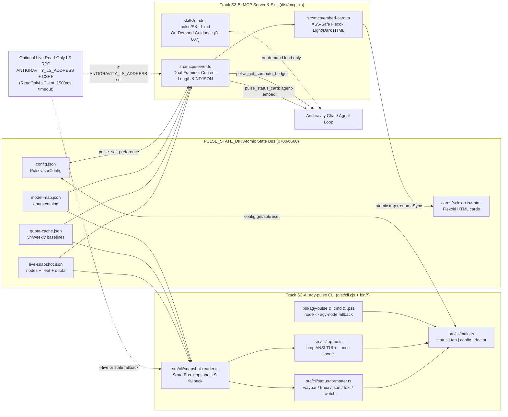

# Stage 3 Implementation Plan — Ecosystem Extensions (`agy-pulse` CLI, Zero-Dep MCP Server, On-Demand Skill & Live Host Validation)

> **Stage ID**: `Stage 3`  
> **Goal**: Ecosystem Extensions: Cross-Platform `agy-pulse` CLI (`top`, `status` for Waybar/tmux/JSON/text, `config`, `doctor`) + Zero-Dep MCP Server (`pulse_status_card`, `pulse_get_compute_budget`, `pulse_set_preference`) + On-Demand Skill (`skills/model-pulse/SKILL.md`) + Prebuilt Bundle Verification & Full Live Host Validation  
> **Target RTM Rows**: `RTM-02`, `RTM-19`, `RTM-20`, `RTM-23`, `RTM-26`, `RTM-27` (and finalizes `RTM-01` across all 4 surfaces)  
> **Canonical References**: [`docs/PRODUCT_DESIGN.md`](../PRODUCT_DESIGN.md) (§2.1, §3.2, §4.4, §5.2, §6.1–§6.2, §7.1–§7.2) · [`00_MASTER_IMPLEMENTATION_BLUEPRINT.md`](./00_MASTER_IMPLEMENTATION_BLUEPRINT.md) · [`DECISION_LOG.md`](./DECISION_LOG.md) (`D-001`–`D-007`) · [`LESSONS_LEARNED.md`](./LESSONS_LEARNED.md) (`L-001`–`L-007`)

---

## 1. Preconditions & Upstream Dependencies

Stage 3 MUST NOT begin implementation until all upstream gates are green:

1. **Upstream Stage Commits & QA Sign-Off**:
   - Stage 0 (`S0-A`, `S0-B`, `S0-QA` — `docs/plans/STAGE_0_AUDIT.md`), Stage 1 (`S1-A`, `S1-B`, `S1-C`, `S1-QA` — `docs/plans/STAGE_1_AUDIT.md`), and Stage 2 (`S2-A`, `S2-B`, `S2-QA` — `docs/plans/STAGE_2_AUDIT.md`) are committed cleanly on `main` with `PASS` verdicts.
   - `npm run typecheck && npm run build && npm test` passes cleanly at the Stage 2 commit baseline.
2. **Frozen Upstream Modules Consumed Read-Only by Stage 3**:
   - `src/types/telemetry.ts` & `src/types/rpc.ts`: Frozen interfaces (`CascadeNodeView`, `FleetSnapshotResponse`, `QuotaSummaryView`, `PulseUserConfig`, `ComputeBudgetAdvice`, `ModelTier`, `LifecyclePhase`).
   - `src/state/state-dir.ts`: `UUID_REGEX`, `StateDirPaths`, `LiveSnapshotFile`, `ModelMapFile`, `QuotaCacheFile`, `isValidUuid`, `assertValidUuid`, `resolveStateDir`, `getStatePaths`, `ensureStateDir`, `writeJsonAtomic`, `readJsonSafe`.
   - `src/state/config-store.ts`: `DEFAULT_PULSE_USER_CONFIG`, `validateConfigPatch`, `mergeConfig`, `loadConfig`, `saveConfig`, `updateConfigPartial`.
   - `src/core/formatters.ts`: `toIntToken`, `parseDurationMs`, `formatDurationCompact`, `formatTokensCompact`, `formatPct`, `formatDeltaQuotaPct`, `computeCacheHitPct`, `computeRetryCount`, `escapeHtml`.
   - `src/core/quota-calculator.ts` & `src/core/model-catalog.ts`: `normalizeQuotaSummary`, `formatResetCountdown`, `buildModelCatalog`, `classifyModelTier`.
   - `src/rpc/ls-client.ts`: `ReadOnlyLsClient`, `READONLY_LS_METHODS`, `FORBIDDEN_LS_METHODS`, `ReadonlyRpcViolationError` (`RTM-26`).
   - `scripts/build.mjs`: Bundles `src/cli/main.ts` -> `dist/cli.cjs` and `src/mcp/server.ts` -> `dist/mcp.cjs` (`format: 'cjs'`, `platform: 'node'`, `target: 'node20'`, `#!/usr/bin/env node` + SPDX MIT copyright banner).
   - `scripts/install.mjs`: Inode-preserving atomic installer (`D-006`), creates `~/.local/bin/agy-pulse` symlink on POSIX, strips repo-only `.agents/` / `AGENTS.md` / `rules/` (`D-007`), and patches only the installed copy of `hooks.json` / `mcp_config.json` when `node` is absent from `PATH`.
   - `bin/agy-pulse`, `bin/agy-pulse.cmd`, and `bin/agy-pulse.ps1` (scaffolded by Stage 0 `S0-A`; verified, hardened, and tested end-to-end against `dist/cli.cjs` in Stage 3 `S3-A`). Note: Blueprint §2 & `PRODUCT_DESIGN.md` §6.1 designate `bin/agy-pulse` and `bin/agy-pulse.cmd` as canonical launchers, while `bin/agy-pulse.ps1` is an optional Windows PowerShell helper matching `antigravity-pele` (`agy plugin validate --strict` returns `findings: []` for all three).
3. **Runtime State Bus Contract (`$PULSE_STATE_DIR`)**:
   - `pulse_cockpit` (`sidecars/pulse_cockpit/dist/server.mjs`) populates `$PULSE_STATE_DIR/live-snapshot.json` (`schemaVersion: 1`, `updatedAt`, `hostConnected`, `activeConversationId`, `nodesByCascadeId`, `fleet`, `quota`), `model-map.json`, `quota-cache.json`, and `config.json`.
   - Stage 2 guarantees `live-snapshot.json.fleet` is always a complete, non-null `FleetSnapshotResponse` (`activeHeadline.modelHistogram` sorted descending by count then `label`; `topQuotaBurners` capped at max 5).
   - Stage 3 CLI & MCP tools MUST also degrade gracefully when `$PULSE_STATE_DIR/live-snapshot.json` is absent or stale (offline/cold-start before Sidecar runs).

---

## 2. Stage 3 Architecture & Data Flow



### Shared Telemetry Resolution & Safety Rules (`S3-A` & `S3-B`)

To strictly uphold `D-003` (zero `/proc` or `wmic` scraping) and `RTM-26` (100% read-only host interaction):

1. **Never Scrape Processes**: Neither `dist/cli.cjs` nor `dist/mcp.cjs` may inspect `/proc`, run `ps`, `pgrep`, `wmic`, or scan arbitrary loopback ports.
2. **State Bus First, Env-Injected LS RPC Optional**:
   - Primary read: `$PULSE_STATE_DIR/live-snapshot.json`, `quota-cache.json`, `model-map.json`, and `config.json` via `readJsonSafe()` (`< 2ms`).
   - Live LS enhancement/fallback: Triggered ONLY when BOTH `process.env.ANTIGRAVITY_LS_ADDRESS` and `process.env.ANTIGRAVITY_CSRF_TOKEN` are non-empty (automatically present inside Antigravity agent/MCP/terminal contexts; invoked in CLI on `--live` or when `live-snapshot.json` is missing/stale `> 10_000ms`, and invoked in MCP `pulse_status_card` / `pulse_get_compute_budget` to ensure freshest 8-decimal quota precision).
   - Live LS queries MUST use `ReadOnlyLsClient` (`src/rpc/ls-client.ts`) with a `1500ms` per-request timeout and strict read-only method allowlist (`GetCascadeModelConfigData`, `RetrieveUserQuotaSummary`, `GetAllCascadeTrajectories`, `GetCascadeTrajectoryGeneratorMetadata`, and `GetCascadeTrajectorySteps` with `stepOffset` + `disableRehydration: true` ONLY for `CASCADE_RUN_STATUS_RUNNING` cascades per `L-004`).
   - All token fields parse through `toIntToken()` (`L-001`), cache hit uses `cacheReadTokens / (inputTokens + cacheReadTokens)` (`L-002`), and retries use `Math.max(0, (retryInfos?.length ?? 0) - 1)` (`L-003`).
3. **Staleness Calculation**:
   - `staleAgeMs = snapshot?.updatedAt ? Math.max(0, Date.now() - Date.parse(snapshot.updatedAt)) : null`
   - `isStale = snapshot === null || !snapshot.hostConnected || staleAgeMs === null || !Number.isFinite(staleAgeMs) || staleAgeMs > 30_000` (when no live LS override succeeded).
4. **Target Conversation & Tree Resolution**:
   - Resolve `targetCid` in order:
     1. Explicit `--conversation <uuid>` (CLI) or `args.conversationId` (MCP) — validated against `UUID_REGEX` (`/^[0-9a-f-]{36}$/i`). Invalid non-empty UUIDs fail cleanly with explicit error instead of crashing or traversing paths (`RTM-27`).
     2. `params._meta?.['antigravity.google/conversation_id']` (MCP host metadata).
     3. `process.env.ANTIGRAVITY_CONVERSATION_ID` (if valid UUID).
     4. `snapshot.activeConversationId`.
     5. Most recently modified `CASCADE_RUN_STATUS_RUNNING` node in `nodesByCascadeId` (resolving up to `rootCascadeId` for full tree view), else most recently modified root node overall.

---

## 3. Parallel Track Decomposition & Disjoint File Ownership

Per Blueprint §4.1, `S3-A` and `S3-B` execute concurrently on strictly disjoint write paths, followed by a unified build checkpoint and independent `S3-QA` referee audit.

| Track | Role | `OWNED_WRITE_PATHS` (Strictly Disjoint) | `READ_ONLY_PATHS` |
| :--- | :--- | :--- | :--- |
| **`S3-A`** | `agy-pulse` CLI & Launchers | `src/cli/snapshot-reader.ts`, `src/cli/status-formatter.ts`, `src/cli/top-tui.ts`, `src/cli/main.ts`, `bin/agy-pulse`, `bin/agy-pulse.cmd`, `bin/agy-pulse.ps1`, `dist/cli.cjs` (unified build), `tests/unit/cli-status.test.ts`, `tests/unit/cli-top.test.ts`, `tests/unit/cli-commands.test.ts` | `src/types/**`, `src/state/**`, `src/core/**`, `src/rpc/ls-client.ts`, `scripts/build.mjs`, `scripts/install.mjs`, `package.json`, `plugin.json`, `DESIGN.md` |
| **`S3-B`** | MCP Server, Cards & Skill | `src/mcp/embed-card.ts`, `src/mcp/server.ts`, `skills/model-pulse/SKILL.md`, `dist/mcp.cjs` (unified build), `tests/unit/mcp-protocol.test.ts`, `tests/unit/mcp-tools.test.ts`, `tests/unit/mcp-embed-card.test.ts` | `src/types/**`, `src/state/**`, `src/core/**`, `src/rpc/ls-client.ts`, `scripts/build.mjs`, `mcp_config.json`, `plugin.json`, `DESIGN.md` |
| **`S3-QA`** | Independent Referee & E2E | `tests/e2e/full-system.test.ts`, `docs/plans/STAGE_3_AUDIT.md` | Whole repository (read-only) + global install `~/.gemini/config/plugins/antigravity-pulse/` |

> **Zero-Race Build Rule**: During parallel authoring, `S3-A` and `S3-B` MUST NOT write to `dist/` simultaneously. Both tracks validate types via `npx tsc --noEmit` and run unit tests cleanly; once both tracks reach `[CONTRACT_SYNC] S3-Code-Freeze`, a single `npm run typecheck && npm run build && npm test` regenerates `dist/cli.cjs` and `dist/mcp.cjs` cleanly before `S3-QA` starts.

---

## 4. Track `S3-A` Specification — Cross-Platform `agy-pulse` CLI & Launchers

### 4.1 `src/cli/snapshot-reader.ts` (Shared CLI Telemetry Loader)

Exposes `loadCliTelemetry({ conversationId?, live?, stateDir?, lsEnv? }): Promise<CliTelemetryView>`:

- Reads `live-snapshot.json`, `quota-cache.json`, `model-map.json`, and `config.json` from `getStatePaths(stateDir)`.
- When `live === true` OR (`(!snapshot || isStale)` AND `ANTIGRAVITY_LS_ADDRESS` + `ANTIGRAVITY_CSRF_TOKEN` are set), runs a `1500ms`-bounded read-only fetch via `ReadOnlyLsClient` to synthesize up-to-date `quota`, `activeNode`, and `treeNodes` (falling back silently to cached state if LS RPC fails).
- Resolves `activeNode` + `treeNodes` (all nodes sharing `activeNode.rootCascadeId`, ordered cleanly) + `activeSubagentCount` (non-root nodes whose `phase !== 'IDLE'`).
- Computes health/alert tier:
  - `'disconnected'`: no snapshot and no live LS response, or `hostConnected === false` with stale data `> 30s`
  - `'alert'`: `gemini5h < 15%` OR `activeNode.phase === 'ERROR_OR_QUOTA'` OR `activeNode.routingStatus === 'retrying'` OR `activeNode.routingStatus === 'mismatch_or_fallback'` OR `activeNode.contextWindow.level === 'critical_85'`
  - `'warning'`: `gemini5h < 25%` OR `activeNode.contextWindow.level === 'warn_70'` OR `activeNode.phase === 'BLOCKED_APPROVAL'` OR `smartGovernanceBanner.active`
  - `'active'`: `activeNode.phase !== 'IDLE'` OR `activeSubagentCount > 0`
  - `'idle'`: otherwise.

### 4.2 `src/cli/status-formatter.ts` (`agy-pulse status`)

Supported flags:
- `--format <waybar|tmux|json|text>` (default: `text`)
- `--watch` (boolean, default `false`)
- `--interval <ms>` (default `1000`, clamped to `>= 200`)
- `--conversation <uuid>` (validated via `isValidUuid()`)
- `--live` (force live LS check when env vars exist)

Format specifications:

1. **`--format waybar`**:
   - Outputs valid **single-line JSON** (`JSON.stringify({ text, tooltip, class, percentage })` + `\n`):
     - `text`: Compact status string, e.g.:
       - Active: `🧠 Carbon (High) +2 sub · 84%` (or `⚡ Gemini 4 Carbon · 84%` for streaming, `🔧 Tool: run_command · Carbon (H) · 84%`, `⏸️ Blocked · Carbon (H) · 84%`, `⚠ Retry ×2 · Carbon (H) · 84%`)
       - Idle: `⚪ Carbon (High) · 84%`
       - Disconnected/Stale: `⚠ Pulse: Offline` (with last cached `%` if `quota-cache.json` exists)
     - `tooltip`: Multi-line summary containing:
       - Session title + `Requested -> Served` model & `effortTier`
       - Phase + stopwatch / `tok/s` + last tool summary
       - `CTX: 38.8k/256k (15.1%) | Cache Hit: 91.8%`
       - Active subagents/swarm list (up to 6 entries: `role | servedModel | phase`)
       - `Gemini 5h: 84.3% (reset 2h21m) | Weekly: 96.5% | 3P 5h: 100%`
       - `Stale` timestamp note when snapshot age `> 30s`.
     - `class`: Single string `'active' | 'warning' | 'alert' | 'idle' | 'disconnected'` (emitted as a single string rather than an array for universal Waybar CSS selector compatibility).
     - `percentage`: Integer `0..100` (`Math.round(gemini5hRemainingPct ?? 0)`).
   - Always exits `0` on valid invocation even when disconnected so Waybar does not crash or remove the bar module.

2. **`--format tmux`**:
   - Outputs a single line using tmux color attributes aligned with Flexoki semantics:
     - Tier colors: Apex `#8b7ec8`, Workhorse `#4385be`, Fast `#3aa99f`, Orchestrator `#d0a215`, Alert `#d14d41`, Idle/Muted `#878580`.
     - Example: `#[fg=#8b7ec8,bold]🧠 Carbon(H)#[default] #[fg=#3aa99f]+2sub#[default] #[fg=#cecdc3]5h:84%#[default]`
     - Alert override: wraps warning/alert badge in `#[fg=#d14d41,bold]...#[default]`.
     - Disconnected: `#[fg=#878580]Pulse: offline#[default]`.

3. **`--format json`**:
   - Outputs structured telemetry JSON:
     ```json
     {
       "schemaVersion": 1,
       "generatedAt": "...",
       "hostConnected": true,
       "stale": false,
       "staleAgeMs": 412,
       "statusClass": "active",
       "activeConversationId": "...",
       "activeNode": { ... },
       "activeSubagentCount": 2,
       "treeNodes": [ ... ],
       "fleetHeadline": { ... },
       "quota": { ... },
       "warnings": []
     }
     ```
   - In one-shot mode, pretty-printed (`JSON.stringify(payload, null, 2)`); in `--watch` mode, **strict single-line NDJSON** (`JSON.stringify(payload)`) per update for stream consumers (`jq`, pipe listeners).

4. **`--format text`**:
   - Clean single-line human summary:
     `[Model Pulse] THINKING 18.4s | Gemini 4 Carbon (High) [gemini-4-carbon] | Subagents: 2 active | CTX 15.1% | Cache 91.8% | Gemini 5h: 84.3% (2h21m)`

5. **`--watch [--interval <ms>]`**:
   - Prints initial formatted line immediately.
   - Attaches `fs.watch(paths.stateDir, { persistent: true }, ...)` filtering changes to `live-snapshot.json`, `quota-cache.json`, `config.json` (wrapped in `try/catch` in case `stateDir` does not yet exist, creating dir lazily or polling cleanly via fallback timer).
   - Runs a fallback polling `setInterval` every `intervalMs` (default `1000ms`, min `200ms`), debounced (`50ms`) on `fs.watch` bursts.
   - Deduplicates consecutive identical output strings (so stationary idle state does not spam stdout every second unless a metric/stopwatch/status changes).
   - Registers `SIGINT` and `SIGTERM` handlers (plus `stdout.on('error', EPIPE)`) to close `fs.watch`, clear timers, and exit `0` cleanly.

### 4.3 `src/cli/top-tui.ts` (`agy-pulse top`)

Supported flags:
- `--interval <ms>` (default `1000`, clamped `>= 250`)
- `--once` (render single deterministic frame and exit `0`)
- `--conversation <uuid>`
- `--sort <active-first|topology-tree>` (overrides `config.hudSortMode` in session without mutating `config.json` unless user runs `config set`)
- `--no-color` (also respects `process.env.NO_COLOR`)

Pure Frame Renderer (`renderTopFrame(view, opts)` — exported and unit-tested directly!):
1. **Header Section**:
   - Title: `Model Pulse — agy-pulse top` · Live badge (`[LIVE]` green / `[STALE 42s]` amber / `[OFFLINE]` red) · timestamp.
   - Focused Session: Breadcrumb / Title (`Root › Subagent Role`), `Requested ➔ Served` model badge colored by Flexoki Tier ANSI (`Purple`, `Blue`, `Cyan`, `Yellow`, `Red`), retry tag if `retryCount > 0`.
2. **Quota & Health Section**:
   - Progress bars rendered cleanly within `columns` width (min 60, default `process.stdout.columns || 100`):
     - `Gemini 5h`: `[████████░░] 84.3% (reset 2h21m)  ΔTree -1.68%`
     - `Gemini Wk`: `[█████████░] 96.5%`  |  `3P 5h`: `[██████████] 100.0%`
     - `Context  `: `[██░░░░░░░░] 15.1% (38.8k/256k)`  |  `Cache Hit`: `91.8%`
   - Smart Governance Banner line when `heavyConcurrentCount >= 3 && (gemini5hRemainingPct ?? 100) < 40`.
3. **Live Multi-Agent Tree Table**:
   - Columns adapted smoothly for `80`-col and `120+`-col terminals:
     - `PHASE` (`THINK 18.4s`, `STRM 46t/s`, `TOOL 3.2s`, `WAIT 5.0s`, `ERR`, `IDLE`)
     - `NODE / ROLE` (topology-indented by `depth` in `topology-tree` mode, or active-pinned first in `active-first` mode)
     - `SERVED MODEL [TIER]`
     - `CTX%` · `CACHE%` · `ΔQUOTA`
     - `LAST TOOL / ACTION` (truncated cleanly with `…` to column width)
   - Scroll window offset (`scrollOffset`) supports lists taller than terminal rows (`rows - chromeRows`).
   - Empty / offline state: clear centered guidance box (`No active Antigravity telemetry snapshot found in <stateDir>. Open Model Pulse sidecar or start a conversation.`).
4. **Footer Keybar**:
   - `[q] Quit  [r] Refresh  [s] Sort: <mode>  [↑/↓] Scroll (<offset>)`

Interactive TTY Lifecycle:
- If `--once` or `!process.stdout.isTTY`: writes `renderTopFrame(...) + '\n'` directly to stdout WITHOUT alternate screen (`\x1b[?1049h`) and returns immediately with exit code `0`.
- If live TTY:
  - Enters alternate screen (`\x1b[?1049h`), hides cursor (`\x1b[?25l`), enables raw stdin mode (`setRawMode(true)` when available).
  - Key bindings: `'q'`, `'Q'`, `'\u0003'` (`Ctrl+C`) -> clean exit; `'r'`, `'R'` -> immediate reload; `'s'`, `'S'` -> toggle sort mode (`active-first` <-> `topology-tree`); `'j'` / `\x1b[B` -> scroll down; `'k'` / `\x1b[A` -> scroll up.
  - Listens for `SIGWINCH` to re-render immediately on terminal resize.
  - `cleanup()` runs idempotently inside `finally`, `SIGINT`, and `SIGTERM`: restores raw mode, shows cursor (`\x1b[?25h`), exits alternate screen (`\x1b[?1049l`).

### 4.4 `src/cli/main.ts` (`agy-pulse` Router, `config`, `doctor`)

Commands:
- `agy-pulse status [options]` -> `status-formatter.ts`
- `agy-pulse top [options]` -> `top-tui.ts`
- `agy-pulse config <subcommand>`:
  - `agy-pulse config` / `agy-pulse config get` -> prints full `PulseUserConfig` JSON
  - `agy-pulse config get <key>` -> prints scalar/sub-object value (`inlineStampMode`, `hudSortMode`, `timelineScope`, `smartThresholds.contextWarnPct`, etc.); exits `1` on unknown key
  - `agy-pulse config set <key> <value>` -> validates via `config-store.ts` (`validateConfigPatch` + `updateConfigPartial`), persists atomically to `$PULSE_STATE_DIR/config.json`, prints updated value; rejects invalid enum or out-of-range numbers with exit `1`
  - `agy-pulse config reset` -> restores `DEFAULT_PULSE_USER_CONFIG` atomically via `saveConfig()`
  - `agy-pulse config path` -> prints `getStatePaths().configPath`
- `agy-pulse doctor [--json]`:
  - Executes 5 non-destructive checks returning structured `{ ok, checks: DoctorCheck[] }`:
    1. `runtime`: Current Node version (`>= 20`) and presence of `node` / `agy-node` fallback.
    2. `state_dir`: `$PULSE_STATE_DIR` existence, permissions (`0o700` on POSIX), write/rename probe (`doctor-probe.tmp` removed immediately), plus existence/age of `live-snapshot.json`, `model-map.json`, `quota-cache.json`, `config.json`, `events.ring.jsonl`.
    3. `host_ls`: Checks whether `ANTIGRAVITY_LS_ADDRESS` & `ANTIGRAVITY_CSRF_TOKEN` are present in environment; if present, performs `ReadOnlyLsClient.getModelConfigData()` (`1500ms` timeout). Note: if absent (e.g., standalone user terminal), reports `'warn'` (`"Not inside an Antigravity host shell; CLI reads $PULSE_STATE_DIR bus"`), never `'fail'`!
    4. `plugin_install`: Verifies `~/.gemini/config/plugins/antigravity-pulse` (or `$ANTIGRAVITY_PLUGIN_DIR`) files: `plugin.json`, `hooks.json`, `mcp_config.json`, `dist/hook-probe.cjs`, `dist/mcp.cjs`, `dist/cli.cjs`, `sidecars/pulse_cockpit/dist/server.mjs`, `sidecars/pulse_cockpit/dist/ui.js`, `skills/model-pulse/SKILL.md`, AND asserts `rules/` directory is absent (`D-007`).
    5. `launcher_link`: On POSIX checks `~/.local/bin/agy-pulse` symlink target & executable mode `0o755`; on Windows checks `bin/agy-pulse.cmd` & `PATH` resolution.
- `--help` / `-h` / `help`: Concise usage manual covering all subcommands & flags.
- `--version` / `-v`: Prints `antigravity-pulse v0.1.0` (read from compile-time constant or `plugin.json`).
- Unknown subcommands/flags print usage hint to `stderr` and exit `2`.

### 4.5 Cross-Platform Launchers (`bin/agy-pulse`, `bin/agy-pulse.cmd`, `bin/agy-pulse.ps1`)

Stage 0 (`S0-A`) scaffolds `bin/agy-pulse`, `bin/agy-pulse.cmd`, and `bin/agy-pulse.ps1` matching `antigravity-pele` semantics; Stage 3 (`S3-A`) verifies and hardens all three launchers against the full `dist/cli.cjs` build:
- `bin/agy-pulse` (POSIX `sh`, `LF`, mode `0o755`):
  - Resolves symlinks (`while [ -L "$SOURCE" ]`) to find plugin root `dist/cli.cjs`.
  - Tries `command -v node`, then `command -v agy-node`, then `"${HOME:-}/.config/Antigravity/bin/agy-node"`, else exits `127` with `agy-pulse: neither node nor agy-node was found in PATH.` on stderr.
- `bin/agy-pulse.cmd` (Windows Batch, `CRLF`):
  - Sets `CLI_ENTRY=%~dp0..\dist\cli.cjs`.
  - Tries `where node`, then `where agy-node`, then `%APPDATA%\Antigravity\bin\agy-node.exe`, then `%LOCALAPPDATA%\Programs\Antigravity\bin\agy-node.exe`, else exits `127`.
- `bin/agy-pulse.ps1` (Windows PowerShell helper, `CRLF`):
  - Matches `antigravity-pele/bin/agy-pele.ps1` with `agy-pulse` branding and `$CliEntry` pointing to `dist\cli.cjs`.
- Stage 3 `S3-A` tests `bin/agy-pulse` directly via `execFile` including a `PATH`-stripped mock `agy-node` executable test (`RTM-20`).

### 4.6 Track `S3-A` Unit Tests

- `tests/unit/cli-status.test.ts`:
  - `waybar` JSON schema (`text`, `tooltip`, `class`, `percentage`), single-line guarantee, tier/alert classes (`5h < 15%` -> `alert`, `5h < 25%` -> `warning`, `CTX > 85%` -> `alert`, `stale > 30s` -> `disconnected`), missing snapshot graceful output.
  - `tmux` ANSI/tag formatting for all 5 tiers + disconnected state.
  - `json` & `text` formatting, `--watch` deduplication on identical states, update emission on file change, and clean `SIGINT` termination.
- `tests/unit/cli-top.test.ts`:
  - `renderTopFrame` across `80x24` and `120x36` terminals, `active-first` vs `topology-tree` sorting, Smart Governance Banner trigger, ANSI stripping with `--no-color` / `NO_COLOR`, and `--once` clean exit.
- `tests/unit/cli-commands.test.ts`:
  - `config get/set/reset/path` round-trip and invalid enum/range rejection (`exitCode === 1`).
  - `doctor --json` with valid/missing state dir and mock plugin dir.
  - `bin/agy-pulse --version` real execution + `PATH` fallback test using a temporary mock `agy-node` binary.

---

## 5. Track `S3-B` Specification — Zero-Dep MCP Server (`dist/mcp.cjs`), Snapshot Cards & `SKILL.md`

### 5.1 `src/mcp/server.ts` (Dual-Framing Stdio JSON-RPC 2.0 Server)

Zero external runtime dependencies (Node built-ins + bundled workspace TS only). Must NEVER log debug output to `process.stdout`.

1. **Dual-Framing `Buffer` Stream Parser (`Content-Length` + NDJSON)**:
   - Reads raw `Buffer` chunks from `process.stdin` (do NOT use `readline` alone, as `Content-Length` headers and multi-line JSON payloads span lines).
   - Detection & parsing loop on accumulating `Buffer`:
     - Trim leading `\r` / `\n` / ASCII whitespace only when inspecting framing boundary.
     - **If buffer starts with `Content-Length:` (case-insensitive)**:
       - Search for header terminator `\r\n\r\n` (or `\n\n`). Wait if incomplete.
       - Parse `Content-Length: <n>` (`Number.parseInt`, validate finite `>= 0` and cap e.g. `<= 16 MiB`).
       - Wait until `bodyOffset + contentLength` bytes are available in buffer.
       - Extract exact byte slice `buf.subarray(bodyOffset, bodyOffset + contentLength).toString('utf8')`, advance buffer, and record framing mode `'content-length'` for that request's reply.
     - **Else (NDJSON mode)**:
       - Search for `\n`. Wait if no `\n` yet (unless stream closed with remaining non-empty JSON line on `end`).
       - Extract line up to `\n`, trim `\r`, skip empty lines, and record framing mode `'ndjson'` for that request's reply.
   - **Adaptive Response Serializer**:
     - `'ndjson'` mode: `process.stdout.write(JSON.stringify(payload) + '\n')`.
     - `'content-length'` mode: `const json = JSON.stringify(payload); const bytes = Buffer.byteLength(json, 'utf8'); process.stdout.write("Content-Length: " + bytes + "\r\n\r\n" + json)`.
   - **JSON-RPC Error Resilience**:
     - Malformed JSON in either framing -> reply `{ jsonrpc: "2.0", id: null, error: { code: -32700, message: "Parse error" } }` in the detected framing mode without exiting.
     - Non-object / missing `method` -> `{ jsonrpc: "2.0", id: req?.id ?? null, error: { code: -32600, message: "Invalid Request" } }`.
     - Unknown method (when `id !== undefined && id !== null`) -> `{ jsonrpc: "2.0", id, error: { code: -32601, message: "Method not found: " + method } }`.

2. **Supported MCP Lifecycle Methods**:
   - `initialize`: Echo client's `params.protocolVersion` (default `'2024-11-05'`), return `{ protocolVersion, capabilities: { tools: { listChanged: false } }, serverInfo: { name: 'antigravity-pulse', version: '0.1.0' } }`.
   - `notifications/initialized` & `notifications/cancelled`: Silent no-op (no response).
   - `ping`: `{}` result.
   - `tools/list`: Returns JSON Schema definitions for all 3 tools below.
   - `tools/call`: Dispatches `pulse_status_card`, `pulse_get_compute_budget`, `pulse_set_preference`; catches all errors gracefully returning `{ content: [{ type: 'text', text: JSON.stringify({ ok: false, error }) }], isError: true }` (never kills stdio loop).

3. **Data & `conversationId` Resolution Inside MCP Tools**:
   - Extract `conversationId` in 4-step order:
     1. `args.conversationId` (if provided: MUST match `UUID_REGEX` `/^[0-9a-f-]{36}$/i`, else return `isError: true` invalid UUID error).
     2. `params._meta?.['antigravity.google/conversation_id']` (if valid UUID).
     3. `process.env.ANTIGRAVITY_CONVERSATION_ID` (if valid UUID).
     4. `live-snapshot.json.activeConversationId` (or most recent `RUNNING` root).
   - Read `$PULSE_STATE_DIR` (`live-snapshot.json`, `quota-cache.json`, `model-map.json`, `config.json`).
   - If `process.env.ANTIGRAVITY_LS_ADDRESS` & `process.env.ANTIGRAVITY_CSRF_TOKEN` are present, query `ReadOnlyLsClient` (`1500ms` timeout, `RTM-26` allowlist) to refresh `RetrieveUserQuotaSummary`, `GetCascadeModelConfigData`, and current conversation metadata, seamlessly merging with or falling back to `$PULSE_STATE_DIR` files on any RPC unavailability.

### 5.2 `src/mcp/embed-card.ts` & Tool Specifications

#### Tool 1: `pulse_status_card`
- **Input Schema**: `{ conversationId?: string, theme?: 'auto' | 'light' | 'dark', includeTree?: boolean }` (`includeTree` defaults `true`).
- **HTML Card Generation (`buildStatusCardHtml`)**:
  - 100% self-contained single HTML5 document (NO external `<link>`, `<script>`, `@import`, or remote fonts; NO `<script>` tags at all so sandboxed `<agent-embed>` frames stay rock-solid and CSP-safe).
  - **Flexoki Light/Dark Adaptive Styling**:
    - Uses CSS custom properties with `:root` (Flexoki Light: paper `#fffcf0`, paper-2 `#f2f0e5`, ink `#100f0f`, muted `#6f6e69`, border `#e6e4d9`) and `@media (prefers-color-scheme: dark)` (Flexoki Dark: `#100f0f`, `#1c1b1a`, `#cecdc3`, `#878580`, `#282726`), plus `[data-theme="light"]` / `[data-theme="dark"]` override when `theme` arg is `'light'` or `'dark'`.
    - Exact 5-tier semantic colors from `PRODUCT_DESIGN.md` §5.2 (`Purple #5e409d/#8b7ec8`, `Blue #205ea6/#4385be`, `Cyan #24837b/#3aa99f`, `Yellow #ad8301/#d0a215`, `Red #af3029/#d14d41`).
  - **Strict XSS Escaping (`RTM-27`)**:
    - EVERY dynamic field (`title`, `role`, `requestedModel`, `servedModel`, `responseModel`, `lastTool.name`, `lastTool.summary`, `warnings`, `swarmState.memberName`, `resetInLabel`, `conversationId`) MUST pass through `escapeHtml()` from `src/core/formatters.ts`.
  - **Compact Card Layout (~596px max width, clean vertical density)**:
    - Header: Model Pulse badge, Active Session Title, Status/Phase pill (`THINKING 18.4s` / `STREAMING` / `TOOL` / `IDLE` / `OFFLINE`), `Requested ➔ Served` pill, Retry badge if `retryCount > 0`.
    - Dual Health Bars: `CTX` (`estimatedTokensUsed / maxContextTokens` + amber/red state) and `Cache Hit %`.
    - Quota Fuel Strip: `Gemini 5h`, `Gemini Weekly`, `3P 5h`, `Reset Countdown`, `Tree ΔQuota%`.
    - Multi-Agent Tree Table (when `includeTree !== false`): Root + Subagents + Workflow + Swarm rows with tier pills, phase, `CTX%`, `ΔQuota%`, and last tool summary.
- **File Persistence & Return Contract**:
  - Safe file name: `<safeCid>-<timestampMs>.html` where `safeCid` is validated 36-char UUID (from resolved `conversationId`) or `'global'` — guarantees zero path traversal (`RTM-27`).
  - Directory: `path.join(paths.stateDir, 'cards')` created with `0o700`, written atomically (`tmp + renameSync`, `0o600`) via `ensureDir` / atomic write pattern.
  - Convert path via Node `pathToFileURL(cardPath).href` (`file:///...` portable across Linux & Windows).
  - Tool result JSON text contains:
    ```json
    {
      "ok": true,
      "conversationId": "...",
      "outputPath": "/abs/path/cards/<cid>-<ts>.html",
      "fileUri": "file:///...",
      "embedTag": "<agent-embed src=\"file:///...\"></agent-embed>",
      "sidecarPill": "[Model Pulse](sidecar://antigravity-pulse/pulse_cockpit/hud)",
      "summary": "Gemini 4 Carbon (High) [gemini-4-carbon] · THINKING 18.4s · 2 active subagents · CTX 15.1% · Cache 91.8% · Gemini 5h 84.3% (2h21m)",
      "hostConnected": true,
      "stale": false,
      "nodeCount": 3
    }
    ```

#### Tool 2: `pulse_get_compute_budget`
- **Input Schema**: `{ conversationId?: string, plannedSubagentCount?: number, taskKind?: 'exploration' | 'coding' | 'review' | 'general' }`.
- **Output Contract**: Strictly conforms to `ComputeBudgetAdvice` (`src/types/telemetry.ts`):
  - `generatedAt`, `conversationId`, `activeModel`, `contextWindowPct`, `quota: { gemini5hRemainingPct, geminiWeeklyRemainingPct, thirdParty5hRemainingPct, resetInLabel }`, `recommendedSubagentModel: 'inherit' | 'argon' | 'flash'`, `reason`, `warnings`.
- **Tier Advice Decision Rules (`RTM-19`)**:
  1. Compute `g5h = quota.gemini5h?.remainingPct ?? null` and `runningApexNodes = runningApexNodesInTree` (active `'apex'` tier nodes currently in the cascade tree), plus `projectedHeavyCount = runningApexNodes + (plannedSubagentCount ?? 0)`.
  2. Recommend `'flash'` when:
     - `g5h !== null && g5h < 25` (hard PRD rule `RTM-19`), OR
     - `runningApexNodes >= 3 && (g5h ?? 100) < 40` (Smart Governance active, `RTM-14`), OR
     - `taskKind === 'exploration' && g5h !== null && g5h < 45`, OR
     - `(plannedSubagentCount ?? 0) >= 4 && (g5h ?? 100) < 55` (or `projectedHeavyCount >= 5 && (g5h ?? 100) < 50` under heavy fan-out).
  3. Else recommend `'argon'` when `g5h !== null && g5h < 45` (balanced conservation tier).
  4. Else recommend `'inherit'` (healthy quota `>= 45%`, or unknown quota with warning `"Live quota telemetry unavailable; defaulting to inherit"`).
  5. Populate `warnings[]`: `gemini5h < 20%` critical alert; `contextWindowPct > 85%` recommend `/compact`; `contextWindowPct > 70%` context elevated; `!hostConnected` / `stale` notice.

#### Tool 3: `pulse_set_preference`
- **Input Schema**:
  ```json
  {
    "inlineStampMode": "smart | every-turn | off",
    "hudSortMode": "active-first | topology-tree",
    "timelineScope": "conversation | tree",
    "smartThresholds": {
      "contextWarnPct": "number (1..100)",
      "contextCriticalPct": "number (1..100)",
      "stampContextTriggerPct": "number (1..100)",
      "quotaLowTriggerPct": "number (1..100)",
      "heavyConcurrentAlertCount": "integer (>= 1)",
      "heavyQuotaThresholdPct": "number (1..100)"
    }
  }
  ```
- Requires at least one recognized setting; rejects unknown keys or out-of-range values via `validateConfigPatch()` in `src/state/config-store.ts` returning `isError: true`.
- Atomically persists `$PULSE_STATE_DIR/config.json` via `updateConfigPartial()` (`0o600` tmp+rename) and returns `{ ok: true, config: updatedConfig, sidecarPill: '[Model Pulse](sidecar://antigravity-pulse/pulse_cockpit/hud)' }`.

### 5.3 `skills/model-pulse/SKILL.md` (On-Demand Agent Skill, `D-007`)

Must obey all `D-007` and Context Governance checks (`scripts/verify-context.mjs`):
- **YAML Frontmatter**:
  ```yaml
  ---
  name: model-pulse
  description: Query live active model routing, 5h/weekly quota compute budget before spawning parallel subagents or swarms, render inline Model Pulse HTML status cards, and configure inline turn stamp preferences.
  ---
  ```
- **Strict Constraints**:
  - `name: model-pulse` matches folder name `skills/model-pulse/`.
  - Size concise (`~2.5–4 KB`, strictly `< 18,000 B`).
  - Zero `@[label](path)` inlining syntax.
  - Canonical URI `[Model Pulse](sidecar://antigravity-pulse/pulse_cockpit/hud)` (`D-002`; never `pulse_hud`).
  - Zero plugin `rules/AGENTS.md` in distributed package (`D-007`); zero contributor/build instructions copied from repo `AGENTS.md`.
- **Content Scope**:
  1. **Adaptive Compute Governance (`pulse_get_compute_budget`)**: Call before spawning `>= 2` `invoke_subagent` or `swarm` workers; honor `recommendedSubagentModel` (`flash` when Gemini 5h `< 25%` or heavy fan-out under quota pressure; `argon` `< 45%`; `inherit` when healthy) for non-critical exploration/retrieval tasks while keeping critical architecture/code-review workers at appropriate tiers.
  2. **Inline Telemetry Card (`pulse_status_card`)**: When the user asks for current model usage, subagent breakdown, or task telemetry summary, call `pulse_status_card` and embed the returned `<agent-embed src="file:///..."></agent-embed>` tag + `[Model Pulse](sidecar://antigravity-pulse/pulse_cockpit/hud)` pill + concise summary.
  3. **Preference Tuning (`pulse_set_preference`)**: Map user requests ("switch inline stamp to every turn", "turn off chat stamps", "sort tree by topology") directly to `pulse_set_preference`.

### 5.4 Track `S3-B` Unit Tests

- `tests/unit/mcp-protocol.test.ts`:
  - Spawns `dist/mcp.cjs` (or invokes transport parser directly + real child process test) over **BOTH** NDJSON AND `Content-Length` framed stdio (including chunked TCP/pipe splits across headers/body, multi-byte UTF-8 emojis/CJK characters where `Buffer.byteLength !== string.length`, and malformed JSON returning `-32700` without crashing).
  - Verifies `initialize`, `notifications/initialized`, `ping`, `tools/list`, unknown method `-32601`, and zero non-JSON stdout contamination.
- `tests/unit/mcp-tools.test.ts`:
  - `pulse_get_compute_budget`: tests `5h = 24.9% -> 'flash'`, `5h = 25.0% -> 'argon'`, `5h = 44.9% -> 'argon'`, `5h = 45.0% -> 'inherit'`, `3 apex running & 5h = 39.0% -> 'flash'`, disconnected fallback `'inherit'` + warning, and optional live LS override mock.
  - `pulse_set_preference`: valid partial updates persist cleanly to `config.json`; invalid enum/out-of-range values return `isError: true` without corrupting `config.json`.
  - `pulse_status_card`: verifies `conversationId` 4-tier resolution, invalid UUID rejection (`../evil` -> `isError: true`), HTML file written inside `$PULSE_STATE_DIR/cards/`, valid `<agent-embed src="file:///...">` + `sidecar://antigravity-pulse/pulse_cockpit/hud`.
- `tests/unit/mcp-embed-card.test.ts`:
  - XSS injection matrix (`<script>alert(1)</script>`, ``, `" onclick="...` in title/role/model/toolSummary) verifying 100% HTML escaping, zero `<script>` tags in generated HTML, Flexoki light & dark CSS variables, and zero external `http://` / `https://` asset URLs.

---

## 6. Peer Sync & `[CONTRACT_SYNC]` Checkpoints

| Checkpoint | Timing | Participants | Artifact / Contract Verified |
| :--- | :--- | :--- | :--- |
| **`CP-3.0` Pre-Start** | Before `S3-A` / `S3-B` begin coding | Orchestrator -> `S3-A`, `S3-B` | Confirm Stage 2 commit SHA & `STAGE_2_AUDIT.md` `PASS`; verify `src/types/telemetry.ts`, `src/state/*`, `src/core/formatters.ts`, `src/rpc/ls-client.ts` checksums. |
| **`CP-3.1` Config Bus Sync** | Mid-track (before `S3-A` `config` & `S3-B` `pulse_set_preference` finalize) | `S3-A` <-> `S3-B` | Confirm both exclusively call `config-store.ts` (`loadConfig`, `validateConfigPatch`, `updateConfigPartial`) for `$PULSE_STATE_DIR/config.json` and read `live-snapshot.json` schemas identically. |
| **`CP-3.2` Code Freeze & Unified Build** | When both `S3-A` & `S3-B` unit tests pass | `S3-A` + `S3-B` -> Orchestrator | Single unified run of `npm run typecheck && npm run build && npm test`; locks git-tracked `dist/cli.cjs` and `dist/mcp.cjs` with SPDX MIT headers (`D-005`). |
| **`CP-3.3` `S3-QA` Gate** | After `CP-3.2` | `S3-QA` (Independent Referee) | Visual card check (`browser`), full E2E suite, `install:global` inode test, `agy plugin validate --strict`, `agy-pele check --strict-mermaid`, live host CLI & MCP probes -> writes `STAGE_3_AUDIT.md`. |

---

## 7. HTML Snapshot Card Visual Check (`browser` Subagent) & CLI Inspection

Before `S3-QA` issues final sign-off, inspect rendered outputs visually across both browser and terminal surfaces:

1. **Generate Sample `pulse_status_card` HTML Artifact**:
   - Invoke `dist/mcp.cjs` (`tools/call` -> `pulse_status_card`) against a realistic fixture (Root `Gemini 4 Carbon (High)` in `THINKING 18.4s`, 2 subagents: `Argon (Med)` streaming & `Flash` tool-running, `CTX 72.4%` amber bar, `Cache Hit 91.8%`, `Gemini 5h 84.3%`, plus a harmless XSS string `<script>alert('xss')</script>` in a mock subagent role to verify literal escaped rendering).
2. **`browser` Subagent Check (`Model: "flash"`, honoring our own `model-pulse` budget policy)**:
   - Open the generated `file:///...` card at `640x520` viewport under **both** `prefers-color-scheme: light` and `prefers-color-scheme: dark`:
     - Verify Flexoki Light (`#fffcf0` background, `#100f0f` text) and Flexoki Dark (`#100f0f` / `#1c1b1a` background, `#cecdc3` text) legibility and contrast of all 5 model tier badges.
     - Verify zero horizontal scrollbar/overflow, zero clipped badges, zero console errors, zero external network requests, and literal display of escaped XSS test text (never executed).
3. **CLI Visual Snapshot Capture**:
   - Capture `agy-pulse top --once` at `80x24` and `120x36` terminal dimensions and verify column alignment, bar truncation, and readable color contrast.
   - Capture `agy-pulse status --format waybar`, `--format tmux`, `--format text`, and `--format json`.

---

## 8. Global Install, Prebuilt Bundle Audit & Live Host Verification (`S3-QA`)

`S3-QA` (`tests/e2e/full-system.test.ts` & `docs/plans/STAGE_3_AUDIT.md`) executes EVERY verification command below verbatim after the final code edit:

### 8.1 Static, Typecheck, Prebuilt Bundle & Read-Only Guardrail Checks

```bash
# 1. Strict TypeScript check
npm run typecheck

# 2. Rebuild git-tracked prebuilt bundles & verify SPDX MIT headers
npm run build
head -n 3 dist/cli.cjs dist/mcp.cjs dist/hook-probe.cjs sidecars/pulse_cockpit/dist/server.mjs sidecars/pulse_cockpit/dist/ui.js

# 3. Full automated test suite (Unit + Contracts + Benchmarks + E2E)
npm test

# 4. Verify zero forbidden write-RPC calls anywhere outside denylist/tests (RTM-26)
rg -n "DeleteCascadeTrajectory|UpdateConversationAnnotations|JetboxWriteState|DeletePlugin|InstallCustomization" src/
```

Expected:
- `typecheck` exits `0`.
- All 5 prebuilt bundles carry `SPDX-License-Identifier: MIT` and `Copyright (c) 2026 springtian`; `dist/cli.cjs` and `dist/mcp.cjs` start with `#!/usr/bin/env node` and import zero external packages (`node:*` built-ins only).
- `npm test` exits `0` with `0` failed and `0` skipped tests.
- Forbidden RPC grep matches ONLY `FORBIDDEN_LS_METHODS` constant definitions in `src/rpc/ls-client.ts` (zero call sites).

### 8.2 `tests/e2e/full-system.test.ts` Scope

`S3-QA` authors `tests/e2e/full-system.test.ts` covering the full 4-surface integration loop in an isolated temp `$PULSE_STATE_DIR` + Mock LS HTTP server:
1. Hook event (`hook-probe.cjs`) -> `events.ring.jsonl` -> Sidecar `TelemetryEngine` (`server.mjs`) -> writes `$PULSE_STATE_DIR/live-snapshot.json` & `quota-cache.json`.
2. `dist/cli.cjs status --format waybar` returns valid single-line JSON `{ text, tooltip, class, percentage }` reflecting live mock LS state; `--format tmux` returns tmux tags; `--format json` returns structured telemetry; `--watch` emits update on state mutation and shuts down cleanly on `SIGTERM`.
3. `dist/cli.cjs top --once` renders active root + subagents + 5h/weekly bars cleanly and exits `0`.
4. `bin/agy-pulse --version` executes both with `node` on `PATH` and in an isolated `PATH` containing only a mock `agy-node` shim (`RTM-20`).
5. `dist/mcp.cjs` passes full JSON-RPC handshake (`initialize` -> `notifications/initialized` -> `tools/list` -> `tools/call` for all 3 tools) in **BOTH** NDJSON and `Content-Length` framed stdio modes:
   - `pulse_get_compute_budget` returns `'flash'` when mock quota drops `< 25%` (`RTM-19`), `'argon'` at `35%`, `'inherit'` at `80%`.
   - `pulse_set_preference` updates `config.json`, which subsequent `hook-probe.cjs` / `cli.cjs config get` reads immediately.
   - `pulse_status_card` creates XSS-safe HTML card in `$PULSE_STATE_DIR/cards/`, returns `<agent-embed src="file:///...">` + `[Model Pulse](sidecar://antigravity-pulse/pulse_cockpit/hud)`.

### 8.3 Global Install, Inode Preservation & Official Validators

```bash
# 1. Record directory inode before re-install (or install once then record & re-install)
npm run install:global
INODE_BEFORE=$(stat -c '%i' ~/.gemini/config/plugins/antigravity-pulse)
npm run install:global
INODE_AFTER=$(stat -c '%i' ~/.gemini/config/plugins/antigravity-pulse)
test "$INODE_BEFORE" = "$INODE_AFTER" && echo "INODE_PRESERVED=$INODE_AFTER"

# 2. Verify ~/.local/bin/agy-pulse symlink & absence of rules/ (D-007)
ls -la ~/.local/bin/agy-pulse
test ! -e ~/.gemini/config/plugins/antigravity-pulse/rules && echo "ZERO_PLUGIN_RULES_OK"

# 3. Verify skill hygiene, repo context governance & Mermaid 12.1 strict syntax
node scripts/verify-context.mjs --strict-paths
agy-pele check . --strict-mermaid

# 4. Validate BOTH source repo (0 errors; only expected workspace AGENTS.md notice per D-007)
#    AND installed clean plugin bundle (--strict must pass with findings: []) (RTM-02)
agy plugin validate . --json
agy plugin validate ~/.gemini/config/plugins/antigravity-pulse --strict --json
```

Expected:
- `INODE_BEFORE === INODE_AFTER` (`D-006`).
- `~/.local/bin/agy-pulse -> ~/.gemini/config/plugins/antigravity-pulse/bin/agy-pulse` (`-rwxr-xr-x`).
- `rules/` directory, `AGENTS.md`, and `.agents/` are absent inside `~/.gemini/config/plugins/antigravity-pulse/` (`D-007`).
- `node scripts/verify-context.mjs --strict-paths` exits `0` (`skills/model-pulse/SKILL.md` valid & `< 18,000 B`, zero broken links/paths).
- `agy-pele check . --strict-mermaid` -> `0 errors, 0 warnings`.
- `agy plugin validate . --json` has `0` errors and `components.rules === 0` (any warning is strictly limited to repo-root contributor `AGENTS.md`, which intentionally stays outside `rules/` per `D-007`).
- `agy plugin validate ~/.gemini/config/plugins/antigravity-pulse --strict --json` exits `0` with `"findings": []` and `"components": { "agents": 0, "hooks": 1, "mcpServers": 1, "rules": 0, "sidecars": 1, "skills": 1 }`.

### 8.4 Live Host CLI & MCP Probes (Real Host Verification)

Run real end-to-end probes against the live Antigravity host (`ANTIGRAVITY_LS_ADDRESS` / `$PULSE_STATE_DIR` — never print `ANTIGRAVITY_CSRF_TOKEN`):

```bash
# 1. Live global CLI probes
agy-pulse --version
agy-pulse doctor --json
agy-pulse status --format waybar
agy-pulse status --format tmux
agy-pulse status --format text
agy-pulse top --once --no-color

# 2. Live MCP stdio probe (NDJSON mode against installed dist/mcp.cjs)
printf '%s\n%s\n%s\n%s\n' \
  '{"jsonrpc":"2.0","id":1,"method":"initialize","params":{"protocolVersion":"2024-11-05","capabilities":{},"clientInfo":{"name":"s3-qa","version":"1.0"}}}' \
  '{"jsonrpc":"2.0","method":"notifications/initialized"}' \
  '{"jsonrpc":"2.0","id":2,"method":"tools/list"}' \
  '{"jsonrpc":"2.0","id":3,"method":"tools/call","params":{"name":"pulse_get_compute_budget","arguments":{}}}' \
  | node ~/.gemini/config/plugins/antigravity-pulse/dist/mcp.cjs

# 3. Live MCP Content-Length framing probe against installed dist/mcp.cjs
node -e '
const { execFileSync } = require("node:child_process");
const msg = (o) => { const s = JSON.stringify(o); return `Content-Length: ${Buffer.byteLength(s)}\r\n\r\n${s}`; };
const input = msg({jsonrpc:"2.0",id:1,method:"initialize",params:{protocolVersion:"2024-11-05"}})
  + msg({jsonrpc:"2.0",id:2,method:"tools/call",params:{name:"pulse_status_card",arguments:{}}});
const out = execFileSync("node", [process.env.HOME + "/.gemini/config/plugins/antigravity-pulse/dist/mcp.cjs"], { input, encoding: "utf8" });
console.log(out);
'
```

`S3-QA` records exact verbatim command outputs, `browser` visual inspection results, git prebuilt bundle status, and `PASS`/`FAIL` verdicts in `docs/plans/STAGE_3_AUDIT.md`.

---

## Implementation Status & Results (MISSION II Backfill)

> **Instructions for MISSION II Execution & `S3-QA`**: Backfill this section upon completing Stage 3 implementation and `S3-QA` sign-off. Do not alter planned specifications above without a logged `[CONTRACT_CHANGE_REQUEST]`.

- **Execution Status**: `[x] Completed` *(MISSION II Stage 3 `S3-QA` `7b37586a` Re-Audit **`VERDICT: APPROVED`**, `0` Blocking, `0` Major)*
- **Stage 3 Commit SHA**: `(backfill SHA in Docs Sync)`
- **Audit Report**: [`STAGE_3_AUDIT.md`](./STAGE_3_AUDIT.md) (`VERDICT: APPROVED`)

| Deliverable / Gate | Owner Track | Status | Verbatim Evidence Summary |
| :--- | :--- | :--- | :--- |
| `src/cli/snapshot-reader.ts`, `status-formatter.ts`, `top-tui.ts`, `main.ts` | `S3-A` | `[x] Completed` | `status` (`waybar`/`tmux`/`json`/`text` + `--watch`), `top` (CJK `codePointDisplayWidth` + `$COLUMNS`/`$LINES` fallback), `config`, and `doctor` (`5/5` live host checks pass). |
| `bin/agy-pulse`, `bin/agy-pulse.cmd`, `bin/agy-pulse.ps1` + `agy-node` fallback | `S3-A` | `[x] Completed` | Missing-bundle exit `127` guards, symlink resolution, and isolated `PATH` `agy-node` fallback verified in `cli-commands.test.ts` & `full-system.test.ts`. |
| `src/mcp/server.ts`, `embed-card.ts`, `skills/model-pulse/SKILL.md` | `S3-B` | `[x] Completed` | Dual-framing (`Content-Length` UTF-8 + `NDJSON`) JSON-RPC server, 3 MCP tools, XSS-safe Flexoki Light/Dark `<agent-embed>` cards, and schema-locked `SKILL.md`. |
| Git-tracked `dist/cli.cjs` & `dist/mcp.cjs` + SPDX MIT headers | `S3-A`/`S3-B` | `[x] Completed` | All 5 bundles (`dist/cli.cjs` `167K`, `dist/mcp.cjs` `138K`, `dist/hook-probe.cjs` `34K` zero `node:crypto`, `server.mjs` `138K`, `ui.js` `97K`) carry SPDX MIT headers. |
| `tests/unit/cli*.test.ts`, `tests/unit/mcp*.test.ts`, `tests/e2e/full-system.test.ts` | `S3-A`/`S3-B`/`S3-QA` | `[x] Completed` | `31` new Stage 3 unit & 4-surface E2E tests across `7` files + contract/catalog/benchmark regression locks (`108` main + `2` benchmarks). |
| `npm run typecheck && npm run build && npm test` | `S3-QA` | `[x] Completed` | `typecheck` exit `0`; `108/108` main across `28` suites (`3345.73ms`, `0` skipped) + `2/2` calibrated benchmarks (`0.196ms` JS / `45.839ms` OS, `bare=34.973ms`, `delta=9.420ms`). |
| `browser` visual check (`pulse_status_card` Light & Dark + XSS check) | `S3-QA` | `[x] Completed` | Inspector `1571a09f` (`NODE_COUNT=3`): `640×520` Light (`step_2_shot_1.png`), `640×520` Dark (`step_4_shot_1.png`), `440×520` Narrow Dark (`step_6_shot_1.png`), literal XSS escaping, crisp 2-tier layout. |
| `npm run install:global` + inode preservation + `~/.local/bin/agy-pulse` | `S3-QA` | `[x] Completed` | `19` files installed atomically (`INODE_BEFORE=17988221 == INODE_AFTER=17988221`), `~/.local/bin/agy-pulse` symlinked, `ZERO_PLUGIN_RULES_OK`, `INSTALLED_SKILL_SYNC_OK`. |
| `agy plugin validate . --json` (`0` errors) & installed `--strict --json` (`findings: []`) | `S3-QA` | `[x] Completed` | Repo `.` `0` errors (`rules: 0`, expected `AGENTS.md` workspace notice only); installed `--strict --json` returned `findings: []`; `verify-context --strict-paths` `PASS`; `agy-pele check . --strict-mermaid` `0 error(s), 0 warning(s)`. |
| Live host `agy-pulse` CLI & `dist/mcp.cjs` dual-framing stdio probes | `S3-QA` | `[x] Completed` | Live `doctor` `5/5`, `waybar`, `tmux`, `text`, `top` (`80×24` `SEP_WIDTHS=[80,80]` & `120×36` `SEP_WIDTHS=[120,120]`), NDJSON (`MCP_EMBED_TAG_OK=true`), and `Content-Length` (`1005B`) probes all pass. |

---

## Stage Retrospectives & Pitfalls Encountered (MISSION II Backfill)

> *Recorded at Stage 3 closeout following `S3-QA` (`7b37586a`) Re-Audit `VERDICT: APPROVED` (`0` Blocking, `0` Major).*

### Track `S3-A` Reflections (`agy-pulse` CLI & Launchers)
- **What went well**: Unified `snapshot-reader.ts` cleanly reused `ReadOnlyLsClient`, `buildTopologyGraph`, and `normalizeQuotaSummary` so `status` (`waybar`/`tmux`/`json`/`text`/`--watch`), `top`, `config`, and `doctor` stay consistent with the Sidecar state bus while degrading gracefully offline.
- **Pitfalls / Edge cases discovered**: CJK cascade titles broke naive `.length` alignment and piped non-TTY invocations lacked PTY column counts; fixed with East Asian/emoji `codePointDisplayWidth` and POSIX PTY -> `$COLUMNS`/`$LINES` fallback ([`L-018`](./LESSONS_LEARNED.md#l-018-east-asiancjk-wide-glyph-terminal-display-width--non-tty-columnslines-fallback)).

### Track `S3-B` Reflections (MCP Server, Cards & `SKILL.md`)
- **What went well**: `McpFrameDecoder` cleanly handles split multi-byte UTF-8 `Content-Length` chunks and `NDJSON` streams in a single zero-dep server, and `embed-card.ts` delivers self-contained Flexoki Light/Dark `<agent-embed>` cards with strict UUID/XSS guards.
- **Pitfalls / Edge cases discovered**: Initial `SKILL.md` drifted from `ComputeBudgetAdvice` field names (caught by `S3-QA` Blocking 1 and locked in `manifest-contracts.test.ts` per [`L-021`](./LESSONS_LEARNED.md#l-021-automated-skillmd-schema-key-contract-guards--unmapped-host-model_placeholder_-routing-trust)), and `440px` narrow cards required `inline-block` `.pill` ellipsis plus responsive 2-tier rows ([`L-019`](./LESSONS_LEARNED.md#l-019-agent-embed-pill-inline-block-ellipsis--responsive-2-tier-flex-rows-vs-fixed--tables)).

### Referee `S3-QA` Reflections & Ledger Updates
- **Audit observations (visual check, live host CLI/MCP, validator)**: Initial `S3-QA` pass caught `SKILL.md` schema drift, missing live `top`/`.embedTag` probes, unmapped host `MODEL_PLACEHOLDER_M669`/`M322` routing false positives, `--watch` E2E polling races ([`L-017`](./LESSONS_LEARNED.md#l-017-e2e---watch-race-against-live-sidecar-polling--ambient-antigravity_-env-isolation)), and `node:crypto` OpenSSL cold-init penalty in `hook-probe.cjs` ([`D-010`](./DECISION_LOG.md#d-010-contract_change_request-openssl-free-hook-bundle--paired-bare-v8-baseline-calibration-for-metric-2-refines-d-004--d-009)). All findings were verified fixed on re-audit (`108/108` main + `2/2` benchmarks, `3` browser card screenshots, `findings: []`, live `doctor` `5/5`, live CLI & dual-framing MCP probes).
- **New `DECISION_LOG.md` (`D-*`) / `LESSONS_LEARNED.md` (`L-*`) entries logged**: [`D-010`](./DECISION_LOG.md#d-010-contract_change_request-openssl-free-hook-bundle--paired-bare-v8-baseline-calibration-for-metric-2-refines-d-004--d-009), [`L-017`](./LESSONS_LEARNED.md#l-017-e2e---watch-race-against-live-sidecar-polling--ambient-antigravity_-env-isolation)–[`L-021`](./LESSONS_LEARNED.md#l-021-automated-skillmd-schema-key-contract-guards--unmapped-host-model_placeholder_-routing-trust).
